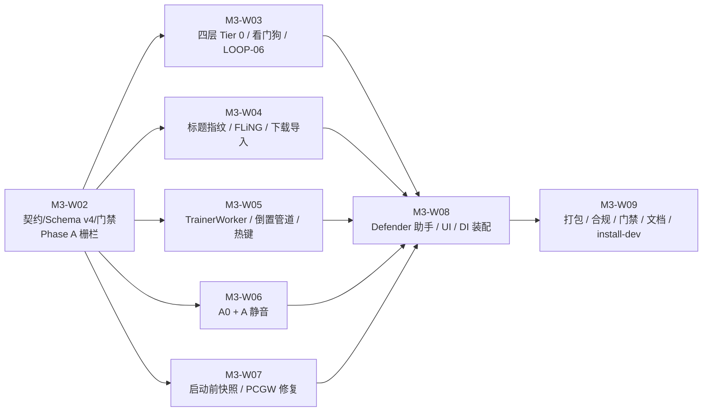

# SPAWN M3 阶段实施计划（Stage Plan — M3 Single-Player Trainer Manager）

> **阶段代号**：`M3`（单机外部修改器安全管家 + 启动前轻量存档快照）
> **计划版本**：`1.1`（2026-11-21 `1.0` 定稿：`M3-R01` 调研回收，用户确认 `M3-Q1` ~ `M3-Q5` 全部采纳推荐默认方案；2026-11-22 `1.1` 增补：用户要求在 `M3` 内一并完成正式版每周构建、应用内自动更新与开发版逐提交重装，按 `D-30` ~ `D-33` / [ADR-0007](../decisions/0007-weekly-release-and-signed-in-app-update.md) 新增 `M3-W10` ~ `M3-W12`）
> **工作分支**：`feat/m3-trainer`（唯一父提交锁定 `main` @ `5bcd04c26372602d89d5d4e9eb541cec8b526193`，对应已合并 [PR #2](https://github.com/chialecode/spawn/pull/2)；唯一阶段提交已含 `M3-W00` ~ `M3-W09` 与 Agent A 审查修复，后续一律 `git commit --amend -s` 收束）
> **阶段状态**：`reviewed`（`M3-W00` ~ `M3-W09` 已交付并经 Agent A 2026-11-22 集中审查 `reviewed`，`F-01` ~ `F-04` 已修复；`1.1` 增补的 `M3-W10` ~ `M3-W12` 已本地实施完成、通过独立分包审查与全量集成门禁，Agent A 整阶段审查 `F-01` ~ `F-03` 返工后于 2026-11-22 复审通过）
> **关联文档**：[项目交付总状态](status.md) · [M3 阶段执行报告](stage-report.md) · [M3 阶段验收用例集](m3-stage-cases.json) · [里程碑路线图](../engineering/delivery-plan.md) · [Progress 模块规格](../modules/progress-saves-and-trainer.md) · [IPC 与安全契约](../design/ipc-and-security-contracts.md) · [ADR-0006](../decisions/0006-m3-external-trainer-manager-elevation-and-ipc.md) · [已确认决策](../decisions/confirmed-decisions.md) · [USER-ACTIONS.md](../../USER-ACTIONS.md)

---

## 1. 阶段目标与边界

依据用户确认的 **`D-25` ~ `D-29`**（及修订后的 `D-04`、`D-11`）与 [ADR-0006](../decisions/0006-m3-external-trainer-manager-elevation-and-ipc.md)，`M3` 只交付路线 (a)「单机外部修改器安全管家」：

- **范围内**：
  1. 新子工程 `Spawn.Modules.Progress`（Clean Host 侧）与独立隔离进程 `Spawn.TrainerWorker`（发布于 `Workers\Trainer\`，`M3` 零跨进程内存读写 API 导入）；冻结修改器全套契约与 SQLite Schema `v4`。
  2. 四层 `Tier 0` 判定、混合单机 `VerifiedOfflineBypass` 零 AC 硬验票、修改器会话 2 秒急停看门狗、`LOOP-06` 自动清场与改名 CE 驱动识别。
  3. 英文标准名/版本指纹补强，洁净室 FLiNG 发现（严守 `robots.txt`）、**用户显式触发单次下载**、本地拖放导入一等公民、安全校验与 SHA-256 钉扎、`AngleSharp` 结构化热键。
  4. 分级按需提权（Level 1 直启 Medium IL / Level 2 每会话 1 次 `runas` UAC）、倒置跨 IL `NamedPipeJsonRpc`、原子 `KILL_ON_JOB_CLOSE` 作业对象、`MAPVK_VK_TO_VSC_EX` 交错热键代理。
  5. `A0`（INI + 27 字节 5.0 秒静音 SMF）+ `A`（专用 MTA 线程 WASAPI 全端点 + 热插拔）零注入静音，默认完全静音。
  6. 启动修改器前轻量存档快照与一键回滚（含 PCGamingWiki `cargoquery` 失效修复与 Steam `userdata` 规则）。
  7. Defender 沙箱单目录排除助手（Opt-in、回读校验、分类降级）、Smart App Control 说明，游戏详情页 `修改器` 子页签与设置页 `修改器与安全沙箱` 分类，修复 `AntiCheatBadgeText` 硬编码绿色。
  8. 打包目录隔离、`THIRD-PARTY-NOTICES`、全套门禁与 `install-dev` 上机。
  9. **（`1.1` 增补）** 正式版自包含打包与符号剥离、版本号与发布判定、签名更新清单（`M3-W10`）；GitHub Actions 每周发布工作流（`M3-W11`）；正式版签名应用内自动更新与设置页 `更新` 分类（`M3-W12`）；开发版改为每次本地提交后重装（`D-32`）。安装器继续使用 Inno Setup（Velopack、MSIX、WiX 等已对照否决，见 ADR-0007 §2）。
- **范围外**：`.CT` 执行引擎与内存扫描器（`M6`，`D-29`）；`Ludusavi` 索引、`FastCDC` 时间机器 + `AlphaVSS`、`32MB SPPK` 云同步（`AC-09` ~ `AC-11` 顺延 `M4`，`D-25`）；XInput 手柄代理（`LOOP-08`）；`%ProgramFiles%` 免 UAC 提权包（`LOOP-07`）；任何修改器二进制中转/镜像、后台批量爬取或 Cloudflare 绕过。

---

## 2. 基线、依据与已确认决策

| 项目 | 事实 |
| :--- | :--- |
| 调研依据 | `M3-R01` 综合技术调研报告（存放于本机忽略目录 `.local/research/`，不入库；结论已提炼进本计划、[Progress 规格](../modules/progress-saves-and-trainer.md)、[IPC 契约](../design/ipc-and-security-contracts.md)、[技术选型](../engineering/technology-selection.md) 与 `D-25` ~ `D-29`） |
| 用户确认 | 2026-11-21：`M3-Q1`（存档范围方案 A）、`M3-Q2`（分级按需 UAC）、`M3-Q3`（混合单机受控离线放行）、`M3-Q4`（默认完全静音 + 键鼠代理先行）、`M3-Q5`（移除 `Reloaded.Memory` 家族并收窄 `M6`）全部按推荐默认执行 |
| 新增依赖（7 天冷却截止 2026-11-14） | `SharpCompress 0.50.9`（MIT，2026-11-12）、`AngleSharp 1.10.3`（MIT，2026-11-13）、`Microsoft.Windows.CsWin32 0.3.371`（MIT，2026-11-10）；复用 `NAudio.Wasapi 2.4.0`；随包精简 `AreWeAntiCheatYet` `games.json` 投影（MIT 数据集） |
| 判红禁用 | `Reloaded.Memory`/`SigScan`/`Hooks`、`SevenZipExtractor`、`Squid-Box.SevenZipSharp`、`Keystone`、`Memory.dll`；严禁复制/移植 `GPL`/`AGPL` 参考管理器代码、正则或词典 |
| 现有可复用资产 | `NamedPipeJsonRpc`（`src/Spawn.Core/NamedPipeJsonRpc.cs`）、`SafeProcessInspector`、`AntiCheatGuardService`、`HighRiskEnvironmentProbe`、`GameDataManagementService` + `GameDataSafetyFence`、`IGameDataManagementService` 契约、`app_settings` 设置表 |

---

## 3. 工作包总表

| 工作包 | 主题 | 子工程 / 进程域 | 依赖 | 状态 |
| :--- | :--- | :--- | :---: | :---: |
| `M3-W00` | 阶段启动卫生：四分类清理、`currentStage` 推进、NuGet / Actions 7 天冷却盘点 | 文档、`Directory.Packages.props` | - | 已完成 |
| `M3-W01` | `D-24` 成就音效原始响度、Schema `v3` | `Spawn.OverlayHost`、`Spawn.Core`、`Spawn.Contracts` | - | 已完成 |
| `M3-R01` | 单机游戏修改器技术调研 | 本机 `.local/research/`（不入库） | - | 已完成（已提炼入正本） |
| `M3-W02` | **契约冻结、Schema `v4`、路径隔离与 Clean Host 门禁升级（Phase A 栅栏）** | `Spawn.Contracts`、`Spawn.Core`、新建 `Spawn.Modules.Progress`/`Spawn.TrainerWorker` 骨架与两个测试工程、`Spawn.Architecture.GateTests` | W00 | 已完成 |
| `M3-W03` | 四层 `Tier 0`、`VerifiedOfflineBypass`、2s 急停看门狗、`LOOP-06` 清场与改名 CE 驱动识别 | `Spawn.Core`（Medium IL）、`Spawn.Modules.Launcher` | W02 | 已完成 |
| `M3-W04` | 英文标题/版本指纹、洁净室 FLiNG 发现、安全下载与本地导入、热键解析 | `Spawn.Modules.Launcher`（扫描器）、`Spawn.Modules.Progress/Catalog` | W02 | 已完成 |
| `M3-W05` | `Spawn.TrainerWorker`、倒置跨 IL 管道、分级提权、`KILL_ON_JOB_CLOSE` 与热键代理 | `Spawn.TrainerWorker`（Medium/High IL）、`Spawn.Core`（管道）、`Spawn.Modules.Progress/Runtime` | W02 | 已完成 |
| `M3-W06` | `A0 + A` 零注入静音与提示音控制 | `Spawn.Modules.Progress/Audio` | W02 | 已完成 |
| `M3-W07` | 启动前轻量存档快照与 PCGamingWiki 规则修复 | `Spawn.Modules.Launcher`（游戏数据）、`Spawn.Modules.Progress/Snapshots` | W02 | 已完成 |
| `M3-W08` | Defender 排除助手、SAC 诊断与 WPF 三栏 UI 集成（含 `#16` 顶栏精简） | `Spawn.Host`、`Spawn.Modules.Progress/Security` 与 DI 装配 | W03 ~ W07 | 已完成 |
| `M3-W09` | 打包目录隔离、合规物料、门禁回归、文档同步、实机验证与 `install-dev` 收口 | `scripts/`、`installer/`、`docs/` | W08 | 已完成 |
| `M3-W10` | 正式版自包含打包、符号剥离、版本号与发布判定、签名更新清单与隔离安装演练 | `scripts/`、`installer/`、`tests/Spawn.Core.UnitTests` 打包用例 | W09 | 已完成 |
| `M3-W11` | GitHub Actions 每周发布工作流与结构门禁 | `.github/workflows/release.yml`、`tests/Spawn.Architecture.GateTests` | W10 | 已完成 |
| `M3-W12` | 正式版签名应用内自动更新、设置页 `更新` 分类与托盘提示 | `Spawn.Contracts`、`Spawn.Core/Update`、`Spawn.Host`、对应测试 | W10 | 已完成 |

---

## 4. 工作包详细规格

> 每个工作包列出 **独占写入范围**（Swarm 模式下即该 Worker 的文件所有权；单会话 Agent B 也按此组织提交内容）。跨包共享文件只由指定唯一责任包修改，其他包通过契约或消息板提出需求。

### 4.1 `M3-W02`：契约冻结、Schema `v4`、路径隔离与 Clean Host 门禁升级（Phase A）

- **独占写入**：`Spawn.sln`、`Directory.Packages.props`、`src/Spawn.Contracts/**`、`src/Spawn.Core/SpawnPaths.cs`、`src/Spawn.Core/SpawnDatabase*.cs`（含新增 `SpawnDatabase.Trainer.cs` 分部文件）、`src/Spawn.Modules.Progress/Spawn.Modules.Progress.csproj` 与 `ProgressServiceCollectionExtensions.cs` 骨架、`src/Spawn.TrainerWorker/Spawn.TrainerWorker.csproj`、`app.manifest`、`Program.cs` 骨架、`tests/Spawn.Modules.Progress.UnitTests/*.csproj`、`tests/Spawn.TrainerWorker.UnitTests/*.csproj`、`tests/Spawn.TrainerWorker.TestStub/*.csproj`、`tests/Spawn.Architecture.GateTests/CleanHostArchitectureGateTests.cs`、`tests/Spawn.Core.UnitTests/TrainerSchemaAndPathsTests.cs`、`docs/design/data-model.md`、`docs/dev-rules/repo-map.md`。
- **交付内容**：
  1. `Directory.Packages.props` 锁定 `SharpCompress 0.50.9`、`AngleSharp 1.10.3`、`Microsoft.Windows.CsWin32 0.3.371`（`PrivateAssets=all`），不改动 `NAudio.Wasapi 2.4.0`。
  2. 新建 `Spawn.Modules.Progress`（`net10.0-windows`，引用 `Spawn.Contracts` + `Spawn.Core`，**不引用任何其他 `Spawn.Modules.*` 与 Worker**）与 `Spawn.TrainerWorker`（`WinExe` 无窗口、`asInvoker` 清单，引用 `Spawn.Contracts` + `Spawn.Core` + `CsWin32`）；新建 `tests/Spawn.Modules.Progress.UnitTests`、`tests/Spawn.TrainerWorker.UnitTests` 与无害合成多子进程桩程序 `tests/Spawn.TrainerWorker.TestStub`（无窗口、只派生子进程并等待，供 W05 作业对象测试）并纳入 `Spawn.sln`。
  3. 冻结 [Progress 规格 §2.1](../modules/progress-saves-and-trainer.md) 全部契约：`ITrainerBackend`、`ITrainerCatalogService`、`ITrainerRuntimeService`、`ITrainerAudioController`、`IPreTrainerSaveSnapshotService`、`ISensitiveWorkerShutdownHook` 及 DTO/枚举；[IPC 契约 §2.3](../design/ipc-and-security-contracts.md) 的 `trainer.*` JSON-RPC 请求/响应/通知 DTO；反作弊放行结果类型；为 `IGameDataManagementService` 增加只读存档位置枚举方法（供 W07 实现、Progress 消费，避免模块间项目引用）。
  4. Schema `v3 → v4` 幂等迁移：`trainer_catalog`、`trainer_title_map`、`trainer_hotkey_bindings`、`pre_trainer_snapshots` 四表 + `games` 新增 `steam_build_id`、`steam_last_updated`、`verified_offline_bypass`、`verified_offline_bypass_at_utc`；在 `SpawnDatabase.Trainer.cs` 一次性提供四表 CRUD 与设置键读写，后续包只调用不修改。
  5. `SpawnPaths` 新增 `TrainerSandboxDirectory`（`vault\Sandbox\Trainers`，支持设置覆盖为自定义纯 ASCII 根）、`TrainerStagingDirectory`、`PreTrainerSnapshotsDirectory`（`vault\Snapshots\PreTrainer`）、`TrainerCacheDirectory`（`cache\trainers`）、`TrainerPipeNamePrefix`（测试/覆盖态沿用 `spawn-test-ipc-*` + 数据根哈希规则）。
  6. 门禁升级：`Spawn.Modules.Progress` 纳入 `CleanHostProjectNames` 与 `cleanDirs`；保持 `Spawn.TrainerWorker` 在禁止引用前缀中；新增断言 ① Clean Host 引用图不含 `Spawn.TrainerWorker`、`SharpCompress`/`AngleSharp` 仅出现在 `Spawn.Modules.Progress`；② `Spawn.TrainerWorker` 编译产物零跨进程内存读写/远程线程/调试挂起类导入（[IPC 契约 §4.2](../design/ipc-and-security-contracts.md)）；③ 全解决方案 `project.assets.json` 不含 `Reloaded.*`、`SevenZipExtractor`、`SevenZipSharp`。
- **验收用例**：`M3-A-01`、`M3-A-02`。**完成即广播 `[Phase A Ready]`**，此后契约变更须经协调者统一修订。

### 4.2 `M3-W03`：四层 `Tier 0` 判定、`LOOP-06` 闭环与急停看门狗

- **独占写入**：`src/Spawn.Core/AntiCheatGuardService.cs`、`src/Spawn.Core/HighRiskEnvironmentProbe.cs`、新增 `src/Spawn.Core/AntiCheat/**`（特征表、`AreWeAntiCheatYet` 精简索引嵌入资源与生成脚本说明、Steam 分类判定、驱动元数据探针、看门狗、`VerifiedOfflineBypass` 判定器）、`src/Spawn.Modules.Launcher/GameLaunchService.cs`、`src/Spawn.Modules.Launcher/GameLibraryService.cs`、`tests/Spawn.Core.UnitTests/AntiCheatTierAndWatchdogTests.cs`。
- **交付内容**：
  1. 扩展目录签名（扫描深度 `6`）补齐 `start_protected_game.exe`、`EasyAntiCheat_EOS.sys`、`BEDaisy.sys`、`*_BE.exe`、`EAAntiCheat.*`、`vgc.exe`、`NeacSafe64.sys`、`GameMon64.des`、`xhunter1.sys`、`BlackCipher64.aes` 等；残影守护进程表扩充并复用已有只读 `K32EnumDeviceDrivers`/SCM 检测会话内核 AC 驱动，冷却状态机在驱动卸载确认后才开始 15 秒倒计时（`REQ-SEC-05`）。
  2. 随包内置精简 `AreWeAntiCheatYet` `SteamAppId → AntiCheat[]` 投影（嵌入资源，附 MIT 声明与刷新说明）；Steam `appdetails` `categories` 判定（`VAC id=8`、`MMO id=20`、仅多人无 `Single-player id=2` 保底 `>= Tier 2`），结果缓存；离线时仅用本地层并保守降级。
  3. 修正 `GameLaunchService` 中 `Math.Max` 叠加与 `GameLibraryService` 重扫覆盖逻辑：静态 `anti_cheat_tier` 保持不变，新增 `VerifiedOfflineBypass` 独立判定（仅具备单人模式的 `Tier 2`），重扫不清除用户确认但在条件失效时自动失效。
  4. 修改器放行统一判定接口：守卫 `IdleSafe` + 静态层 + 硬验票（AC 进程/会话驱动为 `0`）+ `vgk.sys` 策略（伴随 `vgc.exe` 硬拦；空闲驻留警示；严格模式一律禁启）。
  5. 2 秒急停看门狗：仅在存在活跃修改器会话时由守卫启动，只读 `0x1000` + 驱动枚举，检出即发布急停事件（由 W05 运行时订阅执行 `<500ms` 销毁）；无会话 0 轮询。
  6. `LOOP-06`：`GameLaunchService` 注入 `ISensitiveWorkerShutdownHook`（实现由 W05 提供），`Tier 2/3` 放行前调用并二次净场复检；`HighRiskEnvironmentProbe` 增沙箱路径前缀孤儿探针、改名 CE 驱动只读 `FileVersionInfo`（`OriginalFilename`/`InternalName`/`ProductName`/`FileDescription`）与 `QueryDosDeviceW` `CEDRIVER*` 前缀检测；绝不强杀用户自启第三方工具。
- **安全红线**：Clean Host 内全部探测保持 `0x1000` / `SYNCHRONIZE` 只读；不得新增任何 `PROCESS_VM_*` 访问位。
- **验收用例**：`M3-A-03`、`M3-A-04`、`M3-A-05`。

### 4.3 `M3-W04`：英文标题/版本指纹、洁净室 FLiNG 发现、安全下载与本地导入

- **独占写入**：`src/Spawn.Modules.Launcher/GameDirectoryScanner.cs`、`src/Spawn.Modules.Launcher/GameTitleCleaner.cs`、`src/Spawn.Modules.Progress/Catalog/**`（发现、解析、下载、解压、导入、置信度）、`tests/Spawn.Core.UnitTests/ScannerBuildIdAndEnglishTitleTests.cs`、`tests/Spawn.Modules.Progress.UnitTests/Catalog/**` 与自制合成夹具目录 `tests/Spawn.Modules.Progress.UnitTests/Fixtures/Catalog/**`。
- **交付内容**：按 [Progress 规格 §4.1 ~ §4.3](../modules/progress-saves-and-trainer.md) 实现：
  1. ACF `buildid`/`LastUpdated` 解析、英文标准名瀑布（ACF → `appdetails?l=english&filters=basic` 缓存 → GOG info → 清洗回退 → 用户覆盖），中文名仍用于展示；绑定版本指纹与三级置信度映射。
  2. 发现层仅 24h 缓存 `/all-trainers/` + 单次 `wp-json`（并发 `1`），归档站按需 7 天缓存；**代码中不得出现 `/?s=` 或 `/attachments/` 请求构造**（单测断言请求日志）。
  3. `AngleSharp` 附件表/热键/`toolTips` 解析，源域白名单与推广链接过滤；词表与解析逻辑 100% 原创。
  4. 下载器：`AllowAutoRedirect = false` 手动 10 跳、HTTPS 禁降级、同源 `Referer`、`15s/30s` 超时、`100MB` 流式截断、Challenge/HTML 即时中止；魔数分流、Zip-Slip、清单与解压后字节核对、`225/226` 分类、多 EXE 用户自选、原子移动与 SHA-256 钉扎、启动前 TOCTOU 复核；用户本机 `7z.exe` 模式 C 兜底仅在 `SharpCompress` 抛出不支持格式时调用（进程 `CREATE_NO_WINDOW` + `BELOW_NORMAL_PRIORITY_CLASS`）。
  5. 本地导入走同一流水线；非 ASCII 沙箱路径 `GetShortPathNameW` 兜底；严禁剥离 `Zone.Identifier`。
- **测试约束**：全部使用静态 HTML、Mock `HttpMessageHandler` 与仓库内自制无害合成压缩包/stub PE（不得包含任何真实修改器二进制）；零真实网络（`quick_gate.py` 网络绊线保持生效）。
- **验收用例**：`M3-A-06`、`M3-A-07`。

### 4.4 `M3-W05`：`Spawn.TrainerWorker`、倒置跨 IL 管道与热键代理

- **独占写入**：`src/Spawn.TrainerWorker/**`（W02 骨架之后）、`src/Spawn.Core/NamedPipeJsonRpc.cs` 与新增 `src/Spawn.Core/Ipc/TrainerPipe*.cs`（单实例服务端工厂、对端 PID/路径校验）、`src/Spawn.Modules.Progress/Runtime/**`（Host 侧会话编排、提权级别判定、`ExternalTrainerBackend`、`ISensitiveWorkerShutdownHook` 实现、急停订阅）、`tests/Spawn.TrainerWorker.UnitTests/**`、`tests/Spawn.Core.UnitTests/TrainerPipeAuthTests.cs`、`tests/Spawn.Modules.Progress.UnitTests/Runtime/**`、`tests/Spawn.TrainerWorker.TestStub/**`（W02 建立骨架后的桩程序实现）。
- **交付内容**：按 [IPC 契约 §2](../design/ipc-and-security-contracts.md)、[§6.1](../design/ipc-and-security-contracts.md) 与 [Progress 规格 §4.5](../modules/progress-saves-and-trainer.md) 实现：
  1. 单实例会话管道（`maxNumberOfServerInstances = 1` + `FirstPipeInstance` + 128-bit 随机名后缀），保留现有 `NamedPipeSecurityFactory` DACL 规则；Host 校验客户端 PID/路径/`LaunchNonce`，Worker 校验服务端 PID/路径；Worker 以 `SYNCHRONIZE` 监视 Host 并在断连时自毁。
  2. 提权级别判定：读取修改器 PE 清单 `requestedExecutionLevel` 与目标游戏完整性级别 → Level 1 `CreateProcessW` / Level 2 `ShellExecuteExW runas`；用户取消 UAC 返回可读取消结果，不重试。
  3. Worker：`TrainerSandboxJob`（`KILL_ON_JOB_CLOSE` ON、`BREAKAWAY_OK`/`SILENT_BREAKAWAY_OK` OFF）+ `PROC_THREAD_ATTRIBUTE_JOB_LIST` 原子入组 + IOCP（`NEW_PROCESS` 通知、`ACTIVE_PROCESS_ZERO` 结束）；命令白名单（沙箱根内 + SHA-256 复算一致）；`WM_CLOSE` `1500ms`/急停 `500ms` → `TerminateJobObject`；窗口显隐；`trainer.setAudioFallback` 回退执行。
  4. 热键代理：`MAPVK_VK_TO_VSC_EX`、扩展键 `KEYEVENTF_EXTENDEDKEY`、填充 `wVk`+`wScan`、默认不设 `KEYEVENTF_SCANCODE`、交错 `20 / HoldMs(默认 75，50–120) / 20ms` 高精度等待；输入发送器抽象为可注入接口，**单元测试只断言生成的 `INPUT` 序列与时序，严禁真实调用 `SendInput`**。
  5. `M3` Worker 不导入任何跨进程内存读写 API（W02 门禁断言守卫）。
- **验收用例**：`M3-A-08`、`M3-A-09`、`M3-A-10`。

### 4.5 `M3-W06`：`A0 + A` 零注入静音

- **独占写入**：`src/Spawn.Modules.Progress/Audio/**`、`tests/Spawn.Modules.Progress.UnitTests/Audio/**`。
- **交付内容**：按 [Progress 规格 §4.4](../modules/progress-saves-and-trainer.md) 实现 `A0`（`SHGetKnownFolderPath(FOLDERID_Documents)` 与 `%LOCALAPPDATA%` 双目录 INI 预写/备份/还原、27 字节静音 SMF 字节级常量）与 `A`（专用 MTA 线程、`Register → Enumerator → GetCount()`、`IMMNotificationClient`、主/子 PID + 沙箱前缀匹配、`FullMute` 默认、`KeepCuesExperimental` 实验性、`E_ACCESSDENIED` 回退 Worker）。Core Audio 访问封装在可注入抽象后，单测验证注册顺序、状态机与释放零泄漏。
- **静音测试约束**：`mciSendString` 播放 27 字节静音 SMF 的用例仅打开 MIDI 序列器播放无音符文件（不产生可闻声音）；无 MIDI 设备的环境自动跳过并在报告标 `not-run`。`UNV-02` 静音端点探针仅在显式开启的本机诊断开关下运行，不进入日常门禁。
- **验收用例**：`M3-A-11`、`M3-A-12`。

### 4.6 `M3-W07`：启动前轻量存档快照与 PCGamingWiki 规则修复

- **独占写入**：`src/Spawn.Modules.Launcher/PcGamingWikiRuleParser.cs`、`src/Spawn.Modules.Launcher/GameDataManagementService.cs`（含实现 W02 新增的存档位置枚举方法）、`src/Spawn.Modules.Progress/Snapshots/**`、`tests/Spawn.Core.UnitTests/PcGamingWikiParseAndSteamUserdataTests.cs`、`tests/Spawn.Modules.Progress.UnitTests/Snapshots/**`。
- **交付内容**：按 [Progress 规格 §4.6](../modules/progress-saves-and-trainer.md) 实现：`action=parse&redirects=1&prop=wikitext` + `list=search` 兜底替换失效的 `cargoquery`（离线夹具测试）；Steam `userdata\<uid>\<AppId>\remote` 规则；`PreTrainerSaveSnapshotService`（`FileShare.ReadWrite | Delete` 前后一致性复检、跳过 ReparsePoint、`HKCU` 确定性 JSON、原子 `manifest.json`、`256MB`/排他锁非阻塞跳过、滚动保留、`PreRestoreSafety`、游戏运行中拒绝回滚、`GameDataSafetyFence` 校验回滚目标、仅删除快照目录自身）。
- **安全红线**：全部测试在临时数据目录与合成存档目录执行；不得触碰真实 `%APPDATA%`/`Documents`/注册表真实游戏键（注册表用例使用 `HKCU\Software\SPAWN-Test\<guid>` 临时键并在测试结束清理）。
- **验收用例**：`M3-A-13`、`M3-A-14`。

### 4.7 `M3-W08`：Defender 排除助手、SAC 诊断与 WPF UI 集成

- **独占写入**：`src/Spawn.Host/**`、`src/Spawn.Modules.Progress/Security/**`、`src/Spawn.Modules.Progress/ProgressServiceCollectionExtensions.cs`（W02 之后的唯一装配责任方）、`tests/Spawn.Architecture.GateTests/OverlayAndShellHeadlessGateTests.cs`、`tests/Spawn.Modules.Progress.UnitTests/Security/**`、`DESIGN.md`、`docs/design-rules/DESIGN.md`、`docs/design/interaction-and-workflows.md`。
- **交付内容**：
  1. Defender 助手（`Spawn.Modules.Progress/Security`）：预读 `TPExclusions`/`ManagedDefenderProductType`、生成单次 UAC 提权请求（复用 W05 Level 2 拉起 Worker 执行 WMI `MSFT_MpPreference.Add`，零 `powershell.exe`）、强制回读 `ExclusionPath`、分类降级（篡改保护静默拒绝 Event `5013`、第三方杀软被动模式、Smart App Control、用户取消）；WMI 访问封装为可注入抽象，**测试中严禁真实写入 Defender 配置**。
  2. UI：`GameDetailSubTab.Trainers`（`成就 | 游戏数据 | 修改器`）、`SettingsCategory.TrainerAndSandbox`、单主按钮三态状态机、`PlacementTarget.Tag` `⋯` 菜单、虚拟化热键列表、四态安全横幅（受保护围栏卡 / 混合单机离线校验面板 / 冷却倒计时 / `vgk.sys` 警示）、启动前备份与回滚入口、VirusTotal 哈希链接（用户点击才打开）、`AntiCheatBadgeText` 按 `Tier` 着色（`#10B981` / `#F59E0B` / `#DC2626`）与“离线无 AC 就绪”徽标；严守 `D-20`（Column 1 不新增空壳一级图标）与深浅主题、`1000 DIP` 响应式。
  3. DI 装配：注册 Progress 全部服务、将 `ISensitiveWorkerShutdownHook` 注入 `GameLaunchService`、注册看门狗与急停订阅。
- **验收用例**：`M3-A-15`、`M3-A-16`。

### 4.8 `M3-W09`：打包隔离、合规物料、门禁回归、文档同步与 `install-dev`

- **独占写入**：`scripts/package.py`、`scripts/quick_gate.py`（如需新增测试工程计数）、`installer/spawn.iss`、`THIRD-PARTY-NOTICES.txt`（产物生成逻辑与仓库模板）、`tests/Spawn.Core.UnitTests/SingleInstanceAndPackageInstallerTests.cs`、`docs/delivery/**`、`USER-ACTIONS.md`、`docs/governance/document-registry.json`、以及下列文档措辞同步。
- **交付内容**：
  1. `package.py` 将 `Spawn.TrainerWorker` 独立 `dotnet publish` 至 `stage_app\Workers\Trainer\`（严禁平铺根目录）；`--quit-for-update` 先优雅停止活跃修改器会话与 Worker；`spawn-dev-test` 隔离安装演练覆盖 `Workers\Trainer\` 结构；Inno Setup 脚本纳入子目录且卸载不删除用户数据。
  2. 生成/更新 `THIRD-PARTY-NOTICES.txt`（`SharpCompress`、`AngleSharp`、`NAudio`、`AreWeAntiCheatYet` 数据集 MIT 声明及既有 `gbe_fork` `LGPL-3.0` 条目），核对 `project.assets.json` 零 `GPL`/`AGPL`/`LGPL` NuGet 包（`OSS-06`）。
  3. **文档措辞同步（SPEC-18 收尾）**：将以下长期正本中残留的 `gRPC over Named Pipes` 表述统一更正为 `NamedPipeJsonRpc`，并把 BlueprintWorker/WorkflowWorker 的“计划任务静默提权”表述改为“按 `D-11` 分级按需提权（免 UAC 仅限 `LOOP-07`）”：`docs/design/system-architecture.md`、`docs/modules/README.md`、`docs/modules/workflow-and-blueprint.md`、`docs/modules/achievement-and-overlay.md`、`docs/project-baseline.md`、`SECURITY.md`、`CONTRIBUTING.md`、`README.md`（Progress 行描述同步 `M3` 范围）；`docs/dev-rules/quality-gates.md` §3 补充 `Spawn.TrainerWorker` 零跨进程内存 API 与 `Workers\Trainer\` 打包隔离门禁说明。
  4. 运行第 6 节全部门禁；收束 `git commit --amend -s`；执行 `python -B scripts/package.py --install-dev` 静默更新本机 `SPAWN Dev`；更新 `stage-report.md`（含 `not-run` 边界与 `OSS-07` 实测记录）、`status.md`、`USER-ACTIONS.md`（`H-002` 体验指引）。
- **验收用例**：`M3-A-17`、`M3-A-18`、`M3-M-01`、`M3-M-02`。

### 4.9 `M3-W10`：正式版自包含打包、符号剥离、版本号与签名更新清单（`1.1` 增补）

- **独占写入**：`scripts/package.py`、新增 `scripts/release.py` 与 `scripts/sign_update.cs`（`.NET 10` 文件式程序，仅用 BCL）、`installer/spawn.iss`、新增 `installer/update-signing-public.pem`、`scripts/quick_gate.py`（纳入 `release.py` 单测）、`tests/Spawn.Core.UnitTests/SingleInstanceAndPackageInstallerTests.cs`、`.gitignore`（如需）。
- **交付内容**：
  1. `--channel release` 默认自包含 `win-x64`，`Spawn.Host`、`Spawn.OverlayHost` 与 `Workers\Trainer\Spawn.TrainerWorker` 全部自包含且目录隔离不变；开发版仍依赖框架发布。可把三次 `dotnet publish` 改为先构建后 `--no-build` 发布，产物结构不得变化。报告记录正式版与开发版安装包体积。
  2. 所有通道剥离原生 `*.pdb`（如 `libSkiaSharp.pdb`）；正式版剥离全部 `*.pdb`，另生成 `spawn-symbols-<版本>-x64.zip`（不进安装包）。
  3. `scripts/release.py --plan`：版本线取 `NEXT_BASE_VERSION` 的 `主.次`，读取 `v<主>.<次>.*` 标签，新版本为最高补丁号 `+1`（无标签时取 `NEXT_BASE_VERSION`）；无标签或 `git rev-list --first-parent --count <标签>..HEAD > 0` 时 `release=true`；输出 `release=`/`version=` 到标准输出与 `GITHUB_OUTPUT`。开发版版本改为 `<下一正式版本>-dev.<UTC 时间戳>`（本地无标签时回退 `NEXT_BASE_VERSION`）。
  4. `scripts/release.py --build --version <X>`：在 `dist/.release-*` 暂存区调用正式版打包，生成 `update-windows-x64.json`（`schemaVersion`、`channel=release`、`version`、`installer{name,url,size,sha256}`、`publishedUtc`、`notesUrl`；`url` 固定为 `https://github.com/chialecode/spawn/releases/download/v<X>/<安装包名>`），调用 `dotnet run scripts/sign_update.cs` 用 `SPAWN_UPDATE_SIGNING_KEY`（PEM 路径）以 ECDSA P-256 / SHA-256 生成 DER 签名 `update-windows-x64.json.sig`；生成 `VERSION.txt`、`THIRD-PARTY-NOTICES.txt`、由上一标签以来 first-parent 提交标题汇总的 `notes.md` 与 `SHA256SUMS`，校验后原子替换 `dist/spawn/`。私钥路径与内容严禁写入日志或回执。
  5. **签名密钥**：在本机生成 ECDSA P-256 密钥对，私钥只放 `.local/secrets/update-signing/`（不入库），公钥写入 `installer/update-signing-public.pem` 并供 `M3-W12` 编译进 `Spawn.Core`；`USER-ACTIONS` `ACT-009` 引导用户离线备份私钥并上传为 GitHub Secret。测试一律使用测试内临时生成的密钥。
  6. 正式版隔离安装演练：用 `spawn-test` 身份安装到临时目录（`--no-shortcuts --no-relaunch`，`SPAWN_DATA_DIR` 指向临时目录），核对卸载项版本、`Workers\Trainer\`、零 `*.pdb`、`VERSION.txt` 后静默卸载。
  7. `installer/spawn.iss`：识别 `/SPAWNRELAUNCH` 参数，静默安装完成后以 `--after-update` 拉起新版本（重启标记决定窗口或托盘）；未带该参数时行为不变。
- **验收用例**：`M3-A-19`、`M3-A-20`。

### 4.10 `M3-W11`：GitHub Actions 每周发布工作流（`1.1` 增补）

- **独占写入**：新增 `.github/workflows/release.yml`、新增 `tests/Spawn.Architecture.GateTests/ReleaseWorkflowGateTests.cs`、`docs/dev-rules/git-workflow.md` 与 `docs/dev-rules/quality-gates.md` 的发布章节。
- **交付内容**：
  1. 按 [ADR-0007 §3.2](../decisions/0007-weekly-release-and-signed-in-app-update.md) 实现 `plan`（ubuntu-24.04）→ `check`（windows-2025，`CI=true`，构建、全量测试、`check_docs`、`git diff --check`）→ `build`（windows-2025，`environment: release`）→ `publish`（ubuntu-24.04）四任务；`schedule: "0 0 * * 1"` + `workflow_dispatch`（输入 `publish` 默认 `false`）；顶层 `permissions: {}`，`concurrency: release` 不取消进行中任务；**仅限 `main`**：`plan` 带 `if: github.ref == 'refs/heads/main'`（下游任务随之跳过），`publish` 的 `if` 显式前置同一守卫，`release` 环境部署分支限定为 `main`（`ACT-009`，审查修复 `F-02`）。
  2. `build` 任务固定下载官方 Inno Setup `7.1.1` 安装器并钉扎 SHA-256 后静默安装到 `RUNNER_TEMP`（不依赖 runner 预装的 `6.7.1`）；把 `SPAWN_UPDATE_SIGNING_KEY_PEM` 写入 `RUNNER_TEMP` 随机文件、`finally` 删除；执行 `release.py --build` 与正式版隔离安装演练；上传构建产物（保留 7 天，缺文件即失败）。
  3. `publish` 仅在 `github.ref == 'refs/heads/main'`、`vars.SPAWN_RELEASE_PUBLISH == '1'` 且（`schedule` 或 `inputs.publish`）时运行：`sha256sum -c` → 核对 `VERSION.txt` → `openssl dgst -sha256 -verify installer/update-signing-public.pem` 复核清单签名 → `gh release create v<版本> --draft` → 核对资产齐全 → `gh release edit --draft=false --latest`。
  4. 全部 `uses:` 以 40 位 SHA 钉扎并沿用 `ci.yml` 已过冷却的版本；新增 Action 需记录 7 天冷却盘点。
  5. `ReleaseWorkflowGateTests` 解析 `release.yml` 断言上述结构（无 `push`/`pull_request` 触发、`plan` 与 `publish` 的 `refs/heads/main` 守卫、权限边界、发布开关、SHA 钉扎、Secret 只出现在 `build` 任务、Inno 下载带 SHA-256 校验）。
- **验收用例**：`M3-A-21`、`M3-M-03`（合入 `main` 后执行）。

### 4.11 `M3-W12`：正式版签名应用内自动更新（`1.1` 增补）

- **独占写入**：`src/Spawn.Contracts/`（新增更新相关契约文件，不改既有契约）、新增 `src/Spawn.Core/Update/**`、`src/Spawn.Core/SpawnCoreServiceCollectionExtensions.cs`、`src/Spawn.Host/ViewModels/SettingsViewModel.cs` 与新增更新 ViewModel、`src/Spawn.Host/Views/MainWindow.xaml(.cs)` 的设置 `更新` 分类与提示条、`src/Spawn.Host/Services/TrayIconService.cs`、`src/Spawn.Host/App.xaml.cs`（仅接入更新服务与 `--after-update`）、对应单测与 `OverlayAndShellHeadlessGateTests` 新增用例。
- **交付内容**：按 [ADR-0007 §3.3](../decisions/0007-weekly-release-and-signed-in-app-update.md) 实现：
  1. `IUpdateService`：仅 `SpawnChannel == release` 启用；启动 60 秒后与每 24 小时检查，可手动检查、可关闭自动检查；离线静默顺延。
  2. 网络边界：仅 HTTPS、主机白名单、手动重定向不超过 5 跳、清单 `64KB` 与安装包 `300MB` 上限、如实 User-Agent、零标识。
  3. 校验链：内置公钥（与 `installer/update-signing-public.pem` 一致，门禁断言）验 DER 签名 → `channel=release` → 版本严格递增 → URL 前缀 → `.partial` 下载、大小与 SHA-256 校验、原子重命名，只保留最新一份。
  4. 安装时机：默认自动下载；空闲（无受追踪游戏、无修改器会话、无快照/回滚/数据清理）且仅托盘驻留时自动安装，主窗口打开时显示提示条与托盘提示；设置可改“仅提醒”（`Q-002`）。
  5. 安装动作：持禁止写入句柄复核 SHA-256 → `RequestQuitForUpdateAsync(UpdateRestartReason.Update)` → `ShellExecute` 启动 `/VERYSILENT /SUPPRESSMSGBOXES /NORESTART /SP- /SPAWNRELAUNCH`；失败写入记录并提示，不重复轰炸。
  6. 设置页新增 `更新` 分类：当前版本/通道/提交、自动检查与自动安装开关、上次/下次检查时间与结果、`检查更新` / `立即重启更新`、最近 20 条更新记录；开发版显示“开发版由本机打包自动重装”。状态存 `app_settings`，不升级 Schema。
  7. 测试注入假 HTTP 处理器、假时钟与假安装器启动器：零真实网络、零真实安装、零弹窗。
- **验收用例**：`M3-A-22`。

---

## 5. 执行顺序与 Swarm 并行切分



- **`1.1` 增补顺序**：`W10 → W11 → W12` 连续执行（`W11` 与 `W12` 均依赖 `W10` 的签名格式与公钥；Swarm 模式下 `W10` 冻结签名格式后二者可并行）。
- **单会话 Agent B**：按 `W02 → W03 → W04 → W05 → W06 → W07 → W08 → W09` 连续执行，不按工作包停顿询问；每完成一个包至少跑一次 `dotnet build Spawn.sln -c Release` 与相关测试。
- **Swarm 模式**：`@coordinator` 先由单一 Worker 完成 `W02` 并广播 `[Phase A Ready]`；随后 `W03`/`W04`/`W05`/`W06`/`W07` 五个 Worker 以 `workspace: "share"` 并行（各自独占 §4 所列路径）；`Spawn.sln`、`Directory.Packages.props`、`src/Spawn.Contracts/**`、`SpawnDatabase*.cs` 在 Phase A 后冻结，确需变更由 `@coordinator` 统一写入；`W08` 在五包合并后由单一 Worker 执行；`W09` 由 Git 收口角色执行并收束单一阶段提交；`@verifier` 只读复核门禁与 [REVIEW.md](../../REVIEW.md)，以 `F-*` 精准 `@` 责任 Worker。
- **共享测试工程**：各包只新增自己名下的测试文件，测试工程 `.csproj` 仅由 `W02` 修改。

---

## 6. 质量门禁与验证命令

| 门禁 | 命令 | 适用 | 通过判据 |
| :--- | :--- | :--- | :--- |
| 文档治理 | `python -B scripts/check_docs.py` | 每次文档变更 | `PASS`，零告警 |
| 空白卫生 | `git diff --check` | 每次提交前 | 无输出 |
| Release 构建 | `dotnet build Spawn.sln -c Release` | 每个工作包 | 0 警告 0 错误 |
| 一键快速门禁 | `python -B scripts/quick_gate.py` | 日常与收口 | 全绿、5 分钟内、前台零弹窗零声音、网络绊线零触发 |
| 架构 IAT 门禁 | `dotnet test tests/Spawn.Architecture.GateTests -c Release` | W02、W08、W09 | Clean Host（含 `Spawn.Modules.Progress`）零敏感导入；Worker 零跨进程内存 API；Worker 未被 Clean Host 引用 |
| 全量单测 | `dotnet test Spawn.sln -c Release` | 收口 | 全部通过（MIDI 设备缺失等环境性跳过须在报告列明） |
| 依赖漏洞 | `dotnet list Spawn.sln package --vulnerable --include-transitive` | W02、W09 | 0 已知漏洞 |
| 许可证洁净 | 检查各 `obj/project.assets.json` 传递依赖 | W02、W09 | 零 `GPL`/`AGPL`/`LGPL` NuGet 包 |
| 打包与上机 | `python -B scripts/package.py --install-dev` | 每次本地提交 / `amend` 后（`D-32`） | 本机 `SPAWN Dev` 静默更新并驻留托盘，`Workers\Trainer\` 结构正确 |
| 正式版打包与演练 | `python -B scripts/release.py --plan`；`python -B scripts/release.py --build --version <X>`（测试密钥）+ `spawn-test` 隔离安装演练 | W10、收口 | 自包含、零 `*.pdb`、清单签名双端可验、演练安装/卸载成功，记录安装包体积 |
| 发布工作流结构 | `dotnet test tests/Spawn.Architecture.GateTests -c Release` | W11、收口 | `ReleaseWorkflowGateTests` 全绿 |

所有测试与子进程必须 `CREATE_NO_WINDOW` + `BELOW_NORMAL_PRIORITY_CLASS`，严禁抢焦点、弹窗、播放可闻声音、真实注入键盘、触发 UAC、写入 Defender 配置或访问真实网络。

---

## 7. 阶段准出判据与验收映射

| 用例 | 类型 | 工作包 | 验证内容 | 准出标准（AC） |
| :--- | :---: | :---: | :--- | :--- |
| `M3-A-00` | 自动化 | `M3-W01` | `D-24` 成就音效原始响度与 Schema `v3` 迁移回归 | 已通过（`AC-08`） |
| `M3-A-01` | 自动化 | `M3-W02` | Release 零警告构建、Clean Host 含 Progress 零敏感导入、Worker 零内存 API、零 GPL 包 | `AC-02`、`AC-12` |
| `M3-A-02` | 自动化 | `M3-W02` | Schema `v3 → v4` 幂等迁移、四表 CRUD、`SpawnPaths` 新目录隔离 | `AC-12`、`AC-12b` |
| `M3-A-03` | 自动化 | `M3-W03` | 四层 `Tier 0`：扩展特征、AWACY 索引、Steam 分类，CS2/Valorant 不判 `Tier 0` | `AC-03`、`AC-12` |
| `M3-A-04` | 自动化 | `M3-W03` | `VerifiedOfflineBypass` 硬验票、`vgk.sys` 策略、2s 看门狗、驱动残影冷却 | `AC-03`、`AC-12` |
| `M3-A-05` | 自动化 | `M3-W03` | `LOOP-06` 自动清场与二次复检、改名 CE 驱动与 `CEDRIVER*` 检测零误报 | `AC-03`、`AC-12` |
| `M3-A-06` | 自动化 | `M3-W04` | `buildid`/英文名、`robots.txt` 合规请求日志、`AngleSharp` 热键 `>=95%`、置信度映射 | `AC-12` |
| `M3-A-07` | 自动化 | `M3-W04` | 下载/导入流水线：重定向、Challenge 回退、魔数、Zip-Slip、字节核对、`225/226`、SHA-256 TOCTOU | `AC-12` |
| `M3-A-08` | 自动化 | `M3-W05` | 倒置管道单实例、双向 PID/路径/Nonce 互验、伪造连接拒绝 | `AC-12` |
| `M3-A-09` | 自动化 | `M3-W05` | `KILL_ON_JOB_CLOSE` 原子入组、Stub 进程树清零、Host 断连自毁、命令白名单 | `AC-12` |
| `M3-A-10` | 自动化 | `M3-W05` | `MAPVK_VK_TO_VSC_EX` / `EXTENDEDKEY` / 无 `SCANCODE` 映射与交错时序、提权级别判定 | `AC-12` |
| `M3-A-11` | 自动化 | `M3-W06` | `A0` INI 预写/还原与 27 字节静音 SMF 字节断言及静默播放 | `AC-12` |
| `M3-A-12` | 自动化 | `M3-W06` | WASAPI 策略机、MTA 注册顺序、热插拔、`E_ACCESSDENIED` 回退 | `AC-12` |
| `M3-A-13` | 自动化 | `M3-W07` | PCGamingWiki `action=parse` 回退与 Steam `userdata` 规则 | `AC-12b` |
| `M3-A-14` | 自动化 | `M3-W07` | 启动前快照创建/跳过/滚动/回滚/`PreRestoreSafety` | `AC-12b` |
| `M3-A-15` | 自动化 | `M3-W08` | Defender 助手预读、回读校验与分类降级（注入式 WMI 抽象） | `AC-12` |
| `M3-A-16` | 自动化 | `M3-W08` | UI 无头门禁：子页签、设置分类、`PlacementTarget.Tag`、徽标着色、ViewModel 状态转换 | `AC-12`、`AC-12b` |
| `M3-A-17` | 自动化 | `M3-W09` | `Workers\Trainer\` 打包隔离、`spawn-dev-test` 安装演练、`THIRD-PARTY-NOTICES`、`quick_gate.py` | `AC-02`、`AC-12` |
| `M3-A-18` | 自动化 | `M3-W09` | `check_docs.py`、`git diff --check`、注册表与追踪矩阵一致 | `AC-01` |
| `M3-M-01` | 人工体验 | `M3-W09` | `H-002`：真实修改器下载/导入、首帧静音、`NumLock OFF` 热键、单次 UAC、随游戏退出、快照回滚 | `AC-12`、`AC-12b`（`OSS-07` ①④⑤） |
| `M3-M-02` | 人工体验（可选） | `M3-W09` | Defender 排除助手实机、Smart App Control 提示与混合单机离线放行实机 | `AC-12`（未具备条件标 `not-run`） |
| `M3-A-19` | 自动化 | `M3-W10` | 正式版自包含打包、符号剥离、版本号与发布判定、隔离安装演练 | `AC-25` |
| `M3-A-20` | 自动化 | `M3-W10` | 更新清单、ECDSA P-256 DER 签名双端验证、`SHA256SUMS`、私钥零日志 | `AC-25` |
| `M3-A-21` | 自动化 | `M3-W11` | 每周发布工作流结构门禁 | `AC-25` |
| `M3-A-22` | 自动化 | `M3-W12` | 更新器验签、拒绝降级、白名单、大小/SHA-256、开发版不检查、空闲安装判定、重启标记、Clean Host 门禁 | `AC-25`、`AC-02` |
| `M3-M-03` | 人工（合入后） | `M3-W11` | 合入 `main` 后手动 dry-run 发布；首个正式版发布后体验应用内更新（`H-005`） | `AC-25`（未具备条件标 `not-run`） |

---

## 8. 阶段专属红线（Agent B / Swarm 必须逐条遵守）

1. **零绕过**：遇 `403`/Challenge/Turnstile 立即退回浏览器与本地导入；代码中不得出现 Cloudflare 绕过、User-Agent 伪装浏览器、`/?s=` 或 `/attachments/` 请求。
2. **零注入零改写**：不向修改器进程注入 DLL、不打开写内存句柄、不修改修改器二进制（含资源替换）、不剥离 `Zone.Identifier`。
3. **零 LPE**：不注册任何计划任务、服务或 `HKLM` Run 项；UAC 仅由用户显式启动修改器或启用排除助手触发。
4. **Job 方向**：修改器 Job 必须 `KILL_ON_JOB_CLOSE`；游戏追踪 Job 严禁 `KILL_ON_JOB_CLOSE`；两套代码不共用。
5. **洁净室**：不打开、不复制、不改写任何 `GPL`/`AGPL` 参考实现源码；依赖仅限第 2 节清单。
6. **测试静音与隔离**：零真实网络、零真实修改器二进制、零真实键盘注入、零 UAC、零 Defender 写入、零真实存档/注册表游戏键访问。
7. **诚实证据**：`UNV-*` / `OSS-07` 未实测项一律 `not-run`，不得以推断代替。

---

## 9. 预期 `not-run` 边界

- `OSS-07` ①④⑤（INI 冷启动生效、FLiNG 热键检测周期、Authenticode）仅能经 `H-002` 实机记录；② GS Wavetable Synth 会话 PID 归属依赖本机诊断探针；③ Medium→High `SetMute` 需真实 High IL 修改器会话。
- 真实 UAC 提权、真实 Defender 排除写入与 Smart App Control 拦截不在自动化门禁内执行（`M3-M-02`）。
- 无 MIDI 设备环境下静音 SMF 播放用例跳过。
- 每周发布工作流只有在 `M3` 合入 `main` 后才能在 GitHub 上真实运行；真实 Release 发布依赖 `ACT-009`（签名 Secret）与 `ACT-010`（发布开关）；应用内更新端到端依赖至少两个已发布正式版（`M3-M-03`、`H-005`）。

---

## 10. 阶段启动清理记录（四分类）

| 对象 | 裁决 | 说明 |
| :--- | :---: | :--- |
| `docs/delivery/m2-stage-cases.json` | ④ 直接删除 | `M2` 已随 [PR #2](https://github.com/chialecode/spawn/pull/2) 合入 `main`，用例与验证结果依托 Git 历史追溯，注册表同步移除 |
| `docs/delivery/stage-plan.md` / `stage-report.md` | ② 原地精炼 | 按固定复用规则改写为 `M3` 版本，`retireAfter` 推进为 `M3` |
| `docs/delivery/status.md`、`USER-ACTIONS.md` | ② 原地精炼 | 记录 `ACT-007` 执行完毕与 `M3` 启动 |
| `M3-R01` 调研报告（`.local/research/`） | ③ 提炼后保留于本机忽略目录 | 结论已回写 `D-25` ~ `D-29`、ADR-0006 与各长期正本；报告本身不入库 |
| 其余长期正本 | ② 原地精炼 | `M3` v1.0 规划同轮修订需求、路线图、选型、IPC 契约、模块规格与决策台账；残余 `gRPC` 措辞由 `M3-W09` 收尾 |

---

## 11. A → B 连续实施交接 Prompt（`1.1` 增补 `M3-W10` ~ `M3-W12`）

```text
你是 SPAWN 项目的 Agent B。请先阅读 AGENTS.md、docs/delivery/status.md、docs/delivery/stage-plan.md（M3 v1.1，重点 §4.9 ~ §4.11、§6 ~ §9）、docs/delivery/m3-stage-cases.json（M3-A-19 ~ M3-A-22、M3-M-03）、docs/decisions/0007-weekly-release-and-signed-in-app-update.md 与 docs/decisions/confirmed-decisions.md（D-23、D-30 ~ D-33），执行 git status --short --branch 核对当前分支 feat/m3-trainer、阶段父提交 5bcd04c26372602d89d5d4e9eb541cec8b526193 与当前唯一阶段提交（已含 M3-W00 ~ M3-W09、A 审查修复 F-01 ~ F-04 与 v1.1 规划文档），保留已有改动。

请按 W10 → W11 → W12 连续完成：W10 正式版自包含打包（Host/OverlayHost/Workers\Trainer 全部自包含且目录隔离不变）、所有通道剥离原生 *.pdb 且正式版剥离全部 *.pdb 并另出符号包、scripts/release.py 的 --plan（版本线最高补丁号 +1、无新 first-parent 提交即 release=false）与 --build（update-windows-x64.json 清单 + scripts/sign_update.cs 仅用 BCL 的 ECDSA P-256 DER 签名 + notes.md + SHA256SUMS）、本机生成签名密钥（私钥只放 .local/secrets/update-signing/，公钥入 installer/update-signing-public.pem）、spawn-test 隔离安装演练与 spawn.iss 的 /SPAWNRELAUNCH；W11 .github/workflows/release.yml（plan → check → build → publish，仅 schedule 与 workflow_dispatch，顶层 permissions: {}，只有受 vars.SPAWN_RELEASE_PUBLISH 控制的 publish 有 contents: write，固定下载并 SHA-256 钉扎 Inno Setup 7.1.1，全部 uses 以 40 位 SHA 钉扎）与 ReleaseWorkflowGateTests；W12 仅正式版启用的签名应用内更新（60 秒/24 小时检查、HTTPS 主机白名单、5 跳重定向、64KB/300MB 上限、内置公钥验签、拒绝降级、URL 前缀、持锁 SHA-256 复核、空闲才自动安装、RequestQuitForUpdateAsync(Update) 后以 /SPAWNRELAUNCH 静默安装）与设置页“更新”分类、托盘提示、更新记录。安装器继续使用 Inno Setup，不引入 Velopack 等更新框架。不要按工作包停顿询问。

严守红线：不新增任何 NuGet 包；Clean Host 零敏感导入；私钥与 Secret 绝不进入仓库、日志或回执；测试零真实网络、零真实安装、零 UAC、零弹窗，全部后台静默低优先级运行；开发版与源码运行永不发起更新请求；严禁 git push、创建 PR、打 Tag、发布 Release、创建 GitHub 环境/Secret/变量。

完成后运行 stage-plan §6 全部可执行门禁（含 release.py 单测与测试密钥签名演练、正式版隔离安装演练并记录安装包体积），同步 m3-stage-cases.json、traceability.json、document-registry.json、stage-report.md（含 not-run：真实工作流运行、真实发布与端到端更新）、status.md 与 USER-ACTIONS.md（ACT-009 填入公钥指纹与私钥本机路径说明），以 git commit --amend -s 收束进唯一阶段提交（保留 DCO，不改写父提交），之后按 D-32 执行 python -B scripts/package.py --install-dev。最后输出最新 40 位完整阶段提交 SHA 与可直接发给 Agent A 的集中审查 Prompt。
```
