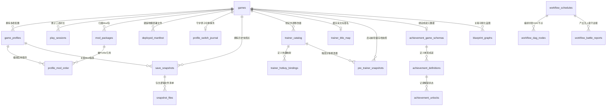

# SPAWN 数据模型与存储格式正本（Data Model & Storage Specification）

> **文档状态**：Active（M1 基线锁定；M3 同步 SQLite Schema `v4` 修改器四表与沙箱布局；M4 存档时间机器轨道同步 Schema `v5` 分支树、FastCDC CAS 与 32MB SPPK 云同步七表）
> **适用范围**：`spawn.db` SQLite WAL 数据库契约、核心表结构 DDL、`SPAWN_Vault` 物理目录拓扑、`FastCDC` 分块算法与 `32MB SPPK` 云同步二进制协议
> **关联文档**：[ADR-0004 存储与 Junction 拓扑](../decisions/0004-cas-fastcdc-storage-and-mod-junction-topology.md) · [系统顶层架构](system-architecture.md) · [存档与修改器规格](../modules/progress-saves-and-trainer.md) · [Mod 与极客工具规格](../modules/nexus-mods-and-utilities.md)

---

## 1. 本地持久化全景布局

SPAWN 的全部状态由**关系型元数据索引库（`spawn.db`）**与**不可变内容寻址大对象仓库（`SPAWN_Vault`）**共同组成。以正式通道 `%LOCALAPPDATA%\spawn\`（开发通道自动映射至 `%LOCALAPPDATA%\spawn-dev\`）为例，标准物理目录树如下：

```text
%LOCALAPPDATA%\spawn\
├── config\
│   ├── host-settings.json                 # 宿主界面主题、语言、全局快捷键与分卷仓库路径表
│   ├── environment_rollback.json          # HDR / 分辨率 / 电源计划启动前接管回滚日志（断电自愈锚点）
│   └── workflow_config_rollback.json      # 外部自动化工具（如 MAA gui.json）运行前备份回滚日志
├── db\
│   ├── spawn.db                           # 主元数据库 (SQLite 3, WAL 模式 — 严禁放入网盘同步目录！)
│   ├── spawn.db-wal                       # 预写式日志
│   ├── spawn.db-shm                       # 共享内存索引
│   └── backups\                           # Schema 迁移前通过 SQLite Online Backup API 生成的自动备份
├── secrets\
│   └── <credential-id>.sec                # 经 CurrentUser DPAPI 加密的 S3/WebDAV/Webhook 独立密文文件
├── logs\
│   └── spawn-<yyyyMMdd>.jsonl             # 结构化滚动诊断日志（自动脱敏路径与令牌）
├── cache\
│   ├── gbe_fork\                          # 锁定的离线成就兼容层缓存池
│   └── trainers\                          # M3 修改器发现索引缓存（fling-all-trainers.html / fling-archive-index.html）
└── vault\                                 # 默认本地内容寻址库（跨盘游戏分卷库挂载为 <目标盘根>\SPAWN_Vault\ 以启用同卷硬链接）
    ├── Blobs\                             # Mod 原始不可变内容寻址池 (按 BLAKE3 前四位两级分片)
    │   └── 4a\f1\4af19c...e802.blob       # 只读属性 (ReadOnly)，供同卷 Profile 视图建立硬链接
    ├── Chunks\                            # FastCDC 存档去重压缩块池 (BLAKE3 命名 + Zstd 压缩)
    │   └── 8c\2d\8c2d07...11b9.zst
    ├── Profiles\
    │   └── <ProfileId>\
    │       ├── StagingView\               # 预组装的 Mod 硬链接与 MutableCopy 视图目录 (Junction 挂载源)
    │       └── Overrides\                 # 游戏退出后经 XxHash3 差异扫描自动回收的配置文件变更层
    ├── Saves\
    │   └── <GameId>\
    │       └── Slot_<ProfileId>\          # 当前 Profile 绑定的独立活跃存档槽位目录
    ├── Snapshots\
    │   └── PreTrainer\<GameId>\<SnapshotId>\ # M3 启动修改器前轻量存档快照（files\、registry_snapshot.json、原子 manifest.json）
    ├── Schemas\
    │   └── Icons\<Platform>_<AppId>\      # 缓存的解锁彩色图标与 SkiaSharp Rec.709 预合成灰阶图标
    ├── Reports\
    │   └── <yyyyMM>\                      # Workflow 生成的暗黑毛玻璃汇总战报长图与异常现场截图
    └── Sandbox\
        └── Trainers\                      # M3 外部修改器沙箱根（唯一允许 Opt-in 添加 Defender 排除；支持纯 ASCII 自定义根）
            ├── .staging\<guid>\           # 下载与本地导入暂存校验区，通过后原子移动
            └── <GameId>\<TrainerId>\      # 成品修改器目录（钉扎本地 SHA-256，启动前 TOCTOU 复核）
```

---

## 2. `spawn.db` SQLite 连接与并发规范

1. **驱动选型**：统一使用 `Microsoft.Data.Sqlite`（`.NET 10`）配合编译期类型安全的微 ORM / 参数化映射，零 `EF Core` 运行时重型反射开销。
2. **强制连接初始化指令（Connection Pragmas）**：每次打开连接必须立即执行：
   ```sql
   PRAGMA journal_mode = WAL;
   PRAGMA synchronous = NORMAL;
   PRAGMA foreign_keys = ON;
   PRAGMA busy_timeout = 5000;
   PRAGMA temp_store = MEMORY;
   PRAGMA cache_size = -32768; -- 32 MiB 页缓存
   ```
3. **单写多读纪律**：仅 `Spawn.Host.exe` 内部有界 `Channel<IDbWriteCommand>` 持有唯一写连接串行提交事务；并发后台查询任务使用 `Mode=ReadOnly` 连接池并行读取，彻底根绝 `SQLITE_BUSY` 死锁。
4. **表命名、演进与备份铁律**：全库核心实体表与各业务模块级配置辅助表一律采用统一的 **`snake_case` 小写下划线命名规范**，共享同一套幂等递增编号 SQL 迁移管线（记录于 `schema_migrations` 表）；执行任何跨版本迁移前必须先调用 `SqliteConnection.BackupDatabase` 生成快照备份。**严禁引导或允许用户将 `db\` 目录直接置于 OneDrive / 坚果云实时同步盘下**（云同步统一走第 6 节定义的无状态 `SPPK` 协议）。

---

## 3. 全域实体关系图（ER Diagram）



---

## 4. 核心表结构 DDL 契约

### 4.1 游戏库、环境策略与三态会话表（Spawn 域）

```sql
CREATE TABLE IF NOT EXISTS games (
    GameId                  TEXT PRIMARY KEY,               -- ULID 唯一主键
    Title                   TEXT NOT NULL,
    SortTitle               TEXT NOT NULL,
    PlatformSource          TEXT NOT NULL,                  -- 'Steam' | 'GOG' | 'DLsite' | 'Portable' | 'Emulator'
    ExternalAppId           TEXT,                           -- Steam AppId / GOG ProductId / RJ 号
    InstallDir              TEXT NOT NULL,                  -- 游戏根目录规范化路径
    ExecutableRelPath       TEXT NOT NULL,                  -- 主启动程序相对 InstallDir 路径
    EngineType              TEXT NOT NULL DEFAULT 'Unknown',-- 'UnityMono' | 'UnityIl2Cpp' | 'Unreal4_5' | 'Gacha3DM' | 'Generic'
    AntiCheatTier           INTEGER NOT NULL DEFAULT 0,     -- 0=Tier0, 1=Tier1, 2=Tier2, 3=Tier3
    AntiCheatSignature      TEXT,                           -- 命中的反作弊特征标识 (如 'ACE:SGuard64', 'EAC', 'Vanguard')
    ActiveProfileId         TEXT,                           -- 当前激活的 game_profiles.ProfileId
    TotalActiveSeconds      INTEGER NOT NULL DEFAULT 0,
    TotalBackgroundSeconds  INTEGER NOT NULL DEFAULT 0,
    TotalAfkSeconds         INTEGER NOT NULL DEFAULT 0,
    LastPlayedAtUtc         TEXT,                           -- ISO-8601 UTC
    CoverImageRelPath       TEXT,
    HeroImageRelPath        TEXT,
    MetadataJson            TEXT NOT NULL DEFAULT '{}',     -- 发行商、标签、Bangumi/VNDB/IGDB 评分与多源关联 ID
    CreatedAtUtc            TEXT NOT NULL
);

-- M3 Schema v4 实际在 `SpawnDatabase` 既有 snake_case `games` 主表上经 `PRAGMA table_info(games)` 幂等追加四列：
--   steam_build_id                 TEXT                      -- Steam ACF buildid 版本指纹
--   steam_last_updated             TEXT                      -- Steam ACF LastUpdated (ISO-8601 UTC)
--   verified_offline_bypass        INTEGER NOT NULL DEFAULT 0 -- 混合单机受控离线放行确认位（绝不改写 anti_cheat_tier）
--   verified_offline_bypass_at_utc TEXT                      -- 玩家显式确认离线放行时间戳 (ISO-8601 UTC)

CREATE INDEX IF NOT EXISTS ix_games_platform_external_id ON games(PlatformSource, ExternalAppId);

CREATE TABLE IF NOT EXISTS play_sessions (
    SessionId               TEXT PRIMARY KEY,
    GameId                  TEXT NOT NULL REFERENCES games(GameId) ON DELETE CASCADE,
    ProfileId               TEXT,
    StartedAtUtc            TEXT NOT NULL,
    EndedAtUtc              TEXT,
    ActiveSeconds           INTEGER NOT NULL DEFAULT 0,
    BackgroundSeconds       INTEGER NOT NULL DEFAULT 0,
    AfkSeconds              INTEGER NOT NULL DEFAULT 0,
    ExitCode                INTEGER
);
```

### 4.2 多维 Profile、硬链接清单与切换事务表（Nexus 域）

```sql
CREATE TABLE IF NOT EXISTS game_profiles (
    ProfileId               TEXT PRIMARY KEY,
    GameId                  TEXT NOT NULL REFERENCES games(GameId) ON DELETE CASCADE,
    ProfileName             TEXT NOT NULL,                  -- 如 'Vanilla', 'HeavyMod', 'Speedrun'
    IsPuristVanilla         INTEGER NOT NULL DEFAULT 0,     -- 1=强制零第三方 DLL 纯净模式
    ModProfileHash          TEXT NOT NULL,                  -- 基于启用 Mod 列表与顺序计算的 BLAKE3 摘要 (防坏档校验锚点)
    SaveSlotDir             TEXT NOT NULL,                  -- 绑定的独立存档槽位路径
    LaunchArgs              TEXT NOT NULL DEFAULT '',
    LocaleMode              TEXT NOT NULL DEFAULT 'Native', -- 'Native' | 'AutoJp' | 'ForceLR_x64' | 'ForceLE_x86'
    EnableAutoHdr            INTEGER NOT NULL DEFAULT 0,     -- 0=保持原状, 1=启动强开HDR, -1=启动强关HDR
    TargetResolutionJson    TEXT,                           -- 可选专属分辨率/刷新率 JSON
    CpuAffinityPolicy       TEXT NOT NULL DEFAULT 'Default',-- 'Default' | 'PCoresOnly' | 'X3DCcd0'
    DefaultBlueprintId      TEXT,
    TrainerPresetJson       TEXT NOT NULL DEFAULT '{}',
    UpdatedAtUtc            TEXT NOT NULL
);

CREATE TABLE IF NOT EXISTS mod_packages (
    ModId                   TEXT PRIMARY KEY,
    GameId                  TEXT NOT NULL REFERENCES games(GameId) ON DELETE CASCADE,
    DisplayName             TEXT NOT NULL,
    Version                 TEXT NOT NULL,
    Author                  TEXT,
    ArchiveBlake3           TEXT NOT NULL,
    InstallTargetStrategy   TEXT NOT NULL,                  -- 'RootOverlay' | 'BepInExPlugin' | 'UEPakMods' | 'ReloadedII' | 'XXMI'
    FileEntriesJson         TEXT NOT NULL,                  -- [{RelPath, BlobBlake3, SizeBytes, IsMutableConfig}]
    ImportedAtUtc           TEXT NOT NULL
);

CREATE TABLE IF NOT EXISTS profile_mod_order (
    ProfileId               TEXT NOT NULL REFERENCES game_profiles(ProfileId) ON DELETE CASCADE,
    ModId                   TEXT NOT NULL REFERENCES mod_packages(ModId) ON DELETE CASCADE,
    LoadOrder               INTEGER NOT NULL,               -- 数值越大优先级越高（后覆盖前）
    IsEnabled               INTEGER NOT NULL DEFAULT 1,
    PRIMARY KEY (ProfileId, ModId)
);

CREATE TABLE IF NOT EXISTS deployed_manifest (
    GameId                  TEXT NOT NULL REFERENCES games(GameId) ON DELETE CASCADE,
    TargetRelPath           TEXT NOT NULL,                  -- 游戏目录内相对路径
    DeployMode              TEXT NOT NULL,                  -- 'HardLink' | 'MutableCopy' | 'CrossVolumeCopy' | 'JunctionRoot'
    SourceBlobBlake3        TEXT,
    LastKnownXxHash3        TEXT,                           -- 用于游戏退出后极速检测 MutableCopy 是否被游戏改写
    HasVanillaBackup        INTEGER NOT NULL DEFAULT 0,     -- 1=同目录存在 .spawn_vanilla_bak 原版保护备份
    PRIMARY KEY (GameId, TargetRelPath)
);

CREATE TABLE IF NOT EXISTS profile_switch_journal (
    JournalId               TEXT PRIMARY KEY,
    GameId                  TEXT NOT NULL UNIQUE REFERENCES games(GameId) ON DELETE CASCADE,
    FromProfileId           TEXT,
    ToProfileId             TEXT NOT NULL,
    Phase                   TEXT NOT NULL,                  -- 'PrepareStaging' | 'SwitchModJunction' | 'SwitchSaveJunction' | 'CommitMetadata' | 'Completed'
    ReparseTargetsJson      TEXT NOT NULL,                  -- 记录重解析点新旧目标以供断电幂等回滚或前滚
    StartedAtUtc            TEXT NOT NULL
);
```

### 4.3 修改器安全管家（`M3` Schema `v4` 实装）与存档时间机器（`M4` 轨道，Progress 域）

`M3` Schema `v4` 幂等迁移实装于 `src/Spawn.Core/SpawnDatabase.Trainer.cs`（全 `snake_case`，严格对齐 [Progress 模块规格 §3.1](../modules/progress-saves-and-trainer.md)）：

```sql
CREATE TABLE IF NOT EXISTS trainer_catalog (
    trainer_id                  TEXT PRIMARY KEY,
    game_id                     TEXT NOT NULL REFERENCES games(game_id) ON DELETE CASCADE,
    provider                    TEXT NOT NULL DEFAULT 'LocalImport', -- 'FlingMain' | 'FlingArchive' | 'LocalImport'
    display_name                TEXT,
    version_label               TEXT,
    source_page_url             TEXT,
    source_updated_at           TEXT,
    sandbox_relative_path       TEXT NOT NULL,                       -- 相对沙箱根路径（<GameId>\<TrainerId>\<Exe>）
    file_sha256                 TEXT NOT NULL,                       -- 本地钉扎 SHA-256（每次启动前 TOCTOU 复核）
    file_size                   INTEGER,
    pe_machine                  TEXT,
    requires_admin              INTEGER NOT NULL DEFAULT 0,
    authenticode_status         TEXT,                                -- 仅作信息标签，不作安全前提
    parse_mode                  TEXT NOT NULL DEFAULT 'FreeHosted',  -- 'Structured' | 'FreeHosted'
    bound_build_id              TEXT,
    bound_exe_size              INTEGER,
    bound_exe_last_write_utc    TEXT,
    imported_at_utc             TEXT NOT NULL,
    last_launched_at_utc        TEXT
);

CREATE INDEX IF NOT EXISTS ix_trainer_catalog_game_id ON trainer_catalog(game_id);

CREATE TABLE IF NOT EXISTS trainer_title_map (
    game_id                 TEXT PRIMARY KEY REFERENCES games(game_id) ON DELETE CASCADE,
    english_title           TEXT NOT NULL,                           -- 英文标准名缓存（废除 Slug 硬拼）
    title_source            TEXT NOT NULL DEFAULT 'Cleaner',         -- 'AcfName' | 'SteamAppDetails' | 'GogInfo' | 'Cleaner' | 'User'
    user_search_override    TEXT,
    fling_page_url          TEXT,
    updated_at_utc          TEXT NOT NULL
);

CREATE TABLE IF NOT EXISTS trainer_hotkey_bindings (
    trainer_id      TEXT NOT NULL REFERENCES trainer_catalog(trainer_id) ON DELETE CASCADE,
    entry_id        TEXT NOT NULL,
    label           TEXT NOT NULL,
    tooltip         TEXT,
    original_chord  TEXT NOT NULL,
    mapped_chord    TEXT,
    entry_kind      TEXT NOT NULL DEFAULT 'Toggle',                  -- 'Toggle' | 'Trigger'
    proxy_state     INTEGER NOT NULL DEFAULT 0,                      -- 代理显示状态（可一键重置）
    sort_order      INTEGER NOT NULL DEFAULT 0,
    PRIMARY KEY (trainer_id, entry_id)
);

CREATE INDEX IF NOT EXISTS ix_trainer_hotkey_bindings_sort
    ON trainer_hotkey_bindings(trainer_id, sort_order ASC);

CREATE TABLE IF NOT EXISTS pre_trainer_snapshots (
    snapshot_id             TEXT PRIMARY KEY,
    game_id                 TEXT NOT NULL REFERENCES games(game_id) ON DELETE CASCADE,
    trainer_id              TEXT REFERENCES trainer_catalog(trainer_id) ON DELETE SET NULL,
    trigger_kind            TEXT NOT NULL DEFAULT 'PreTrainer',      -- 'PreTrainer' | 'PreRestoreSafety'
    status                  TEXT NOT NULL DEFAULT 'Completed',       -- 'Completed' | 'Skipped' | 'Failed'
    skip_reason             TEXT,
    file_count              INTEGER NOT NULL DEFAULT 0,
    total_bytes             INTEGER NOT NULL DEFAULT 0,
    manifest_relative_path  TEXT,
    created_at_utc          TEXT NOT NULL,
    restored_at_utc         TEXT
);

CREATE INDEX IF NOT EXISTS ix_pre_trainer_snapshots_game_created
    ON pre_trainer_snapshots(game_id, created_at_utc DESC);
```

以下七表由 `M4` 存档时间机器与分支树轨道（Schema `v5` 幂等迁移，实装于 `src/Spawn.Core/SpawnDatabase.Saves.cs`，全 `snake_case` 命名）统一落库：

```sql
CREATE TABLE IF NOT EXISTS save_branches (
    branch_id           TEXT PRIMARY KEY,
    game_id             TEXT NOT NULL REFERENCES games(game_id) ON DELETE CASCADE,
    name                TEXT NOT NULL,
    description         TEXT,
    color_hex           TEXT NOT NULL DEFAULT '#1677FF',
    head_snapshot_id    TEXT,
    base_snapshot_id    TEXT,
    is_default          INTEGER NOT NULL DEFAULT 0,
    is_archived         INTEGER NOT NULL DEFAULT 0,
    created_at_utc      TEXT NOT NULL,
    updated_at_utc      TEXT NOT NULL,
    UNIQUE (game_id, name COLLATE NOCASE)
);

CREATE INDEX IF NOT EXISTS ix_save_branches_game
    ON save_branches(game_id, is_default DESC, created_at_utc ASC);

CREATE TABLE IF NOT EXISTS cloud_sync_endpoints (
    endpoint_id             TEXT PRIMARY KEY,
    display_name            TEXT NOT NULL,
    provider_type           TEXT NOT NULL DEFAULT 'LocalFolder', -- 'LocalFolder' | 'WebDav' | 'S3'
    endpoint_url            TEXT NOT NULL,
    bucket_or_root          TEXT NOT NULL DEFAULT '',
    region                  TEXT,
    path_style_addressing   INTEGER NOT NULL DEFAULT 1,
    secret_credential_id    TEXT,                                -- 对应 secrets/<id>.sec (DPAPI)
    is_default              INTEGER NOT NULL DEFAULT 0,
    created_at_utc          TEXT NOT NULL,
    updated_at_utc          TEXT NOT NULL
);

CREATE TABLE IF NOT EXISTS save_snapshots (
    snapshot_id                     TEXT PRIMARY KEY,            -- ULID
    game_id                         TEXT NOT NULL REFERENCES games(game_id) ON DELETE CASCADE,
    branch_id                       TEXT NOT NULL REFERENCES save_branches(branch_id) ON DELETE CASCADE,
    parent_snapshot_id              TEXT REFERENCES save_snapshots(snapshot_id) ON DELETE SET NULL,
    merge_parent_snapshot_id        TEXT REFERENCES save_snapshots(snapshot_id) ON DELETE SET NULL,
    profile_id                      TEXT,
    mod_profile_hash                TEXT NOT NULL DEFAULT '',
    trigger_kind                    TEXT NOT NULL DEFAULT 'Manual',
    note                            TEXT,
    file_count                      INTEGER NOT NULL DEFAULT 0,
    registry_key_count              INTEGER NOT NULL DEFAULT 0,
    total_raw_bytes                 INTEGER NOT NULL DEFAULT 0,
    total_stored_bytes              INTEGER NOT NULL DEFAULT 0,
    created_machine_id              TEXT NOT NULL,
    playtime_active_seconds         INTEGER NOT NULL DEFAULT 0,
    created_at_utc                  TEXT NOT NULL,
    is_pinned                       INTEGER NOT NULL DEFAULT 0,  -- 1=永久钉住免受滚动淘汰策略清理
    legacy_pre_trainer_snapshot_id  TEXT                         -- 从 M3 pre_trainer_snapshots 无损桥接时去重键
);

CREATE INDEX IF NOT EXISTS ix_save_snapshots_game_time
    ON save_snapshots(game_id, created_at_utc DESC, snapshot_id DESC);
CREATE INDEX IF NOT EXISTS ix_save_snapshots_branch_time
    ON save_snapshots(branch_id, created_at_utc DESC, snapshot_id DESC);
CREATE INDEX IF NOT EXISTS ix_save_snapshots_parent
    ON save_snapshots(parent_snapshot_id) WHERE parent_snapshot_id IS NOT NULL;
CREATE UNIQUE INDEX IF NOT EXISTS ux_save_snapshots_legacy
    ON save_snapshots(legacy_pre_trainer_snapshot_id) WHERE legacy_pre_trainer_snapshot_id IS NOT NULL;

CREATE TABLE IF NOT EXISTS save_game_state (
    game_id                         TEXT PRIMARY KEY REFERENCES games(game_id) ON DELETE CASCADE,
    active_branch_id                TEXT REFERENCES save_branches(branch_id) ON DELETE SET NULL,
    current_head_snapshot_id        TEXT REFERENCES save_snapshots(snapshot_id) ON DELETE SET NULL,
    auto_watch_enabled              INTEGER NOT NULL DEFAULT 1,
    post_exit_snapshot_enabled      INTEGER NOT NULL DEFAULT 1,
    include_config_files            INTEGER NOT NULL DEFAULT 0,
    max_rolling_snapshots           INTEGER NOT NULL DEFAULT 30,
    cloud_endpoint_id               TEXT REFERENCES cloud_sync_endpoints(endpoint_id) ON DELETE SET NULL,
    last_synced_at_utc              TEXT,
    has_unresolved_cloud_conflict   INTEGER NOT NULL DEFAULT 0,
    updated_at_utc                  TEXT NOT NULL
);

CREATE TABLE IF NOT EXISTS snapshot_files (
    snapshot_id         TEXT NOT NULL REFERENCES save_snapshots(snapshot_id) ON DELETE CASCADE,
    logical_path        TEXT NOT NULL,                           -- 占位符标准化逻辑路径，如 '<winAppData>/EldenRing/<storeUserId>/ER0000.sl2'
    original_path       TEXT NOT NULL,
    category            TEXT NOT NULL DEFAULT 'Save',            -- 'Save' | 'Config' | 'RegistryExport'
    file_size           INTEGER NOT NULL DEFAULT 0,
    last_write_time_utc TEXT NOT NULL,
    file_blake3         TEXT NOT NULL,
    chunk_sequence_json TEXT NOT NULL DEFAULT '[]',              -- 有序 [chunk_blake3, ...] 重组清单
    PRIMARY KEY (snapshot_id, logical_path)
);

CREATE TABLE IF NOT EXISTS cas_chunks (
    chunk_blake3             TEXT PRIMARY KEY,                   -- 64 字符十六进制 BLAKE3
    raw_size_bytes           INTEGER NOT NULL DEFAULT 0,
    compressed_size_bytes    INTEGER NOT NULL DEFAULT 0,
    ref_count                INTEGER NOT NULL DEFAULT 0,         -- 引用计数归零且经 GC 宽限期后方可回收物理块
    pack_id                  TEXT,                               -- 已归档进远端云同步 SPPK 包时记录对应 PackId
    created_at_utc           TEXT NOT NULL,
    last_unreferenced_at_utc TEXT
);

CREATE INDEX IF NOT EXISTS ix_cas_chunks_unreferenced
    ON cas_chunks(ref_count, last_unreferenced_at_utc) WHERE ref_count <= 0;

CREATE TABLE IF NOT EXISTS ludusavi_rules (
    rule_name           TEXT PRIMARY KEY COLLATE NOCASE,         -- 标准游戏英文/唯一标识名
    steam_app_id        INTEGER,
    gog_id              TEXT,
    aliases_json        TEXT NOT NULL DEFAULT '[]',
    save_paths_json     TEXT NOT NULL DEFAULT '[]',              -- 仅含 [save] 标签的路径占位符规则数组
    config_paths_json   TEXT NOT NULL DEFAULT '[]',              -- 剥离出的 [config] 画质/键位规则数组
    registry_rules_json TEXT NOT NULL DEFAULT '[]',
    updated_at_utc      TEXT NOT NULL
);

CREATE INDEX IF NOT EXISTS ix_ludusavi_rules_steam ON ludusavi_rules(steam_app_id) WHERE steam_app_id IS NOT NULL;
CREATE INDEX IF NOT EXISTS ix_ludusavi_rules_gog   ON ludusavi_rules(gog_id) WHERE gog_id IS NOT NULL;
```

### 4.4 全域成就 Schema 与解锁记录表（Achievement 域）

```sql
CREATE TABLE IF NOT EXISTS achievement_game_schemas (
    SchemaKey               TEXT PRIMARY KEY,               -- '<Platform>:<AppId>' 如 'Steam:1245620'
    GameId                  TEXT REFERENCES games(GameId) ON DELETE SET NULL,
    SchemaSource            TEXT NOT NULL,                  -- 'LocalEmuJson' | 'SteamLocalBin' | 'CommunityMirror' | 'GogLocal'
    Language                TEXT NOT NULL DEFAULT 'schinese',
    TotalAchievements       INTEGER NOT NULL,
    HasEnablerDeployed      INTEGER NOT NULL DEFAULT 0,
    OriginalApiDllSha256    TEXT,                           -- 一键赋能备份的原始 steam_api(64).dll 哈希
    LastSyncedAtUtc         TEXT NOT NULL
);

CREATE TABLE IF NOT EXISTS achievement_definitions (
    SchemaKey               TEXT NOT NULL REFERENCES achievement_game_schemas(SchemaKey) ON DELETE CASCADE,
    ApiName                 TEXT NOT NULL,                  -- 内部成就标识符 (如 'ACH_01')
    DisplayName             TEXT NOT NULL,
    Description             TEXT NOT NULL,                  -- 即便 hidden=1 也预先缓存真实揭晓文本（UI 负责剧透遮罩）
    IsHidden                INTEGER NOT NULL DEFAULT 0,
    GlobalUnlockPercent     REAL,                           -- <10.0 触发稀有成就钻石长混响动效
    UnlockedIconRelPath     TEXT,
    LockedGrayIconRelPath   TEXT,                           -- SkiaSharp Rec.709 离线合成灰阶图路径
    PRIMARY KEY (SchemaKey, ApiName)
);

CREATE TABLE IF NOT EXISTS achievement_unlocks (
    SchemaKey               TEXT NOT NULL,
    ApiName                 TEXT NOT NULL,
    IsUnlocked              INTEGER NOT NULL DEFAULT 0,
    UnlockedAtUtc           TEXT,
    CurrentProgress         REAL,
    MaxProgress             REAL,
    AdapterSource           TEXT NOT NULL,                  -- 'Goldberg' | 'GBEFork' | 'CODEX' | 'SmartSteamEmu' | 'GogComet9977' | 'SteamVdf' ...
    RawSourcePath           TEXT,
    IsInitialSeed           INTEGER NOT NULL DEFAULT 0,     -- 1=首次入库静默对齐，不弹通知
    PRIMARY KEY (SchemaKey, ApiName),
    FOREIGN KEY (SchemaKey, ApiName) REFERENCES achievement_definitions(SchemaKey, ApiName) ON DELETE CASCADE
);
```

### 4.5 二次元并发 DAG 计划与可视化蓝图表（Workflow 域）

```sql
CREATE TABLE IF NOT EXISTS blueprint_graphs (
    BlueprintId             TEXT PRIMARY KEY,
    GameId                  TEXT REFERENCES games(GameId) ON DELETE SET NULL,
    Title                   TEXT NOT NULL,
    GraphFileRelPath        TEXT NOT NULL,                  -- 指向序列化 JSON 图文件 (.spbp)
    RequiredActuatorLevel   TEXT NOT NULL DEFAULT 'L1',     -- 'L1_WindowMsg' | 'L2_SendInput' | 'L3_ViGEm' | 'L4_HardwareHid'
    UpdatedAtUtc            TEXT NOT NULL
);

CREATE TABLE IF NOT EXISTS workflow_schedules (
    ScheduleId              TEXT PRIMARY KEY,
    Name                    TEXT NOT NULL,
    CronOrDailyTime         TEXT NOT NULL,                  -- 如每日 '04:00'
    EnableRtcWake           INTEGER NOT NULL DEFAULT 0,     -- 1=允许注册可唤醒定时器从 S3 睡眠唤醒
    BlackoutMode            TEXT NOT NULL DEFAULT 'SoftwareCurtain', -- 'None' | 'SoftwareCurtain' | 'IddCxVirtualDisplay'
    PostAction              TEXT NOT NULL DEFAULT 'None',   -- 'None' | 'SleepWith60sCancel'
    NotifyChannelsJson      TEXT NOT NULL DEFAULT '[]',     -- 关联加密 Webhook 配置 ID 列表
    IsEnabled               INTEGER NOT NULL DEFAULT 1
);

CREATE TABLE IF NOT EXISTS workflow_dag_nodes (
    NodeId                  TEXT PRIMARY KEY,
    ScheduleId              TEXT NOT NULL REFERENCES workflow_schedules(ScheduleId) ON DELETE CASCADE,
    AdapterType             TEXT NOT NULL,                  -- 'MaaArknights' | 'MaaFrameworkEmbedded' | 'MaaFgoBridge' | 'BetterGI' | 'March7th' | 'SRC' | 'ZZZOneDragon' | 'OkWuWa'
    ToolRootDir             TEXT NOT NULL,
    TaskConfigJson          TEXT NOT NULL,                  -- 映射 interface.json 或 CLI 参数模型
    DependsOnNodeIdsJson    TEXT NOT NULL DEFAULT '[]',     -- 上游拓扑依赖节点数组
    ResourceLocksJson       TEXT NOT NULL,                  -- {NeedsPrimaryForeground, EmulatorSerial, MinFreeRamMb, MinFreeVramMb}
    TimeoutSeconds          INTEGER NOT NULL DEFAULT 1800
);

CREATE TABLE IF NOT EXISTS workflow_battle_reports (
    ReportId                TEXT PRIMARY KEY,
    ScheduleId              TEXT NOT NULL REFERENCES workflow_schedules(ScheduleId) ON DELETE CASCADE,
    StartedAtUtc            TEXT NOT NULL,
    CompletedAtUtc          TEXT NOT NULL,
    OverallStatus           TEXT NOT NULL,                  -- 'Succeeded' | 'PartialWarning' | 'Failed'
    NodeSummariesJson       TEXT NOT NULL,
    LongImageRelPath        TEXT NOT NULL,                  -- SkiaSharp 合成战报长图路径
    NotificationSent        INTEGER NOT NULL DEFAULT 0
);
```

---

## 5. `FastCDC` 确定性变长分块算法规范

为保证同一份存档在不同机器（桌面主力机与 Windows 掌机）切分出**完全相同的分块边界与 `BLAKE3` 指纹**，`Spawn.Core` 的 `FastCdcChunker` 严格固定以下算法常数：

1. **分块尺寸约束**：
   - `MinSize = 262,144`（`256 KiB`）：切分游标直接跳过前 `256 KiB`，消除极碎块元数据开销。
   - `NormalSize = 1,048,576`（`1 MiB`）：标准归一化锚点。
   - `MaxSize = 4,194,304`（`4 MiB`）：硬上限截断点，防止全零填充段产生超大单块。
2. **Gear 查找表（`GearTable[256]`）确定性生成**：
   - 使用固定种子的无外部依赖 `SplitMix64` 伪随机数生成器（初始种子固定为 ASCII `"SPAWN_CD"` 对应的 `0x535041574E5F4344UL`）一次性生成 256 个 `uint64` 常数，写死为编译期 `ReadOnlySpan<ulong>` 常量表，严禁运行期随机生成。
3. **双掩码归一化滚动判据**：
   - 在 `[MinSize, NormalSize)` 区间使用更严格的 21-bit 掩码 `MaskS = 0x0003590703530000UL`（降低过早切分概率）；
   - 在 `[NormalSize, MaxSize)` 区间切换至宽松的 19-bit 掩码 `MaskL = 0x0000D90303530000UL`（加速收敛切分，使块长紧聚在 `1 MiB` 附近）；
   - 滚动状态更新公式：`fp = (fp << 1) + GearTable[byte]`，当 `(fp & mask) == 0` 时在此字节边界截断。
4. **哈希与压缩落盘**：每个切出的 `ReadOnlySpan<byte>` 立即计算 256-bit `BLAKE3` 哈希；若 `cas_chunks` 中不存在该键，则经 `ZstdSharp`（默认压缩等级 `3`）写入临时文件并同卷原子 `MoveFileEx` 至 `Chunks\<h[0..2]>\<h[2..4]>\<blake3>.zst`。

---

## 6. `32MB SPPK` Packfile 二进制格式与不可变云同步模型

### 6.1 `SPPK`（SPAWN Packfile v1）物理字节布局

所有待上传的压缩块在本地内存/流缓冲区按序聚合成上限 `32 MiB` 的不可变 `.sppk` 文件（若单个大块压缩后仍超过 `32 MiB`，则允许独占单包）：

```text
Offset   Length        Field Name             Description
------------------------------------------------------------------------------------------------
0x0000   4 Bytes       Magic                  固定 ASCII 字节 'S', 'P', 'P', 'K' (0x53 0x50 0x50 0x4B)
0x0004   1 Byte        Version                格式版本号 = 0x01
0x0005   3 Bytes       Flags                  默认 0x000000（Bit 0 预留端到端 ChaCha20-Poly1305 加密扩展；Header 固定合计 8 Bytes）
0x0008   Variable      Payload Body           连续紧排的 N 个 Zstd 压缩块原始字节流
...      4 + N*48 B    Footer Index           定长二进制块索引区：
                                              - 4 Bytes: EntryCount (uint32 LE = N)
                                              - N * 48 Bytes 定长记录数组，每项精确结构：
                                                [32B ChunkBlake3, 8B PackOffset (uint64 LE), 4B ZstdLength (uint32 LE), 4B RawLength (uint32 LE)]
End-36   4 Bytes       FooterByteLength       小端序 uint32，精确指示上方 Footer Index 的字节总长度 (4 + N * 48)
End-32   32 Bytes      PackBlake3             Trailer 完整性签名：覆盖从 Offset 0x0000 至 End-32 前一字节的全流 BLAKE3 摘要
```

**读取优势**：恢复远端缺失块或执行断点校验时，客户端仅需一次 HTTP `Range: bytes=-4096`（或读取文件末尾）即可解析出包内全部块偏移表，按需通过字节范围请求精准拉取特定分块而无需整包下载。

### 6.2 远端无状态目录结构与分叉血缘判定

在 S3 / Cloudflare R2、WebDAV 或本地同步盘根目录下，SPAWN 维护如下纯追加/原子替换目录：

```text
<RemoteRoot>/spawn-sync/
├── repo.json                              # 仓库格式版本、加密盐参数与创建时间
├── packs/
│   └── pack-<pack_blake3>.sppk            # 不可变数据包（内容寻址，永不覆写）
├── snapshots/
│   └── <GameId>/<SnapshotId>.json         # 不可变快照清单（含 ModProfileHash、ParentSnapshotId 与逻辑文件块序列表）
└── heads/
    └── <GameId>/<MachineId>.json          # 各设备独立写入自身的最新指针与最近 64 代 AncestorIds 数组
```

**三路血缘决策规则**：
1. **无操作（Up-to-Date）**：远端所有设备的 `HeadSnapshotId` 均等于本机当前快照或已包含在本机 64 代祖先链中。
2. **无感快进（Fast-Forward）**：本机当前 `HeadSnapshotId` 出现在远端另一台设备（如掌机）新发布的 `AncestorIds` 链中，且本机无未同步新修改——提示或自动执行安全快进拉取（自动打上本地 `[PreRollbackSafety]` 保护点）。
3. **双端离线分叉告警（Diverged Conflict）**：两台设备各自的 `HeadSnapshotId` 均不在对方的祖先链中——**绝对禁止按时间戳静默覆盖**，强制弹出可视化分叉解决向导（对比双端设备名、游玩时长增量、修改时间与关联 Mod Profile，支持“采用远端并将本机存为独立分支快照”或“以本机为准推进新血缘”）。
