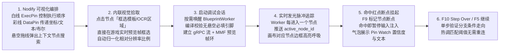
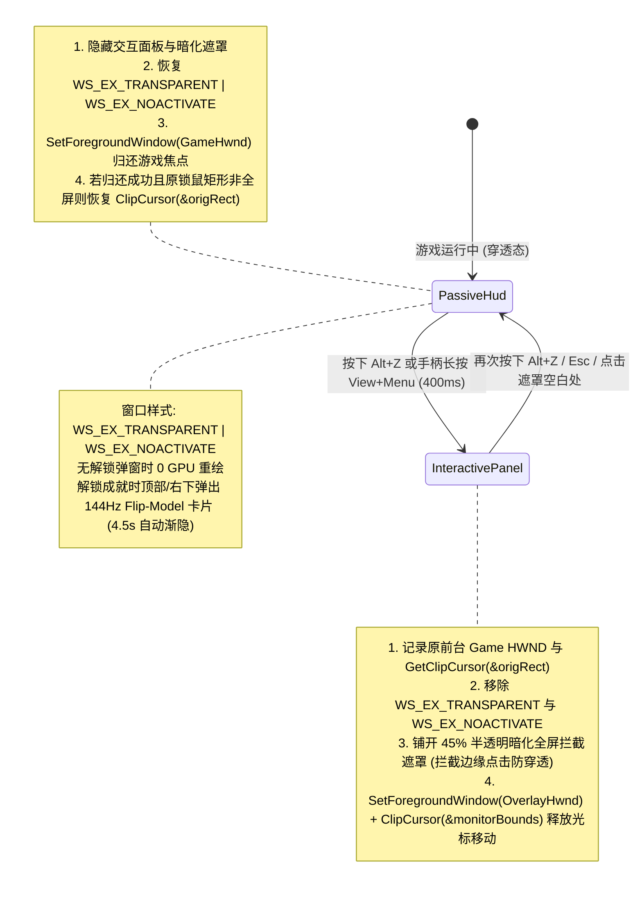

# SPAWN 桌面交互架构与核心端到端工作流（Interaction & Workflows）

> **文档状态**：Active（M1 基线锁定）
> **适用范围**：桌面主界面信息架构、五位一体 Profile 秒切与云分叉向导、类 UE 蓝图发光单步调试工作流、`Alt+Z` 游戏内面板接管与锁鼠状态机、二次元夜间无人值守闭环
> **关联文档**：[设计视觉规范](../design-rules/DESIGN.md) · [ADR-0002 UI 技术栈](../decisions/0002-pure-native-wpf-and-nodify-ui-stack.md) · [系统顶层架构](system-architecture.md) · [IPC 与安全契约](ipc-and-security-contracts.md)

---

## 1. 桌面主窗口与托盘信息架构（Desktop Shell IA）

SPAWN 主界面基于 `WPF-UI` `FluentWindow`（Windows 11 深色云母材质 Mica Alt + 极客高对比度语义色徽章）构建，采用左侧可折叠侧边导航栏 + 顶部全局状态胶囊 + 主内容视口三栏式布局：

```text
+--------------------------------------------------------------------------------------------------+
| [SPAWN]   搜索游戏 / Mod / 成就 / 蓝图 (Ctrl+K)        [AC Guard: 安全就绪] [云同步: 空闲] [- □ ×] |
+------------------+-------------------------------------------------------------------------------+
| 导航栏            | 游戏详情英雄头图 (Hero Banner) & 核心动作条                                     |
|                  | +---------------------------------------------------------------------------+ |
| > 游戏库 (Spawn)  | |  《艾尔登法环》                         [Profile: HeavyMod ▼]  [▶ 启动游戏] | |
|   存档与修改器    | |  真实游玩 142.6h · 挂机 4.1h · 成就 38/42 (90%) · 反作弊等级: Tier 0 (离线) | |
|   成就殿堂        | +---------------------------------------------------------------------------+ |
|   Mod 与极客箱    | [概览]  [存档时间机器 (28)]  [FLiNG 修改器]  [Mod 编排 (46)]  [成就清单]  [蓝图] |
|   二次元收菜      | +---------------------------------------------------------------------------+ |
|   UE 蓝图工坊     | | 上下文子工作区（虚拟化列表 / 时间轴树 / 热键开关卡片 / Nodify 画布）           | |
|                  | |                                                                           | |
| ---------------- | |                                                                           | |
|   系统与安全设置  | |                                                                           | |
+------------------+-------------------------------------------------------------------------------+
```

### 1.1 全局反作弊与运行态顶栏胶囊（Global Guard Pill）
顶栏右侧常驻显示当前安全状态胶囊，消除玩家心理盲区：
- **翡翠绿 `Guard: Tier 0 就绪`**：全功能解锁。
- **琥珀黄 `Guard: Tier 2/3 保护中`**：受保护网游正在运行，鼠标悬停可查看已自动物理隔离关闭的敏感子系统清单。
- **脉冲蓝 `Guard: 安全冷却 12s...`**：网游刚退出，实时倒数反作弊守护进程退出后的 15 秒强制静默期。

### 1.2 原生 XAML 系统托盘快捷浮窗（`H.NotifyIcon`）
关闭主窗口默认最小化至系统托盘并释放海报墙非活跃图像缓存（工作集压缩至 `<90MB`）；左键单击托盘图标呼出轻量无边框 Fluent 浮窗，支持一键启动最近 5 款游戏、查看正在后台执行的二次元收菜进度条或紧急触发“死锁黑屏强杀救援”。

---

## 2. 多维 Profile 一键切换与云端分叉合并交互流

### 2.1 五位一体 Profile `<100ms` 切换体验
1. 用户在游戏详情页顶部下拉框将 Profile 从 `HeavyMod` 切换至 `Purist Vanilla`（如准备联机前纯净启动）。
2. 若目标游戏正在运行，下拉框自动锁定为只读并提示“游戏运行期间禁止热切换文件系统视图”。
3. 静态下点击切换：
   - 后台在 `<100ms` 内顺序执行 `profile_switch_journal` 五阶段事务，原子重定向顶层 Mod 目录与独立存档槽位 NTFS Junction，同步刷新启动参数、默认伴生蓝图与修改器预设。
   - 若切换到 `Purist Vanilla`，界面顶部亮起“零第三方 DLL 纯净校验通过”标识。
4. **跨 Profile 存档恢复防坏档拦截**：当用户在 `Purist Vanilla` 下进入“存档时间机器”点击恢复一个带有 `HeavyMod` 标记的历史快照时，弹出双选项保护对话框：
   - **推荐选项 A**：“连同切换回 `HeavyMod` Profile 并恢复该存档（防缺模组坏档）”；
   - **选项 B**：“保持当前 Profile，将该存档克隆至新测试分支槽位”。

### 2.2 自建云同步分叉决策向导（Divergence Wizard）
当主力台式机与 Windows 掌机均在离线状态下推进了同一款游戏的存档，联网触发 `SPPK` 同步检测到双方 `HeadSnapshotId` 互不构成祖先关系时，弹出双栏对比面板：
- 左栏展示**本机最新快照**（设备名、保存时间、总活跃游玩时长、快照备注、关联 Mod Profile）；
- 右栏展示**云端远端快照**（同维度对比）；
- 提供三大无损动作：① **保留双端（推荐）**——先将本机当前状态固定为永久置顶历史分支 `[LocalBranchPin]`，再拉取应用云端进度；② **以本机覆盖远端指针**（远端旧包仍在不可变 `snapshots/` 中可随时找回）；③ **暂不同步**。

---

## 3. 类 UE 蓝图画布连线与实时发光单步调试工作流

SPAWN 的“UE 蓝图工坊”完全围绕纯可视化交互打造，零代码输入框：



### 3.1 引脚色彩语义体系（Pin Color Semantics）
严格对齐 Unreal Engine 玩家直觉：
- **纯白色楔形箭头（`ExecPin`）**：控制流脉冲走向（如 `OnStart -> FindImage -> Branch [True / False] -> ClickTarget`）。
- **绯红色圆形引脚（`Bool`）**：条件真假值。
- **青绿色圆形引脚（`Int / Float`）**：循环次数、延时毫秒、图像匹配置信度（`0.00 ~ 1.00`）。
- **琥珀金圆形引脚（`Point / Rect`）**：屏幕归一化坐标或命中包围盒中心点。
- **品紫色圆形引脚（`String`）**：`PaddleOCR` 识别出的文本字符串。
- **天蓝色圆形引脚（`ImageFrame`）**：`WGC` 捕获帧引用句柄。

### 3.2 安全紧急刹停热键（Panic Stop）
无论目标游戏处于前台何种状态，通过 `RawInput` 底层键盘状态监听全局最高优紧急中断键（默认 **`F12` 或 `Ctrl+Alt+Backspace`**）：一旦按下，`<10ms` 内立即清空 `BlueprintWorker` 待发输入队列、释放所有按下态虚拟按键/手柄摇杆并挂起虚拟机。

---

## 4. `Alt+Z` 游戏内战术面板焦点接管与 `ClipCursor` 锁鼠工作流

针对第一人称/第三人称动作游戏普遍将鼠标死锁在屏幕中心导致普通悬浮窗无法点击或点穿开火的核心难题，`Spawn.OverlayHost` 执行严格的四步切换协议：



### 4.1 游戏内战术面板四大快捷页签
1. **成就进度雷达**：置顶展示“即将达成”与“近期解锁”成就；对 `IsHidden=1` 的隐藏成就默认显示毛玻璃遮罩防剧透，鼠标悬停或按手柄 `Y` 键平滑揭晓中文解锁条件。
2. **存档时间机器快门**：一键点击“创建手动检查点”（触发后台无损快照并回弹成功微提示），无需切出桌面备份。
3. **修改器开关矩阵（仅 `Tier 0` 可见）**：直接用鼠标或手柄十字键开关已绑定的外部 FLiNG 功能卡片与提示音音量滑块。
4. **单机战术控制（仅 `Tier 0` 可见）**：过场动画急冻暂停（`NtSuspendProcess`）开关与游戏独立输出音量滑块。

---

## 5. 二次元夜间无人值守收菜与战报长图推送闭环

针对多修二次元玩家“凌晨 04:00 体力溢出自动清完、早上起床手机看一眼战报”的高频刚需，端到端闭环工作流如下：

1. **RTC 睡眠唤醒与反作弊前置仲裁**：
   - 凌晨设定时刻由 `CreateWaitableTimerExW` 硬件时钟唤醒主机，调用 `SetThreadExecutionState(ES_SYSTEM_REQUIRED | ES_CONTINUOUS)` 保持系统清醒。
   - 前置询问 `Anti-Cheat Guard`：若玩家睡前忘了关闭某款 `Tier 2/3` 在线网游，流水线自动跳过冲突节点并在战报中标注原因，绝不强行触碰受保护环境。
2. **显示环境接管与 OLED 防烧屏保护**：
   - 若系统当前开启了 Windows HDR，先记录回滚标志并临时切回 SDR（防止 `BetterGI`/`M7A` 等基于 SDR 模板阈值的工具出现过曝识图失效）。
   - 根据用户配置拉起全屏纯黑（`#000000`）软件防烧屏幕布（置于被控窗口视觉上方或配合后台模拟器/虚拟显示器 `IddCx` 彻底熄灭物理显示器背光；按任意 `Esc` 双击可即时解除幕布观察现场）。
3. **四维资源锁并发 DAG 推进**：
   - **后台模拟器并发车道**：同时拉起 MuMu12 实例 1 跑明日方舟 `MAA`（预写 `gui.json`）与实例 2 跑 FGO `MaaFgo+BBChannel`（双端口监控 + 30 秒助战异常看门狗）。
   - **前台独占串行车道**：模拟器后台刷本的同时，`PrimaryForegroundLock` 依次串行调度 `BetterGI` -> `March7thAssistant` -> `ZenlessZoneZero-OneDragon`，前一项正常退出并释放显存水位后再拉起下一项。
4. **战报长图合成、多端推送与可取消休眠**：
   - 所有节点收敛后，自动还原 HDR 状态与 `MAA` 原始 `gui.json`。
   - `SkiaSharp` 离线渲染一张高分辨率暗黑毛玻璃汇总战报长图（包含总耗时、各游戏勾玉/合成玉/星琼任务达成状态、重试次数及任何超时失败节点的最后一帧现场缩略图），通过加密保存的 Webhook 推送到 Bark / Telegram / 飞书 / 企业微信 / OneBot。
   - 若计划配置了“完成后自动睡眠”，屏幕中央弹出 **60 秒高对比度可取消倒计时框**（检测到任何人为键鼠移动即刻中止休眠）；倒计时归零后调用 `SetSuspendState(false, false, false)` 安全重返 S3 低功耗睡眠。
