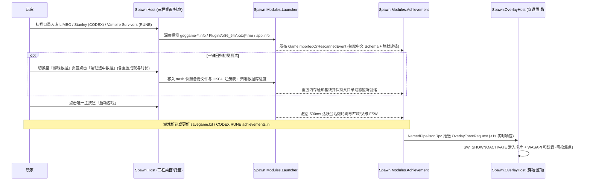
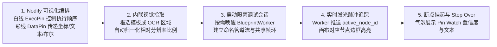
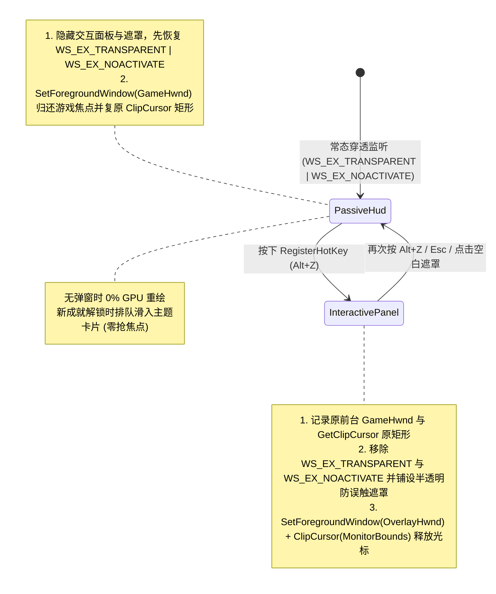

# SPAWN 桌面交互架构与核心端到端工作流（Interaction & Workflows）

> **文档状态**：Active
> **适用范围**：沉浸式三栏桌面主界面与系统托盘信息架构、单机游戏入库与成就实时跳杯闭环、PCGamingWiki 游戏数据可逆清理工作流、多维 Profile 秒切与云分叉向导、类 UE 蓝图单步调试、`Alt+Z` 锁鼠状态机及夜间无人值守闭环
> **关联文档**：[UI 与交互设计规范](../design-rules/DESIGN.md) · [ADR-0002 UI 技术栈](../decisions/0002-pure-native-wpf-and-nodify-ui-stack.md) · [系统顶层架构](system-architecture.md) · [IPC 与安全契约](ipc-and-security-contracts.md)

---

## 1. 桌面主窗口三栏信息架构（Three-Column Immersive Shell IA）

`Spawn.Host.exe` 采用 `WindowChrome` 沉浸式无边框通顶窗口，以 **最左侧窄图标切换栏（`52px`）+ 二级上下文侧栏（`264px`）+ 右侧主面板（固定顶栏 + 独立工作区）** 构建清爽克制的现代桌面信息架构：

```text
+------+------------------------+--------------------------------------------------------------------+
|  S   | 游戏库            [↻]  | Vampire Survivors         [ 📁 输入游戏目录路径... [添加/扫描] ] ─ □ × |
|      |                        +--------------------------------------------------------------------+
| [🎮•]| v 全部游戏 (3)         | +--------+  Vampire Survivors                    [▶ 启动游戏] [⋯]  |
|      |   [图] LIMBO       GOG | |  封面  |  Steamrip 免安装 · Tier 0 · ● RUNE 离线模拟器监听 · 就绪 |
| [🏆] |   [图] Stanley Steamrip| |  海报  |  有效游玩 00:42:10 · 后台 00:01:05 · 挂机 00:00:00      |
|      |   [图] Vampire Steamrip+--------+-----------------------------------------------------------+
|      | > GOG (1)              | [成就 (12/220)]   [游戏数据]                                       |
|      | > Steamrip (2)         +--------------------------------------------------------------------+
|      |                        | 成就收集进度 [██░░░░░░░░░░░░░░] 12 / 220 (5.5%)                    |
| [🛡] |                        | [全部] [已解锁] [未解锁] [隐藏成就]      [显示剧透 ○] [🔍 搜索...] |
| [⚙]  |                        +--------------------------------------------------------------------+
|      |                        | (VirtualizingStackPanel Recycling 丝滑虚拟化滚动列表)               |
+------+------------------------+--------------------------------------------------------------------+
 52px         264px (可折叠)                         右侧纯白/极客深色主面板
```

### 1.1 三大核心视图与系统托盘交互流（首发闭环）

1. **游戏库视图（`Spawn`）—— 零门槛入库、双子页签详情工作台与进程追踪**：
   - **三种顺滑入库路径**：① 在主面板固定顶栏右侧的**胶囊快速导入框**直接输入单机游戏目录路径（或点击浏览/扫描 `.local\games` 及默认游戏库目录）并点击 `添加 / 扫描`；② 直接从资源管理器将游戏文件夹或 `.exe` 拖拽进窗口任意区域；③ 未选中游戏时的居中空状态若检测到默认扫描目录下存在未入库游戏，提供温和的一键扫描导入入口。
   - **左侧分组与运行态感知**：上下文侧栏支持按 `全部游戏` / `GOG` / `Steamrip` 树形折叠浏览；正在运行的游戏行展示绿色运行外圈并自动排在最前，最左 `52px` 图标栏的“游戏库”图标右上角同步点亮绿色状态圆点。
   - **单主按钮 + 浮动 `⋯` 更多菜单**：选中游戏后，头部右侧仅保留唯一主按钮 **`启动游戏`**（运行期间实时切换为 **`运行中 · 停止`** 并刷新 `有效游玩 / 后台 / 挂机` 等宽计时）；`打开游戏所在文件夹`、`管理 / 清理游戏数据`、`刷新中文成就元数据`、`测试游戏内跳杯弹窗`、`一键切换为 gbe_fork 增强成就补丁` / `还原原始 DLL`、`重新扫描本地成就记录` 及红字 `从游戏库移除` 全部收纳于旁侧 **`⋯` 浮动菜单**。
   - **子页签 A：`成就 (已解锁/总数)`（`Recycling` 虚拟化列表）**：支持按 `全部 / 已解锁 / 未解锁 / 隐藏成就` 标签切换与关键词实时过滤；未开启全局剧透开关时，未解锁的隐藏成就隐藏条件文本并展示 `隐藏成就 · 点击展开查看条件`（点击可单条展开）；每行右侧 `⋯` 菜单支持手动 `标记为已解锁`、`重置为未解锁` 或 `在弹窗中预览此成就`。
   - **子页签 B：`游戏数据`（PCGamingWiki + 引擎推断 + 可逆清理恢复）**：自动聚合展示 `存档数据`、`离线成就文件`、`配置与日志`、`注册表项` 四类路径与 `HKCU` 键（标注 `PCGamingWiki`、`Unity 引擎`、`CODEX`、`RUNE`、`原生存档` 等规则来源、是否存在及文件体积），支持单行 `打开目录` / `复制路径`，顶部提供 `刷新 / 同步 PCGamingWiki`、勾选 `同时重置 SPAWN 成就进度与游玩时长`、主按钮 **`清理选中数据`**（自动备份至隔离 `trash/` 快照）以及 **`恢复上次清理`** 一键完整还原文件、注册表与成就进度。
2. **成就中心视图（`Achievements`）—— 跨游戏全收集进度墙与时间线**：
   - 上下文侧栏列出“最近解锁总览”与各入库游戏的解锁进度条；主面板汇总展示全库总解锁数、100% 全成就达成数、稀有成就数与按时间倒序排列的最近解锁动态流。
3. **设置视图（`Settings`）—— 凭据脱敏、Steam 原版音效/弹窗定制、双主题与版本通道**：
   - 上下文侧栏切换五大分类：`常规与游戏库`、`成就与 Steam API`、`弹窗外观与音效`（默认自动探测并关联本机 Steam 桌面客户端原版跳杯音效 `desktop_toast_default.wav`（Steam 桌面模式 `ToastAchievement` 实际播放的文件；仅缺失时回退大屏幕/Deck 模式的 `deck_ui_achievement_toast.wav`），同时支持切换内置主题和弦合成音效或导入自定义 `.wav` 音频文件；默认严格跟随 Windows 系统默认输出设备——含显示器外接音箱、扬声器或耳机，并支持手动锁定输出声卡，经峰值提振、DP/DAC 微激励唤醒前导帧与纯 C# 三次插值重采样保留 `WaveFormatExtensible` 声道掩码播放）、`外观主题`、`关于与版本`（清晰展示 `SPAWN Dev` / `source` / `release` 运行通道、构建版本号、Commit 短哈希、可执行文件安装位置与隔离数据目录路径）。
4. **单实例、系统托盘（`--background`）与无损升级退出（`--quit-for-update`）**：
   - 启动参数带 `--background` 时（如 `install-dev` 自动部署完成后），`Spawn.Host` 不创建前台打扰窗口，静默驻留系统托盘（开发通道展示琥珀色 `DEV` 角标图标），双击图标或右键点击原生菜单 `打开主界面` 即刻呼出主窗口；二次直接启动时自动唤醒已有实例置前；收到 `--quit-for-update` 时经同用户 SDDL 命名管道通知运行中实例优雅保存退出，绝不连坐关闭正在游玩的单机游戏。

### 1.2 单机启动、数据清理回归与实时跳杯端到端闭环



---

## 2. 多维 Profile 一键切换与云端分叉合并交互流（M3 / M4 扩展）

### 2.1 五位一体 Profile `<100ms` 切换体验
1. 后续挂载 `Nexus` 与 `Progress` 模块后，在游戏详情头部切换 Profile（如从 `HeavyMod` 切至 `Purist Vanilla`）；游戏运行期间锁定为只读防热切冲突。
2. 静态切换时后台顺序执行 `profile_switch_journal` 五阶段事务，原子重定向顶层 Mod 目录与独立存档槽位 NTFS Directory Junction（卸载时严格调用非递归删除原语，绝不伤及真实存档文件）。
3. 跨 Profile 恢复历史存档快照时，提供“连同切换回原关联 Profile（推荐）”或“克隆至新测试槽位”双选项防坏档保护。

### 2.2 自建云同步分叉决策向导（Divergence Wizard）
当多台设备离线推进同一游戏存档导致 `HeadSnapshotId` 互不构成祖先关系时，弹出本机与远端快照双栏对比向导，支持 **保留双端（推荐，本机固定为永久历史分支后再应用远端）**、**以本机覆盖远端指针** 或 **暂不同步**。

---

## 3. 类 UE 蓝图画布连线与实时发光单步调试工作流（M6 扩展）

后续“蓝图工坊”围绕 `miroiu/nodify` 纯可视化连线构建：



无论目标游戏处于何种状态，按下紧急刹停热键（默认 `F12` 或 `Ctrl+Alt+Backspace`）均在 `<10ms` 内清空 `BlueprintWorker` 待发队列并释放所有虚拟按键与摇杆状态。

---

## 4. `Alt+Z` 游戏内战术面板焦点接管与 `ClipCursor` 锁鼠工作流（M4 扩展）

针对动作与射击游戏将鼠标锁在屏幕中心导致悬浮面板难以交互的场景，`Spawn.OverlayHost` 在瞬态穿透弹窗态（`PassiveHud`）与交互面板态（`InteractivePanel`）之间执行严格对称切换：



---

## 5. 二次元夜间无人值守收菜与战报长图推送闭环（M5 扩展）

1. **RTC 唤醒与反作弊前置仲裁**：设定时刻唤醒主机后先询问 `AntiCheatGuard`，若存在运行中的 `Tier 2/3` 受保护网游则自动跳过冲突节点并记录战报原因。
2. **四维资源锁并发 DAG 调度**：后台模拟器并发车道与前台独占串行车道协同推进外部自动化工具进程，全程按模式 C/B 进程隔离边界编排。
3. **战报长图合成与可取消休眠**：任务收敛后还原显示状态，用 `SkiaSharp` 离线渲染汇总战报推送至用户配置的 Webhook；若启用自动睡眠，先展示 **60 秒键鼠可取消倒计时** 后再安全进入睡眠。
