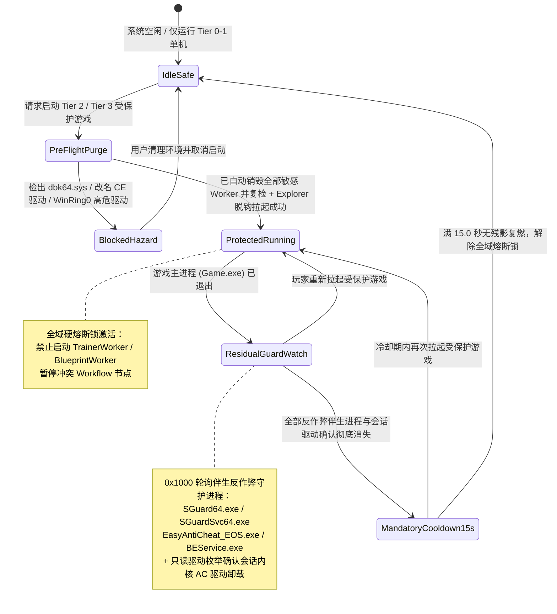

# SPAWN 跨进程通信与安全隔离契约（IPC & Security Contracts）

> **文档状态**：Active（M1 基线锁定；M3 v1.0 规划对齐零依赖 `NamedPipeJsonRpc`、倒置跨 IL 角色与分级按需提权，见 [ADR-0006](../decisions/0006-m3-external-trainer-manager-elevation-and-ipc.md)）
> **适用范围**：`.NET 10` `NamedPipeJsonRpc` 协议、跨完整性级别 ACL 访问控制与倒置角色鉴权、`MemoryMappedFile` 环形共享帧缓冲、CI `PEReader` 红线门禁、Explorer 血缘脱钩、15 秒反作弊退出冷却状态机、修改器会话急停看门狗与分级按需提权契约
> **关联文档**：[ADR-0003 反作弊与进程隔离](../decisions/0003-anti-cheat-guard-and-process-isolation.md) · [ADR-0006 修改器提权与 IPC](../decisions/0006-m3-external-trainer-manager-elevation-and-ipc.md) · [系统顶层架构](system-architecture.md) · [安全与数据规范](../dev-rules/data-and-security.md) · [Progress 模块规格](../modules/progress-saves-and-trainer.md)

---

## 1. 跨进程通信总则（Zero-TCP Local IPC）

除外部生态既有协议（GOG Galaxy 本地 `127.0.0.1:9977` Comet 监听与 `MaaFgo` 对 `BBChannel` 的 `127.0.0.1:25001/25002` 本地回环桥接）外，**SPAWN 自身隔离进程之间的内部通信严禁开启任何 TCP/UDP 监听端口**，一律采用：

1. **控制流与事件流**：`M2` 已实装的零依赖 **`NamedPipeJsonRpc`**（`src/Spawn.Core/NamedPipeJsonRpc.cs`：长度前缀帧 + `System.Text.Json` JSON-RPC 请求/响应/通知，基于 BCL `System.IO.Pipes`），微秒级内核对象传输、不触发 Windows 防火墙弹窗，不引入 Kestrel / `Grpc.*` 依赖。
2. **高频图像帧流**：基于本地会话命名空间 **`MemoryMappedFile` 无锁三缓冲环形帧槽**（用于蓝图调试 60FPS ROI 实时画面回传与可选图元共享，彻底消除大块字节数组序列化 GC 压力）。

---

## 2. `NamedPipeJsonRpc` 契约与跨完整性级别 ACL 规范

### 2.1 管道命名、角色与会话绑定

所有管道严格绑定当前 Windows 登录会话 ID（`Process.GetCurrentProcess().SessionId`）与运行身份（`spawn` / `spawn-dev`；自动化测试与 `SPAWN_DATA_DIR` 覆盖态使用 `spawn-test-ipc-*` 前缀并附数据根哈希）：

| 服务端进程 | 客户端进程 | 正式通道管道名（开发通道前缀替换为 `spawn-dev`） | 核心职责 |
| :--- | :--- | :--- | :--- |
| `Spawn.OverlayHost` | `Spawn.Host` | `spawn-ipc-<SessionId>-overlay` | 下发当前游戏成就 Schema、实时推送解锁弹窗事件、同步 `Alt+Z` 快捷检查点请求 |
| **`Spawn.Host`（倒置）** | **`Spawn.TrainerWorker`** | `spawn-ipc-<SessionId>-trainer-<128-bit 随机十六进制>`（每个修改器会话新建，单实例） | 托管外部修改器生命周期、转发 UI 热键开关至 `SendInput` 代理、上报子 PID 供 WASAPI 静音、反作弊紧急销毁熔断 |
| `Spawn.BlueprintWorker` | `Spawn.Host` | `spawn-ipc-<SessionId>-blueprint`（`M6` 若以 High IL 运行须改为倒置角色） | 加载/停止 `.spbp` 蓝图、回传发光激活节点与 `Pin Watch` 变量、下发断点与 `Step Over` 指令 |
| `Spawn.WorkflowWorker` | `Spawn.Host` | `spawn-ipc-<SessionId>-workflow`（`M5` 若以 High IL 运行须改为倒置角色） | 启动/中止二次元并发 DAG、流式回传各节点日志与进度、汇报战报生成结果 |

> **倒置角色铁律**：凡 Worker 可能以 High IL 运行，**一律由 Medium IL `Spawn.Host` 担任服务端、Worker 担任客户端**。Windows 强制完整性控制（MIC，`NO_WRITE_UP`）会在 DACL 检查前拒绝 Medium IL 客户端写入 High IL 服务端（`ERROR_ACCESS_DENIED`），而 High → Medium 写入天然放行，倒置后无需任何 SACL 强制标签 P/Invoke。

### 2.2 ACL、单实例与双向身份互验

1. **显式授予当前交互登录用户 SID**：通过 `WindowsIdentity.GetCurrent().User` 获取精确 `SecurityIdentifier` 授予读写（`AccessControlType.Allow`）。**严禁**对 `Everyone`（`WorldSid`）或 `AuthenticatedUsers` 开放写权限。
2. **显式拒绝网络横移访问**：强制添加 `PipeAccessRule(new SecurityIdentifier(WellKnownSidType.NetworkSid, null), PipeAccessRights.FullControl, AccessControlType.Deny)`，在内核 SMB 层封死局域网远程命名管道调用。
3. **修改器会话管道单实例防抢注**：`Spawn.Host` 为每个修改器会话以 `maxNumberOfServerInstances = 1` + `PipeOptions.FirstPipeInstance` 创建服务端（严禁沿用 `MaxAllowedServerInstances`），管道名含每会话 128-bit CSPRNG 后缀，**先建管道、后拉起 Worker**；同用户其他进程因单实例限制无法再创建同名实例。
4. **Host 校验客户端（Worker）**：
   - `GetNamedPipeClientProcessId` 必须等于 `ShellExecuteExW`（`SEE_MASK_NOCLOSEPROCESS`）或 `CreateProcessW` 返回的 Worker 进程 PID；
   - 以 `0x1000` + `QueryFullProcessImageNameW` 回读路径，必须等于 `<InstallDir>\Workers\Trainer\Spawn.TrainerWorker.exe`（源码运行态为对应构建输出目录）；
   - 首个握手帧必须携带启动参数中下发的 **256-bit 一次性 `LaunchNonce`**（恒定时间比较，用后即焚），任一不符立即断开并终止该 Worker。
5. **Worker 校验服务端（Host）**：`GetNamedPipeServerProcessId` 必须等于启动参数中的父 Host PID，且 `0x1000` 回读路径为同安装目录主程序（`spawn.exe` / `spawn-dev.exe` 或源码运行的 `Spawn.Host.exe`），否则 Worker 立即退出，杜绝同用户进程伪造服务端向 High IL Worker 下发指令。
6. **生命周期绑定**：Worker 以 `SYNCHRONIZE` 打开父 Host 进程句柄并监听管道断连；任一失效即自毁，内核 `KILL_ON_JOB_CLOSE` 连坐清场全部修改器进程。
7. **命令白名单（纵深防御）**：Worker 仅执行位于沙箱根 `vault\Sandbox\Trainers\` 内、且本地重算 SHA-256 与 Host 下发钉扎值一致的可执行文件；拒绝沙箱外路径、工作目录与任意命令行注入。

### 2.3 核心 JSON-RPC 方法契约摘要（`Spawn.Contracts`）

方法名采用 `<域>.<动作>` 小驼峰；请求/响应 DTO 定义于 `Spawn.Contracts`，`M3` 冻结修改器域，其余域在对应里程碑冻结：

| 方向 | 方法 / 通知 | 载荷要点 | 说明 |
| :--- | :--- | :--- | :--- |
| Worker → Host | `trainer.handshake` | `LaunchNonce`、`WorkerPid`、`WorkerIntegrityLevel`、协议版本 | 首帧鉴权，失败即断开 |
| Host → Worker | `trainer.launch` | `SessionId`、沙箱相对路径、钉扎 `Sha256`、工作目录、`HotkeyHoldMs`、`ExpectedArchitecture` | Worker 复核路径与哈希后以 `PROC_THREAD_ATTRIBUTE_JOB_LIST` 原子入组启动 |
| Host → Worker | `trainer.triggerHotkey` | `SessionId`、`EntryId`、`VirtualKey`、`Modifiers[]`、`ScanCodeMode`（默认 `false`） | `MAPVK_VK_TO_VSC_EX` + `EXTENDEDKEY` 交错按压 |
| Host → Worker | `trainer.setWindowVisibility` | `SessionId`、`Visible` | 显示/隐藏修改器原窗口（`ShowWindow`，不注入） |
| Host → Worker | `trainer.setAudioFallback` | `Pids[]`、`Mute`、`Volume` | 仅在 Host 侧 `SetMute` 返回 `E_ACCESSDENIED` 时启用的 Worker 侧回退 |
| Host → Worker | `trainer.stop` / `trainer.emergencyShutdown` | `SessionId` / `Reason` | 优雅 `WM_CLOSE` 等 `1500ms` / 急停 `500ms`，超时 `TerminateJobObject` |
| Worker → Host（通知） | `trainer.processCreated` / `trainer.sessionEnded` | 子 PID、映像路径 / 退出原因 | IOCP `NEW_PROCESS` 推送供 WASAPI 静音；`ACTIVE_PROCESS_ZERO` 判定结束 |
| Host → Overlay | `overlay.syncActiveGame` / `overlay.enqueueToast` | 见 [成就与 Overlay 规格](../modules/achievement-and-overlay.md) | `M2` 已实装 |

---

## 3. `MemoryMappedFile` 无锁三缓冲帧共享协议

为使主界面蓝图工作台以 60FPS 零延迟预览 `Spawn.BlueprintWorker` 捕获的 `WGC` 游戏帧及匹配框，双方通过内存映射文件（`Local\spawn-mmf-<SessionId>-bppreview`）按定长头部 + 三缓冲槽位无锁交换 BGRA32 像素数据：

```text
Offset   Size      Type       Field                  Description
-----------------------------------------------------------------------------------------
0x0000   4 Bytes   uint32     Magic                  固定魔数 0x5350464D ('SPFM')
0x0004   4 Bytes   uint32     Version                协议版本 = 1
0x0008   4 Bytes   int32      LatestCompletedSlot    原子写端最新写完槽位索引 (0, 1, 或 2)，经 Volatile.Write 发布
0x000C   4 Bytes   uint32     MaxSlotBytes           单个像素槽预分配最大字节容量 (如 3840*2160*4 = 33,177,600 B)
0x0010   64 Bytes  SlotMeta[0] { uint64 FrameSeq; uint32 Width; uint32 Height; uint32 Stride; uint32 PixelFormat; int64 RoiRectPacked; ... }
0x0050   64 Bytes  SlotMeta[1] 同上
0x0090   64 Bytes  SlotMeta[2] 同上
0x0100   MaxSlot   byte[]     SlotBuffer[0]          BGRA8888 连续像素行
...      MaxSlot   byte[]     SlotBuffer[1]
...      MaxSlot   byte[]     SlotBuffer[2]
```

**无锁读写同步协议**：
1. 写端（`BlueprintWorker`）挑选不等于当前 `LatestCompletedSlot` 的空闲槽位写入像素与 `SlotMeta`，先以递增奇数标记 `FrameSeq` 写中态，拷贝完成后发布偶数 `FrameSeq` 并通过 `Volatile.Write(ref header.LatestCompletedSlot, nextSlot)` 原子切换最新槽。
2. 读端（`Spawn.Host` `CompositionTarget.Rendering`）通过 `Volatile.Read` 读取 `LatestCompletedSlot`，校验写入前后 `FrameSeq` 恒定为同一偶数后直接拷贝入 `WriteableBitmap.BackBuffer`，全程零内核互斥锁阻塞。

---

## 4. CI `PEReader` 敏感导入表静态红线门禁

`tests/Spawn.Architecture.GateTests` 在每次本地构建与 GitHub Actions CI 中通过 `System.Reflection.PortableExecutable.PEReader` 与 `System.Reflection.Metadata.MetadataReader` 直接解析编译产出的 `Spawn.Host.dll`、`Spawn.Host.exe`、`Spawn.OverlayHost.dll`、`Spawn.OverlayHost.exe` 及它们传递引用的非系统业务程序集（含 `Spawn.Modules.Progress`）：

### 4.1 零容忍禁用 P/Invoke 导入符号清单（Clean Host Blacklist）

| 风险类别 | 严禁出现在 `Spawn.Host` 与 `Spawn.OverlayHost` 导入表中的原生函数 |
| :--- | :--- |
| **跨进程内存读写与执行** | `ReadProcessMemory`、`WriteProcessMemory`、`NtReadVirtualMemory`、`NtWriteVirtualMemory`、`VirtualAllocEx`、`VirtualProtectEx`、`CreateRemoteThread`、`CreateRemoteThreadEx`、`NtCreateThreadEx`、`QueueUserAPC`、`RtlCreateUserThread` |
| **进程调试与线程挂起篡改** | `DebugActiveProcess`、`NtSuspendProcess`、`NtResumeProcess`、`SuspendThread`、`SetThreadContext`、`GetThreadContext` |
| **全局钩子与输入伪造** | `SetWindowsHookExA`、`SetWindowsHookExW`、`SendInput`、`keybd_event`、`mouse_event` |
| **高危第三方程序集引用** | `Reloaded.*`（全仓禁止，`D-29`）、`MinHook`、`EasyHook`、`Nefarius.ViGEm.Client`、`Iced`、`Spawn.BlueprintWorker`、`Spawn.TrainerWorker`、`Spawn.WorkflowWorker` |

> **注**：单机应急工具箱中的离线 `NtSuspendProcess` 亦物理委托给仅在 `Tier 0` 下运行的短期辅助进程执行，确保 `Spawn.Host.exe` 常驻本体永不携带该导入符号。

### 4.2 `Spawn.TrainerWorker` `M3` 专属门禁与打包目录隔离

1. **`M3` Worker 零跨进程内存 API**：`Spawn.TrainerWorker` 编译产物同样禁止导入 §4.1 “跨进程内存读写与执行”与“进程调试与线程挂起篡改”两类符号，仅允许作业对象、IOCP、`SendInput` / `MapVirtualKeyW`、`PostMessageW` / `ShowWindow` 与只读进程查询；`M6` 引入原生修改后端时须先修订本节白名单与门禁断言。
2. **打包目录隔离**：`scripts/package.py` 将 `Spawn.TrainerWorker` 独立发布至 `stage_app\Workers\Trainer\`，严禁平铺于主程序根目录；`CleanHostArchitectureGateTests` 对主程序顶层目录全部 `.exe`/`.dll` 执行 IAT 扫描并断言 `Workers\` 子树不被 Clean Host 引用。

### 4.3 `0x1000` 最低权限进程查询规则

宿主内需要调用 `OpenProcess` 监控游戏存活或获取路径时，封装在唯一受审计辅助类 `SafeProcessInspector` 中，访问标志位编译期硬编码常量 `PROCESS_QUERY_LIMITED_INFORMATION (0x1000) | SYNCHRONIZE (0x00100000)`，配套 `QueryFullProcessImageNameW` 获取完整路径；严禁在全仓任何项目中声明 `PROCESS_VM_READ (0x0010)`、`PROCESS_VM_OPERATION (0x0008)` 或 `PROCESS_ALL_ACCESS`（`M6` 原生修改后端例外须仅限 `Spawn.TrainerWorker` 并经门禁白名单登记）。

---

## 5. Explorer Shell COM 切断父子血缘、15 秒反作弊冷却与修改器急停

### 5.1 Explorer 委派脱钩启动机制

当目标游戏判定为 `Tier 2` 或 `Tier 3` 时，`Spawn.Modules.Launcher` 严禁直接调用 `Process.Start`：
1. 在 STA 线程获取当前交互桌面的 `ShellWindows` COM 集合，定位桌面外壳窗口（`SWC_DESKTOP`）对应的 `IShellDispatch2` 接口实例。
2. 调用 `IShellDispatch2.ShellExecute(exePath, args, workingDir, "open", SW_SHOWNORMAL)`。
3. 操作系统由系统常驻 `explorer.exe` 直接派生游戏进程：游戏进程的 `InheritedFromUniqueProcessId`（PPID）天然指向 `explorer.exe`，环境变量块取自纯净用户桌面会话，与 `Spawn.Host.exe` 零句柄继承关系。
4. 随后切换至 35 秒周期（前台切出事件辅助唤醒）的 `0x1000` 目录前缀匹配追踪器记录在线游玩时长。
5. **启动前自动清场（`LOOP-06`）**：放行前经 `ISensitiveWorkerShutdownHook` 自动销毁 `Spawn.TrainerWorker`（`WM_CLOSE` 等 `500ms` → `TerminateJobObject` → 确认消亡，上限 `2s`），并以沙箱路径前缀探针兜底孤儿进程、二次净场复检；用户自启的第三方工具（如 Cheat Engine）绝不强杀，仍以 `HIGH_RISK_ENVIRONMENT_BLOCKED` 阻断并说明。

### 5.2 反作弊守卫状态机与 15 秒残影强制冷却（Post-Exit Cooldown）



### 5.3 修改器启动硬验票与会话期急停看门狗（`D-27`）

1. **启动前双重硬验票**：每次启动修改器前，Host 与 Worker 分别独立确认：守卫阶段为 `IdleSafe`；目标游戏为 `Tier 0`，或为具备单人模式的 `Tier 2` 且已由玩家显式确认 `VerifiedOfflineBypass`（静态 `AntiCheatTier` 不被改写）；扩展反作弊守护进程数为 `0`；会话内核反作弊驱动（`EasyAntiCheat_EOS.sys`、`BEDaisy.sys`、`ACE-BASE.sys`、`ACE-GAME.sys`、`randgrid.sys`、`HoYoKProtect.sys`、`xhunter1.sys`、`NeacSafe64.sys` 等）为 `0`。`vgk.sys` 伴随活跃 `vgc.exe` 时硬拦；仅空闲驻留时 UI 显示橙色警示（“严格模式”开启时一律禁启）。
2. **会话期 2 秒急停看门狗**：仅在存在活跃修改器会话时运行，每 2 秒执行一次只读 `0x1000` 进程枚举 + 驱动枚举（无会话时 0 轮询，满足 `NFR-01`）；检出任何反作弊进程/驱动或任何 `Tier 2/3` 游戏启动时，`<500ms` 内经 `trainer.emergencyShutdown` 销毁 Worker 与全部修改器，并将守卫置于相应锁定态。
3. **改名 CE 驱动识别**：只读读取 SCM 活跃驱动 `ImagePath` 对应 `.sys` 的 `FileVersionInfo`（`OriginalFilename` / `InternalName` / `ProductName` / `FileDescription` 命中 `dbk64.sys` / `dbk32.sys` / `DBK` / `Cheat Engine`）与 `QueryDosDeviceW` 精确 `CEDRIVER*` 前缀；否决泛化拦截未签名驱动。

---

## 6. 分级按需提权与 `ZBID_UIACCESS` 本地瞬态签名契约

### 6.1 High IL Worker 分级按需提权（替代原计划任务静默提权，`D-11` / [ADR-0006](../decisions/0006-m3-external-trainer-manager-elevation-and-ipc.md)）

`M2` 起 SPAWN 按 `D-23` 以 `PrivilegesRequired=lowest` 安装至当前用户可写的 `%LOCALAPPDATA%\Programs\spawn[-dev]\`。任何指向该目录（或加载该目录 DLL 闭包）的高权限计划任务都构成无 UAC 本地提权（LPE），因此：

| 级别 | 触发条件 | 拉起方式 | UAC 次数 |
| :--- | :--- | :--- | :--- |
| **Level 1** | 修改器 PE 清单未声明 `requireAdministrator` 且目标游戏为 Medium IL | `Spawn.Host` 以 `CreateProcessW` 直接启动 Medium IL `Spawn.TrainerWorker.exe` | 0 |
| **Level 2（`M3` 默认）** | 修改器声明 `requireAdministrator`，或目标游戏以 High IL 运行（UIPI 会静默吞掉 Medium → High `SendInput`） | `ShellExecuteExW`（`Verb = "runas"`、`SEE_MASK_NOCLOSEPROCESS`）拉起 High IL Worker，修改器作为其子进程继承 High IL | 每个修改器会话 1 次 |
| **Level 3（`LOOP-07`，顺延）** | 未来发布 100% 自包含、受管理员 ACL 保护的 `%ProgramFiles%\SPAWN\Worker\` 提权包 | 绑定精确路径与当前交互用户（`InteractiveToken`、`HighestAvailable`）的计划任务 + 启动前 PE 哈希白名单 | 0（仅首次安装授权） |

硬约束：
1. UAC 仅由用户显式点击“启动修改器”触发，严禁在 SPAWN 启动、扫描、后台轮询或自动化测试中弹出；用户取消 UAC 视为正常取消，不重试、不降级为其他提权手段。
2. **严禁**为 `%LOCALAPPDATA%` 下任何文件注册高权限计划任务；**否决** `SYSTEM` Windows 服务（Session 0 隔离破坏 `SendInput` 且扩大攻击面）。
3. Defender 沙箱单目录排除助手同样走 Level 2 单次 UAC：预读 `TPExclusions` / `ManagedDefenderProductType` → 用户确认 → WMI `MSFT_MpPreference.Add` 仅排除 `vault\Sandbox\Trainers\` → **强制回读 `ExclusionPath` 核验**；失败（篡改保护静默拒绝、第三方杀软接管、Smart App Control 拦截）时降级为“复制沙箱路径 + 用户点击打开 `windowsdefender://exclusions`”分类引导，严禁关闭实时保护、篡改保护或 Smart App Control，严禁静默剥离用户导入文件的 `Zone.Identifier`。

### 6.2 `Spawn.OverlayHost` 本地瞬态自签名与 `ZBID_UIACCESS` 特权获取

Windows 内核 `win32kfull.sys` 规定，仅同时满足以下三项条件的进程方可获得高于常规无边框全屏窗口的 `ZBID_UIACCESS` Z-Order 窗口带：
1. 应用清单声明 `<requestedExecutionLevel level="asInvoker" uiAccess="true" />`；
2. 可执行文件使用链接至本机 `LocalMachine\Root` 信任锚的数字证书签名；
3. 可执行文件物理位于 `%ProgramFiles%\`（或 `%SystemRoot%\`）受保护目录。

**零私钥泄漏风险的本地瞬态签发流程**：
1. 在安装程序（Inno Setup）或设置页的“一键启用全屏置顶图层”向导中，在进程内存瞬态生成唯一 `RSA-4096`（`SHA-256`）密钥对与 `CN=SPAWN Local UIAccess Authority (<MachineGuid>)` 自签名证书（有效期 10 年，限定增强型密钥用法 `Code Signing 1.3.6.1.5.5.7.3.3`）。
2. 将**仅含公钥**的 `.cer` 证书导入本机 `LocalMachine\Root` 受信任根证书存储区。
3. 调用内存签名管线（或系统 `signtool.exe` 配合瞬态内存 PFX）对 `%ProgramFiles%\spawn\Overlay\Spawn.OverlayHost.exe` 完成 Authenticode 签名。
4. **立即清零并销毁内存中的 RSA 私钥且永不落盘**：任何外部恶意程序即便入侵用户磁盘也绝无可能盗用该根证书签发其他程序；卸载 SPAWN 时自动按证书指纹从 `LocalMachine\Root` 干净移除该公钥证书。
