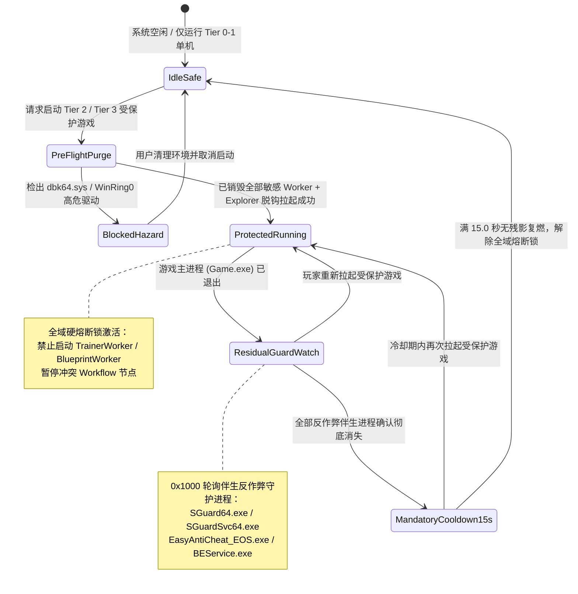

# SPAWN 跨进程通信与安全隔离契约（IPC & Security Contracts）

> **文档状态**：Active（M1 基线锁定）
> **适用范围**：`.NET 10` `gRPC over Named Pipes` 协议、跨完整性级别 SDDL 访问控制、`MemoryMappedFile` 环形共享帧缓冲、CI `PEReader` 红线门禁、Explorer 血缘脱钩、15 秒反作弊退出冷却状态机与静默提权契约
> **关联文档**：[ADR-0003 反作弊与进程隔离](../decisions/0003-anti-cheat-guard-and-process-isolation.md) · [系统顶层架构](system-architecture.md) · [安全与数据规范](../dev-rules/data-and-security.md)

---

## 1. 跨进程通信总则（Zero-TCP Local IPC）

除外部生态既有协议（GOG Galaxy 本地 `127.0.0.1:9977` Comet 监听与 `MaaFgo` 对 `BBChannel` 的 `127.0.0.1:25001/25002` 本地回环桥接）外，**SPAWN 自身六大隔离进程之间的内部通信严禁开启任何 TCP/UDP 监听端口**，一律采用：

1. **控制流与事件流**：基于 `.NET 10` 原生 `Kestrel` + `Grpc.Net.Client` 构建 **`gRPC over Windows Named Pipes`**（双向流式 Protobuf RPC，微秒级内核对象传输，不触发 Windows 防火墙弹窗）。
2. **高频图像帧流**：基于本地会话命名空间 **`MemoryMappedFile` 无锁三缓冲环形帧槽**（用于蓝图调试 60FPS ROI 实时画面回传与可选图元共享，彻底消除大块字节数组序列化 GC 压力）。

---

## 2. `gRPC over Named Pipes` 契约与跨完整性级别 SDDL 规范

### 2.1 管道命名与会话绑定

所有管道严格绑定当前 Windows 登录会话 ID（`Process.GetCurrentProcess().SessionId`）与运行通道（`spawn` vs `spawn-dev`）：

| 服务端进程 | 客户端进程 | 正式通道管道名（开发通道前缀替换为 `spawn-dev`） | 核心职责 |
| :--- | :--- | :--- | :--- |
| `Spawn.OverlayHost` | `Spawn.Host` | `\\.\pipe\spawn-ipc-<SessionId>-overlay` | 下发当前游戏成就 Schema、实时推送解锁弹窗事件、同步 `Alt+Z` 快捷检查点请求 |
| `Spawn.BlueprintWorker` | `Spawn.Host` | `\\.\pipe\spawn-ipc-<SessionId>-blueprint` | 加载/停止 `.spbp` 蓝图、实时双向流回传发光激活节点与 `Pin Watch` 变量、下发断点与 `Step Over` 指令 |
| `Spawn.TrainerWorker` | `Spawn.Host` | `\\.\pipe\spawn-ipc-<SessionId>-trainer` | 托管外部 FLiNG 生命周期、转发 UI 热键开关至 35ms 硬件扫描码、反作弊紧急销毁熔断 |
| `Spawn.WorkflowWorker` | `Spawn.Host` | `\\.\pipe\spawn-ipc-<SessionId>-workflow` | 启动/中止二次元并发 DAG、流式回传各节点日志与进度、汇报战报生成结果 |

### 2.2 跨完整性级别（High IL <-> Medium IL）SDDL 授权规范

当 `Spawn.BlueprintWorker`、`Spawn.TrainerWorker` 或 `Spawn.WorkflowWorker` 以管理员权限（`High IL`）运行作为命名管道服务端时，Windows 默认 DACL 会拦截运行于普通权限（`Medium IL`）的 `Spawn.Host.exe` 连接请求。所有 Worker 管道服务端**必须**使用 `NamedPipeServerStreamAcl` 自定义 `PipeSecurity`：

1. **显式授予当前交互登录用户 SID**：通过 `WindowsIdentity.GetCurrent().User` 获取精确 `SecurityIdentifier`，授予 `PipeAccessRights.ReadWrite | PipeAccessRights.CreateNewInstance`（`AccessControlType.Allow`）。**严禁**对 `Everyone` (`WorldSid`) 或 `AuthenticatedUsers` 开放写权限。
2. **显式拒绝网络横移访问**：强制添加一条 `PipeAccessRule(new SecurityIdentifier(WellKnownSidType.NetworkSid, null), PipeAccessRights.FullControl, AccessControlType.Deny)`，在内核 SMB 层彻底封死局域网远程命名管道调用。
3. **客户端进程身份互验**：连接建立后的首个握手帧校验对端命名管道客户端 PID（`GetNamedPipeClientProcessId`），通过 `0x1000` 受限权限回读可执行文件完整路径，确认归属同一安装目录并携带匹配的一次性随机启动令牌（Launch Nonce）。

### 2.3 核心 Protobuf 服务接口契约摘要（`Spawn.Contracts`）

```protobuf
syntax = "proto3";
package spawn.contracts.v1;

// 通用宿主监管与紧急熔断服务（所有 Worker 必须实现）
service WorkerLifecycleService {
  rpc Handshake (HandshakeRequest) returns (HandshakeReply);
  rpc Heartbeat (HeartbeatPing) returns (HeartbeatPong);
  // Anti-Cheat Guard 触发 Tier 2/3 启动前毫秒级排空并销毁 Worker
  rpc EmergencyDrainAndExit (EmergencyExitRequest) returns (EmergencyExitAck);
}

// 蓝图执行与发光单步调试双向流服务
service BlueprintDebugService {
  rpc StartGraph (StartGraphRequest) returns (StartGraphReply);
  rpc ControlExecution (DebugControlCommand) returns (DebugControlAck); // Pause / Resume / StepOver / ToggleBreakpoint
  rpc SubscribeTelemetry (TelemetrySubscription) returns (stream BlueprintRuntimeEvent);
}

message BlueprintRuntimeEvent {
  uint64 sequence = 1;
  string active_node_id = 2;             // 驱动 Nodify 画布对应节点外发光脉冲
  bool is_paused_at_breakpoint = 3;
  map<string, string> pin_watch_values = 4; // 断点或悬停引脚实时求值快照 (如置信度 "0.94", 坐标 "(1280, 720)")
  string diagnostic_message = 5;
}

// 修改器沙箱与热键代理服务（仅限 Tier 0）
service TrainerControlService {
  rpc LaunchSandboxTrainer (TrainerLaunchRequest) returns (TrainerStatusReply);
  rpc TriggerOptionToggle (TrainerToggleRequest) returns (TrainerToggleReply); // 触发 35ms 硬件扫描码或二期 .CT 项
  rpc TerminateAllTrainers (TerminateRequest) returns (TerminateAck);
}

// 游戏内高刷 Overlay 调度服务
service OverlayDispatchService {
  rpc SyncActiveGameContext (ActiveGameContext) returns (DispatchAck);
  rpc EnqueueAchievementToast (AchievementToastPayload) returns (DispatchAck);
  rpc SubscribeOverlayActions (OverlaySubscription) returns (stream OverlayUserAction); // Alt+Z 快捷快照 / 离线暂停请求
}
```

---

## 3. `MemoryMappedFile` 无锁三缓冲帧共享协议

为使主界面蓝图工作台以 60FPS 零延迟预览 `Spawn.BlueprintWorker` 捕获的 `WGC` 游戏帧及匹配框，双方通过内存映射文件（`Local\spawn-mmf-<SessionId>-bppreview`）按定长头部 + 三缓冲槽位无锁交换 BGRA32 像素数据：

```text
Offset   Size      Type       Field                  Description
-----------------------------------------------------------------------------------------
0x0000   4 Bytes   uint32     Magic                  固定魔数 0x5350464D ('SPFM')
0x0004   4 Bytes   uint32     Version                协议版本 = 1
0x0008   4 Bytes   int32      LatestCompletedSlot    原子写端最新写完槽位索引 (0, 1, 或 2)，经 Volatile.Write 发布
0x000C   4 Bytes   uint32     MaxSlotBytes           单个像素槽预分配最大字节容量 (如 3840*2160*4 = 33,177,600 B)
0x0010   64 Bytes  SlotMeta[0] { uint64 FrameSeq; uint32 Width; uint32 Height; uint32 Stride; uint32 PixelFormat; int64 RoiRectPacked; ... }
0x0050   64 Bytes  SlotMeta[1] 同上
0x0090   64 Bytes  SlotMeta[2] 同上
0x0100   MaxSlot   byte[]     SlotBuffer[0]          BGRA8888 连续像素行
...      MaxSlot   byte[]     SlotBuffer[1]
...      MaxSlot   byte[]     SlotBuffer[2]
```

**无锁读写同步协议**：
1. 写端（`BlueprintWorker`）挑选不等于当前 `LatestCompletedSlot` 的空闲槽位写入像素与 `SlotMeta`，先以递增奇数标记 `FrameSeq` 写中态，拷贝完成后发布偶数 `FrameSeq` 并通过 `Volatile.Write(ref header.LatestCompletedSlot, nextSlot)` 原子切换最新槽。
2. 读端（`Spawn.Host` `CompositionTarget.Rendering`）通过 `Volatile.Read` 读取 `LatestCompletedSlot`，校验写入前后 `FrameSeq` 恒定为同一偶数后直接拷贝入 `WriteableBitmap.BackBuffer`，全程零内核互斥锁阻塞。

---

## 4. CI `PEReader` 敏感导入表静态红线门禁

`tests/Spawn.Architecture.GateTests` 在每次本地构建与 GitHub Actions CI 中通过 `System.Reflection.PortableExecutable.PEReader` 与 `System.Reflection.Metadata.MetadataReader` 直接解析编译产出的 `Spawn.Host.dll`、`Spawn.Host.exe`、`Spawn.OverlayHost.dll`、`Spawn.OverlayHost.exe` 及它们传递引用的非系统业务程序集：

### 4.1 零容忍禁用 P/Invoke 导入符号清单（Clean Host Blacklist）

| 风险类别 | 严禁出现在 `Spawn.Host` 与 `Spawn.OverlayHost` 导入表中的原生函数 |
| :--- | :--- |
| **跨进程内存读写与执行** | `ReadProcessMemory`、`WriteProcessMemory`、`NtReadVirtualMemory`、`NtWriteVirtualMemory`、`VirtualAllocEx`、`VirtualProtectEx`、`CreateRemoteThread`、`CreateRemoteThreadEx`、`NtCreateThreadEx`、`QueueUserAPC`、`RtlCreateUserThread` |
| **进程调试与线程挂起篡改** | `DebugActiveProcess`、`NtSuspendProcess`、`NtResumeProcess`、`SuspendThread`、`SetThreadContext`、`GetThreadContext` |
| **全局钩子与输入伪造** | `SetWindowsHookExA`、`SetWindowsHookExW`、`SendInput`、`keybd_event`、`mouse_event` |
| **高危第三方程序集引用** | `Reloaded.Hooks`、`MinHook`、`EasyHook`、`Nefarius.ViGEm.Client`、`Spawn.BlueprintWorker`、`Spawn.TrainerWorker`、`Spawn.WorkflowWorker` |

> **注**：单机应急工具箱中的离线 `NtSuspendProcess` 亦物理委托给仅在 `Tier 0` 下运行的短期辅助进程执行，确保 `Spawn.Host.exe` 常驻本体永不携带该导入符号。

### 4.2 `0x1000` 最低权限进程查询规则

宿主内需要调用 `OpenProcess` 监控游戏存活或获取路径时，封装在唯一受审计辅助类 `SafeProcessProbe` 中，访问标志位编译期硬编码常量 `PROCESS_QUERY_LIMITED_INFORMATION (0x1000) | SYNCHRONIZE (0x00100000)`，配套 `QueryFullProcessImageNameW` 获取完整路径；严禁在全仓任何非 `TrainerWorker` 项目中声明 `PROCESS_VM_READ (0x0010)`、`PROCESS_VM_OPERATION (0x0008)` 或 `PROCESS_ALL_ACCESS`。

---

## 5. Explorer Shell COM 切断父子血缘与 15 秒反作弊冷却状态机

### 5.1 Explorer 委派脱钩启动机制

当目标游戏判定为 `Tier 2` 或 `Tier 3` 时，`Spawn.Modules.Launcher` 严禁直接调用 `Process.Start`：
1. 在 STA 线程获取当前交互桌面的 `ShellWindows` COM 集合，定位桌面外壳窗口（`SWC_DESKTOP`）对应的 `IShellDispatch2` 接口实例。
2. 调用 `IShellDispatch2.ShellExecute(exePath, args, workingDir, "open", SW_SHOWNORMAL)`。
3. 操作系统由系统常驻 `explorer.exe` 直接派生游戏进程：游戏进程的 `InheritedFromUniqueProcessId`（PPID）天然指向 `explorer.exe`，环境变量块取自纯净用户桌面会话，与 `Spawn.Host.exe` 零句柄继承关系。
4. 随后切换至 35 秒周期（前台切出事件辅助唤醒）的 `0x1000` 目录前缀匹配追踪器记录在线游玩时长。

### 5.2 反作弊守卫状态机与 15 秒残影强制冷却（Post-Exit Cooldown）



---

## 6. 免 UAC 弹窗静默提权与 `ZBID_UIACCESS` 本地瞬态签名契约

### 6.1 计划任务单次授权静默拉起 High IL Worker

为避免每次启动管理员权限单机游戏时弹出刺眼的 UAC 提权确认框，同时坚守 `Spawn.Host.exe` 运行于 `Medium IL` 的安全原则：
1. **单次引导注册**：用户首次启用需要 High IL 的模块（修改器沙箱或面向管理员游戏的蓝图执行器）时，由一次性提权安装助手在系统计划任务库 `\SPAWN\` 命名空间下创建受限任务 `Spawn_Worker_Launcher`。
2. **防提权劫持硬约束**：
   - 计划任务 `<Command>` 硬编码绑定受 ACL 保护的 `%ProgramFiles%\spawn\Spawn.WorkerBootstrap.exe` 绝对安装路径（普通非管理员进程无权篡改该目录下二进制文件），且启动前校验目标 Worker 的 PE 哈希白名单；
   - `<Principal>` 显式限定当前交互登录用户 SID（`LogonType = InteractiveToken`, `RunLevel = HighestAvailable`），禁止 `SYSTEM` 账户执行。
3. **运行期静默唤醒**：`Spawn.Host` 通过 Task Scheduler COM 接口传递一次性管道会话令牌触发该任务，在 `<150ms` 内静默拉起 High IL Worker 并完成 SDDL 命名管道双向握手。

### 6.2 `Spawn.OverlayHost` 本地瞬态自签名与 `ZBID_UIACCESS` 特权获取

Windows 内核 `win32kfull.sys` 规定，仅同时满足以下三项条件的进程方可获得高于常规无边框全屏窗口的 `ZBID_UIACCESS` Z-Order 窗口带：
1. 应用清单声明 `<requestedExecutionLevel level="asInvoker" uiAccess="true" />`；
2. 可执行文件使用链接至本机 `LocalMachine\Root` 信任锚的数字证书签名；
3. 可执行文件物理位于 `%ProgramFiles%\`（或 `%SystemRoot%\`）受保护目录。

**零私钥泄漏风险的本地瞬态签发流程**：
1. 在安装程序（Inno Setup）或设置页的“一键启用全屏置顶图层”向导中，在进程内存瞬态生成唯一 `RSA-4096`（`SHA-256`）密钥对与 `CN=SPAWN Local UIAccess Authority (<MachineGuid>)` 自签名证书（有效期 10 年，限定增强型密钥用法 `Code Signing 1.3.6.1.5.5.7.3.3`）。
2. 将**仅含公钥**的 `.cer` 证书导入本机 `LocalMachine\Root` 受信任根证书存储区。
3. 调用内存签名管线（或系统 `signtool.exe` 配合瞬态内存 PFX）对 `%ProgramFiles%\spawn\Overlay\Spawn.OverlayHost.exe` 完成 Authenticode 签名。
4. **立即清零并销毁内存中的 RSA 私钥且永不落盘**：任何外部恶意程序即便入侵用户磁盘也绝无可能盗用该根证书签发其他程序；卸载 SPAWN 时自动按证书指纹从 `LocalMachine\Root` 干净移除该公钥证书。
