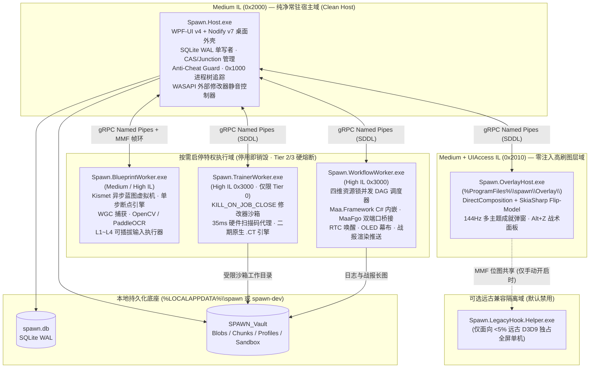
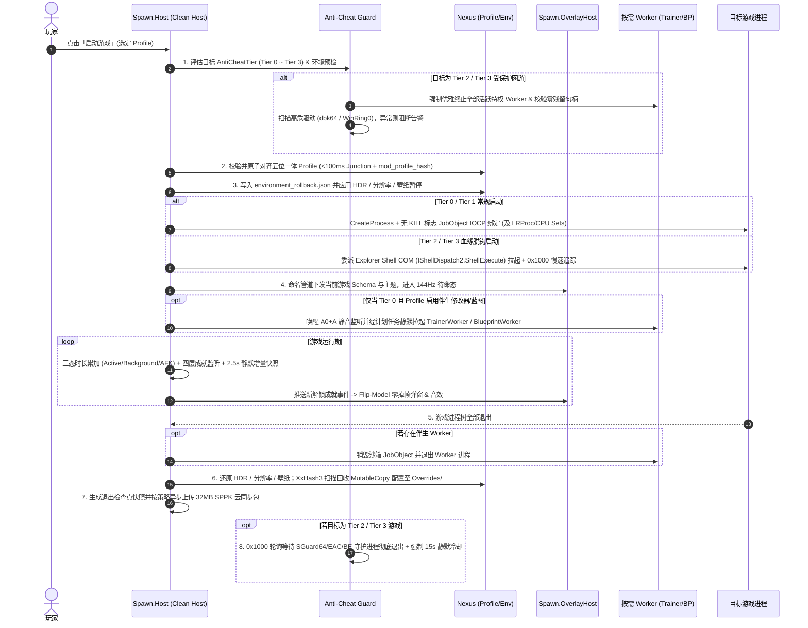

# SPAWN 系统顶层架构正本（System Architecture）

> **文档状态**：Active（M1 基线锁定）
> **适用范围**：多进程完整性隔离拓扑、解决方案程序集依赖边界、跨模块协同流水线与四级反作弊全局联锁矩阵
> **关联文档**：[产品需求正本](../requirements/product-requirements.md) · [ADR-0002 UI 技术栈](../decisions/0002-pure-native-wpf-and-nodify-ui-stack.md) · [ADR-0003 反作弊隔离](../decisions/0003-anti-cheat-guard-and-process-isolation.md) · [数据模型正本](data-model.md) · [IPC 与安全契约](ipc-and-security-contracts.md) · [交互与工作流](interaction-and-workflows.md)

---

## 1. 架构设计哲学

SPAWN 的顶层系统架构围绕三大不可妥协的工程准则构建：

1. **物理进程与完整性级别（Integrity Level）强隔离**：将常驻桌面管理外壳（`Medium IL`）与按需运行的特权/敏感执行器（`UIAccess IL`、`High IL`）从可执行文件边界彻底切开。常驻宿主永远不加载、不引用任何可能引发内核反作弊警觉的 Win32 API 或第三方库。
2. **数据不可变与预写日志自愈（Crash-Only Durability）**：无论是存档时间机器、Mod 硬链接与顶层 NTFS Junction 切换，还是 HDR/分辨率系统环境接管，一切副作用变更必先持久化回滚/前滚事务日志，任意时刻断电重启均可幂等恢复一致态。
3. **单一真相源与跨模块事件联动**：以本地 `spawn.db`（SQLite WAL）与内容寻址仓库 `SPAWN_Vault` 为底座，通过强类型领域事件总线与 `gRPC over Named Pipes` 将启动器、存档、成就、自动化工作流与 Mod Profile 编织为一个有机协同整体。

---

## 2. 全景多进程隔离拓扑

### 2.1 六大运行域拓扑图



### 2.2 进程职责、权限边界与生存期矩阵

| 可执行文件 | 运行完整性级别（IL） | 核心职责 | 静态导入表（IAT）禁区 | 生命周期策略 |
| :--- | :--- | :--- | :--- | :--- |
| `Spawn.Host.exe` | `Medium IL (0x2000)` | 主窗口 UI、海报墙、蓝图画布编辑、`spawn.db` 唯一写端、Mod 硬链接与 Junction 事务、存档 `FastCDC` 备份与 `SPPK` 云同步、`0x1000` 进程追踪、WASAPI 会话静音、反作弊守卫 | **严禁**出现 `ReadProcessMemory`、`WriteProcessMemory`、`VirtualAllocEx`、`CreateRemoteThread`、`NtSuspendProcess`、`SetWindowsHookEx`、`SendInput`、`mouse_event` 及任何 Hook/虚拟驱动库 | 随桌面会话常驻或最小化至原生 XAML 系统托盘；支持资源管理器直接拖拽导入 Mod/存档包 |
| `Spawn.OverlayHost.exe` | `Medium + UIAccess IL (0x2010)` | 游戏内 144Hz 成就解锁弹窗队列渲染、`Alt+Z` 与手柄呼出交互式面板、防穿透遮罩与 `ClipCursor` 光标边界软接管 | 与 `Spawn.Host.exe` 执行同等严格的 CI `PEReader` 黑名单门禁；**严禁向任何游戏进程打开句柄或注入模块** | 游戏运行态按需驻留（无弹窗时零重绘休眠），全部游戏退出后可自动回收释放显存 |
| `Spawn.BlueprintWorker.exe` | `Medium IL`（目标管理员游戏时经计划任务静默拉起 `High IL`） | 解析执行 `.spbp` 蓝图 AST、异步 Kismet 循环与断点挂起、`WGC` 帧捕获、`OpenCvSharp4` / `PaddleOCR` 推理、`RawInput` 监听及 `L1~L4` 输入动作投递 | 允许引用 `SendInput`、`ViGEmClient` 与视觉推理库；严禁内存篡改 API | 仅在用户激活蓝图运行或调试时拉起；停止脚本或触发 `Tier 2/3` 游戏启动前立即销毁 |
| `Spawn.TrainerWorker.exe` | `High IL (0x3000)` | 管理 `SPAWN_Vault\Sandbox\Trainers\` 隔离目录、通过 `KILL_ON_JOB_CLOSE` 作业对象托管外部 FLiNG 进程、发送小键盘硬件扫描码代理、承载二期 `.CT` 内存后端 | 允许在 `Tier 0` 单机授权下调用硬件扫描码输入及二期受控进程内存 API | **仅在 `AntiCheatTier == Tier 0` 且全域无 `Tier 2/3` 进程/冷却锁时允许存在**；游戏退出同步连带销毁整个沙箱作业树 |
| `Spawn.WorkflowWorker.exe` | `High IL (0x3000)` | 二次元四维资源锁并发 DAG 调度、内嵌 `Maa.Framework` C#、`MAA` 配置预写、`MaaFgo+BBChannel` 双端口桥接、PC 二次元 CLI 统管、RTC 唤醒与战报推送 | 允许调用模拟器 ADB、标准进程 I/O 重定向与电源唤醒 API | 定时收菜计划触发或手动执行流水线时拉起；流水线全部收尾后自动优雅退出 |
| `Spawn.LegacyHook.Helper.exe` | 按目标进程位宽隔离 | 针对 `<5%` 不支持 DWM 合成的远古 DirectX 9 硬件独占全屏离线游戏提供可选共享纹理叠层 | 物理隔离于独立可选组件目录，默认安装包不启用 | 默认禁用；仅用户在特定 `Tier 0` 老游戏属性页显式勾选确认风险后单次伴生运行 |

---

## 3. 解决方案（`Spawn.sln`）物理程序集分层

为从编译器层面杜绝跨层污染，M2 建立的 `.NET 10`（`net10.0` / `net10.0-windows10.0.26100.0`）解决方案严格划分为以下项目边界：

```text
Spawn.sln
├── src/
│   ├── Spawn.Contracts/                 # 零业务依赖契约层：Protobuf (.proto)、IPC DTO、共享内存结构体、枚举定义
│   ├── Spawn.Core/                      # 纯净基础设施：SQLite WAL 访问层、FastCDC、BLAKE3/XxHash3、SPPK、NTFS 硬链接/Junction、DPAPI、日志与双通道路径解析
│   ├── Spawn.Modules.Launcher/          # Spawn 领域逻辑：0x1000 进程追踪、三态计时、CCD HDR/分辨率回滚、三级元数据刮削、Anti-Cheat Guard 状态机
│   ├── Spawn.Modules.Nexus/             # Nexus 领域逻辑：引擎加载器适配、五位一体 Profile 切换事务、WOF 熵值压缩、超分签名替换、Sunshine 协同
│   ├── Spawn.Modules.Progress/          # Progress 纯净侧逻辑：Ludusavi 规则引擎、存档快照/回滚、云同步后端、FLiNG 检索解析、WASAPI 会话静音控制器
│   ├── Spawn.Modules.Achievement/       # Achievement 纯净侧逻辑：15+ 模拟器与 GOG/Steam 解析器、四层防漏监听器、gbe_fork 赋能器、Schema 瀑布流
│   ├── Spawn.Modules.Workflow/          # Workflow 纯净侧逻辑：DAG 编排模型、interface.json 表单元数据映射、蓝图图模型序列化 (.spbp)
│   ├── Spawn.Host/                      # 主桌面进程 (WPF-UI + Nodify)：聚合上述纯净模块，受 PEReader 红线门禁严格保护
│   ├── Spawn.OverlayHost/               # 独立图层进程 (DirectComposition + SkiaSharp)：同样受 PEReader 红线门禁严格保护
│   ├── Spawn.BlueprintWorker/           # 独立蓝图执行进程：Kismet VM + WGC/OpenCV/PaddleOCR + L1~L4 输入执行器
│   ├── Spawn.TrainerWorker/             # 独立修改器沙箱进程：ITrainerBackend (一期 ExternalFlingBackend + 二期 NativeCheatTableBackend)
│   └── Spawn.WorkflowWorker/            # 独立二次元调度进程：Maa.Framework 绑定 + MaaFgo 双端口客户端 + CLI 适配器 + 战报合成
└── tests/
    ├── Spawn.Architecture.GateTests/    # CI 架构门禁测试：PEReader 导入表黑名单扫描、程序集依赖图无环与隔离断言
    ├── Spawn.Core.Tests/                # 存储与算法单测：FastCDC 确定性切分、SPPK 封包校验、Junction 安全卸载、DPAPI 加解密
    ├── Spawn.Achievement.Tests/         # 15+ 模拟器与 Binary VDF / GOG 黄金样本集解析测试
    └── Spawn.Integration.Tests/         # 后台静默集成测试：Named Pipe SDDL 鉴权、反作弊 15s 冷却状态机、崩溃回滚自愈验证
```

> **编译期硬约束**：`Spawn.Host.csproj` 与 `Spawn.OverlayHost.csproj` **严禁**添加对 `Spawn.BlueprintWorker`、`Spawn.TrainerWorker`、`Spawn.WorkflowWorker` 的 `ProjectReference`，跨进程交互仅允许通过 `Spawn.Contracts` 通讯。

---

## 4. 跨模块全生命周期协同流水线

当玩家在 SPAWN 中点击启动一款游戏直至退出归档时，五大领域模块按确定性阶段状态机协同运转：



---

## 5. 四级反作弊（`AntiCheatTier`）全局联锁矩阵

`Anti-Cheat Guard` 是横跨所有模块的最高优先级安全仲裁器。任何特权功能在执行前必须通过 `IAntiCheatGuard.EnsurePermitted(gameId, capability)` 同步校验：

| 安全等级 | 典型游戏与特征识别依据 | 游戏启动方式与追踪 | Achievement / Overlay | Nexus (Mod / 超分 / 应急) | Progress (存档 / 修改器) | Workflow / Blueprint |
| :--- | :--- | :--- | :--- | :--- | :--- | :--- |
| **`Tier 0`**<br>纯离线单机 | 无反作弊特征且声明离线单机（Galgame、离线 RPG、模拟器单机） | 直接启动 + 无强杀标志 `JobObject` IOCP + CPU Sets | 全功能开放（15+ 模拟器监听、`gbe_fork` 赋能、`ZBID_UIACCESS` 面板） | 全功能开放（硬链接 Mod、DLSS 签名替换、WOF 压缩、`NtSuspendProcess` 急冻） | 全功能开放（`FastCDC` 快照、外部 FLiNG 沙箱管家、二期 `.CT` 引擎） | 全功能开放（`L1~L4` 全级输入、单步调试、OCR 识图） |
| **`Tier 1`**<br>弱联网单人 / 二次元客户端 | 含联网登录但以单人体验为主（米哈游/库洛 PC 客户端、含联机排行榜独立游戏） | 直接或引导器启动 + `JobObject` / `0x1000` 混合追踪 | 开放只读成就监听与纯外部零注入 `ZBID_UIACCESS` 弹窗 | 仅允许沙箱隔离加载（如 `XXMI` 皮肤且强提示 `HideUID`）；**禁止 `NtSuspendProcess`** | 开放外部存档备份；**硬锁死禁用一切修改器与 `TrainerWorker`** | 允许外部 CLI / `MaaFramework` 收菜编排及用户显式确认白名单下的纯视觉/标准输入蓝图 |
| **`Tier 2`**<br>用户态 / 轻内核反作弊网游 | 目录或服务含 `EasyAntiCheat`、`BattlEye`、`nProtect`、VAC 保护多人模式 | **强制清场 Worker + Explorer COM 切断 PPID 血缘** + `0x1000` 35s 慢速追踪 + **退出 15s 冷却** | 仅允许只读解析本地 Steam/GOG 缓存与纯外部 `ZBID_UIACCESS` 窗口通知 | **硬锁死禁止部署任何游戏目录 DLL / Mod / 超分替换** | 仅允许游戏完全退出且冷却结束后的冷存档备份；**严禁 `TrainerWorker`** | **全域熔断**：运行与冷却期间禁止拉起 `BlueprintWorker`，并发 DAG 自动挂起冲突任务 |
| **`Tier 3`**<br>Ring-0 强内核反作弊竞技网游 | 识别到 Riot `vgk.sys`、腾讯 ACE `AntiCheatExpert`/`SGuard64.exe`、动视 `randgrid.sys`、完美世界反作弊 | **最高戒备清场 + 驱动自检阻断 + Explorer COM 脱钩** + 极简 `0x1000` 存活探测 + **守护进程退出后强制 15s 冷却** | 默认静默休眠游戏内交互面板，零前台钩子干扰 | **完全只读**：禁止触碰游戏安装目录任何字节 | **完全熔断**：禁止任何运行期文件扫描与特权进程驻留 | **完全熔断**：彻底销毁一切自动化与输入模拟工作进程直至冷却期归零 |

---

## 6. 正式版与开发版双通道运行时隔离规范

为兑现 [产品需求 `NFR-05`](../requirements/product-requirements.md) 中“研发调试绝不触碰玩家真实数据”的承诺，`Spawn.Core` 中的 `AppEnvironment` 在进程入口通过编译配置与显式命令行标志确定唯一通道上下文：

| 隔离维度 | 正式发行通道（`Production`） | 源码开发与测试通道（`Development`） |
| :--- | :--- | :--- |
| **本地根数据目录** | `%LOCALAPPDATA%\spawn\` | `%LOCALAPPDATA%\spawn-dev\` |
| **SQLite 元数据库路径** | `%LOCALAPPDATA%\spawn\db\spawn.db` | `%LOCALAPPDATA%\spawn-dev\db\spawn.db` |
| **默认内容寻址仓库路径** | `%LOCALAPPDATA%\spawn\vault\`（支持用户在高速游戏盘自定义分卷库） | `%LOCALAPPDATA%\spawn-dev\vault\`（单元测试使用每次用完即焚的随机临时子目录） |
| **DPAPI 加密凭据目录** | `%LOCALAPPDATA%\spawn\secrets\` | `%LOCALAPPDATA%\spawn-dev\secrets\` |
| **命名管道名称空间** | `\\.\pipe\spawn-ipc-<SessionId>-<Role>` | `\\.\pipe\spawn-dev-ipc-<SessionId>-<Role>` |
| **共享内存帧环前缀** | `Local\spawn-mmf-<SessionId>-<StreamId>` | `Local\spawn-dev-mmf-<SessionId>-<StreamId>` |
| **主窗口标题栏视觉标识** | `SPAWN` | `SPAWN [DEV SANDBOX]`（醒目琥珀色徽章提示） |
