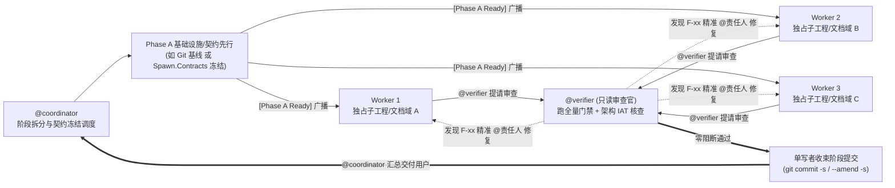

# 开发协作流程与多 Agent / Swarm 并行隔离协议

本规范定义 SPAWN 在每个里程碑阶段（`M1`~`M6`）的标准研发闭环，同时覆盖**单会话 Agent A ↔ Agent B 连续交付模式**与 **Swarm 多智能体集群并行开发模式**。沟通与消息板礼仪详见 [沟通协议](communication-protocol.md)，Git 单阶段提交规则详见 [Git 工作流](git-workflow.md)。

---

## 1. 主流程：Agent A 整阶段规划 ↔ Agent B 连续实现 ↔ Agent A 集中审查

| 阶段环节 | 责任角色 | 核心职责与结束判据 |
| :--- | :--- | :--- |
| **① 整阶段规划（`planned`）** | Agent A | 核对基线与用户决定，完成阶段清理与开源查证，编写覆盖**整个里程碑阶段**的可执行长计划 `docs/delivery/stage-plan.md`（不分零碎小批次），明确工作包（`M2-W01` 等）、模块契约、验收映射与 A→B 交接 Prompt |
| **② 连续实现与自检（`executing → ready-for-review`）** | Agent B（或 Swarm 实现集群） | 核对分支与父提交，连续完成计划内全部可执行工作包、单元/架构门禁测试、问题修复与受影响正本同步；产出 `docs/delivery/stage-report.md`、完整提交 SHA 及 B→A 审查 Prompt |
| **③ 集中技术审查（`reviewed` / `changes-requested`）** | Agent A（或 Swarm `@verifier`） | 直接审查实际 `git diff`、源码边界与门禁实跑结果；局部确定性小瑕疵（单会话模式下）直接修复并复验，跨模块缺口汇总为单次 `F-*` 清单退回返工；收敛后分列实现/技术审查/产品验收三项结论 |
| **④ 远端授权与集成（`closed`）** | 用户授权 + Agent 执行 | 技术审查收敛后在 [USER-ACTIONS.md](../../USER-ACTIONS.md) 登记具体 `ACT-*`；获用户明确授权后执行 `git push`、创建 PR、核对 CI（`docs` + DCO）并按授权范围 squash 合并入 `main` |

- 阶段状态流转严格遵循：`planned → executing → ready-for-review → reviewed → closed`（需返工时记为 `changes-requested`）。
- 工程技术审查通过（`reviewed`）、产品人工实机检查（`H-*`）与远端推送授权（`ACT-*`）三者正交记录：人工体验项可跨阶段顺延，不阻塞请求或执行远端 PR 授权，但合入 `main` 亦不代表人工实机体验已自动验收通过。

---

## 2. 多 Agent / Swarm 集群协同开发协议

SPAWN 天然具备清晰的 `Spawn.sln` 多进程物理隔离工程结构与模块化文档树，非常适合通过 Swarm 多智能体集群并行加速。启用 Swarm 集群时，必须严格遵守以下五条防碰撞铁律：

1. **契约先行与阶段栅栏（Phase Barrier）**：
   - 在并行编写各业务模块或 Worker 子进程前，必须先完成共享底座契约冻结（如 `M1` 的 Git 空 `README` 第一提交与分支就绪栅栏 `[Phase A Ready]`；`M2+` 编码阶段先冻结 `Directory.Packages.props`、`Spawn.Contracts` DTO/`.proto` 与 `Spawn.Core` 接口签名），再唤醒下游并行 Worker，杜绝各 Worker 各自臆造冲突的接口名或包版本。
2. **文件与子工程独占写权限（Zero Overlapping Writes）**：
   - `@coordinator` 在每个 Worker 的启动 Brief 中必须显式列出**允许创建/修改的精确文件路径或子工程目录**（例如：`worker-launcher` 独占 `src/Spawn.Modules.Launcher/**`、`worker-nexus` 独占 `src/Spawn.Modules.Nexus/**`、`worker-progress` 独占 `src/Spawn.Modules.Progress/**` 与 `src/Spawn.TrainerWorker/**`）。
   - **绝对红线**：严禁两个活跃 Worker 同时编辑同一个文件（如 `Spawn.sln`、`Directory.Packages.props`、`document-registry.json` 或 `Spawn.Host/App.xaml.cs`）；共享注册表或宿主装配入口必须指定**唯一责任 Worker** 统合写入，其他 Worker 通过消息板告知所需注册条目。
   - 若多个 Worker 需同时执行冲突性 `dotnet build`（锁定同一 `obj/` 目录）或独立分支演练，应为并行编译型 Worker 配置独立工作区（`workspace: "share"`），并在销毁（`kill`）Worker 前将其变更合并落地回主工作区。
3. **`@verifier` 只审不代改原则**：
   - `@verifier` 作为独立质量守门员，负责运行全套门禁脚本（`check_docs.py`、`quick_gate.py`、`dotnet test`、`PEReader` IAT 审计与 `git diff --check`）并对照 [REVIEW.md](../../REVIEW.md) 核查技术细节。
   - `@verifier` **严禁直接动手修改其他 Worker 负责的文件**（防止与仍在运行的作者发生写覆盖冲突）；发现任何缺陷统一整理为 `F-01`… 编号，在消息板精准 `@<对应责任 Worker>` 修复并复验。
4. **点对点精准唤醒（禁止滥用 `@coordinator` CC）**：
   - Worker 之间交接（如文档作者写完通知 `@gov-rules` 核对注册表并 `@verifier` 提请审查）只 `@` 下一步实际行动者，严禁在中间过程每条消息抄送 `@coordinator` 消耗上下文与配额；仅在遇到无法自行消解的跨边界死锁或最终收敛交付时唤醒 `@coordinator`。
5. **收束为单一阶段提交**：
   - Swarm 内部无论拆分了多少个并行 Worker，对外交付到阶段分支（如 `feat/m1-foundation`、`feat/m2-launcher-achievement`）时，必须由指定的 Git 收口角色在全部门禁通过后统一暂存并生成/修订**唯一一个带 DCO `Signed-off-by` 的阶段提交**，且清理所有已完成的辅助 Worker。

---

## 3. 连续执行与可逆默认决策机制

1. **不逐包停顿请示**：在当前阶段计划范围内，常规代码编写、NuGet 包还原、单元测试补齐、门禁报错修复与正本文档同步均由 Agent 一气呵成连续执行。
2. **非阻塞默认先行**：遇到不影响安全底线与外部付费授权的细节取舍，先采用工程上最稳健的可逆默认方案落地实现，并在 [USER-ACTIONS.md](../../USER-ACTIONS.md) 或 [已确认决策](../decisions/confirmed-decisions.md) 中透明注明当前默认值；仅当缺失决定会导致破坏性数据变更、违反反作弊安全边界或需要用户外部授权时，才精准暂停该受阻支线并继续推进其余独立工作包。

---

## 4. 阶段启动清理与 NuGet 7 天冷却依赖盘点

自 `M2` 起，每个新里程碑阶段启动时固定执行两项例行卫生动作并纳入本阶段提交：

1. **文档与工作区四分类清理**：按 [文档治理政策](../governance/documentation-policy.md#stage-cleanup) 清理上一阶段遗留的过渡文件，更新 `retireAfter` 到期项并保持长期正本无过期阶段标签。
2. **NuGet 与 GitHub Actions 依赖盘点**：
   - 检查远端是否有待处理的 Dependabot 安全告警或已满 **7 天冷却期**（对齐 [`.github/dependabot.yml`](../../.github/dependabot.yml) `cooldown.default-days: 7`）的版本更新 PR；安全漏洞修复不受冷却期限制，优先合入验证。
   - 核查 `Directory.Packages.props` 中各直接依赖包已发布满 7 天的新稳定版（拒绝抢跑刚发布未满 7 天的非安全更新，规避上游供应链投毒或撤包闪崩），升级兼容版本并跑通 `Spawn.Architecture.GateTests` 与全量回归测试。
