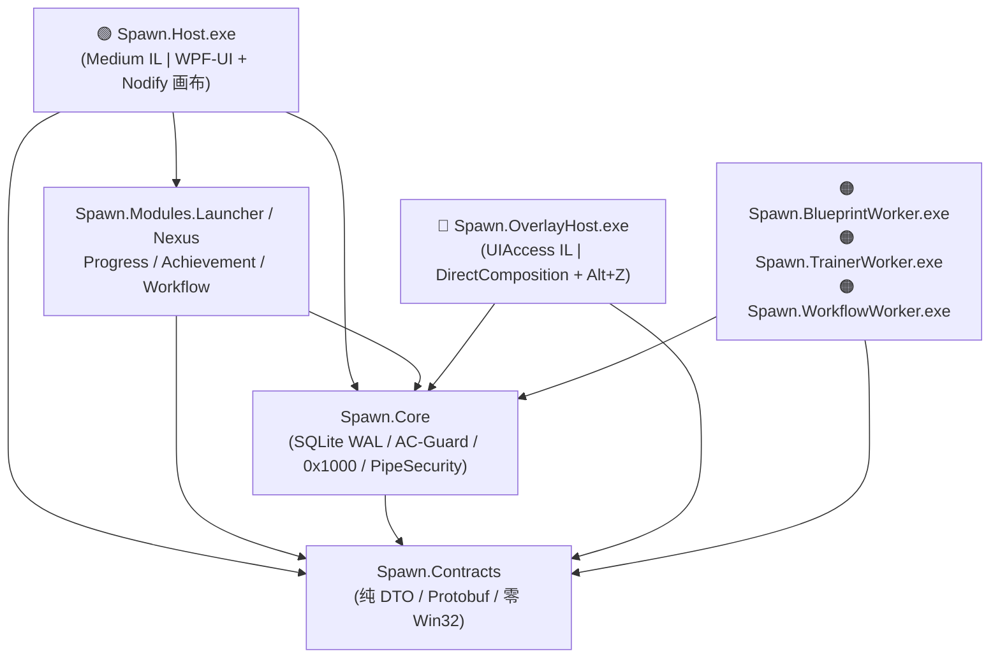

# 仓库地图与 `Spawn.sln` 依赖隔离规范

当前仓库实际落地进度以 [当前执行状态](../delivery/status.md) 为准：`M1` 已完成全套治理、架构契约、五大模块规格与 GitHub 配置基线；`M2` 起按本文件定义的物理隔离边界初始化 `Spawn.sln` 多工程结构。

---

## 1. 仓库顶层目录所有权（`M1` 已建立与 `M2+` 演进）

| 仓库相对路径 | 状态 | 职责与所有权边界 |
| :--- | :--- | :--- |
| 根文档（`README.md`、`AGENTS.md`、`CLAUDE.md`、`CONTRIBUTING.md`、`DESIGN.md`、`REVIEW.md`、`SECURITY.md`、`USER-ACTIONS.md`） | `M1` 已建立 | 项目门面、AI/开发者工作指令唯一正本、审查一票否决门禁、安全声明与全仓唯一用户待办 |
| `.github/`（`workflows/docs.yml`、`dependabot.yml`、`rulesets/main.json`、`repository-settings.json`、`actions-policy.json`、`PULL_REQUEST_TEMPLATE.md`） | `M1` 已建立 | 远端仓库设置镜像、`main-protection` 规则集、Actions 白名单、NuGet/Actions 7 天冷却 Dependabot 与 CI 文档/DCO 门禁 |
| `docs/governance/`、`docs/product-rules/`、`docs/design-rules/`、`docs/dev-rules/`、`docs/templates/` | `M1` 已建立 | 文档治理政策、`document-registry.json` 注册表、五大产品不变量、WPF/Nodify/Overlay 视觉规范、工程协作规则与写作模板 |
| `docs/requirements/`、`docs/decisions/`、`docs/design/`、`docs/engineering/`、`docs/delivery/` | `M1` 已建立 | 产品需求正本、ADR-0001~0005 与决策台账、系统架构/数据/IPC 契约、开源选型与环境清单、里程碑路线图与追踪矩阵 |
| `docs/modules/`、`docs/research/` | `M1` 已建立 | S.P.A.W.N. 五大领域模块正式实现规格书（`active`）及前期源码级深度调研档案（`reference`） |
| `assets/`、`installer/` | `M2` 已建立 | 双通道应用图标（矢量正本 `icon.svg` / `icon-dev.svg` 与栅格产物 `icon.ico|png`、带琥珀色 `DEV` 角标的 `icon-dev.ico|png`，规格见 [DESIGN.md](../design-rules/DESIGN.md)）及 Inno Setup 7 按用户免提权安装包模板（`installer/spawn.iss`） |
| `scripts/` | `M1`~`M2` 已建立 | 零外部依赖 Python 3.12+ 门禁与打包脚本（`check_docs.py`、`quick_gate.py`、`generate_icons.py`、`package.py --install-dev`） |
| `src/`、`tests/`、`Directory.Build.props`、`Directory.Packages.props`、`global.json`、`Spawn.sln` | `M2` 已建立并按阶段扩充 | 纯原生 `.NET 10`（LTS）多进程物理隔离源码树、中央包版本管理（CPM）与 `PEReader` 架构门禁测试 |
| `.local/`、`SPAWN_Vault/`、`bin/`、`obj/`、`dist/` | `.gitignore` 忽略 | 本地隔离开发数据、门禁测试原始日志、构建中间产物与安装包暂存目录（严禁提交入库） |

---

## 2. `Spawn.sln` 物理隔离多工程结构与职责（`M2`~`M6` 目标拓扑）

为从 MSBuild 编译期与项目引用图（Project Reference Graph）根源上杜绝开发人员误将高敏内存/钩子/视觉 API 引入常驻主界面，`Spawn.sln` 严格拆分为以下子工程：

```text
Spawn.sln
├── Directory.Build.props                # 统一 net10.0 / net10.0-windows10.0.26100.0、Nullable=enable、ImplicitUsings、TreatWarningsAsErrors
├── Directory.Packages.props             # NuGet 中央包版本管理（Central Package Management），全解决方案锁定唯一兼容版本
├── src/
│   ├── Spawn.Contracts/                 # 零业务/零 Win32 纯契约层：DTO、枚举、Protobuf (.proto) IPC 定义、System.Text.Json SourceGen
│   ├── Spawn.Core/                      # 纯净共享底座：SQLite WAL 仓储、AntiCheatGuard 预检与 15s 冷却状态机、0x1000 安全进程查询、DPAPI 凭据、NamedPipe SDDL ACL 封装
│   ├── Spawn.Modules.Launcher/          # [Spawn] JobObject IOCP + 0x1000 破壳追踪、三态精准时长、CCD HDR/转区/CPU Sets 自愈管线、三级漏斗离线刮削
│   ├── Spawn.Modules.Nexus/             # [Nexus] CAS 硬链接部署 + XxHash3 可变配置回收、5 阶段 WAL + NTFS Junction 原子切换、四大引擎编排与极客工具箱纯净侧
│   ├── Spawn.Modules.Progress/          # [Progress 纯净侧] Ludusavi 原生解析、FastCDC+BLAKE3+Zstd 时间机器、SPPK Packfile 云同步、FLiNG 检索与 A0+A WASAPI 会话静音
│   ├── Spawn.Modules.Achievement/       # [Achievement 纯净侧] 15+ 离线模拟器解析、四层 FSW 状态机、Comet 127.0.0.1:9977 GOG 守护、隐藏成就瀑布流、gbe_fork 事务激活器
│   ├── Spawn.Modules.Workflow/          # [Workflow 纯净侧] 二次元排班配置模型、interface.json 元数据映射、蓝图有向图序列化契约与主宿主调度代理
│   │
│   ├── Spawn.Host/                      # 🟢 常驻桌面主进程 EXE (Medium IL)：WPF-UI 壳层 + Nodify 双画布编辑器（仅允许引用纯净层，受 IAT 门禁硬锁！）
│   ├── Spawn.OverlayHost/               # 🔵 独立置顶覆盖层 EXE (Medium+UIAccess IL)：DirectComposition+SkiaSharp 144Hz 弹窗 + Alt+Z 锁鼠交互面板（受 IAT 门禁硬锁！）
│   │
│   ├── Spawn.BlueprintWorker/           # 🟠 按需隔离子进程 EXE：Kismet 异步蓝图 VM + RawInput + WGC/OpenCvSharp4/PaddleOCR + SendInput/PostMessage/ViGEmBus/KMBox
│   ├── Spawn.TrainerWorker/             # 🟠 按需隔离子进程 EXE (High IL)：FLiNG 沙箱托管(KILL_ON_JOB_CLOSE) + 35ms 硬件扫描码代理 + NtSuspendProcess + AlphaVSS + 二期 .CT/SigScan/Iced 引擎
│   ├── Spawn.WorkflowWorker/            # 🟠 按需隔离子进程 EXE (High IL)：并发资源锁 DAG + 内嵌 Maa.Framework C# + MaaFgo/BBC 双端口桥接 + 二游 CLI 适配器群 + 唤醒/防黑屏/战报长图
│   └── Spawn.LegacyHook.Helper/         # ⚪ 默认不加载可选包：仅面向极少数纯离线老独占全屏单机的 RTSS OSD / Vulkan Layer 辅助
└── tests/
    ├── Spawn.Architecture.GateTests/    # ★ 一票否决门禁：校验 csproj 引用图 + PEReader 静态扫描 Host/OverlayHost 导入表零敏感 Win32 API！
    ├── Spawn.Core.UnitTests/            # M2 核心与领域全量单测：SpawnPaths/SQLite/DPAPI、16+ 模拟器、GOG Comet、LIMBO 原生存档、进程追踪与 IPC
    ├── Spawn.Achievement.Tests/         # (M3+ 按需拆分专项) 扩展成就样本回归与高刷压力夹具
    └── Spawn.Integration.Tests/         # (M3+ 按需扩充) 多 Worker 跨进程端到端集成测试
```

---

## 3. 项目引用方向与 NuGet 边界硬约束（强制执行）



1. **严禁反向或跨宿主耦合**：
   - `Spawn.Contracts` 严禁引用任何其他项目或平台专属 UI/Win32 包；
   - `Spawn.Host`、`Spawn.OverlayHost` 及五个 `Spawn.Modules.*` **严禁直接或间接引用任何 `Spawn.*Worker` 或 `Spawn.LegacyHook.Helper` 项目**；
   - 各个 `Spawn.*Worker` 之间彼此独立，严禁相互项目引用，所有状态协同统一经 `Spawn.Host` 的 Named Pipe gRPC 总线仲裁。
2. **高敏与重型 NuGet 隔离红线**：
   - `OpenCvSharp4`、`Sdcb.PaddleOCR`、`Nefarius.ViGEm.Client` 仅允许出现在 `Spawn.BlueprintWorker`；
   - `Reloaded.Memory.SigScan`、`Iced`、`AlphaVSS` 仅允许出现在 `Spawn.TrainerWorker`；
   - `Maa.Framework`、`Hi3Helper.Sophon` 仅允许出现在 `Spawn.WorkflowWorker`；
   - 违反上述任一规则将直接触发 `Spawn.Architecture.GateTests` 编译与门禁失败（详见 [质量门禁](quality-gates.md)）。
3. **按里程碑渐进建项原则**：只创建当前里程碑有真实代码与消费者的 `.csproj` 子工程，不为尚未进入的远期阶段预先堆砌空壳代码库。
