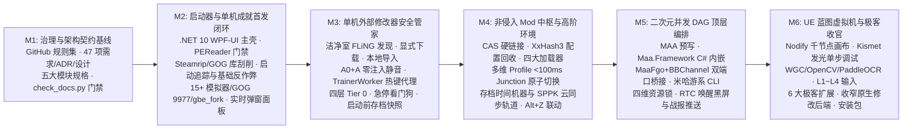

# SPAWN 里程碑交付路线图与验收门槛（Milestone Delivery Plan）

> **文档状态**：Active（M1 基线锁定；M3 v1.0 规划定稿修订 `M3` 范围、`AC-09` ~ `AC-12b` 与 `AC-24`）
> **适用范围**：M1 ~ M6 六阶段递增交付边界、阶段准入/准出条件与 `AC-01` ~ `AC-25`（含 `AC-12b`）结构化验收判据
> **关联文档**：[产品需求正本](../requirements/product-requirements.md) · [已确认架构决策](../decisions/confirmed-decisions.md) · [系统顶层架构](../design/system-architecture.md) · [技术选型与环境清单](technology-selection.md) · [需求追踪矩阵](../delivery/traceability.json)

---

## 1. 递增演进总体路线图

遵循用户确认的 **`D-01`（升级锁定 `.NET 10 LTS`）** 与 **`D-19`（`M2` 优先打通“启动器 + Steamrip/GOG 单机成就自动捕获与实时弹窗管理闭环”）** 战略，SPAWN 按六阶段有序演进：

---

## 2. 分阶段范围、交付物与准出标准

### 2.1 `M1`：文档治理、远端安全基线与系统架构契约（当前阶段）
- **核心目标**：在写下第一行 C# 业务代码前，100% 消除架构模糊地带，完成远端 GitHub 保护规则配置、全套需求/ADR/顶层设计/五大模块规格与自动化文档追踪门禁建设，并确认本机 `.NET 10 SDK` 构建环境就位。
- **核心交付物**：
  - 远端不可变初始提交基线（`ad7454c1ab58bb2019e0f0ba6810c5928f8a335e`）与激活态 `main-protection` 规则集；
  - 根治理套件（`README.md`、`AGENTS.md`、`CONTRIBUTING.md`、`REVIEW.md`、`SECURITY.md`、`DESIGN.md`、`USER-ACTIONS.md`、`LICENSE`）；
  - 全套 `docs/requirements/`、`docs/decisions/`、`docs/design/`、`docs/modules/`、`docs/engineering/`、`docs/delivery/`、`docs/governance/`、`docs/dev-rules/` 正本与 `docs/research/` 归档；
  - `scripts/check_docs.py` 与 `.github/workflows/docs.yml` CI 门禁。
- **准出标准**：满足 `AC-01`，本地 `feat/m1-foundation` 形成唯一带 DCO 签名的原子提交并通过独立审查。

### 2.2 `M2`：Clean Host 主壳、Steamrip/GOG 游戏库启动接管与单机成就自动捕获闭环（首发代码交付阶段）
- **准入前置条件**：M1 经用户 `ACT-002` 授权合并入 `main`（本机 `.NET 10 SDK 10.0.404` `ACT-001` 已就绪，无需额外阻塞等待）。
- **核心交付物**：
  - `.NET 10`（`net10.0` / `net10.0-windows10.0.26100.0`）解决方案 `Spawn.sln`（含 `Spawn.Contracts`、`Spawn.Core`、`Spawn.Modules.Launcher`、`Spawn.Modules.Achievement`、`Spawn.Host`、`Spawn.OverlayHost` 及 `Spawn.Architecture.GateTests` 等测试工程）与 `.github/workflows/ci-dotnet.yml`；
  - 纯净 `WPF-UI` 桌面主壳（Mica 材质、海报墙虚拟化视图、`H.NotifyIcon` 原生托盘、成就管理殿堂页）、`spawn.db` SQLite WAL 单写者底座、DPAPI 凭据加密及 `spawn` / `spawn-dev` 双通道物理隔离；
  - **游戏库管理与封面刮削**：支持添加、自动识别、手动编辑 Steamrip 免安装单机、GOG 离线安装版与本地正版游戏，落地三级瀑布流离线/多源高清封面元数据刮削缓存；
  - **Spawn 游戏启动接管与基础反作弊防线**：无 `KILL_ON_JOB_CLOSE` 的 `JobObject` IOCP + `0x1000` 35s 破壳双引擎进程追踪、`Active`/`Background`/`AFK` 三态游玩计时，以及 `Anti-Cheat Guard` 四级识别、Explorer COM 血缘脱钩与 15 秒反作弊残影冷却状态机；
  - **Achievement 单机成就全链路闭环**：15+ 款 Steam 模拟器文件四层防漏实时监听与冷启动静默对齐、GOG 离线版 `127.0.0.1:9977` Comet 本地守护免改 DLL 捕获 + `gameplay.db` WAL、无成就桩/FLT 补丁游戏一键无损 `Detanup01/gbe_fork` 激活器（含 SHA-256 原子还原）、中文成就 Schema/隐藏描述/灰阶图标自动拉取缓存（免 Key 瀑布流 + 可选 `ACT-006` Steam Web API Key），以及独立进程 `Spawn.OverlayHost`（`DirectComposition` + `SkiaSharp` Flip-Model + 本地瞬态自签名 `ZBID_UIACCESS`）144Hz 零掉帧游戏内实时解锁弹窗。
- **准出标准**：满足 `AC-02` ~ `AC-08`，全部单元、黄金样本解析与 `PEReader` 架构门禁测试后台静默通过。

### 2.3 `M3`：单机外部修改器安全管家与启动前轻量存档快照
- **准入前置条件**：M2 合并入 `main`（已满足：`5bcd04c26372602d89d5d4e9eb541cec8b526193`）。
- **范围依据**：用户 2026-11-21 确认 `M3-Q1` ~ `M3-Q5` 推荐默认方案（`D-25` ~ `D-29`、[ADR-0006](../decisions/0006-m3-external-trainer-manager-elevation-and-ipc.md)）；阶段执行记录见 [M3 阶段报告](../evidence/2026-11-22-m3-stage-report.md)。
- **核心交付物**：
  - 新子工程 `Spawn.Modules.Progress`（Clean Host 侧：修改器目录、洁净室 FLiNG 发现/解析/下载、本地导入、`A0+A` 静音、启动前存档快照）与独立隔离进程 `Spawn.TrainerWorker`（发布于 `Workers\Trainer\`，`M3` 零跨进程内存读写 API 导入）；冻结 `ITrainerBackend` 及修改器全套契约与 SQLite Schema `v4`；
  - 分级按需提权（无管理员清单直启 Medium IL / 每会话 1 次 `runas` UAC）+ 倒置跨 IL `NamedPipeJsonRpc`（Host 单实例服务端、Worker 客户端、双向 PID/路径/`LaunchNonce` 互验）+ `PROC_THREAD_ATTRIBUTE_JOB_LIST` 原子入组 `KILL_ON_JOB_CLOSE` 作业对象；
  - 洁净室 FLiNG 发现（严守 `robots.txt`：24h 缓存 `/all-trainers/` + 单次 `wp-json`）、用户显式触发单次下载（HTTPS 禁降级、同源 `Referer`、魔数嗅探、Zip-Slip 防护、`SharpCompress` 解压前后字节核对、`225/226` 隔离识别、本地 `SHA-256` 钉扎）、遇 Challenge 秒退浏览器 + 本地拖放导入一等公民；`AngleSharp` 结构化热键与三级版本置信度；
  - `A0`（`SHGetKnownFolderPath` INI 预写 + 27 字节 5.0 秒静音 SMF）+ `A`（专用 MTA 线程 `NAudio.Wasapi` 全端点 + 热插拔监听，默认完全静音、`35%` 提示音实验性）；`MAPVK_VK_TO_VSC_EX` + `EXTENDEDKEY`（禁 `SCANCODE`）交错 `65–80ms` 无小键盘热键代理；
  - 四层 `Tier 0` 判定（扩展特征 + MIT `AreWeAntiCheatYet` 索引 + Steam 分类 + 混合单机 `VerifiedOfflineBypass` 零 AC 硬验票）、修改器会话 2 秒急停看门狗、`LOOP-06` 自动清场与改名 CE 驱动识别；
  - 基于 `M2` 游戏数据引擎的启动修改器前轻量存档快照与一键回滚（修复 PCGamingWiki `cargoquery` 失效并补 Steam `userdata` 规则）；
  - Defender 沙箱单目录排除助手（Opt-in、回读校验、篡改保护/第三方杀软/Smart App Control 分类降级引导）与游戏详情页 `修改器` 子页签、设置页 `修改器与安全沙箱` 分类。
- **范围外（顺延）**：`Ludusavi` 预编译索引、`FastCDC` 存档时间机器 + `AlphaVSS`、`32MB SPPK` 云同步（`AC-09` ~ `AC-11`）顺延至 `M4` 独立交付轨道（`D-25`）；`.CT` 执行引擎与内存扫描器不进入 `M3`；手柄热键代理顺延 `LOOP-08`。
- **准出标准**：满足 `AC-12`、`AC-12b` 与 `AC-25`（2026-11-22 按 `D-30` ~ `D-33` 增补正式版每周发布与签名应用内更新），并通过 `REQ-SEC-03`/`05`/`06` 的 `M3` 增量判据。

### 2.4 `M4`：Nexus 非侵入硬链接 Mod 中枢、存档时间机器与云同步轨道、高阶启停环境管线与 `Alt+Z` 游戏内大面板联动
- **准入前置条件**：M3 合并入 `main`。
- **核心交付物**：
  - `Spawn.Modules.Nexus` 全功能落地：CAS 只读硬链接零拷贝部署、`.spawn_vanilla_bak` 原版保护、可变配置文件 `MutableCopy` + 游戏退出后 `XxHash3` SIMD 增量回收至 Profile `Overrides/`；
  - **存档时间机器与云同步独立交付轨道（自 `M3` 顺延，`D-25`）**：`ludusavi-manifest` 预编译 SQLite 索引器（`<1ms` 展开并剥离 `[save]` 与 `[config]`）、确定性 Gear-Hash `FastCDC` + `BLAKE3` + `Zstd` 块级去重存档时间机器、2.5s 防撕裂双向量校验 + `AlphaVSS` 兜底（提权路径遵循 `D-11` / `OSS-05`）、回滚前 `[PreRollbackSafety]` 自动保护点、`32MB SPPK` Packfile 自建云同步（S3/R2、WebDAV、本地目录与 64 代 `ParentSnapshotId` 分叉向导），并与 `mod_profile_hash` 防坏档护栏联动；`M3` 启动前快照的 `manifest.json` 原始副本可作为初始节点导入；`M4` 开启规划时由用户确认是否再拆为独立里程碑；
  - 四大游戏引擎加载器语义编排（Unity BepInEx Doorstop Mono/IL2CPP、UE4/5 `RE-UE4SS`/`~mods`、`Reloaded-II`、二次元 `XXMI` 沙箱与 `HideUID` 强提示）；
  - 跨模块五位一体多维 Profile `<100ms` 顶层 NTFS Directory Junction WAL 原子快照切换（含断电自愈、严禁递归删除目标保护及存档回滚跨 `mod_profile_hash` 防坏档拦截）；
  - **Pre/Post-Launch 高阶环境接管管线**：`environment_rollback.json` 断电自愈的系统 HDR / 独占分辨率 / 电源计划切换、x64 `LRProc` / x86 `LEProc` 自动区域转码、混合架构 P-Core / 3D V-Cache `CPU Sets` 亲和性与 EcoQoS 豁免、Wallpaper Engine 暂停与 Magpie 缩放伴生协同；
  - **`Alt+Z` 与手柄组合键游戏内交互大面板全面合龙**：在 `Spawn.OverlayHost` 中打通跨模块实时交互面板（游戏内成就剧透悬停检视、一键手动存档快照快门、`Tier 0` 修改器热键开关矩阵），实现动态穿透样式切换、45% 暗化防误触遮罩与 `ClipCursor` 光标接管/归还。
- **准出标准**：满足 `AC-09` ~ `AC-11`（自 `M3` 顺延）与 `AC-13` ~ `AC-16`。

### 2.5 `M5`：Workflow 二次元外部代肝生态并发 DAG 顶层编排器
- **准入前置条件**：M4 合并入 `main`。
- **核心交付物**：
  - `Spawn.Modules.Workflow` 与独立进程 `Spawn.WorkflowWorker`；
  - 明日方舟 `MAA` `gui.json` 原子预写与还原适配器（规避 `--config` 自重启脱管）、`Maa.Framework` C# 原生内嵌（解析 `interface.json` V2 动态生成配置表单 + `MaaPiCli.exe` 无感降级）；
  - FGO `MaaFgo` + 闭源 `BBChannel` `_ctypes.pyd` 代理注入双端口（`25001/25002`）RPC 客户端与 30 秒助战异常视觉看门狗；
  - 米哈游/库洛系 PC 原生助手（`BetterGI`、`March7thAssistant`、`StarRailCopilot`、`ZenlessZoneZero-OneDragon`、`ok-wuthering-waves`）标准化 CLI 适配器与 `Sophon` 更新预检；
  - 四维资源锁并发 DAG 调度器、RTC 睡眠定时唤醒、HDR 临时接管、OLED 全黑防烧屏幕布、`SkiaSharp` 暗黑毛玻璃战报长图多渠道推送与 60 秒可取消自动休眠。
- **准出标准**：满足 `AC-17` ~ `AC-20`。

### 2.6 `M6`：类 UE 蓝图发光调试虚拟机、六大极客扩展、二期 `.CT` 引擎与安装包收官
- **准入前置条件**：M5 合并入 `main`。
- **核心交付物**：
  - 主界面 `Nodify` 千节点 60FPS 可视化蓝图工坊 + 独立进程 `Spawn.BlueprintWorker`（Kismet 异步状态机、实时节点发光脉冲、红点断点挂起、`Step Over`、`Pin Watch`、全局刹停热键、`MMF` 三缓冲 60FPS 零拷贝预览、`WGC`/`OpenCvSharp4`/`Sdcb.PaddleOCR` 与 `L1~L4` 输入执行器）；
  - Nexus 六大极客扩展工具箱：便携沙箱化、WOF 熵值感知透明压缩（$H>7.85$ 跳过 + `dstorage.dll` 熔断）、DLSS 4 / FSR 3.1 / XeSS 官方签名校验热替换、Sunshine/Moonlight 动态虚拟屏、进程独立音频端点路由与单机战术应急工具箱；
  - 二期收窄原生修改后端（声明式原生修改包 + 静态指针链 / 基础纯汇编 `.CT` 子集：CE `<Offsets>` 逆序解引用、`.NET 10` `Vector256`/`Avx2` 自研 AOB 扫描与 `Iced` 安全跳板；复杂 Lua/C/Mono 表经模式 C 外部唤起 Cheat Engine）落地于 `TrainerWorker`（`D-29`）；
  - Inno Setup 7 正式发行打包脚本、`THIRD-PARTY-NOTICES` 动态链接合规包与全链路回归验收。
- **准出标准**：满足 `AC-21` ~ `AC-24`。

---

## 3. 结构化总验收门槛矩阵（`AC-01` ~ `AC-25`，含 `AC-12b`）

| 验收编号 | 归属阶段 | 关联需求范围 | 确定性验收断言与验证手段 |
| :--- | :---: | :--- | :--- |
| `AC-01` | `M1` | `NFR-07`, `NFR-08` | 不可变初始提交 `ad7454c1ab58bb2019e0f0ba6810c5928f8a335e` 完好，远端 `main-protection` 规则集激活，`python -B scripts/check_docs.py` 零告警通过，全部 `REQ-*`/`NFR-*` 100% 闭环映射至 `traceability.json`。 |
| `AC-02` | `M2` | `REQ-SEC-01`, `REQ-SEC-02`, `REQ-SEC-06`, `NFR-01`, `NFR-04`, `NFR-05` | `.NET 10` `Spawn.sln` 编译通过，`Spawn.Architecture.GateTests` 通过 `PEReader` 验证 `Spawn.Host` 与 `Spawn.OverlayHost` 零黑名单 API 导入、进程探测恒定 `0x1000`、命名管道强制绑定当前用户 SID 并 `Deny` `NetworkSid`、开发与正式通道物理隔离且全部测试后台静默。 |
| `AC-03` | `M2` | `REQ-SEC-03`, `REQ-SEC-04`, `REQ-SEC-05` | 四级 `AntiCheatTier` 准确分级；模拟启动 `Tier 2/3` 游戏前自动销毁敏感 Worker、拦截高危驱动，并通过 Explorer COM 使游戏父进程 PID 归属 `explorer.exe`；退出后严格执行伴生守护进程监测 + **15 秒强制静默冷却**。 |
| `AC-04` | `M2` | `REQ-SPW-01`, `REQ-SPW-02` | 无 `KILL_ON_JOB_CLOSE` 的 `JobObject` IOCP 与 `0x1000` 35s 破壳慢速追踪准确捕获自杀启动器派生的真实游戏进程退出（强杀宿主不误杀游戏）；`Active`/`Background`/`AFK` 三态计时准确覆盖手柄与音频活跃态。 |
| `AC-05` | `M2` | `REQ-SPW-06`, `NFR-06` | Steamrip 免安装版、GOG 离线版与 Steam 游戏库添加/编辑及三级瀑布流元数据刮削器在断网下 100% 识别本地指纹与 `RJ` 号，联网拉取高清封面后支持纯离线极速浏览。 |
| `AC-06` | `M2` | `REQ-ACH-01`, `REQ-ACH-02` | 15+ 离线模拟器、GOG 本地 `127.0.0.1:9977` Comet 免改 DLL 监听 + `gameplay.db` WAL 与正版 Steam Binary VDF 黄金夹具解析率 100%；四层监听管线连续同秒解锁零漏报，历史旧档首次导入静默零误弹。 |
| `AC-07` | `M2` | `REQ-ACH-03`, `REQ-ACH-04` | 无成就桩/FLT 补丁游戏一键部署 `gbe_fork` 成功激活成就并可按 SHA-256 100% 无损还原原版 DLL；中文成就 Schema 瀑布流（免 Key 镜像 + 可选 Steam Web API Key）完整缓存 `hidden=1` 剧透保护描述与 Rec.709 灰阶图标。 |
| `AC-08` | `M2` | `REQ-ACH-05`, `NFR-02` | `Spawn.OverlayHost` 本地瞬态自签名获取 `ZBID_UIACCESS` 置顶（私钥内存即焚），`DirectComposition` + `SkiaSharp` Flip-Model 渲染多主题 144Hz 实时解锁弹窗零闪烁（1% Low FPS 损耗 `<0.5%`），并与主界面成就管理面板实时同步。 |
| `AC-09` | `M4`（自 `M3` 顺延，`D-25`） | `REQ-PRG-01` | `ludusavi-manifest` 预编译入 SQLite 后单次规则查询 `<1ms`，16 种跨平台占位符展开无误且严格剥离 `[save]` 与 `[config]`。 |
| `AC-10` | `M4`（自 `M3` 顺延，`D-25`） | `REQ-PRG-02`, `NFR-03` | 确定性 `FastCDC` 存档时间机器 20 次微改快照额外磁盘占用缩减 `>90%`，2.5s 静默双向量防撕裂与 `AlphaVSS` 兜底零坏档，回滚前 100% 自动创建 `[PreRollbackSafety]` 快照。 |
| `AC-11` | `M4`（自 `M3` 顺延，`D-25`） | `REQ-PRG-03` | `32MB SPPK` Packfile 在 S3/R2、WebDAV 与本地目录后端无 `429` 限流完成增量上传与 Range 恢复，64 代血缘链 100% 拦截双端离线分叉静默覆盖。 |
| `AC-12` | `M3` | `REQ-PRG-04`, `REQ-PRG-05`, `REQ-PRG-06`, `REQ-SEC-03`, `REQ-SEC-06`, `NFR-07` | **用户显式触发**的 FLiNG 单次下载与本地拖放导入全链路通过（HTTPS 禁降级、魔数嗅探、Zip-Slip 防护、解压前后字节核对、`225/226` 隔离诊断、本地 `SHA-256` 钉扎与启动前复核；遇 Challenge 即退浏览器），`AngleSharp` 热键解析准确率 `>=95%`；`A0` 预写 INI + **27 字节 5.0 秒静音 SMF** 与 `A` 专用 MTA 线程 WASAPI 全端点会话控制（默认完全静音）实现 **SPAWN 零注入、零改写修改器二进制**（以沙箱单目录 Defender 排除助手、隔离错误码诊断与 Smart App Control 说明替代“0 报毒”绝对承诺）；`Spawn.TrainerWorker` 零跨进程内存读写导入、倒置管道双向鉴权、`KILL_ON_JOB_CLOSE` 子孙进程 100% 清零，`MAPVK_VK_TO_VSC_EX` + `EXTENDEDKEY`（禁 `SCANCODE`）交错 `65–80ms` 热键代理；全部能力仅在 `Tier 0` 或已通过零 AC 硬验票的 `VerifiedOfflineBypass` 混合单机下生效，2 秒急停看门狗与 `LOOP-06` 自动清场生效。 |
| `AC-12b` | `M3` | `REQ-PRG-08` | 启动修改器前轻量存档快照默认开启可关：复用 `M2` 游戏数据引擎写入 `vault\Snapshots\PreTrainer\` 原子 `manifest.json`，默认保留 `5` 份、超 `256MB` 或排他锁非阻塞跳过并提示，一键回滚前自动创建 `PreRestoreSafety` 保护快照、游戏运行中禁止回滚，回滚后文件与注册表导出逐项哈希一致；PCGamingWiki `cargoquery` 失效回退与 Steam `userdata` 规则单测全绿。 |
| `AC-13` | `M4` | `REQ-NEX-01` | 同盘符 CAS 硬链接毫秒级部署零额外体积、`.spawn_vanilla_bak` 原版 100% 无损还原；可变配置文件独立 `MutableCopy` 并在游戏退出后经 `XxHash3` 精确回收到 Profile `Overrides/`。 |
| `AC-14` | `M4` | `REQ-NEX-02`, `REQ-NEX-03`, `REQ-NEX-07`, `NFR-03` | 四大游戏引擎加载器结构自动适配，五位一体 Profile 通过顶层 NTFS Junction WAL 在 `<100ms` 内完成原子切换（断电自愈且绝不递归误删真实文件），跨 `mod_profile_hash` 存档回滚强制触发防坏档拦截。 |
| `AC-15` | `M4` | `REQ-SPW-03`, `REQ-SPW-04`, `REQ-SPW-05`, `NFR-03` | Pre/Post-Launch 高阶环境接管管线（HDR/分辨率/电源计划切换）具备 `environment_rollback.json` 断电重启 100% 自愈能力；x64/x86 转码、CPU Sets 亲和与 Wallpaper Engine / Magpie 伴生协同准确生效。 |
| `AC-16` | `M4` | `REQ-ACH-06` | `Alt+Z` 与手柄呼出游戏内交互式大面板（联动成就剧透悬停揭示、快捷存档检查点与修改器开关）正确切换穿透样式、铺设 45% 防误触遮罩并完成 `ClipCursor` 接管与还原，全屏动作游戏内点击零穿透。 |
| `AC-17` | `M5` | `REQ-WFL-01`, `REQ-WFL-02` | `MAA` 原子预写 `gui.json` 彻底消除 `--config` 自重启脱管并在结束后还原配置；`Maa.Framework` C# 绑定解析 `interface.json` V2 动态生成配置面板并具备 `MaaPiCli.exe` 无感降级能力。 |
| `AC-18` | `M5` | `REQ-WFL-03` | FGO `MaaFgo` + `BBChannel` 经 `_ctypes.pyd` 代理零改包打通 `25001/25002` 双端口 JSON RPC，模拟助战弹窗异常在 30 秒内由视觉看门狗自动点击恢复。 |
| `AC-19` | `M5` | `REQ-WFL-04`, `REQ-WFL-05` | 五大 PC 二次元 CLI 适配器稳定解析状态与退出码；四维资源锁并发 DAG 严格保障前台独占任务串行排队、多后台模拟器实例并行执行且受内存/显存水位保护。 |
| `AC-20` | `M5` | `REQ-WFL-06` | 夜间无人值守闭环验证：RTC 定时唤醒、HDR 临时关闭与事后复原、OLED 黑屏幕布、`SkiaSharp` 暗黑毛玻璃战报多渠道推送及 60 秒可取消休眠倒计时全部按契约工作。 |
| `AC-21` | `M6` | `REQ-WFL-07`, `NFR-01` | `Nodify` 画布 1000 节点平移缩放 `>=60FPS`；`BlueprintWorker` 异步 Kismet 状态机实时驱动节点发光脉冲、断点挂起、`Step Over`、`Pin Watch`、全局刹停与按 `D-11` 分级提权拉起（免 UAC 计划任务仅限 `LOOP-07` 受保护提权包）。 |
| `AC-22` | `M6` | `REQ-WFL-07` | 蓝图视觉与输入执行管线（`WGC` + `MMF` 60FPS 零拷贝预览、`OpenCvSharp4`、`Sdcb.PaddleOCR` 及 `L1~L4` 输入执行器）端到端测试通过且仅在白名单安全等级放行。 |
| `AC-23` | `M6` | `REQ-NEX-04`, `REQ-NEX-05`, `REQ-NEX-06` | 六大极客扩展工具达标：便携沙箱化收拢存档、WOF 压缩跳过 $H>7.85$ 高熵文件并熔断 `dstorage.dll`、超分替换强制校验官方数字签名、Sunshine 串流动态虚拟屏、单进程音频路由与 `Tier 0` 应急工具箱可靠运行。 |
| `AC-24` | `M6` | `REQ-PRG-07`, `NFR-07` | 二期收窄原生修改后端在 `TrainerWorker` 内安全支持声明式原生修改包与静态指针 / 基础纯汇编 `.CT` 子集（逆序指针链、`.NET 10` `Vector256` 自研 AOB 扫描、`Iced` 安全跳板，退出原子还原），不支持的复杂表给出外部 Cheat Engine 指引；传递依赖树零 `GPL`/`AGPL` 包（无 `Reloaded.Memory` 家族）；Inno Setup 7 安装包构建成功并附完整 `Apache-2.0` / `LGPL-3.0` / MIT 第三方合规声明。 |
| `AC-25` | `M3` | `NFR-09`, `NFR-05`, `NFR-06`, `REQ-SEC-01` | 正式版自包含安装包不含 `*.pdb` 且隔离安装演练通过；每周发布工作流仅定时/手动触发、无新合入即跳过、只有受仓库变量控制的 `publish` 任务可写仓库、全部 Action 以 SHA 钉扎；更新器在零真实网络夹具下验证验签、拒绝降级、主机/URL 白名单、大小与 SHA-256 校验、开发版永不检查、空闲安装判定与重启标记写入，Clean Host 门禁保持全绿 |
