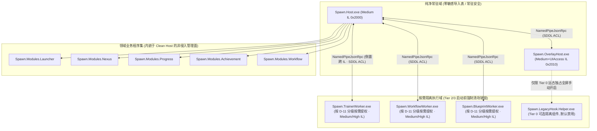

# SPAWN 领域模块规格正本总览（Domain Module Specifications）

> **文档状态**：Active（M1 基线锁定）
> **适用范围**：指导 M2 ~ M6 全阶段编码实现、进程隔离边界、数据落盘契约与自动化验收测试
> **关联文档**：[产品需求规格正本](../requirements/product-requirements.md) · [已确认架构决策](../decisions/confirmed-decisions.md) · [系统顶层架构](../design/system-architecture.md) · [数据模型正本](../design/data-model.md) · [IPC 与安全契约](../design/ipc-and-security-contracts.md) · [里程碑交付路线图](../engineering/delivery-plan.md) · [前期调研档案](../research/README.md)

---

## 1. 模块划分原则与安全基线

**SPAWN** 基于 **`.NET 10 (LTS)`（目标框架 `net10.0-windows`）+ 纯原生 WPF（`WPF-UI` + `Nodify`）** 围绕五大核心产品支柱（**S**pawn · **P**rogress · **A**chievement · **W**orkflow · **N**exus）构建高内聚、低耦合的领域模块体系。所有模块设计严格受控于以下三条全局架构铁律（详见 [ADR-0003](../decisions/0003-anti-cheat-guard-and-process-isolation.md) 与 [ipc-and-security-contracts.md](../design/ipc-and-security-contracts.md)）：

1. **Clean Host 物理进程隔离（`REQ-SEC-01`）**：常驻桌面主进程 `Spawn.Host.exe`（Medium IL `0x2000`）与独立合成渲染进程 `Spawn.OverlayHost.exe`（Medium+UIAccess IL `0x2010`）保持**绝对纯净 PE 导入表**，零内存读写、零输入模拟、零钩子注入库引用；一切涉及高完整性级别（High IL `0x3000`）、模拟输入、沙箱修改器托管或外部 CLI 子进程编排的逻辑，必须下沉至按需拉起、用完即毁的独立 Worker 进程。
2. **全域 `0x1000` 探测与四级反作弊熔断（`REQ-SEC-02` ~ `REQ-SEC-05`）**：任何模块枚举或监听外部进程仅允许申请 `PROCESS_QUERY_LIMITED_INFORMATION (0x1000)`；启动 `Tier 2/3` 反作弊受保护游戏前，强制排空销毁全部特权 Worker 并委派 `explorer.exe` 血缘脱钩启动；退出后等待伴生反作弊服务（如 `SGuard64.exe`、`EasyAntiCheat_EOS.exe`、`BEService.exe`）彻底消失并完成 **15 秒强制静默冷却**。
3. **预写事务日志（WAL）断电幂等自愈（`NFR-03`）**：凡涉及修改系统显示/电源状态、重定向 NTFS Directory Junction、覆盖外部助手配置文件（如 `MAA` `gui.json`）或回滚游戏存档的操作，必须先持久化回滚/重做日志（Rollback Journal），确保任意时刻断电或崩溃重启后 100% 自动恢复一致态。

---

## 2. 五大业务域与子工程、进程域及里程碑映射矩阵

| 模块代号 | 规格正本文件 | 对应需求族 | 核心承载工程（`src/`） | 运行进程域与完整性级别（IL） | `AntiCheatTier` 准入边界 | 目标交付阶段 | 前期调研溯源 |
| :--- | :--- | :--- | :--- | :--- | :--- | :--- | :--- |
| **`spawn.launcher`** | [spawn-launcher.md](./spawn-launcher.md) | `REQ-SPW-01` ~ `06` `REQ-SEC-01` ~ `05` | `Spawn.Core` `Spawn.Modules.Launcher` `Spawn.Host` | `Spawn.Host.exe`（`Medium IL 0x2000`） | `Tier 0 ~ 3` 全兼容（`Tier 2/3` 强制切换 `explorer.exe` 脱钩启动 + `0x1000` 慢速轮询） | **M2**（游戏库管理、Steamrip/GOG 封面刮削、双通道进程追踪、三态计时、基础反作弊门禁） **M4**（Pre/Post-Launch 高阶自愈环境管线） | [卷 02 §1](../research/02-launcher-process-and-mod-nexus.md) |
| **`spawn.achievement`** | [achievement-and-overlay.md](./achievement-and-overlay.md) | `REQ-ACH-01` ~ `06` | `Spawn.Modules.Achievement` `Spawn.OverlayHost` `Spawn.LegacyHook.Helper`（可选） | 文件/Comet 监听运行于 `Spawn.Host.exe`（`Medium IL`）；游戏内高刷弹窗与面板运行于 `Spawn.OverlayHost.exe`（`Medium+UIAccess IL 0x2010`） | 零注入 `ZBID_UIACCESS` 模式支持 `Tier 0 ~ 3`；无桩 DLL 赋能与经典注入回退硬锁 `Tier 0` | **M2**（15+ 模拟器实时监听、GOG `9977` Comet 捕获、一键 `gbe_fork` 激活器、中文 Schema 缓存、`OverlayHost` 弹窗与成就管理面板） **M4**（`Alt+Z` 游戏内交互大面板跨模块联动） | [卷 04](../research/04-achievement-and-ingame-overlay.md) |
| **`spawn.progress`** | [progress-saves-and-trainer.md](./progress-saves-and-trainer.md) | `REQ-PRG-01` ~ `08` | `Spawn.Modules.Progress` `Spawn.TrainerWorker` | 修改器发现/静音/启动前轻量快照（`M3`）及 `M4` 存档时间机器/`SPPK` 云同步运行于 `Spawn.Host.exe`（`Medium IL`）；外部修改器沙箱与热键代理运行于 `Spawn.TrainerWorker.exe`（按 `D-11` 分级按需提权，`Medium/High IL`，`M3` 零跨进程内存 API） | 存档备份/云同步支持 `Tier 0 ~ 3`；外部修改器管家仅限 `Tier 0`（及通过实时零 AC 硬验票的 `VerifiedOfflineBypass` 混合单机），二期收窄原生后端硬锁 `Tier 0` | **M3**（单机外部修改器安全管家：洁净室 FLiNG 发现 + 用户显式下载 + 本地导入、`A0+A` 默认静音、`TrainerWorker` 沙箱与热键代理、启动前轻量存档快照与一键回滚） **M4**（`Ludusavi` + `FastCDC` 存档时间机器与 `32MB SPPK` 云同步，`D-25`） **M6**（二期收窄原生修改后端，`D-29`） | [卷 03](../research/03-save-timemachine-and-trainer.md) |
| **`spawn.nexus`** | [nexus-mods-and-utilities.md](./nexus-mods-and-utilities.md) | `REQ-NEX-01` ~ `07` | `Spawn.Modules.Nexus` `Spawn.TrainerWorker`（仅限 `Tier 0` 进程急冻协助） | 文件拓扑与 CAS 部署运行于 `Spawn.Host.exe`（`Medium IL`）；`NtSuspendProcess` 急冻委派 `Spawn.TrainerWorker.exe` | CAS/Profile 仅对离线单机生效；`XXMI` 激活反作弊互斥锁；超分 DLL 替换限 `Tier 0/1`；进程急冻硬锁 `Tier 0` | **M4**（CAS 硬链接、`XxHash3` 配置回收、四大加载器编排、`<100ms` Junction 原子 Profile） **M6**（便携沙箱/WOF/DLSS 4/Sunshine/声卡/急救箱 6 大极客工具箱） | [卷 02 §2 ~ §3](../research/02-launcher-process-and-mod-nexus.md) |
| **`spawn.workflow`** | [workflow-and-blueprint.md](./workflow-and-blueprint.md) | `REQ-WFL-01` ~ `07` | `Spawn.Modules.Workflow` `Spawn.Host`（Nodify 画布编辑器） `Spawn.WorkflowWorker` `Spawn.BlueprintWorker` | 画布编辑与调度编排面位于 `Spawn.Host.exe`（`Medium IL`）；二次元调度位于 `Spawn.WorkflowWorker.exe`；蓝图执行与视觉/输入驱动位于 `Spawn.BlueprintWorker.exe`（按 `D-11` 分级按需提权 `Medium/High IL`，免 UAC 仅限 `LOOP-07`） | 二次元外部官方认可助手限 `Tier 1` 白名单；通用蓝图执行限 `Tier 0/1`；遇到 `Tier 2/3` 全量排空停机 | **M5**（二次元外部代肝生态并发 DAG 顶层编排器） **M6**（`Nodify` 类 UE 蓝图可视化按键/识图脚本虚拟机） | [卷 01](../research/01-ui-architecture-and-blueprint.md) · [卷 05](../research/05-gacha-workflow-orchestration.md) |

---

## 3. 统一规格章节结构约定

本目录下的每一份业务域模块规格正本均严格遵循统一七段式工程结构编写，确保人类开发者与编码智能体能够无歧义落地：

1. **职责边界与进程权限域**：明确模块 In-Scope / Out-of-Scope、宿主与 Worker 职责切分、Windows Integrity Level 与敏感 API 禁区。
2. **核心接口与状态机契约**：定义 C# 领域服务核心接口签名、状态转换图（Mermaid `stateDiagram-v2` / `sequenceDiagram`）与生命周期时序。
3. **数据模型与存储路径**：列出模块独占/读写的 `spawn.db` SQLite 表结构、`%LOCALAPPDATA%\spawn`（开发态 `spawn-dev`）物理目录布局及外部配置文件约定。
4. **关键算法与协议细节**：固化核心数据结构、字节级解析布局、系统 Win32/COM 调用参数、并发锁与性能预算。
5. **跨模块协同契约**：定义与其余四大业务域及 `AntiCheatGuard` 总线的事件订阅、调用顺序和数据交接契约。
6. **异常恢复与反作弊熔断行为**：枚举断电崩溃自愈流程、文件锁冲突退避策略及 `Tier 0 ~ 3` 安全熔断响应矩阵。
7. **测试与阶段验收要求**：绑定具体的 `REQ-*` / `NFR-*` 条目，对齐四大标准测试工程（`Spawn.Architecture.GateTests`、`Spawn.Core.Tests`、`Spawn.Achievement.Tests`、`Spawn.Integration.Tests`），规定夹具构造方法、Headless 静默测试约束（`NFR-04`）与量化准出指标。
