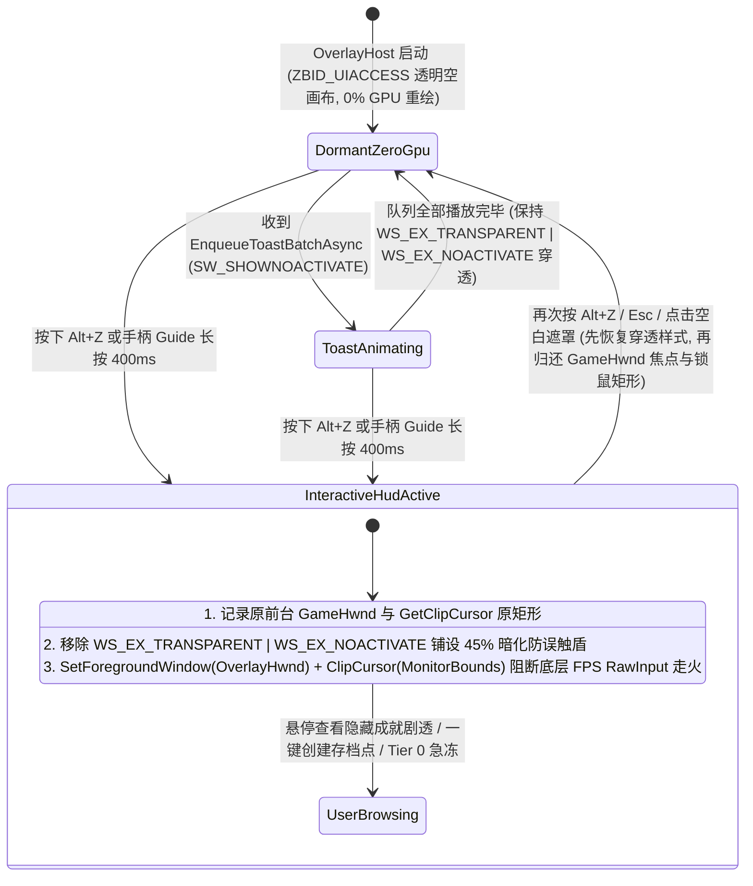

# Achievement 模块规格正本：全渠道离线/正版成就引擎与 144Hz 零注入 Overlay（`spawn.achievement`）

| 元数据项 | 规格定义 |
| :--- | :--- |
| **模块代号** | `spawn.achievement` |
| **承载子工程** | `Spawn.Modules.Achievement`（15+ 模拟器/GOG/正版解析、四层监听、Schema 瀑布流、无桩赋能器）、`Spawn.OverlayHost`（独立高刷透明渲染进程）、`Spawn.LegacyHook.Helper`（仅限 `Tier 0` 远古独占全屏可选隔离件，默认禁用），统一基于 `.NET 10 LTS`（`net10.0-windows`） |
| **所属进程域与权限** | 成就监听与入库运行于 `Spawn.Host.exe`（`Medium IL 0x2000`）；游戏内解锁弹窗与交互面板运行于独立纯净进程 `Spawn.OverlayHost.exe`（`Medium+UIAccess IL 0x2010`，绝对零敏感导入表） |
| **覆盖需求与决策** | `REQ-ACH-01` ~ `REQ-ACH-06`、`REQ-SEC-01` ~ `REQ-SEC-03`、`D-01`、`D-02`、`D-07`、`A-05`、`NFR-02` |
| **目标交付里程碑** | `M2`（首发核心闭环：15+ Steam 模拟器实时监听、GOG 离线版 `127.0.0.1:9977` Comet 免改 DLL 捕获、无成就桩/FLT 游戏一键无损 `gbe_fork` 激活器、中文成就 Schema/隐藏描述/图标自动拉取缓存、`Spawn.OverlayHost` 144Hz 游戏内实时弹窗与桌面成就管理面板） · `M4`（`Alt+Z` 与手柄组合键游戏内交互式大面板及跨模块存档/Profile/单机急冻深度联动） |
| **关联设计正本** | [ADR-0005：外部生态编排与 UIAccess 高刷 Overlay](../decisions/0005-external-ecosystem-orchestration-and-uiaccess-overlay.md) · [系统顶层架构](../design/system-architecture.md) · [数据模型正本](../design/data-model.md) · [IPC 与安全契约](../design/ipc-and-security-contracts.md) |
| **前期调研档案** | [卷 04：全渠道离线/正版成就实时捕获与零注入高刷 Overlay 引擎](../research/04-achievement-and-ingame-overlay.md) |

---

## 1. 职责边界与进程权限域

### 1.1 模块职责范围（In-Scope）

1. **全渠道零 Node.js 依赖成就解析矩阵**：以纯原生高性能 C# 一次性打通 **15+ 流派离线 Steam 模拟器**、**GOG 离线免平台安装包**（本地 `127.0.0.1:9977` Comet Protobuf 免改 DLL 实时截获 + Galaxy `gameplay.db` WAL 只读监控）以及 **正版 Steam 本地 `UserGameStats_*.bin` Binary VDF**（辅以 Epic EOS / Xbox Live 云端同步拓展），在单一成就殿堂内聚合展示玩家全平台进度。
2. **四层零漏报实时文件/网络监听状态机**：融合首次入库静默种子（杜绝历史存量解锁弹窗轰炸）、窄域 64KB 缓冲 `FileSystemWatcher`、针对当前前台运行游戏的 `500ms` 文件属性微轮询以及 `120ms` 共享锁重试去抖通道，做到游戏内解锁后 `< 250ms` 触发丝滑弹窗。
3. **无成就桩发行版一键无损赋能器（Achievement Enabler）**：针对早期 `FLT` 等将成就 API 编译为空操作桩（No-Op Stub）的离线版本，提供带 SHA-256 原始 DLL 备份与反作弊门禁校验的一键 `Detanup01/gbe_fork` 无损替换与一键纯净还原。
4. **免 API Key 中文隐藏成就真相补全瀑布流**：无需玩家申请高门槛 Steam Web API Key，自动合并本地 Schema、Steam CM 公共缓存与第三方成就猎人镜像，补全被官方接口抹除的 `hidden=1` 隐藏成就中文解锁条件，并用 `SkiaSharp` 离线合成防剧透灰阶图标。
5. **144Hz/240Hz 零掉帧独立合成 Overlay 与 `Alt+Z` 战术面板**：在独立进程 `Spawn.OverlayHost.exe` 中基于 `DirectComposition` + `SkiaSharp` Flip-Model 交换链与本机瞬态自签 `ZBID_UIACCESS (2)` 窗口带渲染五大定制主题弹窗及 `Alt+Z` 半透明毛玻璃交互面板（内置 `ClipCursor` 防 FPS 走火锁鼠机制）。

### 1.2 明确排除边界（Out-of-Scope）

- **主路径 100% 零游戏进程注入（Zero Injection）**：`Spawn.OverlayHost.exe` 严禁打开任何游戏进程句柄、严禁注入 DXGI `Present` / Vulkan Hook DLL，从根源消灭与 EAC / BattlEye / Vanguard / ACE 冲突封号及游戏崩溃的风险（`REQ-ACH-05`、`REQ-SEC-01`）。
- **严禁修改正版 Steam 目录文件**：一键 `gbe_fork` 赋能器一旦检测到目标路径位于正版 `steamapps\common` 下或 `AntiCheatTier >= Tier 1`，立即硬阻断拒绝执行（`REQ-ACH-03`）。

---

## 2. 核心接口与状态机契约

### 2.1 核心领域服务接口与跨进程 IPC 契约

```csharp
namespace Spawn.Modules.Achievement.Contracts;

public interface IAchievementParser
{
    string ProviderFlavor { get; } // "Goldberg", "GbeFork", "CodexRune", "Tenoke", "SmartSteamEmu", "GogComet", "SteamBinVdf"...
    bool CanHandle(AchievementSourceDescriptor source);
    ValueTask<IReadOnlyList<ParsedAchievementState>> ParseAsync(Stream stream, AchievementSchemaMap schema, CancellationToken ct = default);
}

public interface IAchievementWatcherCoordinator
{
    IObservable<AchievementUnlockedNotification> UnlockStream { get; }
    Task BindActiveGameSessionAsync(Guid gameId, IReadOnlyCollection<uint> trackedPids, CancellationToken ct = default);
    Task<EnablerApplyResult> ApplyGbeForkEnablerAsync(Guid gameId, CancellationToken ct = default);
    Task RestoreOriginalSteamApiDllAsync(Guid gameId, CancellationToken ct = default);
}

// Spawn.Host -> Spawn.OverlayHost (NamedPipeJsonRpc: spawn-overlay-<UserSid>)
public interface IOverlayHostRpcContract
{
    Task EnqueueToastBatchAsync(IReadOnlyList<OverlayToastPayload> toasts, CancellationToken ct = default);
    Task SetInteractiveHudVisibilityAsync(bool visible, ActiveGameHudContext context, CancellationToken ct = default);
}
```

### 2.2 `Spawn.OverlayHost` 双模态窗口穿透与 `Alt+Z` 锁鼠状态机



---

## 3. 数据模型与存储路径

### 3.1 SQLite 核心表契约（归属 `spawn.db`）

主表结构严格对齐 [data-model.md](../design/data-model.md) 全局 `snake_case` 命名契约，模块配置辅表（如 `achievement_watch_roots`、`achievement_enabler_backups`）共享同一版本化 SQL 迁移管线：

| 表名 | 主键 | 关键字段与约束摘要 | 业务用途 |
| :--- | :--- | :--- | :--- |
| `achievement_game_schemas` | `schema_key TEXT` | `game_id TEXT`, `schema_source TEXT`, `language TEXT`, `total_achievements INT`, `has_enabler_deployed INT DEFAULT 0`, `original_api_dll_sha256 TEXT`, `last_synced_at_utc TEXT` | 游戏级成就元数据来源与无桩赋能状态主表 |
| `achievement_definitions` | `(schema_key, api_name)` | `display_name TEXT`, `description TEXT`, `is_hidden INT NOT NULL`, `global_unlock_percent REAL`, `unlocked_icon_rel_path TEXT`, `locked_gray_icon_rel_path TEXT` | 标准单项成就定义字典、隐藏成就剧透真相与全球稀有度 |
| `achievement_unlocks` | `(schema_key, api_name)` | `is_unlocked INT NOT NULL`, `unlocked_at_utc TEXT`, `current_progress REAL`, `max_progress REAL`, `adapter_source TEXT NOT NULL`, `raw_source_path TEXT`, `is_initial_seed INT NOT NULL DEFAULT 0` | 玩家实际解锁进度（`is_initial_seed=1` 确保首次入库或重启绝不重复轰炸弹窗） |
| `achievement_watch_roots` | `id TEXT` | `game_id TEXT`, `flavor TEXT`, `watch_path TEXT NOT NULL`, `last_write_ticks INT`, `last_file_size INT` | 窄域监听锚点与 500ms 微轮询元数据快照辅表 |
| `achievement_enabler_backups` | `game_id TEXT` | `dll_rel_path TEXT NOT NULL`, `original_sha256 TEXT NOT NULL`, `backup_rel_path TEXT NOT NULL`, `applied_gbe_version TEXT`, `applied_at TEXT` | 无桩离线版一键 `gbe_fork` 赋能与 100% 字节级还原凭证辅表 |

### 3.2 本地文件路径契约

- **成就图标离线缓存**：`%LOCALAPPDATA%\spawn\vault\Schemas\Icons\<Platform>_<AppId>\{<api_name>_color.webp, <api_name>_gray.webp}`。
- **UIAccess 独立合成宿主部署位**：
  - 标准安装版：`%ProgramFiles%\spawn\Overlay\Spawn.OverlayHost.exe`（位于受信任系统目录，满足 Windows 内核 `ZBID_UIACCESS` 路径白名单校验）；
  - 绿色便携版：`<PortableRoot>\Overlay\Spawn.OverlayHost.exe`（自动检测令牌未持有 `UIAccess` 标志时，零报错优雅回退常规 `HWND_TOPMOST` 创建窗口）。

---

## 4. 关键算法与协议细节

### 4.1 15+ 离线模拟器、GOG 本地安装版与正版 Steam 精确解析全表（`REQ-ACH-01`）

C# 解析引擎基于 `Span<T>` / `Utf8JsonReader` 实现，针对各流派历史怪癖实施逐字节兼容：

| 序号 | 渠道 / 模拟器流派 | 标准落盘路径（含自定义重定向） | 精确格式与字节级怪癖处理规则 |
| :--- | :--- | :--- | :--- |
| 1 | **`Detanup01/gbe_fork`** (当代主流) | `%APPDATA%\GSE Saves\<AppID>\achievements.json`（及 `configs.user.ini` `[user::saves] saves_folder_name` 覆盖路径与游戏目录 `steam_settings\` 便携目录） | **关键区分**：数组 `[...]` 为 Schema 定义文件（非解锁进度！）；根为对象 `{"ACH_01": {"earned": true, "earned_time": 1730000000, "progress": 5}}` 才是真实玩家解锁状态。 |
| 2 | **原版 Goldberg Emulator** | `%APPDATA%\Goldberg SteamEmu Saves\<AppID>\achievements.json` | JSON 对象，`earned: true` + Unix 秒级 `earned_time`。 |
| 3 | **EMPRESS** | `%APPDATA%\EMPRESS\<AppID>\remote\<AppID>\achievements.json` 及 `%PUBLIC%\Documents\EMPRESS\<AppID>\...` | 注意双层 `<AppID>\remote\<AppID>` 嵌套结构，字段同 Goldberg。 |
| 4 | **CODEX / PLAZA** | `%PUBLIC%\Documents\Steam\CODEX\<AppID>\achievements.ini` 或 `%APPDATA%\Steam\CODEX\<AppID>\achievements.ini` | 标准 INI `[ACH_ID]` 节：`Achieved=1`，`UnlockTime=1710000000`（十进制 Unix 秒）。 |
| 5 | **RUNE** | `%PUBLIC%\Documents\Steam\RUNE\<AppID>\achievements.ini` | **必须跳过头部汇总索引节 `[SteamAchievements]`**（内含 `Count=N`、`00000=ACH_1`）；在具体 `[ACH_1]` 节读取 `Achieved=1` 与 `UnlockTime`（或 `CurProgress`/`MaxProgress`）。 |
| 6 | **TENOKE** | `<GameInstallDir>\SteamData\user_stats.ini`（解析同目录 `tenoke.ini` 获取真实 `id`） | 类 TOML 内联字典语法：在 `[ACHIEVEMENTS]` 节下形如 `"ACH_NAME" = {unlocked = true, time = 1712345678}`，专用状态机扫描器解析。 |
| 7 | **Online-Fix** | `%PUBLIC%\Documents\OnlineFix\<AppID>\Stats\Achievements.ini`（若外层套用 `480` Spacewar，读取 `OnlineFix.ini` `RealAppId`） | 布尔小写文本：`achieved=true`（兼容 `1`），`timestamp=1712345678`。 |
| 8 | **ALI213 (游侠)** | `<GameDir>\Profile\VALVE\Stats\Achievements.Bin` 或 `%USERPROFILE%\Documents\VALVE\<AppID>\...`（由 `ALI213.ini` 决定） | **经典伪装陷阱**：扩展名为 `.Bin` 实为带/不带 UTF-8 BOM 的纯文本 INI！支持 `[ACH_ID]` 下 `HaveAchieved=1` + `HaveAchievedTime` 以及扁平 `ACH_ID=1` 两种历史变体。 |
| 9 | **3DM** | `<GameDir>\3DMGAME\<PlayerName>\stats\achievements.ini` | 节名或键含 `State` / `Time`：常见 **`0101` 前缀字节或 8 字符十六进制小端序（Little-Endian Hex `UInt32`）时间戳**（如 `Time=80513b65` -> 按双字符反转字节序解析为 `0x653b5180`）。 |
| 10 | **RLD! (Reloaded)** | `%PROGRAMDATA%\Steam\<PlayerName>\<AppID>\storage\achievements.ini` | 含 `[State]` 与 `[Time]` 分离节，时间戳同样支持十进制与小端序 Hex 自动双栈识别。 |
| 11 | **SKIDROW / Hoodlum / DARKSiDERS** | `%LOCALAPPDATA%\SKIDROW\<AppID>\Storage\` 或 `%APPDATA%\Hoodlum\<AppID>\` | 文本键值键值映射或标准 INI 变体，统一剥离引号与空白后归并。 |
| 12 | **SmartSteamEmu (SSE)** | `%APPDATA%\SmartSteamEmu\<AppID>\stats.bin` | **纯二进制定长记录**：偏移 `0x00` 为 `UInt32 EntryCount`；紧随 `N × 24 Bytes` 结构体：`+0x00 UInt32 Crc32Hash`、`+0x08 UInt64 UnlockUnixTime`、`+0x14 UInt32 Value (1=已解锁)`。预先对 Schema 所有 `api_name` 的 ASCII 小写/原样双形态计算 `System.IO.Hashing.Crc32` 建立哈希反查字典 $O(1)$ 还原。 |
| 13 | **GreenLuma (2020/2024)** | 注册表 `HKCU\SOFTWARE\GLR\AppID\<AppID>\Achievements` 或 `GL2020` | 定时/退出时读取 `DWORD` 值（`1` 表示已解锁）。 |
| 14 | **FLT (Fairlight)** | 默认仅内存空操作桩，无落盘文件 | 扫描器检出 `FLT` 特征 `steam_api64.dll` 且无 `achievements.ini/json` 时，在 UI 提示可一键启用 **`gbe_fork` 无损赋能器**（见 §4.3）。 |
| 15 | **GOG 离线免平台安装包** | ① 本地 `127.0.0.1:9977` Comet TCP 端口；<br>② `%PROGRAMDATA%\GOG.com\Galaxy\storage\galaxy-2.0.db` / `gameplay.db`；<br>③ `%APPDATA%\NemirtingasGalaxyEmu\` | **零修改 DLL 杀手锏**：GOG 离线安装版自带的原版 `Galaxy64.dll` 启动时会自动尝试连接本机回环 `127.0.0.1:9977` 发送带 2 字节大端头长的 Protobuf `AuthInfoReq` 与 `SetAchievementReq`！SPAWN 按需在单机启动期间挂载本地回环微型 Comet 接收器（读取根目录 `goggame-<id>.info` 中的 `clientId`/`gameId` 完成握手），**无需替换游戏任何文件即可毫秒级实时捕获 GOG 离线版解锁弹窗**！若机器装有 GOG Galaxy 客户端导致 `9977` 已监听，自动退让并切换为 SQLite `mode=ro` WAL 只读监听 `gameplay.db`。 |
| 16 | **正版 Steam 本地缓存** | `<SteamPath>\appcache\stats\UserGameStats_<id32>_<AppID>.bin` | 原生 Binary VDF 递归解析器（识别类型码 `0x00` 子对象、`0x01` UTF-8 串、`0x02` `Int32`、`0x08` 块结束）：根据 Schema 中每项成就的 `(BlockId, BitIndex)` 检查 `(dataU32 >> BitIndex) & 1U == 1U`，并从子字典 `AchievementTimes[BitIndex]` 提取精确秒级解锁时间。 |
| 17 | **纯 DRM-Free 原生存档规则引擎 (`NativeSaveAchievementProvider`)** | 声明式相对/系统特殊目录模板（如 `<GameInstallDir>\save_game\savegame.txt`、`<GameInstallDir>\savegame.txt`、`%APPDATA%\Playdead\Limbo\savegame.txt`） | 面向不携带 `Galaxy.dll` 的早期纯独立 GOG 离线包，提供四类声明式提取算子（**位掩码 `BitmaskFromRegexInt`、正则键值 `RegexKeyValue`、JSONPath `JsonPath`、二进制位偏移 `BinaryBitOffset`**）。首发内置 **`LIMBO`（GOG `1724299977` ↔ Steam `AppID 48000`）**：自动兼容明文键值与原版 `StorageEmulator` `AES-128-ECB + 16B XOR Mask` 加密容器，提取 `achievements = "<mask>"` 的 `Bit 0..12`（`1 << (id - 1)`）精确映射至 `ACH_1` ~ `ACH_13` 并联动拉取 13 项官方简中 Schema 与隐藏成就 `ACH_13` 揭晓描述。 |

### 4.2 四层防漏文件监听与首次入库静默种子算法（`REQ-ACH-02`, `A-05`）

1. **首次扫描静默对齐（Initial Seed）**：新游戏首次绑定成就源时，先全量扫描现有存档目录，将已解锁条目批量写入 `achievement_unlocks` 并置 **`is_initial_seed = 1`**，确保老存档导入 50 个旧成就时**零弹窗打扰**；此后唯有数据库中原本不存在或 `is_unlocked: 0 -> 1` 跃迁的新增项才推入 `EnqueueToastBatchAsync`。
2. **窄域 `FileSystemWatcher` + 500ms 前台微轮询双轨兜底**：
   - 严禁对整个 `%APPDATA%` 或磁盘根开启宽泛递归监控；仅对已入库游戏命中的具体模拟器子目录挂载 `InternalBufferSize = 65536`（64KB，防突发溢出）的窄域 FSW，同时订阅 `Created | Changed | Renamed`（应对模拟器先写 `.tmp` 再 `MoveFileExW` 原子替换而不触发 `Changed` 的情形）。
   - 针对部分模拟器使用内存映射文件（MMF）刷盘不触发 Win32 ReadDirectoryChangesW 通知的盲区，对**当前唯一处于运行态的游戏**附加 `500ms` 极轻量 `GetFileAttributesExW` 元数据轮询（仅比对 `ftLastWriteTime` 与 `nFileSizeLow`，CPU 开销 `< 0.01%`）。
3. **120ms 去抖与共享锁退避自愈**：事件进入按路径聚合的 `120ms` 去抖通道；读取文件一律带 `FileShare.ReadWrite | FileShare.Delete`，若遇瞬时独占写锁或读到截断的半写 JSON/INI，按 `25ms -> 60ms -> 120ms -> 250ms` 四阶退避自动重读，绝不因单次半写异常弄丢监控器。
4. **深层子目录特征探测与“数据清理后首次重建”动态自愈**：扫描器深入至 6 层子目录（自动跳过 `StreamingAssets`、`usd`、`_OST` 等重资产目录），精准识别 Unity `*_Data\Plugins\x86_64\` 与 Unreal `ThirdParty\Steamworks\` 下的 `.cdx`（`CODEX`）、`.rne`（`RUNE`）与 `steam_emu.ini`；当玩家通过游戏数据管理清理掉尚不存在或刚被移除的存档目录（如 `%PUBLIC%\Documents\Steam\CODEX\<AppID>`）并调用 `ResetGameAchievementStateAsync` 重置解锁基线时，监听器自动向上攀升挂载存活父目录（上限 5 级且避开盘符根与用户主目录根）并配合 `500ms` 元数据微轮询实现“目录从无到有新建并写入首条成就”时的 `< 250ms` 零漏报实时跳杯。

### 4.3 无成就桩版一键无损赋能与免 Key 中文剧透保护瀑布流（`REQ-ACH-03`, `REQ-ACH-04`）

1. **`gbe_fork` 无损赋能安全事务**：
   - 前置门禁：确认 `AntiCheatTier == Tier 0` 且路径不含 `\steamapps\common\`；
   - 将原 `steam_api(64).dll` 计算 `SHA-256` 后重命名为 `steam_api(64).dll.spawn_orig_bak` 写入 `achievement_enabler_backups`，再投射对应位数的开源 `Detanup01/gbe_fork` DLL 并在同级生成含完整中英文 Schema 的 `steam_settings\achievements.json` 与 `steam_appid.txt`。一键还原时校验备份哈希原位恢复并清理 `steam_settings\`。
2. **隐藏成就中文真相补全与可选 API Key 增强瀑布流**：
   - 官方 Steam `GetSchemaForGame/v2` 接口默认要求个人 Web API Key，且会将所有 `hidden=1` 隐藏成就的达成描述直接抹空！
   - SPAWN 采用默认零配置三级瀑布流（并兼容玩家在设置中可选填入个人免费 Steam Web API Key 走 DPAPI `.sec` 加密作为 Steamrip 官方 `schinese` Schema 高速增强源，不配亦 100% 正常运作）：① 优先读取游戏目录自带的 `steam_settings\achievements.json` 或本机 `<Steam>\appcache\stats\UserGameStatsSchema_<AppId>.bin`；② 调用免 Key 公共接口 `ISteamUserStats/GetGlobalAchievementPercentagesForApp/v2` 获取全球解锁率（`< 10.0%` 标记为稀有成就）；③ 从社区成就百科镜像（SteamHunters / Exophase `zh-CN` 页解析）补全隐藏成就揭晓描述。
   - **离线灰阶图标合成**：对缺少灰色未解锁图标的条目，用 `SkiaSharp` 加载彩色图标后施加标准 Rec.709 亮度色彩矩阵（$Y = 0.2126R + 0.7152G + 0.0722B$，透明度乘 `0.75`）离线保存为 `*_gray.webp`；UI 与 `Alt+Z` 面板对未解锁隐藏成就默认施加高斯模糊防剧透遮罩，悬停/点击眼睛按钮才平滑显影 `hidden_truth_zh`。

### 4.4 `Spawn.OverlayHost` `ZBID_UIACCESS` 自签部署与 144Hz 零掉帧渲染架构（`REQ-ACH-05`, `REQ-ACH-06`）

1. **为什么常规 WPF `Topmost = true` 会失效或导致高刷掉帧**：
   - 常规窗口处于 `ZBID_DESKTOP (1)` 窗口带，一旦无边框全屏游戏激活，DWM 会将游戏提升至焦点全屏合成平面从而压住普通 `Topmost` 窗口；而 WPF 默认 `AllowsTransparency="True"` 走 `UpdateLayeredWindow` CPU 位图拷贝路径，在 4K 144Hz 下极易破坏硬件独立翻转（Independent Flip / MPO）引发 G-Sync 闪烁与微卡顿。
2. **本机瞬态私钥销毁自签名 `ZBID_UIACCESS (2)` 方案**：
   - 安装/首次启用向导（单次 UAC 确认）在内存中使用 `System.Security.Cryptography.RSA.Create(4096)` 动态生成**仅当前机器唯一**的根证书 `CN=SPAWN Local UIAccess Authority`，导入 `LocalMachine\Root`，对嵌入了 `<requestedExecutionLevel level="asInvoker" uiAccess="true" />` 清单的 `%ProgramFiles%\spawn\Overlay\Spawn.OverlayHost.exe` 完成 Authenticode 签名后，**当场在内存中清零销毁私钥（绝不落盘任何 `.pfx` 私钥文件，杜绝证书被恶意程序盗用风险）**！
   - `Spawn.OverlayHost.exe` 启动后持有 `Medium + UIAccess (0x2010)` 令牌，调用 `user32.dll!CreateWindowInBand(..., ZBID_UIACCESS /* 2 */)` 创建宿主窗口，天然悬浮于一切无边框全屏游戏与开始菜单之上。
3. **`DirectComposition` + `SkiaSharp` GPU Flip-Model 渲染与五套主题**：
   - 窗口扩展样式固定为 `WS_EX_TOPMOST | WS_EX_TRANSPARENT | WS_EX_TOOLWINDOW | WS_EX_NOACTIVATE | WS_EX_NOREDIRECTIONBITMAP`；调用 `ShowWindow(hwnd, SW_SHOWNOACTIVATE /* 4 */)` 绝不抢夺游戏焦点。
   - 通过 `DCompositionCreateDevice` 将带 `DXGI_ALPHA_MODE_PREMULTIPLIED` 的 `IDXGISwapChain1` 挂载至窗口视觉树：无弹窗静止期**交换链完全休眠（0 FPS / 0% GPU）**；弹窗滑入期间以显示器原生垂直同步（144Hz/240Hz）驱动 `SkiaSharp` `GRContext` 硬件加速绘制圆角毛玻璃、流光粒子与解锁进度条，内置 **Steam Deck 流光、PS5 白金奖杯（按全球达成率自动映射铜/银/金并在本游戏达成 100% 全成就时自动追加白金奖杯庆典弹窗！）、Xbox 稀有钻石（达成率 `< 10%` 触发璀璨钻石立体翻转与长混响音效）、原神天地万象、崩铁星琼铁道** 五套主题，音效通过 `NAudio.Wasapi` `WasapiOut (AudioClientShareMode.Shared)` 混音播放。
4. **`Alt+Z` 锁鼠防走火与免打扰感知**：
   - 使用系统级 `RegisterHotKey`（严禁使用易被反作弊扫描的 `WH_KEYBOARD_LL` 低级钩子）监听 `Alt+Z` 及 `Vortice.XInput` 组合键。
   - 弹窗播放前调用 `SHQueryUserNotificationState`：若用户正在非游戏全屏演示（PPT/会议投屏）则静默压制弹窗。
   - 呼出 `Alt+Z` 交互面板瞬间：记录原游戏窗口 `GameHwnd` 与原 `GetClipCursor(out RECT prevClip)` -> 剥离 `WS_EX_TRANSPARENT | WS_EX_NOACTIVATE` 并铺开全屏 45% 暗化点击拦截层 -> 调用 `SetForegroundWindow(OverlayHwnd)` 使底层 FPS 游戏收到 `WM_KILLFOCUS` 停止 `RawInput` 视角旋转与左键开火 -> 调用 `ClipCursor(ref monitorRect)` 将光标限制在当前显示器内；关闭面板时按严格逆序恢复穿透样式、归还 `GameHwnd` 焦点并复原 `prevClip`。

---

## 5. 跨模块协同契约

- **与 `spawn.launcher` 协同（`M2` 首发核心闭环）**：① 在用户添加/扫描 Steamrip 或 GOG 免安装游戏时，直接复用 `spawn.launcher` Stage 1 探针提取的 `Steam AppID`、`goggame-<id>.info`（`gameId`/`clientId`）与 DLL 特征完成静默种子入库（`is_initial_seed=1`）、中文 Schema/图标缓存及无桩/FLT `gbe_fork` 激活引导；② 接收 `ActiveGameSessionChangedEvent` 动态启停前台 `500ms` 微轮询与本地 `127.0.0.1:9977` GOG Comet 守护监听；③ 将 `Spawn.OverlayHost.exe` 进程 PID 注册至 `spawn.launcher` 的 `TrustedProxyWindows` 白名单，确保玩家呼出覆盖层期间连续计入 `Active` 游玩时长（`REQ-SPW-02`）。
- **与 `spawn.progress` & `spawn.nexus` 协同（`M4` 面板联动扩展）**：`Alt+Z` 游戏内交互大面板通过 `Spawn.Host` 中转调用 `ISaveTimeMachineService.CreateSnapshotAsync(QuickManual)` 实现游戏内免切桌面一键存盘，并在 `Tier 0` 单机下联动展示当前 Mod Profile 与过场急冻快捷入口。

---

## 6. 异常恢复与反作弊熔断行为

1. **`Spawn.OverlayHost` 崩溃隔离与无感自拉起**：由于 `OverlayHost` 与主进程及游戏进程完全物理隔离，即便极端显卡驱动重置（`DXGI_ERROR_DEVICE_REMOVED`）导致 `OverlayHost` 异常退出，正在运行的游戏 **0 影响、0 闪退**；`Spawn.Host` 检测到命名管道断开后在 1 秒内重建 `OverlayHost` 并重发未完成的 Toast。
2. **便携未签名环境自动降级**：若用户在网吧或移动硬盘未执行安装器自签名初始化，`OverlayHost` 启动时调用 `GetTokenInformation(TokenUIAccess)` 检测到返回 `0`，立即跳过 `CreateWindowInBand` 自动回退至标准 `CreateWindowExW(WS_EX_TOPMOST | ...)`，保证窗口化与普通无边框游戏弹窗正常显示。
3. **反作弊安全边界**：`Spawn.OverlayHost.exe` 二进制纳入 CI `PEReader` 纯净导入表扫描范围（与 `Spawn.Host.exe` 同等最高洁净标准）；可选的 `Spawn.LegacyHook.Helper`（仅服务极少数 2010 年前老旧 D3D9 硬独占全屏单机）默认不安装/不启用，且在 `Tier 1~3` 任何联网游戏中由 `AntiCheatGuard` 硬锁死禁止加载。

---

## 7. 测试与阶段验收要求

1. **16 种成就格式黄金夹具集 100% 精确解析测试（验证 `REQ-ACH-01`，承载于 `Spawn.Achievement.Tests`）**：
   - 在 `tests/Spawn.Achievement.Tests/` 构建覆盖 `gbe_fork`（含数组 Schema 干扰项）、Goldberg、EMPRESS、CODEX、RUNE（含 `[SteamAchievements]` 头）、TENOKE、Online-Fix、ALI213（UTF-8 BOM `.Bin`）、3DM（小端 Hex 时间戳）、SmartSteamEmu（24B CRC32 二进制样本）、GOG Comet Protobuf 帧与 Steam Binary VDF 位掩码的完整静态字节夹具集，断言全部解锁状态与 UTC 时间戳解析准确率 `100%`，单样本耗时 `< 2ms`。
2. **首次静默种子、高并发防漏与半写自愈测试（验证 `REQ-ACH-02`）**：
   - 导入预置 30 条已解锁记录的夹具目录，断言 `achievement_unlocks` 入库 30 条（`is_initial_seed = 1`）且 `EnqueueToastBatchAsync` 调用次数为 **`0`**；随后在 `50ms` 内分两次模拟“先写半截损坏 JSON -> `40ms` 后原子重命名完整解锁 5 项新成就”，断言去抖与退避机制零异常精准推送这 5 项新成就且在最后一项触发“100% 全成就白金事件”。
3. **`gbe_fork` 赋能器幂等备份与逐字节还原测试（验证 `REQ-ACH-03`）**：
   - 针对模拟 `Tier 0` 目录执行赋能再执行还原，断言原始模拟 DLL 的 `SHA-256` 100% 复原且零多余文件残留；针对模拟 `steamapps\common` 目录或 `Tier 2` 标记游戏调用赋能，断言 100% 抛出安全阻断异常。
4. **Clean PE 导入表与 Headless 状态机验证（验证 `REQ-ACH-05`, `REQ-ACH-06`, `REQ-SEC-01`, `NFR-04`，承载于 `Spawn.Architecture.GateTests` / `Spawn.Achievement.Tests`）**：
   - 架构门禁测试扫描 `Spawn.OverlayHost` 编译产物，断言零敏感 Win32/Hook 引用；在 Offscreen 单元测试中验证 `InteractiveHudActive` 状态转换时焦点记录、样式掩码切换与 `ClipCursor` 委托还原调用序列严格对称无泄漏。
