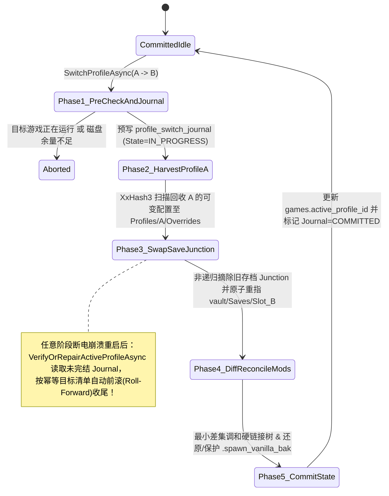

# Nexus 模块规格正本：非侵入 Mod 中枢、原子 Profile 与极客军火库（`spawn.nexus`）

| 元数据项 | 规格定义 |
| :--- | :--- |
| **模块代号** | `spawn.nexus` |
| **承载子工程** | `Spawn.Modules.Nexus`（CAS 仓库、引擎编排、Profile 事务与系统级极客工具）、`Spawn.TrainerWorker`（仅受托执行 `Tier 0` 进程挂起急冻），统一基于 `.NET 10 LTS`（`net10.0-windows`） |
| **所属进程域与权限** | 文件拓扑与设备控制运行于 `Spawn.Host.exe`（`Medium IL 0x2000`）；`NtSuspendProcess` 战术急冻物理隔离在 `Spawn.TrainerWorker.exe`（`High IL 0x3000`） |
| **覆盖需求与决策** | `REQ-NEX-01` ~ `REQ-NEX-07`、`REQ-SEC-01`、`REQ-SEC-03`、`D-01`、`D-08`、`D-10`、`A-06`、`NFR-03` |
| **目标交付里程碑** | `M4`（CAS 硬链接仓库、`XxHash3` 可变配置回收、四大引擎加载器编排、五位一体多维 Profile `<100ms` NTFS Junction 原子快照切换） · `M6`（6 大极客扩展工具箱：便携沙箱、WOF 熵值无损压缩、DLSS 4 官方签名热替换、Sunshine 虚拟屏串流、进程独立声卡路由、单机战术急救箱） |
| **关联设计正本** | [ADR-0004：CAS 存储与 Junction 拓扑](../decisions/0004-cas-fastcdc-storage-and-mod-junction-topology.md) · [数据模型正本](../design/data-model.md) · [IPC 与安全契约](../design/ipc-and-security-contracts.md) · [Spawn 启动器规格](./spawn-launcher.md) · [Progress 存档规格](./progress-saves-and-trainer.md) |
| **前期调研档案** | [卷 02 §2 ~ §3：非侵入式 Mod 部署与六大极客扩展功能](../research/02-launcher-process-and-mod-nexus.md) |

---

## 1. 职责边界与进程权限域

### 1.1 模块职责范围（In-Scope）

1. **只读内容寻址（CAS）Mod 仓库与原版零污染部署**：基于 `BLAKE3` 内容哈希去重存储全库 Mod 资产，采用同卷 `CreateHardLinkW` 毫秒级零空间翻倍投射、原版同名文件 `.spawn_vanilla_bak` 原地原子重命名保护，以及对 `.ini/.json/.toml/.cfg/.xml/.yaml` 可变配置文件的 `MutableCopy` 部署与退出后 `XxHash3` SIMD 极速差异回收。
2. **四大主流游戏引擎与二次元 Mod 框架语义编排**：内置 Unity（`BepInEx` 5 Mono vs `BepInEx` 6 IL2CPP 自动侦测 + `UnityDoorstop` 参数路由）、Unreal Engine 4/5（`RE-UE4SS` + `~mods` `.pak/.utoc/.ucas` 槽位序治理）、`Reloaded-II` 配置桥接及二次元 `XXMI`（`3DMigoto` 沙箱隔离加载 + `HideUID` 防封强提醒）编排器。
3. **五位一体多维 Profile `<100ms` 原子切换事务引擎**：通过 5 阶段预写事务日志（`profile_switch_journal`）与非递归顶层 NTFS Directory Junction 重定向，在百毫秒内同步切换“Mod 视图 + 独立存档槽位 + 启动参数/转区 + 伴生蓝图 + 修改器预设”，并与 `spawn.progress` 协同实施 `mod_profile_hash` 防坏档护栏。
4. **六大硬核极客底层扩展工具箱（Geek Arsenal）**：
   - **便携绿色沙箱（Portable Sandbox Wrapper）**：收拢漫游至系统盘的散落存档与注册表依赖；
   - **WOF 内核无损透明压缩管家**：首中尾香农熵预检 + `DirectStorage`（`dstorage.dll`）强制熔断保护；
   - **DLSS 4 / FSR 3.1 / XeSS 官方签名热替换管家**：`WinVerifyTrust` 数字签名强验真与 NGX HUD 调试开关；
   - **Sunshine + Moonlight + `IddCx` 虚拟屏串流联动**：掌机/平板连接自适应分辨率刷新率与主机 OLED 物理熄屏；
   - **进程级独立声卡输出路由**：基于 `IAudioPolicyConfigFactory` 的零注入单游戏音频分轨；
   - **单机战术急停与急救箱**：`Tier 0` 过场动画 `NtSuspendProcess` 时间静止、全屏死锁核按钮强杀救援、老游戏真无边框化。

### 1.2 明确排除边界（Out-of-Scope）

- **不使用内核过滤驱动或用户态 API Hook 虚拟文件系统（否决 `USVFS` / `Dokany`）**：彻底规避 Windows 11 驱动签名兼容危机、杀毒软件拦截与运行时 I/O 性能损耗（见 [ADR-0004](../decisions/0004-cas-fastcdc-storage-and-mod-junction-topology.md)）。
- **严禁在 `Spawn.Host.exe` 中直接调用 `NtSuspendProcess`**：单机进程挂起急冻必须通过命名管道 RPC 委派给按需启动的 `Spawn.TrainerWorker.exe`，保持主界面宿主 PE 导入表 100% 纯净（`REQ-SEC-01`）。

---

## 2. 核心接口与状态机契约

### 2.1 核心领域服务接口（`Spawn.Modules.Nexus`）

```csharp
namespace Spawn.Modules.Nexus.Contracts;

public enum ModDeploymentKind
{
    ImmutableHardLink = 0,   // 静态资产 (.pak/.bundle/.dds/.dll)，指向只读 CAS Blob
    CrossVolumeReadOnlyCopy = 1, // 跨盘符回退只读物理副本
    MutableConfigCopy = 2    // 可变配置 (.ini/.json/.toml/.cfg/.xml/.yaml)，退出后增量回收
}

public interface IModCasVaultService
{
    Task<ModPackageRecord> ImportArchiveAsync(Guid gameId, string archivePath, CancellationToken ct = default);
    Task RestoreVanillaCleanStateAsync(Guid gameId, CancellationToken ct = default);
}

public interface IProfileTransactionService
{
    Task<ProfileSwitchResult> SwitchProfileAsync(Guid gameId, Guid targetProfileId, CancellationToken ct = default);
    Task VerifyOrRepairActiveProfileAsync(Guid gameId, CancellationToken ct = default);
    Task<int> HarvestMutableConfigOverridesAsync(Guid gameId, Guid profileId, CancellationToken ct = default);
}

public interface IGeekUtilitiesService
{
    Task<PortableWrapResult> EnablePortableSandboxAsync(Guid gameId, PortableSandboxMode mode, CancellationToken ct = default);
    Task<WofCompressionReport> CompressGameDirectoryAsync(Guid gameId, WofCompressionAlgorithm algo, IProgress<double>? progress, CancellationToken ct = default);
    Task<UpscalerSwapResult> SwapUpscalerDllAsync(Guid gameId, UpscalerKind kind, string candidateDllPath, CancellationToken ct = default);
    Task RouteProcessAudioEndpointAsync(uint processId, string? mmDeviceEndpointId, CancellationToken ct = default);
    Task ToggleSinglePlayerFreezeAsync(Guid gameId, bool freeze, CancellationToken ct = default);
    Task ExecuteEmergencyDeadlockKillAsync(CancellationToken ct = default);
}
```

### 2.2 五阶段 Profile 原子切换与崩溃自愈状态机



---

## 3. 数据模型与存储路径

### 3.1 SQLite 核心表契约（归属 `spawn.db`）

主表结构严格对齐 [data-model.md](../design/data-model.md) 全局 `snake_case` 命名契约，模块辅表（如 `mod_package_files`、`upscaler_backups`）共享同一版本化 SQL 迁移管线：

| 表名 | 主键 | 关键字段与约束摘要 | 业务用途 |
| :--- | :--- | :--- | :--- |
| `mod_packages` | `mod_id TEXT` | `game_id TEXT NOT NULL`, `display_name TEXT`, `version TEXT`, `install_target_strategy TEXT`, `archive_blake3 TEXT`, `file_entries_json TEXT`, `imported_at_utc TEXT` | 已导入 Mod 包元信息与完整性指纹 |
| `mod_package_files` | `(package_id, rel_path)` | `blob_blake3 TEXT NOT NULL`, `size_bytes INT NOT NULL`, `is_mutable_config INT NOT NULL` | Mod 包内相对路径与 CAS Blob 寻址映射辅表 |
| `game_profiles` | `profile_id TEXT` | `game_id TEXT NOT NULL`, `profile_name TEXT NOT NULL`, `save_slot_dir TEXT NOT NULL`, `launch_args TEXT`, `locale_mode TEXT`, `default_blueprint_id TEXT`, `trainer_preset_json TEXT`, `mod_profile_hash TEXT NOT NULL` | 五位一体多维 Profile 主表（`mod_profile_hash` 供存档防坏档比对） |
| `profile_mod_order` | `(profile_id, mod_id)` | `load_order INT NOT NULL`, `is_enabled INT NOT NULL` | Profile 下启用的 Mod 栈及冲突覆盖优先级（高 `load_order` 胜出） |
| `deployed_manifest` | `(game_id, target_rel_path)` | `deploy_mode TEXT`, `source_blob_blake3 TEXT`, `last_known_xxhash3 TEXT`, `has_vanilla_backup INT NOT NULL DEFAULT 0` | 当前实际投射到 `<GameInstallDir>` 的精确文件账本 |
| `profile_switch_journal` | `journal_id TEXT` | `game_id TEXT NOT NULL`, `from_profile_id TEXT`, `to_profile_id TEXT NOT NULL`, `phase TEXT NOT NULL`, `reparse_targets_json TEXT NOT NULL`, `started_at_utc TEXT` | 断电自愈预写事务日志（WAL） |
| `upscaler_backups` | `(game_id, dll_rel_path)` | `original_sha256 TEXT NOT NULL`, `original_version TEXT`, `active_version TEXT`, `signer_subject TEXT`, `swapped_at TEXT` | DLSS / FSR / XeSS 官方 DLL 替换与一键还原台账辅表 |

### 3.2 物理存储拓扑（`SPAWN_Vault`）

为最大化同盘符硬链接命中率，支持在游戏所在物理分区根部建立卫星分卷库 `<DriveRoot>\SPAWN_Vault\`（默认应用数据主库位于 `%LOCALAPPDATA%\spawn\vault\`）：

```text
<VaultRoot>\
├── Blobs\
│   └── ab\cd\<64-char-blake3-hash>.blob      # 设置 FileAttributes.ReadOnly，跨 Profile 全局单实例去重
├── Profiles\
│   └── <ProfileId>\
│       ├── Overrides\                        # 存放玩家游戏内修改后由 XxHash3 回收的 .ini/.json/.cfg
│       └── StagingRoot\                      # UE ~mods 槽位或 Unity BepInEx 独立插件树拼装视图
├── Saves\
│   └── <GameId>\
│       ├── Slot_Vanilla\                     # 物理存档持久驻留于此，绝不在切换时搬运拷贝！
│       └── Slot_HeavyMod\
└── Sandbox\
    └── XXMI\<GameCode>\                      # 3DMigoto d3d11.dll 与 ShaderFixes 隔离沙箱（游戏本体零落盘）
```

---

## 4. 关键算法与协议细节

### 4.1 CAS 硬链接投射、原版保护与 `XxHash3` 可变配置回收（`REQ-NEX-01`）

1. **入库与只读硬锁**：解压 Mod 压缩包（`SharpCompress`）时流式计算 `BLAKE3` 256-bit 哈希，落盘至 `Blobs/<h[0..2]>/<h[2..4]>/<hash>.blob` 并立即施加 **`FileAttributes.ReadOnly`**——即使游戏引擎不规范地尝试以写模式打开静态资产硬链接，也会被 NTFS 内核在打开阶段直接拦截，绝不污染 CAS 母本。
2. **原版同名文件原地备份（0.5 秒一键洗白）**：
   - 当投射目标 `<GameInstallDir>\<rel_path>` 已存在且不在 `deployed_manifest` 中时，判定为游戏原版自带文件；强制调用 `MoveFileExW(target, target + ".spawn_vanilla_bak", MOVEFILE_WRITE_THROUGH)` 原地重命名保护，并置 `has_vanilla_backup = 1`。
   - 切回 `Purist` 纯净模式或一键洗白时，仅需遍历 `deployed_manifest` 删除投射文件并将 `.spawn_vanilla_bak` 原子改回原名，20GB Mod 还原耗时 `< 500ms`。
3. **同卷硬链接与跨卷优雅回退**：
   - 调用 `GetVolumePathNameW` 校验 `<VaultRoot>\Blobs` 与 `<GameInstallDir>` 是否同属一个 NTFS 卷：同卷直接调用 `CreateHardLinkW(targetPath, blobPath, IntPtr.Zero)`（零额外字节占用）；对于整目录挂载点（如 `BepInEx\plugins`、`Mods`），优先创建**无需管理员权限的 NTFS Directory Junction**（`FSCTL_SET_REPARSE_POINT` `IO_REPARSE_TAG_MOUNT_POINT = 0xA0000003`）；跨卷单文件回退至带 `ReadOnly` 属性的物理复制。
4. **可变配置文件拆流与 `XxHash3` 回收**：
   - 扩展名命中 `{ .ini, .cfg, .toml, .json, .xml, .yaml, .yml, .sav_cfg }` 或位于 `config\` / `UserData\` 下的文件，一律标记为 `MutableCopy`：优先从 `Profiles/<ProfileId>/Overrides/<rel_path>` 复制可写副本（若首次部署则从 CAS Blob 复制并去除 `ReadOnly`），同时计算 128-bit `System.IO.Hashing.XxHash3`（AVX2/AVX-512 吞吐量 `> 15 GB/s`）存入 `last_known_xxhash3`。
   - 游戏退出进入 `PostExitReclaiming` 时，仅扫描 `deploy_mode == 'MutableCopy'` 条目；若当前文件 `XxHash3` 与 `last_known_xxhash3` 不同，自动将该文件拷回 `Profiles/<ProfileId>/Overrides/<rel_path>` 更新持久化。

### 4.2 四大游戏引擎与二次元 Mod 框架编排规则（`REQ-NEX-02`）

| 引擎 / 框架 | 静态特征自动侦测规则 | 非侵入编排与加载顺序控制机制 |
| :--- | :--- | :--- |
| **Unity (`BepInEx` 5 / 6)** | 检查 `UnityPlayer.dll`：若存在 `GameAssembly.dll` 判定为 **IL2CPP**（匹配 `BepInEx 6.x`）；若存在 `MonoBleedingEdge\` 或 `Mono\` 判定为 **Mono**（匹配 `BepInEx 5.4.x`），混装包静态报错阻断。 | 仅在根目录投射轻量 `winhttp.dll`（`UnityDoorstop 4.x`），通过启动参数 `--doorstop-enabled true --doorstop-target-assembly "<ProfileStaging>\BepInEx\core\BepInEx.Preloader.dll"` 直指当前 Profile 独立目录，切换 Profile 零文件搬运。 |
| **Unreal Engine 4 / 5** | 探测 `<Project>\Binaries\Win64\*-Win64-Shipping.exe` 与 `<Project>\Content\Paks\`（含 `.ucas`/`.utoc` 则启用 IoStore 同步三件套校验）。 | 注入层托管 `Win64\dwmapi.dll`（`RE-UE4SS`）；资产层在 `Content\Paks\~mods\` 按 `profile_mod_order.load_order` 自动生成三位序号前缀硬链接（如 `010_HighResTex_P.pak/.utoc/.ucas`），利用 UE 字典序完成确定性覆盖。 |
| **`Reloaded-II`** | 日系/世嘉/Atlus 单机配置项显式关联本机 `Reloaded-II` 目录。 | 启动前原子读写 `%APPDATA%\Reloaded-Mod-Loader-II\Apps\<AppId>\AppConfig.json` 中的 `EnabledMods` 数组，通过 `Reloaded-II.exe --launch "<Exe>"` 串联拉起。 |
| **二次元 `XXMI` (`3DMigoto`)** | 覆盖原神 (`GIMI`)、星铁 (`SRMI`)、绝区零 (`ZZMI`)、鸣潮 (`WWMI`)、终末地 (`EFMI`)。 | **游戏目录零落盘**：`d3d11.dll` 与 `Mods\` 驻留于 `Vault\Sandbox\XXMI\<GameCode>\`，由定制 Loader 等待窗口就绪后注入；退出时回收 `d3dx_user.ini`；**安全硬规则**：① 开启 `XXMI` 期间强制锁死外部修改器与内存读写；② 未启用 `HideUID` Mod 时在启动按钮旁高亮黄色防晒图封号警示。 |

### 4.3 NTFS Junction 非递归摘除铁律与防坏档协同（`REQ-NEX-03`, `REQ-NEX-07`）

> **灾难防御红线**：在切换存档槽位或整目录 Mod Junction 时，**严禁调用 `Directory.Delete(junctionPath, recursive: true)`**（旧版或不当封装若跟随重解析点遍历，将直接清空 `Vault\Saves\Slot_A` 内的真实存档！）。
> - **唯一合法摘除方式**：先校验 `(File.GetAttributes(path) & FileAttributes.ReparsePoint) != 0`，再调用 Win32 P/Invoke `RemoveDirectoryW(junctionPath)`（或 `new DirectoryInfo(junctionPath).Delete()` 即 `recursive: false`），耗时 `< 0.2ms` 且仅移除空壳重解析点。
> - **跨模块 `mod_profile_hash` 防坏档护栏**：`mod_profile_hash = BLAKE3(Sorted(package_id + ":" + version + ":" + load_order))`。当用户在 `spawn.progress` 中尝试恢复一份 `snapshot.mod_profile_hash != currentProfile.mod_profile_hash` 的存档时，Nexus 提供差异对比清单（缺失/多出的 Mod 名称）并支持“连同对应 Profile 一键原子切换后再回滚存档”。

### 4.4 六大极客扩展功能底层规格（`REQ-NEX-04` ~ `REQ-NEX-06`）

#### (1) 便携绿色沙箱（Portable Sandbox Wrapper）
- **底层真相避坑**：现代 Windows 游戏普遍调用 `SHGetKnownFolderPath(FOLDERID_RoamingAppData / FOLDERID_Documents / FOLDERID_LocalAppDataLow)` 直接查询内核 Token 目录，单纯修改子进程环境变量 `APPDATA`/`USERPROFILE` 对 80% 以上的游戏无效。
- **双模式实现**：
  - **模式 A（零注入首选，支持 `Tier 0/1`）**：若目标使用 `Goldberg` / `gbe_fork` 模拟器，自动写入 `steam_settings\local_save.txt` 指向 `<GameInstallDir>\_SpawnPortable\SteamSaves`；对遵循 `ludusavi` 精确子目录规则（如 `%USERPROFILE%\AppData\LocalLow\<Vendor>\<Game>`）的绿色游戏，在启动前将该子目录挂载为指向 `<GameInstallDir>\_SpawnPortable\SaveData` 的临时 NTFS Junction（若原路径已有本机存档则先安全改名 `.host_bak`，游戏退出后拆桥复原），整夹拷入移动硬盘即可即插即玩。
  - **模式 B（深度沙箱，硬锁 `Tier 0` 纯离线单机）**：可选启用轻量 `SpawnPortableShim_x64/x86.dll`，仅对进程内 `SHGetKnownFolderPath` 与 `SHGetFolderPathW` 的 5 个存档相关 `KNOWNFOLDERID` 返回 `<GameInstallDir>\_SpawnPortable\UserRoot` 下的对应子目录。

#### (2) WOF 内核无损透明压缩管家 + `DirectStorage` 熔断
- **内核接口**：通过 `DeviceIoControl` 发送控制码 `FSCTL_SET_EXTERNAL_BACKING (0x00090310)`，传入 `WOF_EXTERNAL_INFO (Version=1, Provider=WOF_PROVIDER_FILE[2])` + `FILE_PROVIDER_EXTERNAL_INFO_V1`，支持 `XPRESS8K (2)`（默认，解压速度 `> 3 GB/s`）、`XPRESS16K (3)` 与 `LZX (1)`（冷归档极限压缩）。压缩产物由 `wof.sys` 在内核页缓存层透明解压，无需开启 SPAWN 即可原生运行。
- **两大智能护栏**：
  1. **`DirectStorage` 强制熔断**：压缩前扫描目录是否存在 `dstorage.dll` 或 `dstoragecore.dll`；一旦检出立即置灰禁用 WOF 压缩并提示原因（防止破坏 GPU 绕过 CPU 的 NVMe DMA 直通流水线引发帧时间尖刺）。
  2. **三段式香农熵预采样（`A-06`）**：对 `>= 1MB` 的文件，仅读取头部 `64KB`、中部 `64KB`、尾部 `64KB` 共 `192KB` 样本计算字节香农熵 $H = -\sum_{i=0}^{255} P(b_i)\log_2 P(b_i)$；若 $H > 7.85\text{ bits/byte}$（如已高度加密压缩的 `.utoc`/`.pak`/`.bk2` 视频），`< 0.5ms` 直接跳过，杜绝数十分钟无效 CPU 满载空转。

#### (3) DLSS 4 / FSR 3.1 / XeSS 官方签名热替换管家
- **扫描目标**：递归定位 `nvngx_dlss.dll`（Super Resolution，支持升级 DLSS 3.10+ Transformer Preset J/K）、`nvngx_dlssg.dll`（Frame Generation）、`nvngx_dlssd.dll`（Ray Reconstruction）、`amd_fidelityfx_dx12.dll` / `amd_fidelityfx_vk.dll`（FSR 3.1+）、`libxess.dll`。
- **安全铁律**：① **仅对 `Tier 0`（及确认白名单的单机化 `Tier 1`）开放**，`Tier 2/3` 多人在线游戏在 UI 与服务层双重硬锁死（规避类似过往网游误封篡改 `nvngx_dlss.dll` 玩家的风险）；② 部署任意替换包前，强制调用 Win32 **`WinVerifyTrust`**（`WINTRUST_ACTION_GENERIC_VERIFY_V2`）验证其包含由 `NVIDIA Corporation`、`Advanced Micro Devices, Inc.` 或 `Intel Corporation` 签发的有效未篡改 Authenticode 数字签名，任何无签名或自签 DLL 100% 拒绝写入；③ 原文件备份至 `<VaultRoot>\Backups\Upscalers\<GameId>\` 并登记 `upscaler_backups`；④ 提供单机调试开关读写 `HKCU\Software\NVIDIA Corporation\Global\NGXCore\ShowDlssIndicator`（`0x400` 开启左下角实时超分版本与 Preset HUD，`0` 关闭）。

#### (4) Sunshine + Moonlight 远程串流与 `IddCx` 虚拟屏熄屏联动
- **应用清单同步**：解析并无损更新本机 `%ProgramFiles%\Sunshine\config\apps.json`，将选定游戏注册为 `spawn-cli.exe launch --game-id <Guid> --from-stream`，并自动导出 `600x900` PNG 海报供 Moonlight 客户端展示。
- **动态虚拟屏与物理 OLED 保护**：当 `spawn-cli` 检测到 Sunshine 注入的环境变量 `SUNSHINE_CLIENT_WIDTH`、`SUNSHINE_CLIENT_HEIGHT`、`SUNSHINE_CLIENT_FPS`、`SUNSHINE_CLIENT_HDR` 时：
  1. 激活开源 `Virtual-Display-Driver`（`IddCx`）虚拟显示器，动态下发与掌机/平板完全一致的分辨率（如 Steam Deck `1280x800@90Hz`、iPad Pro 原生比例）与 HDR 能力；
  2. 调用 Windows CCD `SetDisplayConfig` 将画面仅输出至虚拟屏，**物理切断主机 OLED 显示器信号使其黑屏休眠**（防烧屏、防夜间卧室刺眼漏光）；
  3. 自动切换该游戏的 `StreamHandheld` Profile（大 UI 字体配置），串流断开后 1 秒内经 `environment_rollback.json` 恢复物理主屏拓扑。

#### (5) 进程级独立声卡输出路由（Per-Game Audio Endpoint Router）
- **零注入 COM 机制**：与 Windows 11“系统 -> 声音 -> 音量合成器”同源，调用 `RoGetActivationFactory("Windows.Media.Internal.AudioPolicyConfig", ...)` 获取 `IAudioPolicyConfigFactory`，自适应匹配 Windows 11 22H2~24H2 接口 IID `ab3d4648-e242-459f-b02f-541c70306324` 与 Windows 10 回退 IID `2a59116d-6c4f-45e0-a74f-707e3fef9258`。
- 将 `MMDevice` 端点 ID 封装为标准设备接口字符串 `\\?\SWD#MMDEVAPI#<EndpointId>#{e6327cad-dcec-4949-ae8a-991e976a79d2}`（通过 `WindowsCreateString` 转为 `HSTRING`），对目标游戏 PID 同时设置 `ERole.eConsole (0)` 与 `ERole.eMultimedia (1)` 的 `SetPersistedDefaultAudioEndpoint`，实现“挂机刷本游戏静音推向虚拟声卡、前台 3A 大作独占外置 USB DAC”且零游戏内注入。

#### (6) 极客战术急停与急救箱
1. **单机过场动画“时间静止”急冻（硬锁 `Tier 0`）**：针对不可暂停过场动画（如魂游/日式 RPG 突遇外卖电话），用户按下自定义热键时，`Spawn.Host` 先校验 `game.anti_cheat_tier == Tier 0`，先通过 `NAudio.Wasapi` 将该 PID 音频会话瞬时静音（防止声卡环形缓冲区卡死尖啸），再通过 IPC 指示 `Spawn.TrainerWorker.exe` 调用 `ntdll.dll!NtSuspendProcess`；再次按键先 `NtResumeProcess` 再恢复音量。**防僵尸守护**：`TrainerWorker` 维护挂起 PID 表并在收到管道断开或自身 `ProcessExit` 时无条件遍历执行 `NtResumeProcess`。
2. **全屏黑屏死锁“核按钮”救援（Super-Kill）**：当老游戏独占全屏崩溃假死导致 `Alt+Tab` 与任务管理器均被黑屏遮挡且鼠标被死锁在左上角时，按下 `Ctrl + Alt + Shift + F4`（或手柄 `Guide + Start` 长按 3 秒），宿主直接调用 `TerminateJobObject(hJob, 1)` 瞬秒整棵死锁进程树 -> 调 `ClipCursor(IntPtr.Zero)` 释放鼠标 -> 调 `ChangeDisplaySettingsExW` 恢复桌面原生分辨率。
3. **顽固老游戏真无边框窗口化**：针对仅支持低分辨率窗口化的 DX9/Galgame 老作品，通过外部 Win32 窗口管理剥离 `WS_CAPTION | WS_THICKFRAME | WS_MINIMIZEBOX | WS_MAXIMIZEBOX` 样式并 `SetWindowPos` 贴合目标显示器工作区。

---

## 5. 跨模块协同契约

- **与 `spawn.launcher` 协同**：`VerifyOrRepairActiveProfileAsync` 挂载于 `PreFlightChecking` 阶段，确保断电残留事务在游戏启动前 100% 修复完毕；`HarvestMutableConfigOverridesAsync` 挂载于 `PostExitReclaiming` 阶段，确保玩家游戏内修改的 Mod 配置先一步归档。
- **与 `spawn.progress` 协同**：每次创建存档快照时，由 `spawn.nexus` 提供当前游戏激活 Profile 的 `mod_profile_hash` 写入 `save_snapshots`；回滚存档时双向联动校验依赖一致性（`REQ-NEX-07`）。
- **与 `spawn.achievement` (`Alt+Z` 面板) 协同**：`Alt+Z` 战术面板暴露“单机过场急冻/解冻”快捷按钮（仅在 `Tier 0` 游戏下可见可点），底层复用 `IGeekUtilitiesService.ToggleSinglePlayerFreezeAsync`。

---

## 6. 异常恢复与反作弊熔断行为

1. **Profile 切换中途断电自愈**：`profile_switch_journal` 记录完整目标差异计划 `plan_json`。由于 CAS Blobs 永不就地修改、存档物理目录永不搬移，无论在 Phase 2~4 哪一步断电，重启后重放 Phase 3（重指 Junction）与 Phase 4（幂等校正硬链接与 `.spawn_vanilla_bak`）均为**严格幂等前滚（Idempotent Roll-Forward）**，零坏档、零孤儿硬链接。
2. **文件被占用冲突处理**：切换 Profile 或部署 Mod 时若探测到 `<GameInstallDir>` 下任意可执行文件正在运行（`0x1000` 进程匹配或文件写锁探测失败），在 Phase 1 直接安全拒绝切换并提示先关闭游戏，绝不产生半部署脏目录。
3. **反作弊分级硬熔断矩阵**：
   - `Tier 0`：开放全部 CAS Mod、四大引擎编排、便携沙箱（模式 A/B）、超分替换、进程急冻；
   - `Tier 1`：开放二次元 `XXMI` 独立沙箱（开启期间自动互斥禁用 `TrainerWorker`）、模式 A 便携沙箱与经签名的单机超分查看；**严禁调用 `NtSuspendProcess` 与模式 B DLL 注入**；
   - `Tier 2 / Tier 3`：**全面禁用** Mod 注入编排、超分 DLL 替换、便携 Shim 与进程急冻，仅允许无侵入的声卡端点路由与全屏死锁救援。

---

## 7. 测试与阶段验收要求

1. **CAS 硬链接、原版备份与 `XxHash3` 回收集成测试（验证 `REQ-NEX-01`）**：
   - 在临时目录构造含 100 个静态文件与 5 个 `.ini` 配置的模拟游戏夹具，导入两个存在重叠覆盖关系的 Mod 包：验证同卷硬链接数（`nNumberOfLinks >= 2`）、原版文件 `.spawn_vanilla_bak` 留存、模拟修改 `.ini` 后回收至 `Overrides/`，以及执行 `RestoreVanillaCleanStateAsync` 后目录树与初始状态逐字节哈希 100% 一致。
2. **千文件 Profile `<100ms` 切换与断电注入测试（验证 `REQ-NEX-03`）**：
   - 构造含 5,000 个 Mod 文件条目的 `Profile A` 与 `Profile B` 以及各自含虚拟存档的 `Slot_A` / `Slot_B`：实测切换耗时 `< 100ms`；验证移除存档 Junction 后 `Slot_A` 内文件完好无损；在 Phase 3 与 Phase 4 注入模拟异常中断后调用 `VerifyOrRepairActiveProfileAsync`，断言 100% 自愈收敛至 `Profile B`。
3. **WOF 香农熵采样与 `DirectStorage` 熔断测试（验证 `REQ-NEX-04`）**：
   - 输入高随机度加密缓冲文件（$H \approx 7.99$）与高重复文本/未压缩纹理（$H < 5.5$），断言高熵文件 `< 0.5ms` 被直接跳过；在夹具目录放入空特征文件 `dstorage.dll` 时，断言 `CompressGameDirectoryAsync` 立即触发 `DirectStorageCircuitBreakerException`。
4. **`WinVerifyTrust` 签名校验门禁测试（验证 `REQ-NEX-05`）**：
   - 使用未签名与篡改单字节的模拟 `nvngx_dlss.dll` 调用 `SwapUpscalerDllAsync`，断言 100% 拦截拒绝且目标目录零改动。
5. **进程急冻防僵尸守护测试（验证 `REQ-NEX-06`）**：
   - 针对后台无窗口测试子进程 `DummySleeper.exe` 触发冻结，随后强制终止 `TrainerWorker` 连接，验证守护回收逻辑或宿主兜底使目标测试进程恢复运行计数。
