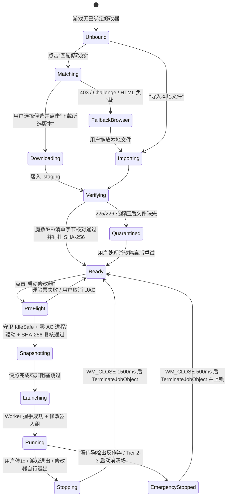
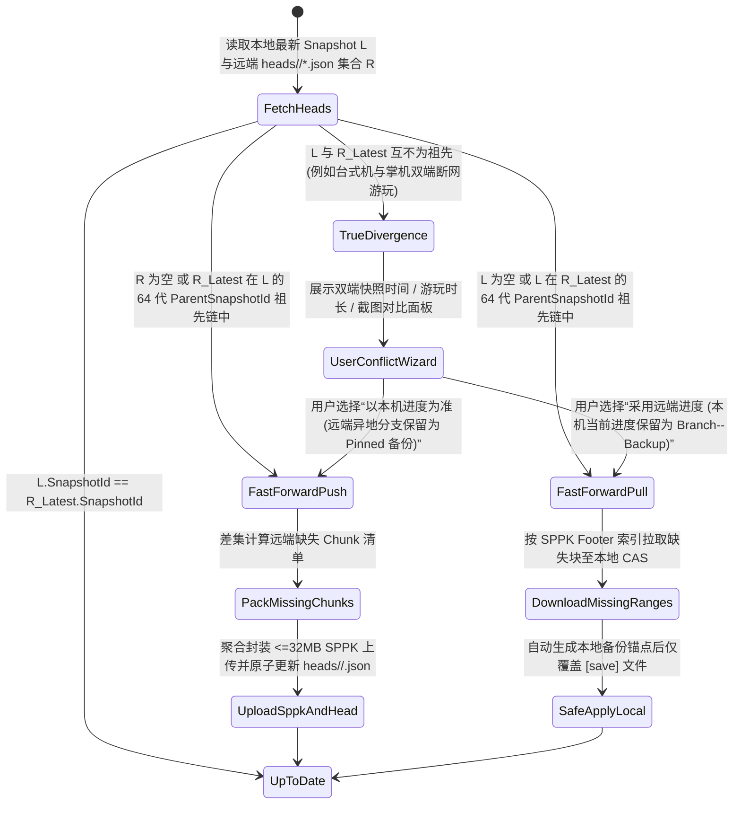

# Progress 模块规格正本：单机外部修改器安全管家、启动前存档快照与存档时间机器/云同步（`spawn.progress`）

| 元数据项 | 规格定义 |
| :--- | :--- |
| **模块代号** | `spawn.progress` |
| **承载子工程** | `Spawn.Modules.Progress`（Clean Host 侧：修改器目录与匹配、洁净室 FLiNG 发现/解析/下载、本地导入、`A0+A` 静音控制、启动前存档快照；`M4` 轨道：存档规则解析、FastCDC 去重库、SPPK 云同步）、`Spawn.TrainerWorker`（隔离进程：修改器 `KILL_ON_JOB_CLOSE` 托管、`SendInput` 热键代理、窗口显隐、WASAPI 回退；`M6`：收窄原生修改后端），统一基于 `.NET 10 LTS`（`net10.0-windows`） |
| **所属进程域与权限** | 修改器目录、下载、解压、静音会话管理与存档快照运行于 `Spawn.Host.exe`（`Medium IL 0x2000`，受 `PEReader` 门禁）；修改器进程托管与按键代理物理隔离于 `Spawn.TrainerWorker.exe`（发布于 `Workers\Trainer\`；按 `D-11` 分级：无管理员清单时 `Medium IL`，需要时每会话 1 次 UAC 升为 `High IL 0x3000`），`M3` 零跨进程内存读写 API 导入 |
| **覆盖需求与决策** | `REQ-PRG-01` ~ `REQ-PRG-08`、`REQ-NEX-07`、`REQ-SEC-01`、`REQ-SEC-03`、`REQ-SEC-05`、`REQ-SEC-06`、`NFR-07`、`D-04`、`D-09`、`D-11`、`D-12`、`D-25` ~ `D-29`、`A-01` ~ `A-03` |
| **目标交付里程碑** | `M3`（外部修改器安全管家 + 启动前轻量存档快照，`AC-12` / `AC-12b`） · `M4`（`Ludusavi` 预编译索引、`FastCDC` 存档时间机器、`32MB SPPK` 云同步轨道，`AC-09` ~ `AC-11`，自 `M3` 顺延） · `M6`（收窄原生修改后端，`AC-24`） |
| **关联设计正本** | [ADR-0004：CAS 与 FastCDC 存储架构](../decisions/0004-cas-fastcdc-storage-and-mod-junction-topology.md) · [ADR-0005：外部生态与零报毒修改器治理](../decisions/0005-external-ecosystem-orchestration-and-uiaccess-overlay.md) · [ADR-0006：修改器提权与 IPC](../decisions/0006-m3-external-trainer-manager-elevation-and-ipc.md) · [数据模型正本](../design/data-model.md) · [IPC 与安全契约](../design/ipc-and-security-contracts.md) · [Nexus 模块规格](./nexus-mods-and-utilities.md) |
| **前期调研档案** | [卷 03：存档时间机器、去中心化云同步与单机修改器管家](../research/03-save-timemachine-and-trainer.md)（`reference`；其中 22B MIDI、35ms 扫描码、`Reloaded.Memory.SigScan`、移植 `GPL`/`AGPL` 解析器、抓取 `/?s=` 等表述已被本规格推翻，以本规格为准） |

---

## 1. 职责边界与进程权限域

### 1.1 `M3` 模块职责范围（In-Scope）

1. **修改器发现与版本匹配（`REQ-PRG-04`）**：以英文标准名与本地版本指纹匹配 FLiNG 主站/归档站修改器，给出三级置信度提示（非硬阻断）；严守源站 `robots.txt`，零后台爬虫、零中转镜像。
2. **用户显式触发下载与本地导入一等公民（`REQ-PRG-04`）**：单次用户点击触发的安全下载流水线 + 拖放导入 `.exe`/`.zip`/`.rar`/`.7z`；落盘即钉扎本地 `SHA-256`。
3. **结构化热键解析（`REQ-PRG-04`）**：`AngleSharp` DOM 洁净室解析热键表与 `toolTips` 提示；非 FLiNG 修改器自动进入“自由托管模式”。
4. **零注入双保险静音（`REQ-PRG-05`、`D-04`、`D-28`）**：`A0` INI + 27 字节静音 SMF 预置，`A` 专用 MTA 线程 WASAPI 全端点会话控制；默认完全静音。
5. **隔离托管与无小键盘热键代理（`REQ-PRG-06`、`D-11`、`D-26`）**：`Spawn.TrainerWorker` 分级按需提权、倒置管道鉴权、原子 `KILL_ON_JOB_CLOSE` 作业对象、`MAPVK_VK_TO_VSC_EX` 交错按键代理、窗口显隐与随游戏退出联动。
6. **启动修改器前轻量存档快照与一键回滚（`REQ-PRG-08`、`D-25`）**：复用 `M2` `GameDataManagementService` + `GameDataSafetyFence`。
7. **反作弊放行判定配合（`REQ-SEC-03`、`D-27`）**：消费 `Spawn.Core` 四层 `Tier 0` 判定、`VerifiedOfflineBypass` 硬验票与 2 秒急停看门狗。
8. **杀软与系统安全提示（`REQ-PRG-04`）**：Opt-in Defender 沙箱单目录排除助手、隔离错误码 `225`/`226` 诊断与 Smart App Control 透明说明。
9. **`ITrainerBackend` 契约冻结（`REQ-PRG-07`）**：一期实现 `ExternalTrainerBackend`，为 `M6` 收窄原生修改后端留出扩展槽。

### 1.2 `M4` 轨道职责（自 `M3` 顺延，契约保留于本规格 §5）

`ludusavi-manifest` 预编译索引与 `[save]`/`[config]` 拆流（`REQ-PRG-01`）、`FastCDC` 块级去重存档时间机器与防撕裂原子回滚（`REQ-PRG-02`）、`32MB SPPK` 自建云同步与血缘合并（`REQ-PRG-03`），并与 Nexus `mod_profile_hash`（`REQ-NEX-07`）联动。

### 1.3 明确排除边界（Out-of-Scope）

- **严禁触碰任何受保护联网游戏**：修改器检索、下载、沙箱启动与热键代理**仅对 `Tier 0` 或已通过零 AC 硬验票的 `VerifiedOfflineBypass` 混合单机开放**；守卫处于 `ProtectedRunning` / `ResidualGuardWatch` / `MandatoryCooldown15s` 任一锁定态时，Host 与 Worker 双重拒绝执行。
- **严禁对外部修改器注入 Hook DLL 或改写其二进制**：否决 `MinHook` 拦截 `PlaySoundW` / `winmm.dll`，否决 `UpdateResourceW` 替换 PE `MID`/`MIDI` 资源（保 SHA-256 钉扎、降杀软启发式）。
- **`M3` 不做 `.CT` 执行引擎与内存数值扫描器**；不接入 FearlessRevolution、OpenCheatTables 或任何商业聚合门户的自动抓取；不建设任何修改器二进制中转/镜像服务器。
- **严禁复制或移植 `GPL`/`AGPL` 参考管理器代码、正则或标题词典**（`D-29`、`NFR-07`）。

---

## 2. 核心接口与状态机契约

### 2.1 `M3` 修改器与快照契约（`Spawn.Contracts`，`M3-W02` 冻结）

```csharp
namespace Spawn.Contracts;

public interface ITrainerBackend : IAsyncDisposable
{
    string BackendKind { get; } // "ExternalTrainer" (M3) | "NativeModPack" (M6)
    Task<TrainerSessionHandle> ActivateSessionAsync(TrainerLaunchSpec spec, CancellationToken ct = default);
    Task TriggerEntryAsync(Guid sessionId, string entryId, bool targetEnabled, CancellationToken ct = default);
    Task ShutdownAllImmediatelyAsync(TrainerShutdownReason reason, CancellationToken ct = default);
}

public interface ITrainerCatalogService
{
    Task<TrainerMatchResult> MatchAsync(Guid gameId, string? userSearchOverride = null, CancellationToken ct = default);
    Task<TrainerImportResult> DownloadAsync(Guid gameId, TrainerCandidate candidate, IProgress<TrainerDownloadProgress>? progress = null, CancellationToken ct = default);
    Task<TrainerImportResult> ImportLocalAsync(Guid gameId, string userSelectedPath, CancellationToken ct = default);
    Task<TrainerIntegrityReport> VerifyAsync(Guid trainerId, CancellationToken ct = default); // 启动前 SHA-256 TOCTOU 复核
    Task RemoveAsync(Guid trainerId, CancellationToken ct = default);
}

public interface ITrainerRuntimeService
{
    TrainerRuntimeState State { get; }
    event EventHandler<TrainerRuntimeStateChanged>? StateChanged;
    Task<TrainerLaunchOutcome> LaunchAsync(Guid trainerId, TrainerLaunchOptions options, CancellationToken ct = default);
    Task TriggerHotkeyAsync(Guid sessionId, string entryId, CancellationToken ct = default);
    Task SetOriginalWindowVisibleAsync(Guid sessionId, bool visible, CancellationToken ct = default);
    Task StopAsync(Guid sessionId, CancellationToken ct = default);
}

public interface ITrainerAudioController : IAsyncDisposable
{
    Task PrepareAsync(TrainerAudioPolicy policy, string sandboxRoot, CancellationToken ct = default); // A0 + MTA 预注册
    void TrackProcess(int pid);                                                                         // 主 PID 与 IOCP 上报子 PID
    Task ApplyPolicyAsync(TrainerAudioPolicy policy, CancellationToken ct = default);                   // 完全静音 / 实验性提示音
}

public interface IPreTrainerSaveSnapshotService
{
    Task<PreTrainerSnapshotResult> CreateAsync(Guid gameId, Guid? trainerId, CancellationToken ct = default); // 非阻塞：超阈值/排他锁返回 Skipped
    Task<IReadOnlyList<PreTrainerSnapshotRecord>> ListAsync(Guid gameId, CancellationToken ct = default);
    Task<PreTrainerRestoreResult> RestoreAsync(Guid snapshotId, CancellationToken ct = default);            // 先建 PreRestoreSafety，游戏运行中拒绝
}

public interface ISensitiveWorkerShutdownHook // 零循环依赖：由 Progress 实现、注入 GameLaunchService
{
    Task<SensitiveWorkerShutdownReport> ShutdownAllForProtectedLaunchAsync(TimeSpan budget, CancellationToken ct = default);
}
```

- `TrainerAudioPolicy`：`Mode`（`FullMute` 默认 / `KeepCuesExperimental`）、`CueVolume`（`0.0–1.0`，默认 `0.35`）、`EnableA0`（默认 `true`）。
- `TrainerLaunchOptions`：`HotkeyHoldMs`（`50–120`，默认 `75`）、`HideOriginalWindow`、`StopWithGameExit`（默认 `true`）、`CreatePreTrainerSnapshot`（默认 `true`）、`ScanCodeMode`（默认 `false`）。
- 反作弊放行结果统一以 `Spawn.Core` 的判定结果对象返回（`Allowed` / `BlockedByTier` / `BlockedByGuardPhase` / `BlockedByLiveAntiCheat` / `RequiresOfflineConfirmation` / `VanguardIdleWarning`），UI 不自行推断。

### 2.2 修改器会话状态机



### 2.3 `M4` 轨道契约（顺延保留）

```csharp
namespace Spawn.Modules.Progress.Contracts;

public interface ISaveTimeMachineService
{
    ValueTask<ResolvedSaveLayout> ResolveGameSavePathsAsync(Guid gameId, CancellationToken ct = default);
    Task<SaveSnapshotRecord> CreateSnapshotAsync(Guid gameId, SnapshotTriggerKind trigger, string? userNote = null, bool includeConfigFiles = false, CancellationToken ct = default);
    Task<RollbackResult> RollbackToSnapshotAsync(Guid snapshotId, ModMismatchResolution mismatchPolicy = ModMismatchResolution.AbortAndPrompt, CancellationToken ct = default);
}

public interface ICloudSaveSyncService
{
    Task<SyncPlanPreview> PlanSyncAsync(Guid gameId, CancellationToken ct = default);
    Task<SyncExecutionReport> ExecuteSyncAsync(Guid gameId, DivergenceResolutionChoice? userChoice = null, IProgress<SyncProgressTick>? progress = null, CancellationToken ct = default);
}
```

去中心化云同步三路血缘比对状态机：



---

## 3. 数据模型与存储路径

### 3.1 SQLite Schema `v4`（`M3-W02` 幂等迁移，归属 `spawn.db`）

主表结构严格对齐 [data-model.md](../design/data-model.md) 全局 `snake_case` 命名契约，迁移由 `SpawnDatabase` 版本化管线执行（`v3 → v4` 幂等，可重复运行）：

| 表名 | 主键 | 关键字段与约束摘要 | 业务用途 |
| :--- | :--- | :--- | :--- |
| `trainer_catalog` | `trainer_id TEXT` | `game_id TEXT NOT NULL`, `provider TEXT NOT NULL`（`FlingMain`/`FlingArchive`/`LocalImport`）, `display_name TEXT`, `version_label TEXT`, `source_page_url TEXT`, `source_updated_at TEXT`, `sandbox_relative_path TEXT NOT NULL`, `file_sha256 TEXT NOT NULL`, `file_size INT`, `pe_machine TEXT`, `requires_admin INT DEFAULT 0`, `authenticode_status TEXT`, `parse_mode TEXT`（`Structured`/`FreeHosted`）, `bound_build_id TEXT`, `bound_exe_size INT`, `bound_exe_last_write_utc TEXT`, `imported_at_utc TEXT NOT NULL`, `last_launched_at_utc TEXT` | 已导入修改器目录、来源归属、本地钉扎哈希与绑定时游戏版本指纹 |
| `trainer_title_map` | `game_id TEXT` | `english_title TEXT NOT NULL`, `title_source TEXT`（`AcfName`/`SteamAppDetails`/`GogInfo`/`Cleaner`/`User`）, `user_search_override TEXT`, `fling_page_url TEXT`, `updated_at_utc TEXT` | 英文标准名缓存与用户纠偏（**废除 Slug 硬拼**） |
| `trainer_hotkey_bindings` | `(trainer_id, entry_id)` | `label TEXT NOT NULL`, `tooltip TEXT`, `original_chord TEXT NOT NULL`, `mapped_chord TEXT`, `entry_kind TEXT`（`Toggle`/`Trigger`）, `proxy_state INT DEFAULT 0`, `sort_order INT` | 结构化热键、用户自定义映射与代理开关显示状态 |
| `pre_trainer_snapshots` | `snapshot_id TEXT` | `game_id TEXT NOT NULL`, `trainer_id TEXT`, `trigger_kind TEXT NOT NULL`（`PreTrainer`/`PreRestoreSafety`）, `status TEXT NOT NULL`（`Completed`/`Skipped`/`Failed`）, `skip_reason TEXT`, `file_count INT`, `total_bytes INT`, `manifest_relative_path TEXT`, `created_at_utc TEXT NOT NULL`, `restored_at_utc TEXT` | 启动前轻量快照台账（滚动保留，`PreRestoreSafety` 不计入滚动配额） |

`games` 主表新增列（列名以 `SpawnDatabase` 既有命名风格为准）：`steam_build_id`、`steam_last_updated`、`verified_offline_bypass INT DEFAULT 0`、`verified_offline_bypass_at_utc`。**`verified_offline_bypass` 绝不改写既有 `anti_cheat_tier`**；重扫游戏库不得清除用户确认，但若静态 `Tier` 变为 `Tier 1`/`Tier 3` 或检测到失去单人模式，自动失效并提示。修改器全局偏好（沙箱根目录覆盖、音频模式与提示音音量、按键保持时长、启动前备份开关/保留份数/阈值、随游戏退出、自动隐藏原窗、`vgk.sys` 严格模式）沿用 `M2` 设置存储机制持久化。

`M4` 轨道表（顺延保留，`M3` 不建表）：

| 表名 | 主键 | 关键字段与约束摘要 | 业务用途 |
| :--- | :--- | :--- | :--- |
| `ludusavi_rules` | `rule_name TEXT` | `steam_app_id INT`, `gog_id INT`, `aliases_json TEXT`, `save_paths_json TEXT NOT NULL`, `config_paths_json TEXT`, `registry_rules_json TEXT` | 预编译存档路径与标签索引（`steam_app_id` 索引，查询 `< 1ms`） |
| `cas_chunks` | `chunk_blake3 TEXT` | `raw_size_bytes INT NOT NULL`, `compressed_size_bytes INT NOT NULL`, `ref_count INT NOT NULL`, `pack_id TEXT` | 全局去重 `FastCDC` 块字典 |
| `save_snapshots` | `snapshot_id TEXT` | `game_id TEXT NOT NULL`, `profile_id TEXT`, `parent_snapshot_id TEXT`, `mod_profile_hash TEXT NOT NULL`, `trigger_kind TEXT`, `total_raw_bytes INT`, `created_machine_id TEXT`, `created_at_utc TEXT`, `is_pinned INT DEFAULT 0` | 存档快照历史树与血缘链 |
| `snapshot_files` | `(snapshot_id, logical_path)` | `category TEXT NOT NULL`（`Save`/`Config`/`RegistryExport`）, `file_size INT`, `last_write_time_utc TEXT`, `file_blake3 TEXT`, `chunk_sequence_json TEXT NOT NULL` | 单快照内逻辑文件与有序块重组清单 |
| `cloud_sync_endpoints` | `id TEXT` | `provider_type TEXT`（`S3`/`WebDav`/`LocalFolder`）, `endpoint_url TEXT`, `bucket_or_root TEXT`, `secret_file_name TEXT` | 云同步后端配置（凭据存 DPAPI `.sec`） |

### 3.2 本地物理存储布局

```text
%LOCALAPPDATA%\spawn\                          # 开发/源码运行为 %LOCALAPPDATA%\spawn-dev\；测试强制重定向临时目录
├── cache\trainers\
│   ├── fling-all-trainers.html                # 24h 缓存的 /all-trainers/ 索引（并发 1）
│   └── fling-archive-index.html               # 用户勾选后按需缓存 7 天的归档站索引
└── vault\
    ├── Sandbox\Trainers\                      # 唯一允许加入 Defender 排除的目录（可由用户改为纯 ASCII 自定义根；自定义根须为空目录，迁移逐目录校验后才删除旧副本）
    │   ├── .staging\<guid>\                   # 下载/解压暂存，校验通过后原子移动
    │   └── <GameId>\<TrainerId>\              # 成品修改器（多 EXE 时用户自选主程序，辅助 EXE 绝不自动执行）
    └── Snapshots\PreTrainer\<GameId>\<SnapshotId>\
        ├── files\...                          # 存档原始副本（跳过 ReparsePoint）
        ├── registry_snapshot.json             # HKCU 导出（确定性 UTF-8 字典序）
        └── manifest.json                      # 原子写入（临时文件 + 同卷重命名）

<InstallDir>\Workers\Trainer\Spawn.TrainerWorker.exe   # 独立发布子目录，严禁平铺于主程序根目录
```

`M4` 轨道追加：`vault\Chunks\ab\cd\<64-char-blake3>.zst` 本地块池与远端 `<RemoteRoot>/spawn-sync/{repo.json, packs/, snapshots/, heads/}` 布局（见 §5.3）。

---

## 4. `M3` 关键算法与协议细节

### 4.1 英文标准名与版本指纹匹配（`REQ-PRG-04`）

1. **一级身份锚定**：`appmanifest_<id>.acf` `"name"` → 惰性请求 `https://store.steampowered.com/api/appdetails?appids=<id>&l=english&filters=basic` 并永久缓存至 `trainer_title_map` → GOG `goggame-*.info` `"name"` → `GameTitleCleaner` 回退 + 用户可编辑搜索词。修复 `M2` 扫描器以 `l=schinese` 落库中文名导致无法直搜英文源的缺口（中文名仍用于展示）。
2. **二级更新检测**：`GameDirectoryScanner` 解析 ACF `"buildid"` 与 `"LastUpdated"`；绑定修改器时记录 `(BuildId, ExeSize, ExeLastWriteUtc)`，后续变化时温和提示“游戏文件已更新，建议检查新版修改器”。
3. **三级参考比对**：PE `FileVersion`/`ProductVersion` 先过滤 Unity（`20xx.x.*`）/Unreal（`4.27.*`/`5.x.*`）引擎版本号噪声，仅在量级一致时参与比对。
4. **四级置信度（非硬阻断）**：FLiNG 版本串存在 `v1.02-v1.16.1`、`v1.0+`/`Early Access+`、`v1.0-v20251216`、`v4.1.1 Updated 2025.04.16`、`v2.0-v2.5 Updated` 等非统一格式，统一映射为 `版本范围匹配` / `建议按更新日期核对`（默认置顶最新并列出全部历史附件）/ `可能已过期`。

### 4.2 洁净室发现与用户显式触发下载流水线（`REQ-PRG-04`）

1. **发现层（严守 `robots.txt` 与直接归档附件合成）**：仅使用 24h 缓存 `https://flingtrainer.com/all-trainers/`（约 180KB，~767 条）与单次 `wp-json/wp/v2/posts?search=<英文名>&per_page=<n>`，全链路携带诚实非伪装 `User-Agent` 与标准 RFC `Accept` / `Accept-Language` 请求头；并发锁死 `1`；**绝不请求 `/?s=`、`/attachments/` 或批量抓取 `/downloads/`**；归档站 `archive.flingtrainer.com` 静态索引仅在用户勾选后缓存 7 天。`wp-json` 的 `content.rendered` 不含附件表，附件表仅在用户打开某候选时单次拉取详情页 HTML，并捕获经白名单校验的重定向后规范 `PageUrl` 作为后续下载同源 `Referer`；对 `archive.flingtrainer.com/files/*.rar|.zip|.7z|.exe` 直接下载条目，解析索引行直接合成 `TrainerAttachmentCandidate`（含估算字节体积），严禁将压缩包二进制当 HTML 拉取。
2. **源域白名单与词边界推广过滤**：解析器仅接受 `flingtrainer.com` / `archive.flingtrainer.com` 链接，显式拒绝含 `wemod`、`auto-updat`、`installer`、`setup` 与第三方注入脚本的链接；推广词 `wand` 严格限定为词边界匹配，避免误杀合法游戏名（如 *Wandering Sword*）。
3. **下载（仅用户点击“下载所选版本”触发单次）**：使用 `SocketsHttpHandler`（`AllowAutoRedirect = false`、`UseCookies = false`、`PooledConnectionLifetime = 2m`），每次下载独占作用域隔离的 `CookieContainer` 跨手动重定向传播会话 Cookie（严禁跨次下载串用），手动跟随最多 10 跳并兼容含未转义空格/括号的原始 `Location` 响应头解析；每跳强制 `https://`、严格校核白名单主机、固定发送 `Accept: */*` 与经规范化/白名单校验的同源 `Referer`（`https://flingtrainer.com/...` 或 `https://archive.flingtrainer.com/`）；连接超时 `15s`、读流停滞 `30s`、体积上限 `100MB`（源站常缺 `Content-Length` 且忽略 `Range`，按流式计数截断）；写入 `vault\Sandbox\Trainers\.staging\<guid>\`。
4. **Challenge 与 403 精准分类秒退（零误报、零绕过）**：
   - 严禁以裸子串 `challenge-platform` 误判 Cloudflare 在正常 HTTP `200` 网页末尾嵌入的被动 JS Detection 遥测脚本（`/cdn-cgi/challenge-platform/scripts/jsd/main.js`）；
   - 仅在响应触发真实挑战或阻断时判定拦截：HTTP `403` / `503`、响应头含 `cf-mitigated: challenge`、页面 `<title>` 为 Cloudflare 校验/拦截页（如 `Just a moment...` / `Attention Required!`）、正文含主动挑战标记（`/cdn-cgi/challenge-platform/h/`、`window._cf_chl_opt`、`cf-browser-verification`、`cf-challenge-running`、`id="challenge-form"`、Turnstile 组件），或二进制下载流返回任何 HTML 负载；
   - 一旦命中上述任一条件，立即零重试中止、清理 `.staging` 暂存目录，按 `Challenge` / `HTTP 403` / `HTTP 503` / `HTML 负载` 区分输出诚实诊断文案，UI 切换为“在默认浏览器打开原页”+“拖放本地文件导入”，绝不做任何验证绕过。
5. **完整性防线**（源站不提供任何官方哈希）：
   - 魔数嗅探分流：`4D 5A`（裸 PE，FLiNG 主站 Hop 3 实际返回）→ `PEReader` 头结构检查；`50 4B 03 04` / `52 61 72 21` / `37 7A BC AF` → 压缩包；其他一律拒绝；
   - 压缩包：先读清单（条目数与解压后字节数），逐条目执行 Zip-Slip 校验（规范化后必须位于暂存根内，拒绝绝对路径、`..`、设备名与 ReparsePoint），`.zip` 优先 BCL `System.IO.Compression`，`.rar`/`.7z` 用 `SharpCompress 0.50.9`，异常时若用户本机存在 `7z.exe` 则以模式 C 兜底；解压后逐文件核对字节数——缺失/截断视为杀软静默吞文件；
   - 捕获 `ERROR_VIRUS_INFECTED (225)` / `ERROR_VIRUS_DELETED (226)` 归类为“杀软隔离”，回滚暂存并展示修复卡（与网络/文件损坏区分）；
   - 多 EXE 时弹窗由用户选择主程序，辅助 EXE 与说明文件仅保留不执行；
   - 校验通过后原子移动至 `<GameId>\<TrainerId>\`，计算并钉扎 `SHA-256`；**每次启动前复核 SHA-256（TOCTOU）**，不一致即拒绝启动并提示重新导入。
6. **本地导入**：拖放/选择 `.exe`/`.zip`/`.rar`/`.7z` 走同一暂存与校验流水线（来源记为 `LocalImport`）；**严禁静默剥离用户导入文件的 `Zone.Identifier`**。只读检测 PE 位数、清单 `requireAdministrator` 与 Authenticode 状态（仅作信息标签）。
7. **非 ASCII 路径**：沙箱根含非 ASCII 字符时优先尝试 `GetShortPathNameW`（8.3 可用时）作为启动路径，并在设置页提供自定义纯 ASCII 沙箱根（迁移时整体移动并更新 `sandbox_relative_path` 基准）。

### 4.3 结构化热键解析（`REQ-PRG-04`）

- 使用 `AngleSharp` 解析详情页（或 `wp-json` `content.rendered`）DOM：剥离 `<script>`，从 `toolTips('.tooltip_x', '说明')` 调用中提取功能提示；按段落/换行切分条目，兼容 `&#8211;` en-dash、`</p>` 结尾末项、`<span class='tooltipsall'>` 包裹；键位词表覆盖 `Num 0–9`、`Num .`、`Num +`、`Num -`、`Num *`、`Num /`、`Num Enter`、`F1–F12`、`Home`、`End`、`Insert`、`Delete`、`Page Up/Down` 及 `Ctrl`/`Alt`/`Shift` 组合。
- 解析结果写入 `trainer_hotkey_bindings`；解析失败或非 FLiNG 修改器进入 `FreeHosted` 自由托管模式（仍享沙箱、静音、随游戏退出与显隐原窗，提供手动添加热键条目），绝不阻断启动。
- 词典与正则 100% 原创编写，**严禁参照 `GPL`/`AGPL` 实现的 `options.rs` 等源码**。

### 4.4 `A0 + A` 零注入静音与提示音控制（`REQ-PRG-05`、`D-28`）

1. **`A0` 启动前预写**：
   - 目录：`SHGetKnownFolderPath(FOLDERID_Documents)\FLiNGTrainer\`（若发生 OneDrive/自定义重定向且原 `%USERPROFILE%\Documents\FLiNGTrainer` 已存在则一并处理）与 `%LOCALAPPDATA%\FLiNGTrainer\`；严禁硬编码 `%USERPROFILE%\Documents`；
   - 写入：`FLiNGTSettings.ini` 的 `OnLoadMusic = False`（等号两侧空格）与 `TrainerSettings.ini` 的 `OnLoadMusic=False`；已存在文件仅改该键（保留其他键与编码），不存在时新建 `[Settings]` 节（冷启动生效性按 `OSS-07` 实机记录）；
   - 预置 `TrainerBGM.mid` 为 **27 字节 5.0 秒非零时长纯静音 SMF**（96 PPQ、默认 120 BPM，单个 `87 40`（960 ticks）delta 后接 End-of-Track，无任何音符）：

     ```text
     4D 54 68 64 00 00 00 06 00 00 00 01 00 60
     4D 54 72 6B 00 00 00 05 87 40 FF 2F 00
     ```
   - 写入前备份原文件为 `.spawn_bak`，用户关闭 `A0` 时可还原；不修改修改器 EXE 同级目录与 `%APPDATA%`（未核实，不纳入默认）。
2. **`A` WASAPI 会话控制**：
   - 专用后台线程以 MTA（`COINIT_MULTITHREADED`）初始化 Core Audio，严禁在 WPF STA 线程注册；
   - 每个活跃渲染端点严格执行 `RegisterSessionNotification` → `GetSessionEnumerator` → `GetCount()`，绝不在回调路径调用 NAudio `RefreshSessions()`（其先注销后枚举会制造监听盲窗）；
   - 实现 `IMMNotificationClient` 动态增删端点（USB 耳机/蓝牙/显示器音频热插拔）；回调 Sink 保持强引用防 GC；妥善处理 `AUDCLNT_E_DEVICE_INVALIDATED` 与 `AUDCLNT_S_NO_SINGLE_PROCESS (0x0889000D)`；
   - 会话匹配：主 PID、Worker IOCP 上报的子 PID（`trainer.processCreated`）与 `0x1000` 回读映像路径位于沙箱根前缀；
   - 策略：`FullMute`（默认）→ `ISimpleAudioVolume.SetMute(true)`；`KeepCuesExperimental` → `SetMasterVolume(CueVolume)` 并在 UI 标注“仅支持 `A0` 生效的新版 FLiNG 修改器去除背景音乐”；
   - Medium IL 对 High IL 会话 `SetMute` 返回 `E_ACCESSDENIED` 时，经 `trainer.setAudioFallback` 由 Worker 侧执行（`OSS-07` ③）；
   - 首次冷启 10–50ms 首帧泄漏属于 WASAPI 异步回调物理边界，诚实记录，不承诺 0ms。

### 4.5 `Spawn.TrainerWorker` 托管、倒置管道与热键代理（`REQ-PRG-06`、`D-11`）

1. **启动链**：Host 完成硬验票与快照 → 创建单实例会话管道服务端 → 按 `D-11` Level 1（`CreateProcessW` Medium IL）或 Level 2（`ShellExecuteExW` `runas`）拉起 `Workers\Trainer\Spawn.TrainerWorker.exe --host-pid <pid> --pipe <name> --nonce <base64url>` → 双向 PID/路径/Nonce 鉴权（[IPC 契约 §2.2](../design/ipc-and-security-contracts.md)）→ `trainer.launch`。
2. **原子作业对象**：Worker 创建 `TrainerSandboxJob`（`JOB_OBJECT_LIMIT_KILL_ON_JOB_CLOSE (0x2000) = ON`、`BREAKAWAY_OK = OFF`、`SILENT_BREAKAWAY_OK = OFF`），以 `InitializeProcThreadAttributeList` + `PROC_THREAD_ATTRIBUTE_JOB_LIST` + `CreateProcessW` 原子入组（消除自解压子进程逃逸竞态，兼容嵌套 Job）；绑定 IOCP：`JOB_OBJECT_MSG_NEW_PROCESS` 推送子 PID，`JOB_OBJECT_MSG_ACTIVE_PROCESS_ZERO` 判定会话结束（绝不以启动 Stub 退出误判）。
3. **停止**：优雅 `PostMessageW(WM_CLOSE)` 至修改器顶层窗口等 `1500ms`（急停 `500ms`）→ `TerminateJobObject` → `CloseHandle`；Worker 检测 Host 进程退出或管道断连即自毁，由内核连坐清场。
4. **热键代理**：
   - `wScan = LOBYTE(MapVirtualKeyW(vk, 4 /* MAPVK_VK_TO_VSC_EX */))`；高字节为 `0xE0`/`0xE1`（及 `Num Enter` 显式标记）时附加 `KEYEVENTF_EXTENDEDKEY (0x0001)`；`Num 0–9`、`Num .`、`Num +`、`Num -`、`Num *`、`Right Shift`、`NumLock` 严禁设该标志；
   - 同时填充 `wVk` 与 `wScan`，**默认不设 `KEYEVENTF_SCANCODE`**（否则 `NumLock OFF` 时 `0x4F` 被译为 `VK_END`）；每个修改器可选“纯扫描码模式”以兼容极少数 DirectInput 工具；
   - 交错时序：`ModifierDown → 20ms → KeyDown → HoldMs（默认 75，范围 50–120）→ KeyUp → 20ms → ModifierUp`，使用高精度等待（避免 15.6ms 时钟粒度导致的漏采）；
   - UI 诚实提示：`SendInput` 送达前台窗口，若游戏自身也绑定该键会同时触发；开关显示为“代理状态”，可“重置开关显示”。
5. **窗口显隐**：启动后可自动隐藏修改器原窗口（`ShowWindow(SW_HIDE)`），提供“显示 / 隐藏原窗口”；不注入、不改窗口过程。

### 4.6 启动修改器前轻量存档快照（`REQ-PRG-08`、`D-25`）

1. **路径发现**：复用 `GameDataManagementService` 多源存档发现与 `GameDataSafetyFence`；修复 `PcGamingWikiRuleParser` 依赖的 `action=cargoquery`（2026-11-21 实测返回 `permissiondenied`）——改用 `action=parse&redirects=1&prop=wikitext` 解析 `{{Game data/saves|Windows|...}}`，页面名未知时 `action=query&list=search` 兜底，结果仍写入既有 SQLite 缓存；新增 Steam 本地 `<SteamRoot>\userdata\<uid>\<AppId>\remote` 离线规则。
2. **创建**：默认开启；以 `FileShare.ReadWrite | FileShare.Delete` 读取并记录前后 `(Length, LastWriteTimeUtc)`，不一致重试一次，仍不一致记为 `Skipped`；递归拷贝跳过 ReparsePoint；`HKCU` 导出确定性 JSON；最后写 `manifest.json`（临时文件 + 同卷原子重命名）。
3. **非阻塞跳过**：总量超阈值（默认 `256MB`）或命中 `ERROR_SHARING_VIOLATION` 时记为 `Skipped` 并在 UI 提示，**绝不阻断修改器启动**，不引入 `AlphaVSS`。
4. **滚动保留**：每游戏默认保留 `5` 份 `PreTrainer`（`3/5/10`），超额删除最旧快照目录（仅删除快照目录自身，非递归穿越 Junction）；`PreRestoreSafety` 单独保留最近 `1` 份。
5. **回滚**：游戏运行中拒绝；先对当前现场创建 `PreRestoreSafety`，再按 manifest 解压至同目录 `<file>.spawn_stage_tmp` 并 `Flush(true)`，全部就绪后批量 `File.Move(..., overwrite: true)`；回滚目标路径必须通过 `GameDataSafetyFence` 校验（严禁游戏根目录、EXE/DLL、`*_Data`、`HKLM`）。
6. 快照 `manifest.json` 采用可被 `M4` 时间机器无损导入的原始副本结构（相对逻辑路径 + 大小 + 修改时间 + SHA-256）。

### 4.7 Defender、Smart App Control 与杀软提示（`REQ-PRG-04`）

- 仅在用户首次启用修改器或触发隔离时展示透明同意卡，绝不在启动时自动弹 UAC；排除范围**仅** `vault\Sandbox\Trainers\`（含 `.staging`），严禁排除游戏目录、`%LOCALAPPDATA%` 或 `Downloads`。
- 流程与降级见 [IPC 契约 §6.1](../design/ipc-and-security-contracts.md)：预读 `TPExclusions`/`ManagedDefenderProductType` → 单次 UAC WMI `MSFT_MpPreference.Add`（零 `powershell.exe`）→ 强制回读核验；失败时“复制沙箱路径 + 打开 `windowsdefender://exclusions`（回退 `ms-settings:windowsdefender`）”。
- Windows 11 Smart App Control 无法被 Defender 排除项绕过：识别拦截后向用户解释并提供微软官方说明链接，绝不尝试编程关闭。
- 每张修改器卡片与候选条目必须以高辨识度来源徽标与来源说明明确区分**外部第三方网站**与**本地手动导入**：
  - 外部网站来源标示为 `外部网站 · FLiNG Trainer (<实际主机名，默认 flingtrainer.com>)` 或 `外部网站 · FLiNG Trainer 归档站 (<archive.flingtrainer.com>)`，并在候选列表、已绑定工作台、全库修改器总览及设置页明确说明其来自第三方外部站点（非 SPAWN 内置、编写或镜像托管），仅在用户主动触发时直连源站获取，经本地 `SHA-256` 钉扎并在独立 `TrainerWorker` 沙箱中隔离运行；记录有合法 `https://` `source_page_url` 时展示源站网页地址并在 `⋯` 菜单提供“在浏览器打开来源网页”与“复制来源网页链接”（仅限显式点击触发，拒绝非 `https://` 协议）。
  - 本地导入来源标示为 `本地导入 · 用户手动添加`（展示沙箱文件名或既有来源记录）。
  - 每张修改器卡片同步展示日期、体积、本地 `SHA-256`，并提供用户点击才打开的“在 VirusTotal 查看此哈希”（仅打开 `https://www.virustotal.com/gui/file/<sha256>`，绝不上传文件）。

### 4.8 UI 集成契约（`D-20`，细节同步至 [DESIGN.md](../design-rules/DESIGN.md) 与 [交互与工作流设计](../design/interaction-and-workflows.md)）

- **Column 1 独立一级入口 + 侧栏总览 + 详情子页签双向同步**：
  - Column 1（`52px` 图标栏）挂载已完整落地的第 3 个非空壳业务一级入口 **③ 修改器（`PrimaryNavSection.Trainers`）**，采用 `1.6px` / 选中 `2.0px` 线性滑块图标，存在活跃修改器会话时右上角同步点亮 `8px` 翡翠绿 `#10B981` 状态圆点；
  - Column 2（`264px` 上下文侧栏）在修改器视图顶部提供刷新按钮、固定 **`全部修改器总览`** 入口、带中文输入法（IME）组合态 `Enter` 防误触保护的检索框，以及按优先级排序的游戏列表（运行中修改器 → 已就绪已绑定修改器 → 可用单机 `Tier 0` / 混合单机 → 受保护屏蔽游戏）；
  - Column 3（右侧主面板）在选中 `全部修改器总览` 时展示全库统计摘要条、安全沙箱路径与 Defender 快捷栏、外部网站与本地导入来源边界说明、活跃运行横幅及 `Recycling` 虚拟化已纳管修改器列表（支持直启/停止、打开沙箱、打开/复制有效 `https://` 外部来源网页、校验 SHA-256、VirusTotal 外链及经 `PlacementTarget.Tag` 桥接的 `⋯` 菜单移除；无修改器时显示明确区分外部网站检索与本地导入的空状态引导）；选中侧栏任意游戏时复用共享 `TrainerWorkbenchTemplate` 渲染单游戏工作台，并与游戏详情页 **`成就 (x/y) | 游戏数据 | 修改器`**（`GameDetailSubTab.Trainers`，头部 `⋯` 菜单含“打开修改器”）保持实时状态与选中项双向同步；设置页保留第 6 分类 **`修改器与安全沙箱`**（`SettingsCategory.TrainerAndSandbox`，顶部常驻修改器来源声明与外部网站白名单边界说明）。
- 单区域唯一主按钮：未绑定 → `匹配修改器`（次要“导入本地文件”）；就绪 → `启动修改器`（`⋯` 菜单：重新匹配、导入覆盖、打开沙箱目录、打开/复制外部来源网页链接（有效 `https://` 时可见）、校验 SHA-256、重置开关显示、在 VirusTotal 查看哈希、红字“移除”，严格经 `PlacementTarget.Tag` 桥接 `DataContext`）；运行中 → 翡翠绿 `运行中 · 停止修改器`（次要“显示 / 隐藏原窗口”）。
- 安全视觉：修复 `AntiCheatBadgeText` 硬编码绿色——`Tier 0` 翡翠绿 `#10B981`、`Tier 1` 琥珀 `#F59E0B`、`Tier 2/3` 警戒红 `#DC2626`，`VerifiedOfflineBypass` 附加“离线无 AC 就绪”小徽标；受保护联网游戏的 `修改器` 页签仅渲染安全围栏说明卡（物理不渲染下载/启动控件）；混合单机渲染可展开离线校验面板（实时 AC 进程/驱动清零状态 + 显式确认勾选）；守卫非 `IdleSafe` 时顶部常驻等宽倒计时横幅并置灰运行/热键控件；`vgk.sys` 空闲驻留显示可折叠橙色警示条。
- 热键列表虚拟化；深浅主题与 `1000 DIP` 窄窗口无截断。

### 4.9 `M6` 收窄原生修改后端（`REQ-PRG-07`、`D-29`，预留）

- **范围**：声明式原生修改包 + 静态指针链 / 基础纯汇编 `.CT` 子集；复杂 Lua / `{$c}` / Mono 表经模式 C 外部唤起用户本机 Cheat Engine。
- **CE `<Offsets>` 逆序解引用铁律**：经核验 Cheat Engine `MemoryRecordUnit.pas`，`<Offsets><Offset>18</Offset><Offset>A0</Offset><Offset>48</Offset></Offsets>` 自底向上存储，解引用必须 `offsets.Reverse()`：`ReadPtr(ReadPtr(ModuleBase + BaseDisp) + 0x48) + 0xA0` 最后 `+ 0x18`。
- **AOB 扫描与安全跳板**：`.NET 10` `Vector256` / `Avx2` 自研扫描器（约 80 行）定位特征码；在目标指令 `±1.75 GiB (0x7000_0000)` 半径内按 `64KB` 粒度双向探测 `MEM_FREE` 页分配近端 Code Cave，`Iced` `BlockEncoder` 重定位被覆盖指令中的 `RIP-Relative` 偏移；退出时原子还原原始字节。
- 引入前须先修订 [IPC 契约 §4.2](../design/ipc-and-security-contracts.md) Worker 门禁白名单。

---

## 5. `M4` 轨道算法与协议细节（自 `M3` 顺延，契约保留）

### 5.1 原生 `ludusavi` 16 种跨平台路径占位符解析表（`REQ-PRG-01`）

C# 路径展开器仅接纳 `when: [{ os: windows }]` 或无 OS 限定的条目，按下列确定性规则将占位符展开为标准 Windows 路径，并对 `[save]` 与 `[config]` 标签物理分流：

| 占位符 | Windows 原生展开映射规则 | 多模拟器 / 边界处理策略 |
| :--- | :--- | :--- |
| `<base>` | 当前游戏实际安装根目录 `<GameInstallDir>` | 首要探测锚点，优先识别便携化存档 |
| `<root>` / `<game>` | 所属平台库根（如 `<SteamLibraryRoot>\steamapps\common`）与游戏子文件夹名 | 离线免安装版无外层库结构时，`<root>/<game>` 自动等价映射为 `<base>` |
| `<home>` | `%USERPROFILE%` | 标准用户主目录 |
| `<winAppData>` | `%APPDATA%`（即 `Roaming`） | 支持通配多模拟器漫游存档 |
| `<winLocalAppData>` | `%LOCALAPPDATA%` | 常规本地应用数据目录 |
| `<winLocalAppDataLow>` | `SHGetKnownFolderPath(FOLDERID_LocalAppDataLow)` | Unity 引擎单机游戏核心存档落点 |
| `<winDocuments>` | `SHGetKnownFolderPath(FOLDERID_Documents)` | 自动跟随用户迁移至其他分区的“我的文档”真实路径 |
| `<winPublic>` | `%PUBLIC%` | CODEX / RUNE 等离线模拟器常用共享存档根 |
| `<winProgramData>` | `%PROGRAMDATA%` | Steam RLD! / 早期发行版公共存档目录 |
| `<winDir>` | `%SystemRoot%` | 仅极少数远古老游戏 `win.ini` 兼容读取 |
| `<osUserName>` | `Environment.UserName` | 匹配带系统登录名子目录的存档规则 |
| `<storeUserId>` | 通配枚举 Steam `userdata\<id32>`、Goldberg `6561197960265728`、`gbe_fork` 自定义 ID 等 | 扫描所有已存在用户 ID 目录并按最近修改时间标注活跃分支 |
| `<xdgData>` / `<xdgConfig>` | 在 Windows 下忽略纯 Linux 路径，除非规则未提供 Windows 替代分支时回退 `%LOCALAPPDATA%` | 保障跨掌机清单兼容 |
| `*` / `**` Glob | 编译为零回溯目录枚举器 | 严格跳过临时缓存目录（`ShaderCache`、`CrashDumps`、`Logs`） |

**注册表存档确定性序列化**：不调用受系统语言与换行影响的 `reg.exe export`，统一使用 `Microsoft.Win32.Registry` 读取目标键值树，按键名 UTF-8 字典序序列化为 `registry_snapshot.json`（显式标注 `REG_SZ`、`REG_DWORD`、`REG_QWORD`、`REG_BINARY` Base64）纳入同一套快照清单（`M3` 启动前快照复用同一序列化器）。

### 5.2 Gear-Hash `FastCDC` 分块与防半写撕裂热备份协议（`REQ-PRG-02`）

1. **确定性 `FastCDC` 参数契约（`A-01`）**：小文件 `< 2 MiB` 整文件单块 `BLAKE3` + `ZstdSharp.Port`（`Level 3`）；大文件 `MinSize = 256 KiB`、`AvgSize = 1 MiB`、`MaxSize = 4 MiB`，256 项 Gear 表采用固定魔数种子 `0x535041574E5F4344UL`（`"SPAWN_CD"`）经 `SplitMix64` 生成，两段式归一化掩码 `MaskS = 0x0003590703530000UL` / `MaskL = 0x0000D90303530000UL`。
2. **三保险防撕裂捕获**：① `2500ms` 静默窗口（`A-03`）；② 前后元数据向量 $V_{\text{pre}} = V_{\text{post}}$ 比对，不一致丢弃重采（最多 3 次）；③ 排他锁 `ERROR_SHARING_VIOLATION` 或持续刷盘超 `15s` 时按 `OSS-05`（`D-11` Level 2 用户确认的单次 UAC）调用 `AlphaVSS` 卷影快照。
3. **原子回滚铁律**：回滚前强制创建 `trigger_kind = "PreRollbackSafety"` 快照；目标块解压至 `<file>.spawn_stage_tmp` 并 `Flush(flushToDisk: true)`，全部校验通过后批量原子替换。

### 5.3 `32MB SPPK` 二进制封装格式协议（`REQ-PRG-03`, `A-02`）

远端传输统一封装为最大 `32 MiB` 的不可变 `SPPK` v1 文件（小端序）：

```text
+-------------------------------------------------------------------+
| Header (8 Bytes)                                                  |
|   [0..3] Magic: ASCII "SPPK" (0x53 0x50 0x50 0x4B)                |
|   [4]    Version: 0x01                                            |
|   [5..7] Flags: 3 Bytes (默认 0x000000，Bit 0 预留端到端加密)      |
+-------------------------------------------------------------------+
| Payload Body (Variable, <= 32 MiB)                                |
|   [Chunk 0 Zstd Bytes][Chunk 1 Zstd Bytes]...[Chunk N-1 Bytes]    |
+-------------------------------------------------------------------+
| Footer Directory Index (4 + N * 48 Bytes)                         |
|   EntryCount: UInt32 (4 Bytes LE)                                 |
|   Entry[0..N-1] (48 Bytes each):                                  |
|     - ChunkBlake3 : 32 Bytes                                      |
|     - PackOffset  : UInt64 (8 Bytes LE)                           |
|     - ZstdLength  : UInt32 (4 Bytes LE)                           |
|     - RawLength   : UInt32 (4 Bytes LE)                           |
+-------------------------------------------------------------------+
| Trailer (36 Bytes)                                                |
|   FooterByteLength : UInt32 (4 Bytes LE, 供 Range 尾部逆向定位)    |
|   PackBlake3       : 32 Bytes (覆盖 0x0000 至 End-32 前一字节)     |
+-------------------------------------------------------------------+
```

远端布局：`<RemoteRoot>/spawn-sync/repo.json`、`packs/pack-<pack_blake3>.sppk`、`snapshots/<GameId>/<SnapshotId>.json`、`heads/<GameId>/<MachineId>.json`（每台设备独立写自己的最新指针与最近 64 代 AncestorIds）。拉取端仅缺少量块时以 `HTTP Range` 定点拉取并单块 `BLAKE3` 校验；上传严格按“packs → snapshots → 最后原子更新 heads”尾提交顺序，断网断电后远端 `head` 仍指向旧一致快照。

---

## 6. 跨模块协同契约

- **与 `spawn.launcher` 协同**：`GameLaunchService` 注入 `ISensitiveWorkerShutdownHook`，启动 `Tier 2/3` 前自动清场并复检（`LOOP-06`）；单机游戏退出（`PostExitReclaiming`）时若 `StopWithGameExit = true` 则停止对应修改器会话；`GameDirectoryScanner` 补 `buildid` 与英文名缓存；`GameDataManagementService` 为启动前快照提供路径发现与安全围栏。
- **与 `Spawn.Core` 反作弊守卫协同**：修改器放行一律调用 `Spawn.Core` 的四层判定与硬验票接口；看门狗由守卫在存在活跃会话时启停；`AreWeAntiCheatYet` 精简索引作为 `Spawn.Core` 嵌入资源随包分发。
- **与 `spawn.nexus` 协同（`M4` 轨道）**：每次生成 `save_snapshots` 时强制写入当前 Profile 的 `mod_profile_hash`；回滚哈希不一致时联动差异弹窗（`REQ-NEX-07`）。
- **与 `spawn.achievement`（`Alt+Z` 面板，`M4`）协同**：向游戏内面板暴露“一键手动检查点”与单机修改项开关列表（仅 `Tier 0` / 已核验离线态游戏可见）。

---

## 7. 异常恢复与反作弊熔断行为

1. **`AntiCheatGuard` 全局硬熔断**：守卫处于任一锁定态时 `LaunchAsync` / `ActivateSessionAsync` 在 Host 与 Worker 两端拒绝；玩家在修改器运行期间点击启动 `Tier 2/3` 游戏时，启动管线先经 `ISensitiveWorkerShutdownHook` 销毁 Worker 并确认退出后才放行；玩家在 SPAWN 外部启动任何反作弊游戏时，2 秒急停看门狗 `<500ms` 销毁全部修改器。
2. **Host 崩溃 / 更新退出**：Worker 检测 Host PID 退出或管道断连立即自毁；`--quit-for-update` 先对活跃会话执行优雅停止再退出；重启后不自动恢复修改器会话。
3. **下载中断与杀软隔离**：任何失败（网络、Challenge、校验、`225/226`）均删除 `.staging\<guid>\` 并保持既有已就绪修改器不变；替换已有修改器时先写新目录再原子切换，失败回滚旧版本。
4. **快照失败**：`Skipped`/`Failed` 仅提示不阻断；回滚失败时保留 `PreRestoreSafety` 并提示手动恢复路径。
5. **`M4` 轨道**：云同步半传恢复与滑动窗口 GC 边界（钉住快照、远端 head 引用快照、最近 `PreRollbackSafety` 永不回收；仅 `ref_count = 0` 的孤立块物理清理）沿用 ADR-0004。

---

## 8. 测试与阶段验收要求

全部测试 100% 离线、后台静默（`CREATE_NO_WINDOW`、`BELOW_NORMAL_PRIORITY_CLASS`），数据目录重定向至临时目录；不下载、不执行任何真实修改器二进制，使用自制无害合成夹具。

1. **发现、解析与下载（`REQ-PRG-04`，`AC-12`）**：静态 HTML / `wp-json` 夹具验证热键提取 `>=95%`（含 `</p>` 末项、`Num /`、`toolTips`）、推广链接过滤与源域白名单；Mock HTTP 验证 10 跳重定向、HTTPS 降级拒绝、无 `Referer` 403、Challenge 即时回退、HTML 伪装拒绝、`100MB` 截断；合成 `.zip`/`.rar`（RAR4/RAR5/Solid）/`.7z`/stub `.exe` 夹具验证魔数分流、Zip-Slip 拒绝、解压前后字节核对、`225/226` 分类与 SHA-256 钉扎/TOCTOU 复核。
2. **静音（`REQ-PRG-05`）**：27 字节 SMF 字节级断言与 `mciSendString` 播放/重播无错误、无忙等；INI 预写/还原幂等；MTA 线程注册顺序与释放零泄漏（以可注入的 Core Audio 抽象测试状态机）；`UNV-02` 静音端点探针按 `OSS-07` 记录。
3. **Worker（`REQ-PRG-06`、`REQ-SEC-06`）**：合成多子进程 Stub 验证 Worker 强杀/Host 断连后子孙进程清零；伪造 Nonce、非法路径客户端、非 Host 服务端连接被拒；`Num /`、`Num Enter`、`Home`、`Insert`、`Num 1` 的 `wVk`/`wScan`/`dwFlags` 与交错时序断言（以可注入输入发送器测试，**严禁真实注入键盘事件**）；`PEReader` 断言 Worker 零跨进程内存 API。
4. **启动前快照（`REQ-PRG-08`，`AC-12b`）**：正常备份、超阈值跳过、排他锁跳过、滚动保留 N 份、回滚前 `PreRestoreSafety`、游戏运行中拒绝回滚、回滚后哈希一致；PCGamingWiki `action=parse` 解析与 Steam `userdata` 规则夹具单测。
5. **反作弊（`REQ-SEC-03`/`05`）**：CS2/Valorant 等索引命中不再判 `Tier 0`；混合单机模拟 AC 进程/驱动存在时拦截、清零确认后放行；`Tier 2/3` 启动自动清场与二次复检；改名 `dbk64.sys` 元数据与 `CEDRIVER*` 命中、普通驱动零误报；看门狗仅在活跃会话期间轮询。
6. **`M4` 轨道（`AC-09` ~ `AC-11`）**：`Ludusavi` 100 款规则展开基准、`FastCDC` 去重率与并发写防撕裂、`SPPK` 往返与三路分叉测试在 `M4` 交付时执行。
