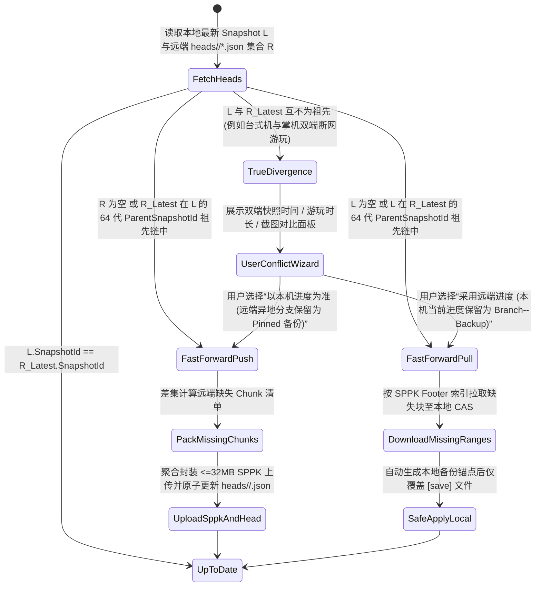

# Progress 模块规格正本：去重存档时间机器、SPPK 云同步与单机修改器管家（`spawn.progress`）

| 元数据项 | 规格定义 |
| :--- | :--- |
| **模块代号** | `spawn.progress` |
| **承载子工程** | `Spawn.Modules.Progress`（存档规则解析、FastCDC 去重库、SPPK 云同步、修改器匹配与静音控制）、`Spawn.TrainerWorker`（修改器沙箱托管、扫描码代理、AlphaVSS 锁穿透、二期原生 `.CT` 引擎），统一基于 `.NET 10 LTS`（`net10.0-windows`） |
| **所属进程域与权限** | 存档快照、云同步与 WASAPI 音量会话管理运行于 `Spawn.Host.exe`（`Medium IL 0x2000`）；修改器进程沙箱、按键模拟与 VSS 卷影复制物理隔离于 `Spawn.TrainerWorker.exe`（`High IL 0x3000`） |
| **覆盖需求与决策** | `REQ-PRG-01` ~ `REQ-PRG-07`、`REQ-NEX-07`、`REQ-SEC-01`、`REQ-SEC-03`、`REQ-SEC-06`、`D-01`、`D-04`、`D-09`、`D-11`、`D-12`、`A-01` ~ `A-03` |
| **目标交付里程碑** | `M3`（`Ludusavi` 预编译索引、`FastCDC` 存档时间机器、`32MB SPPK` 云同步、FLiNG 一键下载与零报毒静音管家及热键代理） · `M6`（`NativeCheatTableBackend` 二期 CE `.CT` 原生内存引擎） |
| **关联设计正本** | [ADR-0004：CAS 与 FastCDC 存储架构](../decisions/0004-cas-fastcdc-storage-and-mod-junction-topology.md) · [ADR-0005：外部生态与零报毒修改器治理](../decisions/0005-external-ecosystem-orchestration-and-uiaccess-overlay.md) · [数据模型正本](../design/data-model.md) · [IPC 与安全契约](../design/ipc-and-security-contracts.md) · [Nexus 模块规格](./nexus-mods-and-utilities.md) |
| **前期调研档案** | [卷 03：存档时间机器、去中心化云同步与单机修改器管家](../research/03-save-timemachine-and-trainer.md) |

---

## 1. 职责边界与进程权限域

### 1.1 模块职责范围（In-Scope）

1. **毫秒级存档路径自动探测与配置拆流**：将开源社区持续更新的 `ludusavi-manifest` 规则集离线预编译入 `spawn.db`，原生解析全部 16 类跨平台路径占位符、多离线模拟器 `<storeUserId>` 展开及 Windows 注册表项，并严格区分 `[save]` 进度数据与 `[config]` 分辨率/键位设置，避免跨桌面与掌机同步时污染画质配置。
2. **块级去重存档时间机器（Save Time-Machine）**：基于确定性 Gear-Hash `FastCDC` 变长分块、`BLAKE3` 寻址与 `Zstd` 压缩构建跨槽位共享块池；通过 2.5 秒写入静默去抖、前后双元数据向量防撕裂校验与 `AlphaVSS` 热备份兜底确保零半写坏档；强制在任意回滚前自动生成 `[PreRollbackSafety]` 安全锚点并与 `spawn.nexus` 校验 `mod_profile_hash`。
3. **去中心化自建云同步（32MB `SPPK` Packfile）**：拒绝同步 `spawn.db` 本体，采用 `32MB SPPK` 聚合包格式打通 S3/Cloudflare R2、WebDAV（坚果云/Nextcloud/OpenList）与本地同步盘目录，依托 64 代 `ParentSnapshotId` 哈希祖先链实现无感 Fast-Forward 与双端离线分叉可视化合并。
4. **一期零杀软误报外部 FLiNG 修改器管家**：从官方双源确定性检索单机修改器、双语正则提取热键生成原生开关卡片、引导配置隔离沙箱目录；采用 **配置预写 + 22 字节合法静音 MIDI + 全输出端点 `NAudio.Wasapi` 会话事件拦截** 实现零刺耳启动 BGM 与提示音独立调音（**100% 零 DLL 注入、零杀软误报**），并通过 `TrainerWorker` 提供无小键盘笔记本硬件扫描码代理。
5. **二期原生 `.CT` 引擎扩展槽（`ITrainerBackend`）**：在 M3 提前冻结统一策略契约，M6 在 `Spawn.TrainerWorker` 内实现 Cheat Engine `.CT` 逆序指针链解析、`Reloaded.Memory.SigScan` AVX2 特征码搜索与 `Iced.Intel` ±1.75GB 安全跳板。

### 1.2 明确排除边界（Out-of-Scope）

- **严禁触碰任何受保护联网游戏**：修改器检索、沙箱启动、热键代理与二期 `.CT` 后端**硬锁死仅对 `AntiCheatTier == Tier 0` 纯离线单机开放**；一旦系统中存在运行态或冷却态的 `Tier 2/3` 游戏，服务层与 Worker 层双重熔断拒绝执行（`REQ-PRG-06`、`REQ-SEC-03`）。
- **严禁对外部加壳修改器注入 Hook DLL**：彻底否决向 FLiNG 等加壳 `.exe` 注入 `MinHook` 拦截 `PlaySoundW` / `winmm.dll` 的高风险做法（`REQ-PRG-05`、`D-04`）。

---

## 2. 核心接口与状态机契约

### 2.1 核心领域服务接口（`Spawn.Modules.Progress` / `Spawn.Core`）

```csharp
namespace Spawn.Modules.Progress.Contracts;

public interface ISaveTimeMachineService
{
    ValueTask<ResolvedSaveLayout> ResolveGameSavePathsAsync(Guid gameId, CancellationToken ct = default);

    Task<SaveSnapshotRecord> CreateSnapshotAsync(
        Guid gameId,
        SnapshotTriggerKind trigger,
        string? userNote = null,
        bool includeConfigFiles = false,
        CancellationToken ct = default);

    Task<RollbackResult> RollbackToSnapshotAsync(
        Guid snapshotId,
        ModMismatchResolution mismatchPolicy = ModMismatchResolution.AbortAndPrompt,
        CancellationToken ct = default);
}

public interface ICloudSaveSyncService
{
    Task<SyncPlanPreview> PlanSyncAsync(Guid gameId, CancellationToken ct = default);
    Task<SyncExecutionReport> ExecuteSyncAsync(
        Guid gameId,
        DivergenceResolutionChoice? userChoice = null,
        IProgress<SyncProgressTick>? progress = null,
        CancellationToken ct = default);
}

public interface ITrainerBackend : IAsyncDisposable
{
    string BackendKind { get; } // "ExternalFling" (M3) | "NativeCheatTable" (M6)
    Task<TrainerSessionHandle> ActivateSessionAsync(TrainerLaunchSpec spec, CancellationToken ct = default);
    Task TriggerEntryAsync(Guid sessionId, string entryId, bool targetEnabled, CancellationToken ct = default);
    Task ShutdownAllImmediatelyAsync(CancellationToken ct = default);
}
```

### 2.2 去中心化云同步三路血缘比对状态机



---

## 3. 数据模型与存储路径

### 3.1 SQLite 核心表契约（归属 `spawn.db`）

主表结构严格对齐 [data-model.md](../design/data-model.md) 全局 `snake_case` 命名契约，模块配置辅表（如 `cloud_sync_endpoints`、`trainer_title_map`）共享同一版本化 SQL 迁移管线：

| 表名 | 主键 | 关键字段与约束摘要 | 业务用途 |
| :--- | :--- | :--- | :--- |
| `ludusavi_rules` | `rule_name TEXT` | `steam_app_id INT`, `gog_id INT`, `aliases_json TEXT`, `save_paths_json TEXT NOT NULL`, `config_paths_json TEXT`, `registry_rules_json TEXT` | 预编译存档路径与标签索引（`steam_app_id` 索引，查询 `< 1ms`） |
| `cas_chunks` | `chunk_blake3 TEXT` | `raw_size_bytes INT NOT NULL`, `compressed_size_bytes INT NOT NULL`, `ref_count INT NOT NULL`, `pack_id TEXT` | 全局去重 `FastCDC` 块字典（本地散列文件与远端 `SPPK` 包双向索引） |
| `save_snapshots` | `snapshot_id TEXT` | `game_id TEXT NOT NULL`, `profile_id TEXT`, `parent_snapshot_id TEXT`, `mod_profile_hash TEXT NOT NULL`, `trigger_kind TEXT`, `total_raw_bytes INT`, `created_machine_id TEXT`, `created_at_utc TEXT`, `is_pinned INT DEFAULT 0` | 存档快照历史树与血缘链（`is_pinned=1` 永久豁免滑动窗口 GC） |
| `snapshot_files` | `(snapshot_id, logical_path)` | `category TEXT NOT NULL` (`Save`/`Config`/`RegistryExport`), `file_size INT`, `last_write_time_utc TEXT`, `file_blake3 TEXT`, `chunk_sequence_json TEXT NOT NULL` | 单快照内标准化逻辑文件与有序 `cas_chunks` 重组清单 |
| `trainer_catalog` | `trainer_id TEXT` | `game_id TEXT NOT NULL`, `provider TEXT`, `target_game_build TEXT`, `executable_sandbox_path TEXT`, `file_sha256 TEXT`, `hotkeys_schema_json TEXT`, `mute_start_music INT DEFAULT 1`, `effect_volume_scalar REAL DEFAULT 0.35` | 已导入单机修改器目录、双语热键映射表与专属音量偏好 |
| `cloud_sync_endpoints` | `id TEXT` | `provider_type TEXT` (`S3`/`WebDav`/`LocalFolder`), `endpoint_url TEXT`, `bucket_or_root TEXT`, `secret_file_name TEXT` | 云同步后端配置辅表（凭据密文独立存于 DPAPI `.sec` 文件，`spawn.db` 零明文密钥） |
| `trainer_title_map` | `game_id TEXT` | `english_search_slug TEXT NOT NULL`, `manual_url_override TEXT` | 解决纯中文/日文名游戏到 FLiNG 英文固定 URL Slug 的确定性映射辅表 |

### 3.2 本地与远端物理存储布局

```text
%LOCALAPPDATA%\spawn\                          # 开发调试环境自动切换为 %LOCALAPPDATA%\spawn-dev\
├── secrets\
│   └── <credential-id>.sec                    # DPAPI (CurrentUser) 加密的 S3 SecretKey / WebDAV 应用密码
└── vault\
    ├── Chunks\ab\cd\<64-char-blake3>.zst      # 本地 Zstd 压缩去重块池
    └── Sandbox\Trainers\<GameId>\             # 单次 UAC 引导加入 Defender 排除目录的修改器专属沙箱
        └── <TrainerName>.exe

<RemoteRoot>/spawn-sync/                       # S3 Bucket / WebDAV 目录 / Syncthing 同步目录
├── repo.json                                  # 仓库格式版本、加密盐参数与创建时间
├── packs/
│   └── pack-<pack_blake3>.sppk                # 不可变 <= 32MB 聚合包（内容寻址，支持无锁上传与 Range 按需拉取）
├── snapshots/
│   └── <GameId>/<SnapshotId>.json             # 不可变单快照清单（含 ModProfileHash、ParentSnapshotId 与逻辑文件块序列）
└── heads/
    └── <GameId>/<MachineId>.json              # 每台设备独立写自己的最新指针与最近 64 代 AncestorIds 数组
```

---

## 4. 关键算法与协议细节

### 4.1 原生 `ludusavi` 16 种跨平台路径占位符解析表（`REQ-PRG-01`）

C# 路径展开器仅接纳 `when: [{ os: windows }]` 或无 OS 限定的条目，按下列确定性规则将占位符展开为标准 Windows 路径，并对 `[save]` 与 `[config]` 标签物理分流：

| 占位符 | Windows 原生展开映射规则 | 多模拟器 / 边界处理策略 |
| :--- | :--- | :--- |
| `<base>` | 当前游戏实际安装根目录 `<GameInstallDir>` | 首要探测锚点，优先识别便携化存档 |
| `<root>` / `<game>` | 所属平台库根（如 `<SteamLibraryRoot>\steamapps\common`）与游戏子文件夹名 | 离线免安装版无外层库结构时，`<root>/<game>` 自动等价映射为 `<base>` |
| `<home>` | `%USERPROFILE%` | 标准用户主目录 |
| `<winAppData>` | `%APPDATA%`（即 `Roaming`） | 支持通配多模拟器漫游存档 |
| `<winLocalAppData>` | `%LOCALAPPDATA%` | 常规本地应用数据目录 |
| `<winLocalAppDataLow>` | `SHGetKnownFolderPath(FOLDERID_LocalAppDataLow)`（`%USERPROFILE%\AppData\LocalLow`） | Unity 引擎单机游戏核心存档落点 |
| `<winDocuments>` | `SHGetKnownFolderPath(FOLDERID_Documents)` | 自动跟随用户在系统属性中迁移至其他分区的“我的文档”真实路径 |
| `<winPublic>` | `%PUBLIC%` | CODEX / RUNE 等离线模拟器常用共享存档根 |
| `<winProgramData>` | `%PROGRAMDATA%` | Steam RLD! / 早期发行版公共存档目录 |
| `<winDir>` | `%SystemRoot%` | 仅极少数远古老游戏 `win.ini` 兼容读取 |
| `<osUserName>` | `Environment.UserName` | 匹配带系统登录名子目录的存档规则 |
| `<storeUserId>` | 通配枚举 Steam `userdata\<id32>`、Goldberg `6561197960265728`、`gbe_fork` 自定义 ID 等 | 扫描所有已存在用户 ID 目录并按最近修改时间标注活跃分支 |
| `<xdgData>` / `<xdgConfig>` | 在 Windows 下忽略纯 Linux 路径，除非规则未提供 Windows 替代分支时回退 `%LOCALAPPDATA%` | 保障跨掌机（SteamOS 导出包导入 Windows）清单兼容 |
| `*` / `**` Glob | 编译为零回溯目录枚举器 | 严格跳过临时缓存目录（`ShaderCache`、`CrashDumps`、`Logs`） |

**注册表存档确定性序列化**：不调用受系统语言与换行影响的 `reg.exe export`，统一使用 `Microsoft.Win32.Registry` 读取目标键值树，按键名 UTF-8 字典序序列化为 `registry_snapshot.json`（显式标注 `REG_SZ`、`REG_DWORD`、`REG_QWORD`、`REG_BINARY` Base64）纳入同一套快照清单。

### 4.2 Gear-Hash `FastCDC` 分块与防半写撕裂热备份协议（`REQ-PRG-02`）

1. **确定性 `FastCDC` 参数契约（跨机器分块边界 100% 一致，`A-01`）**：
   - 小文件直通：文件长度 `< 2 MiB` 时整文件作为单块计算 `BLAKE3` 并经 `ZstdSharp.Port`（`Level 3`）压缩，省去滑动哈希开销。
   - 大文件变长切分（如上百 MB 的开放世界 `.sav` / SQLite 存档库）：`MinSize = 256 KiB`、`AvgSize = 1 MiB`、`MaxSize = 4 MiB`；256 项 `ulong[256]` Gear 表采用固定魔数种子 `0x535041574E5F4344UL`（`"SPAWN_CD"`）经 `SplitMix64` 生成，配合两段式归一化掩码（`< AvgSize` 使用高约束掩码 `MaskS = 0x0003590703530000UL`，`>= AvgSize` 使用宽约束掩码 `MaskL = 0x0000D90303530000UL`），使玩家存档局部改动 `64KB` 后，前后未变区间在毫秒内自动重对齐命中已有 `cas_chunks`。
2. **三保险防撕裂捕获流水线（Zero Torn-Write Guarantee）**：
   - **第一重（2.5s 静默窗口 `A-03`）**：实时监控收到写入事件后重置 `2500ms` 去抖定时器；唯有存档目录下全部关联文件连续 `2.5s` 无新增写入，才启动快照提取。
   - **第二重（Pre/Post 元数据向量二次比对）**：提取前先对存档组所有文件采样向量 $V_{\text{pre}} = \{(\text{RelPath}, \text{Length}, \text{LastWriteTimeUtc})\}$；以 `FileShare.ReadWrite | FileShare.Delete` 流式分块读取完毕后立即复采 $V_{\text{post}}$。若 $V_{\text{pre}} \neq V_{\text{post}}$，说明读取中途游戏恰好再次刷盘，**立即丢弃本次脏块集合并重新排队（最多重试 3 次）**。
   - **第三重（`AlphaVSS` 卷影复制兜底）**：若游戏以独占锁锁死存档抛出 `IOException (HResult == 0x80070020 ERROR_SHARING_VIOLATION)`，或连续高频刷盘超过 `15s` 未出现静默窗口（`A-03`），宿主自动通过命名管道唤醒 `Spawn.TrainerWorker.exe`（High IL）调用 `AlphaVSS` 创建瞬态 NTFS 卷影快照，从只读卷影路径提取原子一致镜像后立即销毁卷影。
3. **原子回滚铁律**：调用 `RollbackToSnapshotAsync` 时，第一步强制为当前磁盘现场创建一条 `trigger_kind = "PreRollbackSafety"` 且短期受保护的快照；随后将目标块解压至同目录 `<file>.spawn_stage_tmp` 并 `Flush(flushToDisk: true)`，全部校验通过后批量 `File.Move(..., overwrite: true)` 原子替换。

### 4.3 `32MB SPPK` 二进制封装格式协议（`REQ-PRG-03`, `A-02`）

为彻底根治数千个小块直接上传 WebDAV（如坚果云）触发的 `HTTP 429 Too Many Requests` 限流风暴，远端传输统一封装为最大 `32 MiB` 的不可变 `SPPK` v1 文件，字节序固定为小端序（Little-Endian）：

```text
+-------------------------------------------------------------------+
| Header (8 Bytes)                                                  |
|   [0..3] Magic: ASCII "SPPK" (0x53 0x50 0x50 0x4B)                |
|   [4]    Version: 0x01                                            |
|   [5..7] Flags: 3 Bytes (默认 0x000000，Bit 0 预留端到端加密)      |
+-------------------------------------------------------------------+
| Payload Body (Variable, <= 32 MiB)                                |
|   [Chunk 0 Zstd Bytes][Chunk 1 Zstd Bytes]...[Chunk N-1 Bytes]    |
+-------------------------------------------------------------------+
| Footer Directory Index (4 + N * 48 Bytes)                         |
|   EntryCount: UInt32 (4 Bytes LE)                                 |
|   Entry[0..N-1] (48 Bytes each):                                  |
|     - ChunkBlake3 : 32 Bytes                                      |
|     - PackOffset  : UInt64 (8 Bytes LE)                           |
|     - ZstdLength  : UInt32 (4 Bytes LE)                           |
|     - RawLength   : UInt32 (4 Bytes LE)                           |
+-------------------------------------------------------------------+
| Trailer (36 Bytes)                                                |
|   FooterByteLength : UInt32 (4 Bytes LE, 供 Range 尾部逆向定位)    |
|   PackBlake3       : 32 Bytes (覆盖 0x0000 至 End-32 前一字节)     |
+-------------------------------------------------------------------+
```

- **按需拉取优化**：拉取端若仅缺失某 `SPPK` 包中的 2 个增量块，无需下载整包 32MB，可直接发送 `HTTP Range: bytes=<Offset>-<End>` 定点拉取对应切片并做单块 `BLAKE3` 校验（本地盘与不支持 Range 的极简后端自动回退整包读取）。

### 4.4 零报毒修改器静音、沙箱托管与二期 `.CT` 引擎细节（`REQ-PRG-04` ~ `REQ-PRG-07`）

1. **FLiNG 双站检索与双语热键正则提取**：
   - 依据 `Steam AppID -> Ludusavi Canonical Title / trainer_title_map` 组装英文检索词，并发检索主站 `flingtrainer.com`（新版独立包）与归档站 `archive.flingtrainer.com`（明确过滤捆绑第三方平台的在线安装壳，仅接收独立可执行归档）。
   - 使用编译期源码生成正则 `[GeneratedRegex(@"^\s*(?<key>(?:Ctrl\+|Alt\+|Shift\+)*(?:Num\s*[\d\.\+\-\*\/]|F\d{1,2}|Home|Insert|Page\s*(?:Up|Down)))\s*[-–—:]\s*(?<desc>.+)$", RegexOptions.Multiline | RegexOptions.IgnoreCase)]` 解析说明文本或 PE 资源串，映射为带中英对照词典的原生 Toggle 卡片。
2. **双保险零注入静音与提示音控音协议（彻底杜绝杀软误报）**：
   - **第一道防线（`A0` 启动前配置与合法空 MIDI 预置，零漏音）**：FLiNG 独立版框架在初始化窗口前会自动读取配置与外部 BGM 资源。启动修改器前，宿主自动在 `%LOCALAPPDATA%\FLiNGTrainer\FLiNGTSettings.ini`、`%USERPROFILE%\Documents\FLiNGTrainer\TrainerSettings.ini` 及修改器同级目录写入 `OnLoadMusic=False`（兼容 `0`），并预置 **22 字节标准合法静音 MIDI 文件 `TrainerBGM.mid`**（十六进制字节：`4D 54 68 64 00 00 00 06 00 00 00 01 00 60 4D 54 72 6B 00 00 00 04 00 FF 2F 00`），从源头令首帧启动芯片音乐消失。
   - **第二道防线（`A` 全输出端点 `NAudio.Wasapi` 会话事件控制）**：枚举 `MMDeviceEnumerator.EnumerateAudioEndPoints(DataFlow.Render, DeviceState.Active)` 下**全部活跃音频输出设备**（兼顾音箱、USB 耳机与蓝牙切换），注册 `IAudioSessionNotification.OnSessionCreated`；当新会话创建时以 `0x1000` 校验其 PID 是否归属 `vault\Sandbox\Trainers\`：若用户设置完全静音则置 `SimpleAudioVolume.Mute = true`，若保留“叮”激活提示音则按 `trainer_catalog.effect_volume_scalar`（默认 `35%`）设置 `Volume`（Windows 音频栈自动持久化该路径的会话音量，后续重启零延迟生效）。
3. **High IL 沙箱生命周期与无小键盘 35ms 扫描码代理**：
   - `Spawn.TrainerWorker.exe` 将拉起的修改器绑定至置位了 **`JOB_OBJECT_LIMIT_KILL_ON_JOB_CLOSE`** 的专属 `JobObject`——与游戏宿主恰恰相反，一旦游戏退出或安全门禁触发关闭 `TrainerWorker`，所有外部修改器子进程 **100% 由内核连坐瞬杀，绝无后台残留**。
   - 当无小键盘笔记本玩家点击 UI 开关时，`TrainerWorker` 同时填充 `KEYBDINPUT.wVk`（如 `VK_NUMPAD1 = 0x61`）与 `wScan = MapVirtualKeyW(vk, MAPVK_VK_TO_VSC)`，按下后 **`await Task.Delay(35)`** 再发送抬起事件，兼容修改器内部 `GetAsyncKeyState` 轮询帧窗口。
4. **二期 `NativeCheatTableBackend` 技术契约（M6 预留，`REQ-PRG-07`）**：
   - **CE `<Offsets>` 逆序解引用铁律**：经核验 Cheat Engine 源码 `MemoryRecordUnit.pas`，XML 中 `<Offsets><Offset>18</Offset><Offset>A0</Offset><Offset>48</Offset></Offsets>` 是**自底向上存储**的！解引用时必须执行 `offsets.Reverse()`，即 `ReadPtr(ReadPtr(ModuleBase + BaseDisp) + 0x48) + 0xA0` 最后 `+ 0x18` 得到最终目标地址，顺序弄反将 100% 指飞。
   - **x64 安全跳板分配**：利用 `Reloaded.Memory.SigScan` AVX2 搜索 AOB 特征码，在目标指令地址 `±1.75 GiB (0x7000_0000)` 半径内按 `64KB` 分配粒度双向探测 `MEM_FREE` 页调用 `VirtualAllocEx` 分配近端 Code Cave（确保 5 字节 `E9 rel32` 相对跳转可达而不破坏更长指令边界），并用 `Iced.Intel` `BlockEncoder` 自动重定位被覆盖指令中的 `RIP-Relative` 寻址偏移。

---

## 5. 跨模块协同契约

- **与 `spawn.launcher` 协同**：订阅游戏生命周期事件——游戏运行中启动存档目录静默防撕裂监控（可选定时自动存档点）；收到 `PostExitReclaiming` 事件时：先通知 `TrainerWorker` 立即销毁伴生修改器，再执行退出增量快照并按策略排队触发 `ICloudSaveSyncService.ExecuteSyncAsync`。
- **与 `spawn.nexus` 协同**：每次生成 `save_snapshots` 时强制写入当前 Profile 的 `mod_profile_hash`；回滚存档若哈希不一致，调用 `spawn.nexus` 弹窗展示差异并支持联动切换 Profile（`REQ-NEX-07`）。
- **与 `spawn.achievement` (`Alt+Z` 面板) 协同**：向游戏内 `Alt+Z` 覆盖层暴露“一键手动创建检查点（Quick Checkpoint）”与单机修改项开关列表（仅 `Tier 0` 游戏可见）。

---

## 6. 异常恢复与反作弊熔断行为

1. **`AntiCheatGuard` 全局硬熔断**：
   - 任何时刻只要 `IAntiCheatGuardService.CurrentLockState` 处于 `ProtectedGameRunning (Tier 2/3)` 或 `CoolingDown`，`ActivateSessionAsync` 立即在宿主与 Worker 两端抛出安全异常；若玩家在单机修改器开启期间直接点击启动一款 `Tier 2/3` 游戏，启动管线 `PreFlightChecking` 会先行调用 `ShutdownAllImmediatelyAsync()` 销毁 `TrainerWorker` 并等待进程退出确认后才放行网游启动（`REQ-PRG-06`、`REQ-SEC-03`）。
2. **云同步网络中断与半传恢复**：
   - `SPPK` 上传采用“先传不可变数据块包 `packs/pack-<pack_blake3>.sppk` -> 再传快照清单 `snapshots/<GameId>/<SnapshotId>.json` -> **最后一步才通过 S3 `If-Match` 或原子重命名更新 `heads/<GameId>/<MachineId>.json`**”的严格尾提交顺序。即使上传到 99% 断网或断电，远端 `head` 指针依然指向旧的一致快照，下次重连通过 `HEAD` 请求跳过已成功落盘的 `SPPK` 包实现零损断点续传。
3. **滑动窗口垃圾回收（GC）安全边界**：
   - 自动快照超配额裁剪时，**严禁回收满足以下任一条件的快照**：① 用户手动钉住 `is_pinned = 1`；② 当前任意设备 `heads/<GameId>/*.json` 正在引用的最新快照；③ 最近一次 `[PreRollbackSafety]` 回滚保护锚点；唯有 `cas_chunks.ref_count` 归零的孤立数据块才从磁盘物理清理。

---

## 7. 测试与阶段验收要求

1. **`Ludusavi` 规则编译与 16 占位符展开基准测试（验证 `REQ-PRG-01`）**：
   - 使用包含 100 款代表性游戏（覆盖 Steam `userdata`、`LocalLow`、`Public`、注册表与 `[save]`/`[config]` 混排）的测试清单夹具：验证预编译后按 `SteamAppId` 查询中位耗时 `< 1ms`，16 种占位符展开准确率 `100%`，且仅恢复 `[save]` 时模拟目录中的 `config.ini` 内容保持原样。
2. **`FastCDC` 去重率与并发写防撕裂压力测试（验证 `REQ-PRG-02`）**：
   - 构造 `64MB` 模拟大存档文件，每次随机覆写中间 `16KB` 连续生成 10 份快照，断言总压缩块池体积增长 `< 4MB`，且任意一版回滚后的整文件 `BLAKE3` 100% 匹配对应时刻原文件；
   - 启动后台写入协程持续高频覆写测试存档，验证双向量校验准确识别并发修改并延迟/重采，**零撕裂坏档入库**，且回滚前自动生成 `[PreRollbackSafety]` 快照。
3. **`32MB SPPK` 二进制往返与三路分叉冲突测试（验证 `REQ-PRG-03`）**：
   - 对内存模拟对象存储 / 本地文件后端执行“设备 A 推进 2 代 -> 设备 B Fast-Forward 拉取 -> A 与 B 同时离线各自推进 1 代 -> 同步触发 `TrueDivergence`”，断言 100% 识别分叉并保留两侧备份快照，且 `SPPK` 尾部整包 `BLAKE3` 篡改 1 比特即刻校验报错拦截。
4. **零报毒静音预置与热键解析测试（验证 `REQ-PRG-04`, `REQ-PRG-05`）**：
   - 准备 30 份真实中英文双语修改器说明样本，验证 `[GeneratedRegex]` 热键提取准确率 `>= 95%`；验证 `A0` 预置器生成的 22 字节 `TrainerBGM.mid` 可被标准音频解码器无错读取且时长为 0，全程 `Spawn.Host` 与 `TrainerWorker` 对目标测试进程零 `WriteProcessMemory` / 零远程线程调用。
5. **二期 CE 逆序指针链单元测试（验证 `REQ-PRG-07`）**：
   - 在本进程内部分配四级嵌套结构体链并构造对应 `.CT` `<Offsets>` XML 片段，验证逆序解析器 100% 命中叶子字段地址。
