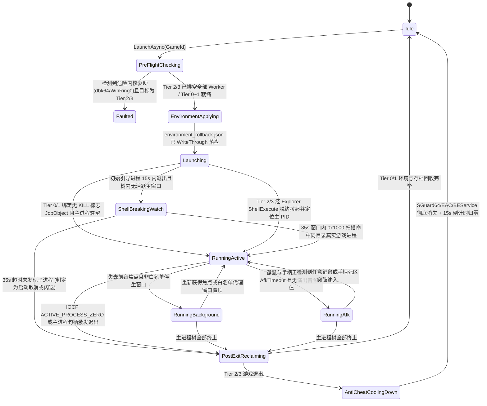
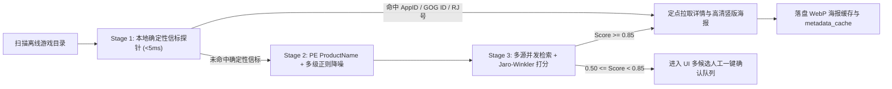

# Spawn 模块规格正本：进程生命周期、自愈环境管线与离线刮削（`spawn.launcher`）

| 元数据项 | 规格定义 |
| :--- | :--- |
| **模块代号** | `spawn.launcher` |
| **承载子工程** | `Spawn.Core`（契约与反作弊分级）、`Spawn.Modules.Launcher`（启动管线与元数据刮削）、`Spawn.Host`（状态呈现，统一基于 `.NET 10 LTS` `net10.0-windows`） |
| **所属进程域与权限** | `Spawn.Host.exe`（`Medium IL 0x2000`，严守 Clean Host 零敏感导入表铁律） |
| **覆盖需求与决策** | `REQ-SPW-01` ~ `REQ-SPW-06`、`REQ-SEC-01` ~ `REQ-SEC-05`、`D-01` ~ `D-03`、`D-17`、`A-04` |
| **目标交付里程碑** | `M2`（首发核心闭环：纯净 WPF-UI 游戏库添加/识别/编辑、Steamrip 与 GOG 三级漏斗封面元数据刮削、双通道进程追踪、三态游玩计时、基础 `Anti-Cheat Guard` 及与 `spawn.achievement` 的单机成就联动） · `M4`（Pre/Post-Launch HDR/分辨率/区域转码/CPU Sets/伴生超分断电自愈高阶环境管线） |
| **关联设计正本** | [系统顶层架构](../design/system-architecture.md) · [数据模型正本](../design/data-model.md) · [IPC 与安全契约](../design/ipc-and-security-contracts.md) · [Nexus 模块规格](./nexus-mods-and-utilities.md) |
| **前期调研档案** | [卷 02 §1：进程生命周期追踪与环境接管流水线](../research/02-launcher-process-and-mod-nexus.md) |

---

## 1. 职责边界与进程权限域

### 1.1 模块职责范围（In-Scope）

1. **双引擎无损进程树生命周期状态机**：统一管理所有单机与联网游戏的启动、破壳发现、运行监控、正常退出与异常崩溃感知，确保 SPAWN 自身升级或崩溃退出时**绝不连坐误杀正在运行的游戏**，并准确穿透“启动器自杀拉起真实游戏主程序”的套壳场景。
2. **Active / Background / AFK 三态真实游玩时长引擎**：按 1 秒节拍融合前台窗口焦点、代理缩放/Overlay 窗口白名单、键鼠空闲时间、`XInput` / `RawGameController` 手柄死区突破与 `WASAPI` 会话音频峰值，精细区分真实游玩、切出后台与挂机发呆时长。
3. **Pre/Post-Launch 断电自愈环境接管管线**：在游戏启动前原子持久化系统基线快照（`environment_rollback.json`），按游戏/Profile 策略自动接管显示器分辨率/刷新率、Windows 11 系统级 HDR 开关、混合架构 CPU P-Core / AMD X3D CCD0 绑定与 `EcoQoS` 豁免、电源计划、32/64 位日韩繁区域转码（`LEProc` / `LRProc`）、`Magpie` / `Lossless Scaling` 超分伴生及 `Wallpaper Engine` 暂停静音；游戏退出或宿主冷启动自检时 100% 幂等还原。
4. **三级漏斗离线优先元数据刮削引擎**：针对无平台免安装单机包（Steamrip、GOG 离线安装包、日系同人 Galgame/RPG），通过“确定性 ID 探针 -> PE 头与多级正则降噪 -> 多源异步图谱与竖版海报补全”实现开箱即用的精美海报墙。

### 1.2 明确排除边界（Out-of-Scope）

- **不负责 Mod 硬链接投射与 Profile 目录重定向**：启动前的文件树就绪校验通过调用 `spawn.nexus` 暴露的 `IProfileTransactionService` 完成（见 [nexus-mods-and-utilities.md](./nexus-mods-and-utilities.md)）。
- **不持有任何高权限进程句柄或输入钩子**：本模块驻留于 `Spawn.Host.exe`（Medium IL），严禁调用 `OpenProcess(PROCESS_ALL_ACCESS / PROCESS_VM_READ)`、严禁安装 `WH_KEYBOARD_LL` / `WH_SHELL` 全局钩子、严禁订阅需管理员权限的内核 ETW 会话（`REQ-SEC-01`、`REQ-SEC-02`）。

---

## 2. 核心接口与状态机契约

### 2.1 核心领域服务接口（`Spawn.Core` / `Spawn.Modules.Launcher`）

```csharp
namespace Spawn.Modules.Launcher.Contracts;

public enum GameLifecycleState
{
    Idle = 0,
    PreFlightChecking = 1,      // 反作弊分级门禁、Worker 排空与 Mod Profile 一致性校验
    EnvironmentApplying = 2,    // 落盘 rollback 快照并切换 HDR/分辨率/电源/伴生工具
    Launching = 3,              // JobObject 直启 或 Explorer COM 血缘脱钩委派
    ShellBreakingWatch = 4,     // 启动器秒退后的 35s 目录特征破壳捕获窗口
    RunningActive = 5,          // 游戏主进程存活且处于真实交互态
    RunningBackground = 6,      // 游戏主进程存活但焦点切出后台
    RunningAfk = 7,             // 游戏处于前台但超过静默阈值无输入/无演出音频
    PostExitReclaiming = 8,     // 游戏退出后触发环境还原、存档增量快照与 Mod 配置回收
    AntiCheatCoolingDown = 9,   // Tier 2/3 伴生反作弊服务监测 + 15s 强制静默冷却
    Faulted = 10
}

public sealed record LaunchRequest(
    Guid GameId,
    Guid? ExplicitProfileId = null,
    LaunchSource Source = LaunchSource.DesktopUi,
    SunshineClientSpec? StreamSpec = null);

public interface IGameLaunchOrchestrator
{
    IReadOnlyDictionary<Guid, GameSessionSnapshot> ActiveSessions { get; }
    IObservable<GameLifecycleTransition> LifecycleStream { get; }

    Task<LaunchResult> LaunchAsync(LaunchRequest request, CancellationToken ct = default);
    Task RecoverOrphanedEnvironmentOnStartupAsync(CancellationToken ct = default);
}

public interface IAntiCheatGuardService
{
    ValueTask<AntiCheatInspectionResult> InspectGameDirectoryAsync(string installDir, CancellationToken ct = default);
    AntiCheatSystemLockState CurrentLockState { get; }
    Task EnsureWorkersDrainedForProtectedLaunchAsync(AntiCheatTier targetTier, CancellationToken ct = default);
}

public interface IMetadataScraperPipeline
{
    Task<ScrapeMatchResult> ScrapeGameAsync(
        string installDir,
        string mainExeRelativePath,
        ScrapePolicy policy,
        CancellationToken ct = default);
}
```

### 2.2 双引擎进程树与反作弊冷却主状态机



---

## 3. 数据模型与存储路径

### 3.1 SQLite 核心表契约（归属 `spawn.db`）

本模块维护游戏主档案、游玩会话流水与元数据刮削映射（完整外键约束与全局索引见 [data-model.md](../design/data-model.md)）：

| 表名 | 主键 | 关键字段与约束摘要 | 读写职责 |
| :--- | :--- | :--- | :--- |
| `games` | `id TEXT` (UUIDv7) | `title`, `sort_title`, `install_dir`, `exe_rel_path`, `work_dir`, `anti_cheat_tier INT NOT NULL DEFAULT 0`, `steam_app_id INT`, `gog_game_id TEXT`, `dlsite_code TEXT`, `vndb_id TEXT`, `bangumi_id INT`, `igdb_id INT`, `active_profile_id TEXT`, `total_active_sec INT`, `total_bg_sec INT`, `total_afk_sec INT`, `last_played_at TEXT` | `spawn.launcher` 主写；其余模块只读引用 |
| `play_sessions` | `id TEXT` (UUIDv7) | `game_id TEXT NOT NULL`, `profile_id TEXT`, `started_at TEXT NOT NULL`, `ended_at TEXT`, `active_sec INT NOT NULL`, `background_sec INT NOT NULL`, `afk_sec INT NOT NULL`, `exit_code INT`, `launch_source TEXT`, `abnormal_terminated INT DEFAULT 0` | 会话进行中每 60s 心跳增量刷盘，退出时原子封账 |
| `game_launch_policies` | `game_id TEXT` | `locale_mode TEXT` (`None`/`AutoJaJp`/`AutoZhTw`/`AutoKoKr`), `cpu_affinity_policy TEXT` (`Default`/`PreferPCores`/`PreferX3dCcd0`), `disable_eco_qos INT`, `hdr_mode TEXT` (`Keep`/`ForceEnable`/`ForceDisable`), `target_width INT`, `target_height INT`, `target_refresh_hz INT`, `upscaler_companion TEXT` (`None`/`Magpie`/`LosslessScaling`), `pause_wallpaper_engine INT`, `afk_timeout_sec INT DEFAULT 300` | 启动管线读取执行（可被激活 Profile 覆写） |
| `metadata_cache` | `cache_key TEXT` | `source_provider TEXT`, `raw_payload_json TEXT`, `confidence_score REAL`, `fetched_at TEXT`, `poster_rel_path TEXT`, `hero_rel_path TEXT`, `logo_rel_path TEXT` | 刮削管线写入，支持 100% 离线渲染海报墙 |

### 3.2 本地文件系统路径契约

遵循正式版 `%LOCALAPPDATA%\spawn` 与开发态 `%LOCALAPPDATA%\spawn-dev` 双通道物理隔离规范（`REQ-SEC-06`、`NFR-05`）：

- **环境自愈事务日志**：`%LOCALAPPDATA%\spawn\config\environment_rollback.json`（仅在环境已被接管期间存在；完整还原后立即 `File.Delete`）。
- **离线媒体资产缓存**：`%LOCALAPPDATA%\spawn\cache\media\<GameId>\{poster_600x900.webp, hero_1920x620.webp, logo.png, icon.ico}`。
- **随包/托管转区工具槽位**：`%LOCALAPPDATA%\spawn\tools\locale-remulator\LRProc.exe`（x64）与 `%LOCALAPPDATA%\spawn\tools\locale-emulator\LEProc.exe`（x86），支持用户在设置中指向本机已有安装路径。

---

## 4. 关键算法与协议细节

### 4.1 双引擎进程树追踪与血缘脱钩算法（`REQ-SPW-01`, `REQ-SEC-04`）

1. **通道 A（`Tier 0 / Tier 1` 常规单机与弱联网客户端）—— 无连坐 `JobObject` + IOCP**：
   - 调用 `CreateJobObjectW(IntPtr.Zero, null)` 创建匿名作业对象，通过 `CreateIoCompletionPort` 绑定 `JOBOBJECT_ASSOCIATE_COMPLETION_PORT`。
   - 调用 `SetInformationJobObject(..., JobObjectExtendedLimitInformation)` 时，`BasicLimitInformation.LimitFlags` **显式设为 `0`**（或仅含 `JOB_OBJECT_LIMIT_BREAKAWAY_OK`），**严禁置位 `JOB_OBJECT_LIMIT_KILL_ON_JOB_CLOSE (0x2000)`**。一旦 `Spawn.Host.exe` 意外崩溃或用户手动关闭管理器，操作系统仅关闭句柄而绝不终止正在运行的游戏进程。
   - 后台单线程阻塞 `GetQueuedCompletionStatus`：收到 `JOB_OBJECT_MSG_NEW_PROCESS (6)` 时动态纳入会话 PID 集合；收到 `JOB_OBJECT_MSG_ACTIVE_PROCESS_ZERO (8)` 时判定整棵进程树自然归零。
2. **破壳发现状态机（Shell-Breaking Heuristic）**：
   - 若初始进程在启动后 `< 15s` 内触发 `ACTIVE_PROCESS_ZERO`（典型场景：游戏自更新器重启、GOG/DRM Wrapper 脱壳、Steam stub 转发），状态机不立即结算退出，而是转入最长 **35 秒 `ShellBreakingWatch` 慢速监听窗口**（每 `1500ms` 采样一次）。
   - 扫描算法：调用 `CreateToolhelp32Snapshot(TH32CS_SNAPPROCESS, 0)` 遍历进程快照 -> 先剔除系统核心进程 -> 调用 `OpenProcess(0x1000 /* PROCESS_QUERY_LIMITED_INFORMATION */, false, pid)` + `QueryFullProcessImageNameW` 获取完整可执行路径 -> 若路径位于 `<GameInstallDir>` 子树下且**未命中辅助幽灵进程黑名单正则**，即捕获为真实主游戏进程并挂载 `RegisterWaitForSingleObject` 监听其 `SYNCHRONIZE` 句柄。
   - **幽灵辅助进程排除正则**：`^(UnityCrashHandler(32|64)|CrashReportClient|CrashSender\d*|ZFGameBrowser|cef_?process|steamerrorreporter|EasyAntiCheat(_EOS)?|BEService|SGuard(Svc)?64)\.exe$`（忽略大小写）。
3. **通道 B（`Tier 2 / Tier 3` 反作弊受保护游戏）—— `explorer.exe` 血缘脱钩**：
   - 严禁由 `Spawn.Host.exe` 直接调用 `CreateProcess` 或挂载 `JobObject`。
   - 通过 COM `Shell.Application`（`IShellDispatch2.ShellExecute`）委托桌面 `explorer.exe` 拉起目标可执行文件或平台协议 URI（`steam://rungameid/<AppId>`），使内核 `EPROCESS->InheritedFromUniqueProcessId` 恒指向 `explorer.exe`，随后直接复用上述 `0x1000` 只读路径匹配器追踪存活状态。

### 4.2 三态真实游玩时长判定算法（`REQ-SPW-02`）

采样循环使用无漂移 `.NET PeriodicTimer(TimeSpan.FromSeconds(1))`：

1. **有效前台焦点判定（`IsGameEffectivelyForeground`）**：
   - `GetForegroundWindow()` -> `GetWindowThreadProcessId(hwnd, out uint fgPid)`。
   - 若 `fgPid` 属于当前游戏会话 `TrackedPids`，或属于 **`TrustedProxyWindows` 白名单**（包括 `Blinue/Magpie` 缩放宿主窗口类 `Window_Magpie_967EB565-6F73-4E94-AE53-00CC42592A22`、`Lossless Scaling` 缩放窗口以及处于呼出态的 `Spawn.OverlayHost.exe`），则视为前台命中；否则累加 `background_sec += 1`。
2. **多模态输入空闲计算（键鼠 + 双栈手柄）**：
   - 键鼠空闲秒数：`GetLastInputInfo` 与 `Environment.TickCount64` 差值。
   - 手柄输入突破检测：
     - **XInput 通道**（`Vortice.XInput`）：遍历槽位 `0..3`；为消除空槽位硬件总线查询开销，对返回 `ERROR_DEVICE_NOT_CONNECTED` 的槽位实施 **5 秒冷却退避**。仅当 `wButtons != 0`、`bLeftTrigger > 30`、`bRightTrigger > 30`、左摇杆模长突破标准死区 `7849` 或右摇杆突破 `8689` 时，刷新 `lastGamepadActiveTick`（免疫摇杆轻微漂移）。
     - **DirectInput / PlayStation / Switch 通道**：订阅 `Windows.Gaming.Input.RawGameController` 按钮数组跳变与轴变化量 `> 0.12`。
   - 取 `idleSec = min(kbMouseIdleSec, gamepadIdleSec)`。
3. **视觉小说自动播放与长过场动画防误判（Audio Peak 豁免）**：
   - 当 `idleSec >= AfkTimeoutSec`（默认 `300s`）时，查询当前游戏 PID 关联的 `NAudio.Wasapi` `AudioSessionControl.AudioMeterInformation.MasterPeakValue`。
   - 若游戏配置为 Galgame/AVG 品类或处于长播片且峰值持续波动（非固定循环 BGM 静默态，最大允许豁免上限 `1800s`），仍计入 `active_sec`；否则累加 `afk_sec += 1`。

### 4.3 Pre/Post-Launch 环境自愈管线协议细节（`REQ-SPW-03` ~ `REQ-SPW-05`）

`environment_rollback.json` 采用两阶段原子落盘（先写 `.tmp` 并开启 `FileOptions.WriteThrough` 刷穿磁盘缓存，再 `File.Move(..., overwrite: true)`）：

```json
{
  "schemaVersion": 1,
  "transactionId": "0196ed40-7a1b-7000-8000-112233445566",
  "ownerHostPid": 14820,
  "gameId": "0196ec00-1234-7000-8000-abcdef012345",
  "capturedAtUtc": "2026-11-15T12:00:00Z",
  "originalHdrEnabled": false,
  "primaryMonitorDeviceName": "\\\\.\\DISPLAY1",
  "originalWidth": 3840,
  "originalHeight": 2160,
  "originalRefreshHz": 144,
  "originalPowerSchemeGuid": "381b4222-f694-41f0-9685-ff5bb260df2e",
  "wallpaperEnginePaused": true,
  "spawnedCompanionPids": [21044]
}
```

各项底层系统控制原语规范如下：

| 接管子项 | 启动前接管（Apply） | 退出后 / 崩溃重启自愈（Restore） |
| :--- | :--- | :--- |
| **显示器分辨率与刷新率** | 调用 `ChangeDisplaySettingsExW(deviceName, ref devMode, IntPtr.Zero, CDS_FULLSCREEN /* 0x04 */, IntPtr.Zero)`。`CDS_FULLSCREEN` 声明临时全屏模式，不污染注册表持久分辨率。 | 正常退出调 `ChangeDisplaySettingsExW(deviceName, IntPtr.Zero, IntPtr.Zero, 0, IntPtr.Zero)` 复位注册表默认值；冷启动自检比对当前 `EnumDisplaySettingsW` 若偏离快照则显式设回。 |
| **Windows 11 HDR 开关** | 通过 Windows CCD API `GetDisplayConfigBufferSizes(QDC_ONLY_ACTIVE_PATHS)` + `QueryDisplayConfig` 定位主显示器 `adapterId` 与 `id`；先调用 `DisplayConfigGetDeviceInfo`（`DISPLAYCONFIG_GET_ADVANCED_COLOR_INFO = 9`）保存原状，再构造 `DISPLAYCONFIG_SET_HDR_STATE`（Win11 24H2+ 兼容结构体，老版本回退 `DISPLAYCONFIG_SET_ADVANCED_COLOR_STATE = 10`）调用 `DisplayConfigSetDeviceInfo` 无弹窗毫秒级切换。 | 读取快照 `originalHdrEnabled` 幂等回写原 HDR 状态。 |
| **32/64 位自动区域转码** | 用 `PEReader` 零加载解析目标 `.exe` `PEHeaders.CoffHeader.Machine`：<br>• `0x8664` (`Amd64`) -> 路由至 **`Locale_Remulator` (`LRProc.exe <ProfileGuid> "<Exe>" <Args>`)**；<br>• `0x014c` (`I386`) -> 路由至 **`Locale-Emulator` (`LEProc.exe -runas <ProfileGuid> "<Exe>" <Args>`)**；<br>自动注入日语 (`ja-JP`, CodePage `932`) / 繁中 (`950`) / 韩语 (`949`) 预设 GUID。 | 转码器仅作为启动引导器注入当前子进程树，零全局系统区域污染。 |
| **混合架构 CPU Sets 与 EcoQoS** | 调用 `GetSystemCpuSetInformation` 解析各逻辑核 `EfficiencyClass`（Intel P-Core `EfficiencyClass > 0`）与 `LastLevelCacheIndex`（AMD X3D 识别大三缓 `CCD0`）；使用**软亲和性 `SetProcessDefaultCpuSets`** 替代硬 `SetProcessAffinityMask`（避免现代多线程引擎调度死锁），并调用 `SetProcessInformation(ProcessPowerThrottling)` 将 `EcoQoS` 掩码显式清零。 | 作用域严格限定于目标游戏进程内核对象，进程销毁自动释放。 |
| **电源计划与伴生工具** | `PowerGetActiveScheme` 备份后 `PowerSetActiveScheme` 切至高性能/卓越性能；若运行 `wallpaper32/64.exe` 则执行 `-control pause` / `-control mute`；按需预写 `Magpie` `config.json`（`autoScale: true`）拉起 `Magpie.exe -t` 或注入 `Lossless Scaling` `Settings.xml` `<GameProfiles>`。 | 还原 `originalPowerSchemeGuid`；执行 Wallpaper Engine `-control play` / `-control unmute`；向 `spawnedCompanionPids` 发送优雅关闭信号。 |

### 4.4 三级漏斗离线优先元数据刮削算法（`REQ-SPW-06`）



1. **Stage 1（确定性零误差探针）**：
   - 探测 `steam_appid.txt`、`steam_settings\steam_appid.txt`、`steam_emu.ini` / `tenoke.ini` / `codex.ini` / `Configs.main.ini` 中的 `AppId=`、Steam 正版库 `appmanifest_*.acf`；
   - 探测 GOG 离线安装包根目录 `goggame-<id>.info` JSON；
   - 正则匹配目录名中的同人作品唯一编号 `\b([RVB]J\d{6,8})\b`（直连 DLsite Web JSON / HTML 元数据接口）。
2. **Stage 2（PE 头提取与脏目录名多级清洗）**：
   - 优先通过 `FileVersionInfo.GetVersionInfo(exePath).ProductName` 读取官方内嵌产品名（过滤 `Application`、`BootstrapPackagedGame`、`UnityPlayer` 等通用引擎占位符）。
   - 对文件夹名按序剥离噪音：剥离 `[]`/`【】`/`()` 内的汉化组、网盘码与整合标签 -> 剥离 `v1.04`、`Build.138421`、`GOTY`、`Deluxe.Edition` -> 剥离常见发行组尾缀（`RUNE`、`TENOKE`、`FLT`、`CODEX`、`EMPRESS`、`Goldberg`、`SteamRIP`、`ElAmigos`、`FitGirl`）-> 将分隔符 `.`/`_` 归一化为空格。
3. **Stage 3（多源并发图谱与置信度阈值）**：
   - **中文与日系同人首选**：`Bangumi API v0`（`POST /v0/search/subjects`，过滤 `type = 4` 游戏，原生返回高质量中文译名与标签）+ `VNDB API v2 (Kana)`（`POST https://api.vndb.org/kana/vn`，额外获取 `length_minutes` 通关预期时长供进度卡片展示）。
   - **欧美全品类与统一海报**：`IGDB API v4` + **`SteamGridDB API v2`**（拉取 `600x900` 标准 2:3 竖版封面、`1920x620` 详情页 Hero 背景与透明 PNG Logo，统一转码缓存至本地 `cache/media/`）。
   - **置信度判定**：计算清洗后标题与候选主标题/别名的 **Jaro-Winkler 相似度 + 发行年份/开发商加权分**；`Score >= 0.85` 自动绑定落库，`0.50 <= Score < 0.85` 存入待确认候选列表供用户在详情页一键点选切换。

---

## 5. 跨模块协同契约

| 协同方向 | 交互接口 / 领域事件 | 协同语义与顺序契约 |
| :--- | :--- | :--- |
| `spawn.launcher` -> `AntiCheatGuard` | `IAntiCheatGuardService.EnsureWorkersDrainedForProtectedLaunchAsync` | **启动前置硬门禁**：在 `PreFlightChecking` 阶段若目标游戏 `Tier >= 2`，必须阻塞等待 `TrainerWorker`、`BlueprintWorker`、`WorkflowWorker` 进程彻底销毁且退出码返回后，才允许推进至 `Launching`。 |
| `spawn.launcher` -> `spawn.nexus` | `IProfileTransactionService.VerifyOrRepairActiveProfileAsync` & `HarvestMutableConfigOverridesAsync` | 启动前校验当前游戏激活 Profile 的 Junction 与 Mod 硬链接完整性；游戏进入 `PostExitReclaiming` 后立即触发 `XxHash3` 可变配置文件差异回收。 |
| `spawn.launcher` -> `spawn.progress` | `GameLifecycleTransition (RunningActive -> PostExitReclaiming)` | 游戏进程树归零瞬间通知存档引擎立即执行退出兜底增量快照，随后自动排队触发 `SPPK` 云端同步；若单机游戏配置了伴生 FLiNG 修改器，由 `spawn.progress` 监听 `RunningActive` 按需拉起 `TrainerWorker`。 |
| `spawn.launcher` -> `spawn.achievement` | `GameImportedOrRescannedEvent` & `ActiveGameSessionChangedEvent` | **`M2` 首发闭环核心联动契约**：① 游戏入库/重扫时，将 Stage 1 探针解析出的 Steamrip `AppID`、GOG `goggame-<id>.info`（`gameId`/`clientId`）及无桩/FLT DLL 特征同步移交 `spawn.achievement`，立即触发中文成就 Schema/隐藏描述/灰阶图标自动拉取、历史存量静默入库（`is_initial_seed=1`）及一键 `gbe_fork` 激活器就绪提示；② 游戏启动进入运行态时激活 `500ms` 前台文件微轮询与本地 `127.0.0.1:9977` GOG Comet 守护监听，并将 `Spawn.OverlayHost.exe` 注册进 `TrustedProxyWindows` 焦点白名单；游戏退出进入 `PostExitReclaiming` 时执行末次成就对账并释放会话绑定。 |
| `spawn.workflow` -> `spawn.launcher` | `IGameLaunchOrchestrator.LaunchAsync(Source = WorkflowScheduler)` | 夜间二次元收菜流水线或 Sunshine 串流入口复用同一套环境与反作弊检查管线，避免绕过安全联锁。 |

---

## 6. 异常恢复与反作弊熔断行为

1. **宿主断电/蓝屏/强杀后的环境自愈（Startup Orphan Recovery）**：
   - `Spawn.Host.exe` 每次启动初始化首步调用 `RecoverOrphanedEnvironmentOnStartupAsync()` 检查 `%LOCALAPPDATA%\spawn\config\environment_rollback.json`。
   - 若文件存在：先通过 `OpenProcess(0x1000)` 探测快照记录的游戏是否仍在后台存活；若游戏已不在运行，立即按快照幂等恢复系统 HDR、原生分辨率/刷新率、原电源计划与 Wallpaper Engine 播放状态，清理伴生孤儿进程后删除该快照文件（`REQ-SPW-03`）。
2. **危险内核驱动启动前阻断（`REQ-SEC-03`）**：
   - 当用户尝试启动 `Tier 2` 或 `Tier 3` 游戏时，利用 `EnumDeviceDrivers` + `GetDeviceDriverBaseName` 检查当前内核模块列表；一旦发现已加载 `dbk64.sys` / `dbk32.sys`（Cheat Engine 内核驱动）、`WinRing0x64.sys` 或 `inpoutx64.sys`，**立即中断启动流程并弹出高危红框告警**，防止带毒环境启动竞技网游触发封号。
3. **内核反作弊残影 15 秒强制静默冷却（`REQ-SEC-05`, `A-04`）**：
   - 当 `Tier 2/3` 游戏窗口关闭后（典型如腾讯 ACE 安全组件 `SGuard64.exe` / `SGuardSvc64.exe` 往往在游戏主进程退出后继续在后台驻留 5~12 秒完成内存校验上报），状态机强制停留在 `AntiCheatCoolingDown`：每 1 秒以 `0x1000` 探测伴生反作弊进程列表，待其 **100% 消失后再额外倒计时 15 秒**（设置中仅允许延长、禁止缩短），期间全局锁定一切特权 Worker 拉起请求。

---

## 7. 测试与阶段验收要求

所有自动化测试承载于 `Spawn.Core.Tests`、`Spawn.Integration.Tests` 与 `Spawn.Architecture.GateTests`，严格遵守 Headless 零弹窗、零抢焦点、零修改真实显示器状态铁律（`NFR-04`、`D-17`），系统显示/电源 API 一律通过 `IDisplayEnvironmentAdapter` / `IPowerSchemeAdapter` 抽象并在集成测试中注入内存替身（Fake Adapter）：

1. **双通道进程树与破壳夹具测试（验证 `REQ-SPW-01`）**：
   - 编译两个极轻量无窗口控制台测试夹具 `FakeLauncherStub.exe`（启动 `500ms` 后拉起同目录 `FakeGameChild.exe` 并立即 `Environment.Exit(0)`）与 `FakeCrashHelper.exe`（模拟 `UnityCrashHandler64.exe` 命名）。
   - 验证：① `ShellBreakingWatch` 在 2 秒内精准捕获 `FakeGameChild.exe` 并忽略 `FakeCrashHelper.exe`；② 模拟强杀宿主监控实例后，`FakeGameChild.exe` 持续存活不受影响。
2. **三态计时器状态机确定性单元测试（验证 `REQ-SPW-02`）**：
   - 注入虚拟时钟 `TimeProvider` 与模拟输入源（`IForegroundProbe`、`IGamepadStateSource`、`IAudioPeakProbe`），构造“正常键鼠 -> 纯手柄推摇杆（突破 7849 死区）-> 呼出 `Magpie` 缩放窗口 -> 切出桌面 -> 前台静默超时 -> AVG 语音峰值豁免”完整序列，断言 `active_sec`、`background_sec`、`afk_sec` 误差为 `0` 秒。
3. **环境回滚日志断电恢复测试（验证 `REQ-SPW-03`）**：
   - 在临时测试目录构造残留 `environment_rollback.json`，冷启动 `GameLaunchOrchestrator` 并断言 `FakeDisplayAdapter.SetHdrState(false)`、`RestoreDisplayMode()` 与 `FakePowerAdapter.SetScheme()` 按幂等顺序精确调用一次且事务文件被清除。
4. **PE 架构路由与离线刮削基准测试（验证 `REQ-SPW-04`, `REQ-SPW-06`）**：
   - 构造最小合法 `PE32 (0x014c)` 与 `PE32+ (0x8664)` 头字节样本，断言 100% 分发至 `LEProc` 与 `LRProc`；
   - 构造 30 组真实脏目录命名样本（含 `RJ` 号、`goggame-*.info`、发行组后缀与版本号），断言离线识别率 `100%` 且单目录 Stage 1+2 耗时 `< 10ms`。
5. **反作弊冷却门禁联锁测试（验证 `REQ-SEC-03` ~ `REQ-SEC-05`）**：
   - 模拟 `Tier 3` 会话退出后伴生进程驻留 `4s`，验证在 `4s + 15s` 窗口内请求启动 `TrainerWorker` 100% 抛出 `AntiCheatCooldownActiveException`，窗口结束后自动放行。
