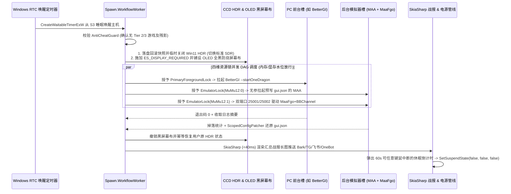
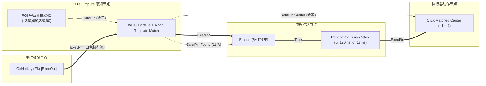

# Workflow 模块规格正本：二次元外部生态并发编排与类 UE 可视化蓝图引擎（`spawn.workflow`）

| 元数据项 | 规格定义 |
| :--- | :--- |
| **模块代号** | `spawn.workflow` |
| **承载子工程** | `Spawn.Modules.Workflow`（DAG 图拓扑模型、蓝图节点校验与配置管理）、`Spawn.Host`（`Nodify` 蓝图画布与 DAG 编排面板）、`Spawn.WorkflowWorker`（二次元外部生态调度、`MaaFramework` 宿主、`BBChannel` 桥接与电源/幕布管理）、`Spawn.BlueprintWorker`（Kismet 虚拟机、`WGC`+`OpenCV`+`PaddleOCR` 感知与 L1~L4 输入驱动），统一基于 `.NET 10 LTS`（`net10.0-windows`） |
| **所属进程域与权限** | 编辑器 UI 与模型校验驻留于 `Spawn.Host.exe`（`Medium IL 0x2000`，零敏感导入表）；外部编排运行于 `Spawn.WorkflowWorker.exe`（按 `D-11` 分级按需提权，免 UAC 仅限 `LOOP-07`）；蓝图执行与输入模拟物理隔离于 `Spawn.BlueprintWorker.exe`（按 `D-11` 分级按需提权，默认 `Medium IL`，遇管理员游戏按需拉起 `High IL 0x3000`，免 UAC 仅限 `LOOP-07`） |
| **覆盖需求与决策** | `REQ-WFL-01` ~ `REQ-WFL-07`、`REQ-SEC-01` ~ `REQ-SEC-06`、`D-01`、`D-05`、`D-06`、`D-11`、`NFR-01` |
| **目标交付里程碑** | `M5`（二次元外部代肝生态并发 DAG 顶层编排器：`REQ-WFL-01` ~ `06`） / `M6`（`Nodify` 类 UE 蓝图可视化按键/识图脚本虚拟机与发光单步调试：`REQ-WFL-07`） |
| **关联设计正本** | [ADR-0002：原生 WPF 与 Nodify 技术栈](../decisions/0002-pure-native-wpf-and-nodify-ui-stack.md) · [ADR-0003：反作弊进程隔离](../decisions/0003-anti-cheat-guard-and-process-isolation.md) · [ADR-0005：外部生态元编排](../decisions/0005-external-ecosystem-orchestration-and-uiaccess-overlay.md) · [交互与核心工作流](../design/interaction-and-workflows.md) · [IPC 与安全契约](../design/ipc-and-security-contracts.md) |
| **前期调研档案** | [卷 01：UI 架构与类 UE 蓝图系统](../research/01-ui-architecture-and-blueprint.md) · [卷 05：二次元日常自动化顶层编排](../research/05-gacha-workflow-orchestration.md) |

---

## 1. 职责边界与进程权限域

### 1.1 模块职责范围（In-Scope）

本模块由上下衔接、进程严格隔离的两大子系统构成：

1. **子系统一：二次元外部生态顶层元编排器（`Spawn.WorkflowWorker.exe`）**
   - **坚守顶层元调度定位**：不重复编写各款二次元长线运营游戏的日常关卡识图逻辑，而是原生内嵌 **`Maa.Framework` C# 绑定**、无损桥接 **`MAA`** 与 **`xlxyvergil/MaaFgo` + `BBChannel`**，并以标准化适配器统管 **`BetterGI`、`March7thAssistant`、`StarRailCopilot`、`ZenlessZoneZero-OneDragon`、`ok-wuthering-waves`**。
   - **四维资源锁并发 DAG 与无人值守闭环**：提供“1 个前台 PC 原生客户端 + N 个后台模拟器实例”无冲突并行调度、双视界防卡死看门狗、S3 硬件定时唤醒、临时关闭 HDR 防过曝、OLED 全黑防烧屏幕布 / `IddCx` 虚拟屏、`SkiaSharp` 汇总战报长图多渠道推送及 60 秒可取消安全睡眠。
2. **子系统二：类 UE 可视化蓝图脚本引擎（`Spawn.Host` 画布 + `Spawn.BlueprintWorker.exe` 运行时）**
   - **100% 纯可视化无代码体验**：基于 `miroiu/nodify` 实现白线执行流（`ExecPin`）与多色强类型数据流（`DataPin<T>`）、悬空连线搜索菜单、内联屏幕 ROI 框选器、红点断点挂起、`Step Over` 单步推进与引脚实时值气泡监视（`Pin Watch`）。
   - **高性能感知与四级可插拔驱动**：在 `BlueprintWorker` 内集成 `Windows.Graphics.Capture`、带 Alpha 掩码与多尺度归一化的 `OpenCvSharp4`、离线 `Sdcb.PaddleOCR` 以及 L1~L4 四级输入执行器，并按 `D-11` 分级按需提权（免 UAC 仅限 `LOOP-07`）解决管理员游戏 UIPI 输入拦截。

### 1.2 明确排除边界（Out-of-Scope）

- **严禁在 `Tier 2 / Tier 3` 反作弊竞技网游存活或冷却期间运行**：无论是 `WorkflowWorker` 还是 `BlueprintWorker`，在任何 `Tier 2/3` 游戏启动前均被 `AntiCheatGuard` 强制排空销毁，且在退出后的 15 秒静默冷却期内严禁拉起（`REQ-SEC-03`、`REQ-SEC-05`）。
- **严禁强制用户编写 Lua / Python / C# 文本代码**：所有逻辑分支、循环、识图与按键组合均由可视化节点与折叠宏（`.spmacro.json`）表达（`D-06`）。

---

## 2. 核心接口与状态机契约

### 2.1 核心服务与跨进程调试协议接口（`Spawn.Modules.Workflow`）

```csharp
namespace Spawn.Modules.Workflow.Contracts;

public sealed record WorkflowResourceContract(
    bool RequiresPrimaryForeground,           // 物理主屏键鼠独占锁 (Capacity = 1)
    bool SupportsChildSession,                // 是否兼容 Win10/11 Pro 桌面分身槽
    string? EmulatorInstanceKey,              // 如 "MuMu12:0", 同实例串行, 异实例并行
    int EstimatedRamMb,
    int EstimatedVramMb);

public interface IExternalGachaAdapter
{
    string AdapterType { get; } // "MaaLegacy", "MaaFrameworkEmbedded", "MaaFgoBbChannel", "BetterGi", "M7A", "Src", "ZzzOneDragon", "OkWw"
    WorkflowResourceContract DeclareResourceNeeds(WorkflowNodeConfig node);
    Task<NodeExecutionReport> ExecuteNodeAsync(WorkflowNodeContext ctx, CancellationToken ct = default);
}

public interface IInputActuator : IDisposable
{
    InputActuatorLevel Level { get; } // L1_PostMessage, L2_SendInput, L3_ViGEmGamepad, L4_HardwareBridge
    ValueTask TapKeyAsync(VirtualKeySpec key, int holdMs, CancellationToken ct = default);
    ValueTask MoveAndClickAsync(NormalizedScreenPoint point, MouseButtonKind button, CancellationToken ct = default);
}

// Spawn.BlueprintWorker <-> Spawn.Host (NamedPipeJsonRpc 双向通道 + MMF 帧预览)
public interface IBlueprintDebugStreamContract
{
    IAsyncEnumerable<BlueprintDebugFrame> SubscribeExecutionPulseAsync(Guid sessionId, CancellationToken ct = default);
    Task PauseOrStepOverAsync(Guid sessionId, DebugStepCommand command, CancellationToken ct = default);
}
```

### 2.2 夜间无人值守并发收菜闭环时序图



---

## 3. 数据模型与存储路径

### 3.1 SQLite 核心表契约（归属 `spawn.db`）

主表结构严格对齐 [data-model.md](../design/data-model.md) 全局 `snake_case` 命名契约，宏子图库辅表（`blueprint_macros`）共享同一版本化 SQL 迁移管线：

| 表名 | 主键 | 关键字段与约束摘要 | 业务用途 |
| :--- | :--- | :--- | :--- |
| `workflow_schedules` | `schedule_id TEXT` | `name TEXT NOT NULL`, `cron_or_daily_time TEXT`, `enable_rtc_wake INT`, `blackout_mode TEXT` (`None`/`SoftwareCurtain`/`IddCxVirtualDisplay`), `post_action TEXT` (`None`/`SleepWith60sCancel`), `notify_channels_json TEXT`, `is_enabled INT` | 跨游戏收菜流水线计划与夜间无人值守策略 |
| `workflow_dag_nodes` | `node_id TEXT` | `schedule_id TEXT NOT NULL`, `adapter_type TEXT NOT NULL`, `tool_root_dir TEXT NOT NULL`, `task_config_json TEXT NOT NULL`, `depends_on_node_ids_json TEXT`, `resource_locks_json TEXT NOT NULL`, `timeout_seconds INT DEFAULT 1800` | DAG 单节点工具路径、拓扑依赖、四维资源锁与超时阈值 |
| `workflow_battle_reports` | `report_id TEXT` | `schedule_id TEXT NOT NULL`, `started_at_utc TEXT`, `completed_at_utc TEXT`, `overall_status TEXT`, `node_summaries_json TEXT`, `long_image_rel_path TEXT`, `notification_sent INT DEFAULT 0` | 每次流水线执行汇总战报、各游戏耗时掉落与长图路径索引 |
| `blueprint_graphs` | `blueprint_id TEXT` | `game_id TEXT`, `title TEXT NOT NULL`, `graph_file_rel_path TEXT NOT NULL`, `required_actuator_level TEXT`, `updated_at_utc TEXT` | 类 UE 蓝图有向图注册索引（指向序列化 `.spbp.json` 图文档） |
| `blueprint_macros` | `id TEXT` | `name TEXT NOT NULL`, `category TEXT`, `inputs_schema_json TEXT`, `outputs_schema_json TEXT`, `subgraph_json TEXT NOT NULL` | 可跨游戏复用的折叠宏节点库辅表（`.spmacro.json`） |

### 3.2 本地文件与配置回滚路径契约

- **外部工具配置防断电回滚日志**：`%LOCALAPPDATA%\spawn\config\workflow_config_rollback.json`（记录被临时覆写的 `MAA/config/gui.json`、`SRC` YAML 等原始备份路径，异常中断重启后 100% 原位恢复）。
- **历史战报长图与卡死取证截图**：`%LOCALAPPDATA%\spawn\vault\Reports\<yyyyMM>\{<ReportId>_summary.png, node_<NodeId>_watchdog.png}`。
- **FGO `BBChannel` 零侵入外置桥接件目录**：`%LOCALAPPDATA%\spawn\tools\bbchannel-bridge\{_ctypes.pyd, bbc_tcp_server.py}`。
- **离线 OCR 模型资产目录**：`%LOCALAPPDATA%\spawn\models\paddleocr\v4-ch\`（PP-OCRv4 轻量检测与识别模型，完全本地离线推理）。

---

## 4. 第一部分关键协议：二次元外部生态顶层编排（`REQ-WFL-01` ~ `REQ-WFL-06`）

### 4.1 明日方舟 `MAA` 无自重启配置预写与 `MaaFramework` 原生内嵌

1. **旧版 `MAA` (`MaaAssistantArknights` v5.x) 防自重启脱管协议（`REQ-WFL-01`）**：
   - **源码级避坑依据**：`MAA` `Bootstrapper.cs` 在检测到命令行携带 `--config` 等参数且需管理员/环境切换时，会内部调用 `ShutdownAndRestartWithoutArgs()` 拉起新实例并自杀，直接导致外部调度器持有的初始进程立即返回退出码 `0`，引发整条 DAG 提前误判完成！
   - **标准执行流**：`ScopedConfigPatcher` 先将 `<MaaRoot>\config\gui.json` 原子备份为 `gui.json.spawn_bak` 并登记回滚日志 -> 修改 JSON 根节点 `"Current"` 指向目标收菜配置页，并将该配置页下的 `AfterCompleted` 设为 `"Exit"`（完成后退出 `MAA` 与模拟器） -> **不带任何触发自重启的命令行参数直接拉起 `MAA.exe`** -> 以 `FileShare.ReadWrite | FileShare.Delete` 实时流式尾随 `<MaaRoot>\debug\gui.log` 提取公招/理智/基建换班进度 -> 进程退出后立即将 `gui.json.spawn_bak` 原子还原。
2. **`MaaFramework` 新一代生态宿主级 C# 原生内嵌（`REQ-WFL-02`）**：
   - 在 `Spawn.WorkflowWorker` 中直接引用官方 `Maa.Framework` C# 绑定（遵循 `LGPL-3.0` 动态链接规范）。
   - 当用户指向任意 `MaaFramework` 生态工具目录（如 `M9A` 重返未来：1999、`MAABH3` 崩坏3、`MaaGF2Exilium` 少女前线2、`MaaYYs` 阴阳师、`MaaEnd` 终末地等）时：
     1. 自动解析项目根目录 **`interface.json`（兼容 `ProjectInterface V2` 规范）** 中的 `controller`、`resource`、`agent`（含 `child_exec` / `child_args`）与 `task`、`option` 树，在 `Spawn.Host` 中零硬编码动态渲染出原生 `WPF-UI` 下拉框、复选框与执行序列表；
     2. 执行时内存级实例化 `MaaResource`、`AdbController`（优先启用 MuMu12 `nemu_ipc` 共享内存极速截图）或 `Win32Controller`；若声明了外部自定义逻辑 `agent`，自动启动 `MaaAgentClient` 通过本地 `socket_id` 握手连接子进程，将任务管线提交 `MaaTasker` 并通过 `Callback` 实时接收每一步节点命中与掉落 JSON 事件；
     3. **ABI 兼容降级兜底**：若外部项目捆绑了特殊预览版 `MaaFramework.dll` 导致内存绑定版本握手不匹配，自动无感回退调用项目自带的 `MaaPiCli.exe -d` 执行。

### 4.2 FGO `xlxyvergil/MaaFgo` + 闭源 `BBChannel` 双端口桥接全协议（`REQ-WFL-03`）

针对 FGO 社区事实标准组合（`BBChannel` 高速后台刷本 + `MaaFgo` 复杂从者技能/宝具编排），在不修改闭源 `BBChannel.exe` 任一字节的前提下，通过 Python 扩展加载优先级实施四层稳定接管：

1. **第一层：`bbcdll/_ctypes.pyd` 代理加载注入**：
   - 将原目录 `bbcdll\_ctypes.pyd` 备份重命名为 `_ctypes_orig.pyd`（记录于回滚日志），放入 SPAWN 编译的同名轻量转发代理 `_ctypes.pyd`：透传全部标准 `ctypes` 导出符号的同时，在首次导入完毕后加载同目录 `bbc_tcp_server.py`，定位 Tkinter 根实例 `_bb_window_global` 与核心控制器 `page`。
2. **第二层：双端口全双工本地回环 JSON RPC（`127.0.0.1:25001` & `25002`）**：
   - 帧封包格式统一为 **`[4 Bytes Big-Endian UInt32 PayloadLen] + [UTF-8 JSON Bytes]`**。
   - **指令端口 `25001`（`WorkflowWorker -> BBChannel`）**：支持 `get_status`、`load_config`、`connect_mumu`（传入 MuMu 安装根与模拟器多开索引）、`set_apple_type`（金/银/铜/青铜苹果枚举）、`set_apple_num`、`set_run_times`、`set_battle_type`、`start_script`、`stop_script` 等 22 项原子指令。
   - **事件通知端口 `25002`（`BBChannel -> WorkflowWorker`）**：实时推送战斗轮次、苹果消耗、拦截到的弹窗内容及停止原因。
3. **第三层：三大致命稳定性缺陷内存级热修复**：
   - **防 `_RetiredMumuApi` 析构黑屏**：`BBChannel` 重连 MuMu 时若旧 `MumuApi` 对象被 Python GC 回收，其析构函数会调用 `nemu_disconnect` 导致底层句柄失效、后续截图恒返回 `displayid=-1` 黑屏！桥接层在切换连接前强制将旧实例追加进全局常驻列表 `_RetiredMumuApi` 阻止析构。
   - **最小化零焦点直接开刷**：不模拟点击 UI 按钮，通过 `page.after(0, invoke_start)` 在 Tk 事件循环线程直接调用 `page.start.startScript()`，支持窗口全程最小化或隐藏在后台执行。
   - **全量阻塞弹窗静默劫持**：Monkey-Patch 替换 `tkinter.messagebox` 全部 6 个入口（`showinfo`、`showwarning`、`showerror`、`askquestion`、`askokcancel`、`askyesno`）；对启动必弹的 `"免责声明！"` 窗口在 2 秒后自动投递 `WM_CLOSE` 关闭，对运行期各类提示弹窗将其标题与正文序列化推送至 `25002` 端口并立即返回安全默认值，彻底杜绝无人值守被模态框卡死到天亮。
4. **第四层：闪退 vs 正常完结双判别与 30 秒助战视觉看门狗**：
   - 收到 `25002` 推送的 `"脚本停止！"` 消息时检查正文：若包含 `'疑似游戏已闪退'`、`'疑似模拟器崩溃'` 或 `'高速接口获取截图失败'`，归类为环境崩溃并自动重启模拟器重连续刷（单任务上限 2 次）；其余情形归类为设定场次或体力耗尽正常完结。
   - 并行运行 30 秒 `get_status` 心跳与 `MaaFramework` 轻量视觉看门狗：一旦连续 30 秒画面停滞且匹配命中 `"助战错误识别"`（FGO 服务器波动弹出“连接失败/重试”框），立即通过 `override_next` 下发点击重试坐标自动恢复刷本循环。

### 4.3 五大 PC 原生二次元助手标准化 CLI 矩阵（`REQ-WFL-04`）

所有外部子进程均置于绑定了 `JOB_OBJECT_LIMIT_KILL_ON_JOB_CLOSE` 的节点级 `JobObject` 中，标准输出流统一剥离 ANSI 颜色转义序列（`\x1b\[[0-9;]*[a-zA-Z]`），日志文件均通过 `FileShare.ReadWrite | FileShare.Delete` 共享尾随：

| 目标游戏与工具 | 无交互启动 CLI 精确契约 | 完成判定、退出码映射与安全禁忌 |
| :--- | :--- | :--- |
| **原神 — `BetterGI`** | `BetterGI.exe --startOneDragon "<ConfigName>"`（一条龙）或 `--startGroups "<G1>" "<G2>"`；Pro 版桌面分身追加 `--instance childsession` | 尾随 `log\better-genshin-impact*.log` 提取每日委托/合成树脂/洞天百宝完成事件，一条龙收尾自动退出。 |
| **崩坏：星穹铁道 — `March7thAssistant`** | 日常：`m7a.exe main --non-interactive --after-finish Exit --json`<br>锄大地/模拟宇宙：`m7a.exe fight` / `m7a.exe universe` | 精确映射退出码：`0`=全部完成，`1`=未分类异常，`2`=参数错误，`3`=游戏启动超时，`4`=登录态失效，`5`=战斗团灭，`6`=人工中断。 |
| **崩坏：星穹铁道 — `StarRailCopilot` (`SRC`)** | 启动前用 `ScopedConfigPatcher` 修改 `config\<profile>.yaml` 中待跑任务的 `Scheduler.Enable: true`、`NextRun: 2020-01-01 00:00:00` 后拉起主程序 | 实时解析 `log\*_gui.txt`：当出现 `Wait until` 且所有启用任务的 `NextRun > Now + 10min` 时判定全队列清空，发送优雅关闭并还原 YAML。 |
| **绝区零 — `ZenlessZoneZero-OneDragon`** | `OneDragon-Launcher.exe -i <实例序号列表如 1,2> -c`（`-c` 表示跑完一条龙后自动关闭游戏与启动器） | **安全硬禁令**：严禁向其透传 `-s` / `--shutdown` 参数，防止单个节点提前把整台电脑关机导致后续 DAG 节点全部流产！ |
| **鸣潮 — `ok-wuthering-waves`** (`ok-script` 家族) | `ok-ww.exe -t 1 -e`（`-t 1` 自动启动第 1 项一条龙任务，`-e` 完成后自动退出进程） | 进程退出码 `0` 结合 `logs\` 尾部完成标记确认收工。 |

### 4.4 四维资源锁并发 DAG 与夜间无人值守基础设施（`REQ-WFL-05`, `REQ-WFL-06`）

1. **四维资源感知调度器（Resource-Aware DAG Scheduler）**：
   - 每个就绪节点仅在同时获得所需四类令牌时才点火执行：① `PrimaryForegroundLock (Semaphore=1)`（所有需接管真实主屏键鼠的 PC 原生游戏严格串行）；② `ChildSessionSlot (Semaphore=1)`；③ `EmulatorInstanceLock("MuMu12:<idx>")`（使用后台 ADB / `nemu_ipc` 帧缓冲的模拟器任务无需申请前台锁，天然与 1 个前台 PC 游戏及异号模拟器并行满速推进！）；④ `SystemMemoryAndVramGate`（通过 `GlobalMemoryStatusEx` 与 `IDXGIAdapter3::QueryVideoMemoryInfo` 确保扣减预估负载后仍保留 `>= 3.0 GiB` 可用物理内存与 `>= 1.5 GiB` 可用显存，防止多开爆显存闪退）。
2. **双视界防卡死看门狗（Dual-Horizon Watchdog）**：
   - 同时监控节点总挂钟上限（默认 `45min`）与日志活跃心跳上限（默认 `300s` 零有效新日志）：任一触发时先抓取现场 PNG 存入战报异常目录，再向窗口发送 `WM_CLOSE` 等待 `5 秒`（保护二次元客户端反作弊组件正常卸载），超时仍存活则关闭节点 `JobObject` 连坐清空子进程树并按 `max_retries` 决定重试或跳过进入下一节点。
3. **S3 唤醒、防锁屏 `0x887A0026` 黑屏与临时关 HDR 闭环**：
   - **定时唤醒**：调用 `CreateWaitableTimerExW(..., CREATE_WAITABLE_TIMER_MANUAL_RESET)` + `SetWaitableTimer(..., fResume: true)`，并在 UI 自检当前电源计划“允许唤醒定时器（RTCWAKE）”是否已开启。
   - **攻克锁屏/息屏导致 DXGI 丢失与过曝**：Windows 一旦进入 `Winlogon` 锁屏桌面或物理关闭 DP 显示器引发 HPD 热插拔，常规前台识图将立即报 `0x887A0026 (DXGI_ERROR_ACCESS_LOST)`，且开启系统 HDR 会令 SDR 模板匹配亮度漂移失效！流水线启动时：① 调用 CCD API **临时关闭系统 HDR 切回标准 SDR**（写入回滚日志，结束必还原）；② 调用 `SetThreadExecutionState(ES_CONTINUOUS | ES_SYSTEM_REQUIRED | ES_DISPLAY_REQUIRED)` 保持图形会话存活，同时铺开 **SPAWN OLED 全黑防烧屏幕布**（全屏纯 `#000000` 置顶无焦点层，支持 `Windows.Graphics.Capture` 直采底层游戏 `HWND` 不受幕布遮挡，双击 `Esc` 解锁；或切换 `IddCx` 虚拟屏彻底关停物理屏）；③ 在未篡改 `termsrv.dll` 的正版 Win10/11 Pro 上可选启用官方 `WTSEnableChildSessions` 后台子会话。
   - **战报长图与 60 秒可取消安全睡眠**：全部节点结束后，用 `SkiaSharp` 在 `< 40ms` 内排版生成暗黑毛玻璃长图（含总耗时、各游戏树脂/理智/星琼勾稽状态、异常截图缩略图），经 DPAPI 解密 Webhook 推送至 Bark / Telegram / 飞书 / 企业微信 / OneBot v11；若配置了自动睡眠，先置顶弹出 **60 秒倒计时提示框**（检测到任意键鼠/手柄活动立即取消，绝不当面把正在用电脑的玩家黑屏休眠！），归零后调用 `powrprof.dll!SetSuspendState(bHibernate: false, bForce: false, bDisableWakeEvent: false)`（**第三个参数必须为 `false`，否则将废除次日凌晨的硬件唤醒闹钟！**）。

---

## 5. 第二部分关键协议：类 UE 可视化蓝图脚本引擎（`REQ-WFL-07`）

### 5.1 `Nodify` 双引脚节点图语义与内联控件模型



1. **双引脚连接拓扑约束（编译期与拖拽期实时静态校验）**：
   - **`ExecPin`（白色楔形执行流引脚）**：允许多个上游分支汇入同一个输入执行槽（`N -> 1`），但单个输出执行槽仅允许连向唯一后继（`1 -> 1`；需并发顺序触发多个分支时使用标准 `Sequence` 节点）。核心内置流控节点：`Sequence`、`Branch`、`ForLoopWithBreak`、`WhileLoop`、`WaitUntil`、`RandomGaussianDelay`（截断正态分布随机延迟）、`Gate`、`DoOnce`、`FlipFlop`。
   - **`DataPin<T>`（彩色圆点强类型数据引脚）**：单输入槽仅接纳一条上游数据线（`1 -> 1`），未连线时直接在引脚旁显示内联字面量编辑器（数值滑块、按键录制钮、屏幕截图 ROI 框选器）；单输出槽支持扇出供给任意多个下游节点（`1 -> N`）。支持隐式安全窄宽转换节点（如 `Int -> Float`、`Point2D -> String`）。
2. **`Pure` 与 `Impure` 求值语义**：
   - 无 `ExecPin` 的纯计算节点（`Pure`，如坐标偏移、数学比较、黑板变量读取）在下游 `Impure` 动作节点被执行时按需惰性反向拉取（Pull Evaluation）；带 `ExecPin` 的动作或高开销感知节点（`Impure`，如 `TemplateMatch`、`PaddleOCR`）在当前激活步执行一次并将输出缓存在帧槽位中供下游多次零开销读取。

### 5.2 异步 Kismet 单步发光虚拟机与零拷贝调试流

1. **无编译开销直接图解释（`BlueprintVirtualMachine`）**：
   - 运行在 `Spawn.BlueprintWorker.exe` 内，主循环每次推进一个 `Impure` 节点（纯内存调度开销 `< 500ns`），每步开始前先检查 `CancellationToken`（按停止热键 `< 5ms` 瞬停）；若连续推进 `10,000` 个同步节点未经过任何 `Delay`/`Wait`，强制插入 `await Task.Yield()` 并告警潜在无延迟死循环。
2. **实时流光高亮、红点断点与 `MemoryMappedFile` 视觉预览**：
   - 当画布开启“实时调试视图”时，虚拟机通过 `Channel<BlueprintDebugFrame>`（`BoundedChannelFullMode.DropOldest`，绝不阻塞脚本真实执行时序！）按最高 `60Hz` 聚合推送当前正在执行的 `NodeId`、刚穿越的 `EdgeId` 及被订阅的 `PinWatch` 值，驱动 `Nodify` 画布连线呈现与 Unreal Engine Kismet 一致的流动光点。
   - 若命中用户打上的红点断点（`Breakpoints.Contains(current.NodeId)`），虚拟机创建 `TaskCompletionSource` 零 CPU 挂起当前协程，等待画布下发 `Resume` 或 `StepOver` 指令；视觉节点截取的局部匹配结果图写入命名共享内存 `MemoryMappedFile`（`spawn-bp-frame-<SessionId>`），主界面零序列化拷贝毫秒级展示绿框匹配置信度。

### 5.3 视觉感知管线、四级输入执行器（L1~L4）与 UIPI 破局

1. **抗干扰高精度视觉管线**：
   - **零黄框无光标捕获**：调用 `Windows.Graphics.Capture`（Win11 22H2+ 显式置 `GraphicsCaptureSession.IsBorderRequired = false`、`IsCursorCaptureEnabled = false`）将 GPU 纹理拷入 DX11 Staging 缓冲直转 `OpenCvSharp4.Mat`。
   - **Alpha 透明掩码模板匹配与分辨率归一化**：所有保存的 UI 图标模板统一按 **`1920x1080` 标准基准坐标系** 存储；当目标游戏运行在 `2560x1440` 或 `3840x2160` 时，自动按客户区高度比例缩放待匹配 ROI 或模板；若 PNG 模板带有透明通道（Alpha < 255 镂空区域），自动提取单通道 `Mask` 传入 `Cv2.MatchTemplate(roi, tpl, TemplateMatchModes.CCorrNormed, mask)`，彻底免疫半透明按钮背后的动态 3D 场景干扰！
   - **离线极速 OCR**：集成 `Sdcb.PaddleOCR`（优先 CPU `Mkldnn` 或核显/独显 `DirectML` 推理），对局部数字/文本 ROI 单次识别耗时 `8ms ~ 22ms`。
2. **四级可插拔输入执行器（`IInputActuator`）**：
   - **L1（后台窗口消息）**：调用 `PostMessageW(hwnd, WM_KEYDOWN / WM_KEYUP / WM_LBUTTONDOWN, ...)`，严格调用 `MapVirtualKeyW` 拼装完整 32 位 `lParam`（含 `RepeatCount`、`ScanCode [16..23]`、`PreviousKeyState [30]`、`TransitionState [31]`）并按需投递 `WM_ACTIVATE(WA_ACTIVE)`，适用于支持失焦输入的单机挂机。
   - **L2（标准前台系统输入）**：调用 `SendInput` 注入 `KEYEVENTF_SCANCODE` 硬件扫描码及带三次贝塞尔微弧度曲线的平滑鼠标移动。
   - **L3（WHQL 签名虚拟手柄总线）**：对接开源 `ViGEmBus v1.22.0` + `Nefarius.ViGEm.Client` 创建虚拟 `Xbox 360` / `DualShock 4` 控制器——即使游戏不接收后台键鼠消息，只要开启游戏内“后台保持手柄输入”，即可在不抢占玩家物理鼠标的情况下后台自动推摇杆按键！
   - **L4（可选外部硬件 HID 桥接）**：面向拥有 `KMBox Net`（本地 UDP 报文）或 `KMBox B+`（CH340 `115200` 波特率串口指令）的极客玩家提供标准实现槽，严格受同一套 `AntiCheatGuard` 门禁约束（仅限 `Tier 0/1` 安全范围）。
3. **管理员权限游戏 UIPI 拦截分级按需提权破局（`REQ-WFL-07`, `D-11`）**：
   - 问题根因：诸多单机与二次元客户端（如原神/星铁启动游戏本体）以管理员权限（`High IL 0x3000`）运行；根据 Windows 内核 UIPI 规则，`Medium IL (0x2000)` 进程发出的 `SendInput` 与 `PostMessageW` 会被内核静默丢弃！
   - 破局链路：激活蓝图前，`Spawn.Host` 以 `OpenProcess(0x1000)` + `OpenProcessToken` 读取目标游戏 `TokenIntegrityLevel`；若检测到 `RID >= 0x3000`，宿主按 `D-11` 分级按需提权策略（[ADR-0006](../decisions/0006-m3-external-trainer-manager-elevation-and-ipc.md)）通过 `ShellExecuteExW(runas)` 经单次 UAC 按需拉起 `High IL` 的 `Spawn.BlueprintWorker.exe`，通过显式授予当前用户 SID 的倒置 SDDL `NamedPipeJsonRpc` 管道回连 `Spawn.Host` 完成同权输入（免 UAC 仅限未来 `%ProgramFiles%` 受管理员 ACL 保护的自包含提权包 `LOOP-07`，严禁为 `%LOCALAPPDATA%` 用户可写目录注册高权限计划任务）；或直接选用不受 UIPI 窗口树限制的 L3 `ViGEmBus` 虚拟手柄。

---

## 6. 跨模块协同、异常恢复与反作弊熔断行为

1. **跨模块协同**：
   - 与 `spawn.nexus` 协同：单机游戏的每个 Profile 可绑定默认伴生蓝图 `default_blueprint_id`（游戏进入 `RunningActive` 自动挂载监听热键，游戏退出自动挂起销毁）；
   - 与 `spawn.launcher` 协同：夜间收菜流水线结束或被用户手动中止时，强制走同一套显示环境恢复逻辑确保 HDR 与屏幕休眠策略 100% 复原。
2. **外部配置与 HDR 崩溃自愈**：
   - `Spawn.Host` 或 `WorkflowWorker` 任何异常崩溃重启后，自检 `%LOCALAPPDATA%\spawn\config\workflow_config_rollback.json` 与 `config\environment_rollback.json`：发现未完结事务立即无损还原玩家原版 `MAA/config/gui.json`、`SRC` YAML、`_ctypes_orig.pyd` 及系统 HDR 开关（`NFR-03`）。
3. **反作弊全局红线硬熔断**：
   - `Tier 0`（纯离线单机）：放行全部蓝图节点与 L1~L4 执行器；
   - `Tier 1`（二次元客户端与弱联网合作）：放行 `WorkflowWorker` 官方社区认可收菜工具集与纯外部 WGC 识图 + 标准前台/手柄输入蓝图，**严禁挂载任何内存读写或注入逻辑**；
   - `Tier 2 / Tier 3`（EAC / BattlEye / Vanguard / ACE 等竞技网游）：**一票否决全量停机**——启动前强制终止 `WorkflowWorker` 与 `BlueprintWorker` 全部实例，运行期间与退出后 15 秒冷却窗口内彻底锁死蓝图启动按钮与定时任务触发器（`REQ-SEC-03`、`REQ-SEC-05`）。

---

## 7. 测试与阶段验收要求

1. **四维资源锁并发 DAG 调度器确定性测试（验证 `REQ-WFL-05`）**：
   - 构造包含 2 个前台独占节点（模拟 `BetterGI`、`ok-ww`）与 2 个异号模拟器后台节点（模拟 `MuMu12:0 MAA`、`MuMu12:1 MaaFgo`）的混合 DAG 夹具：断言任意时刻持锁运行的前台节点数 `<= 1`，而两个异号模拟器节点与当前前台节点在同一时间窗并行执行；当模拟可用内存低于阈值时自动排队延后。
2. **`ScopedConfigPatcher` 与 `MAA` / `BBChannel` 协议夹具测试（验证 `REQ-WFL-01` ~ `REQ-WFL-03`）**：
   - 对模拟 `gui.json` 执行预写并在中途注入异常，断言自愈函数 100% 字节级还原原文件；
   - 使用符合 `MaaFramework` `interface.json` V2 规范的样本文件测试动态表单构建器，验证任务、控制器与下拉选项零硬编码完整映射；
   - 启动本地模拟 TCP 双端口桩服务器验证 `BBChannel` `4B Big-Endian + UTF-8 JSON` 编解码、闪退关键字识别重试与弹窗事件转发逻辑 100% 准确。
3. **1000 节点蓝图图校验与 Kismet 虚拟机断点单步测试（验证 `REQ-WFL-07`, `NFR-01`, `NFR-04`）**：
   - 在 Headless 单元测试中加载含分支、循环、宏子图与断点的蓝图 JSON：验证环路/非法引脚类型静态拦截、命中红点断点后虚拟机挂起零推进、发送 `StepOver` 精确前进 1 步并输出对应 `PinWatch` 快照，以及无延迟死循环在 `10,000` 步触发保护让出。
4. **Alpha 掩码多尺度模板匹配精度测试（验证 `REQ-WFL-07`）**：
   - 以 `1080p` 截取的带透明镂空按钮 PNG 为模板，在叠加了完全不同随机背景噪声的 `1440p` 与 `4K` 合成测试帧上运行归一化 Alpha 匹配，断言定位中心坐标换算误差 `<= 2px` 且置信度 `>= 0.92`。
