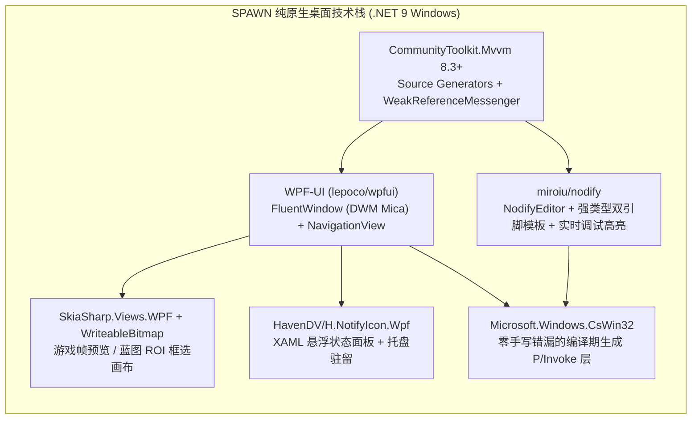
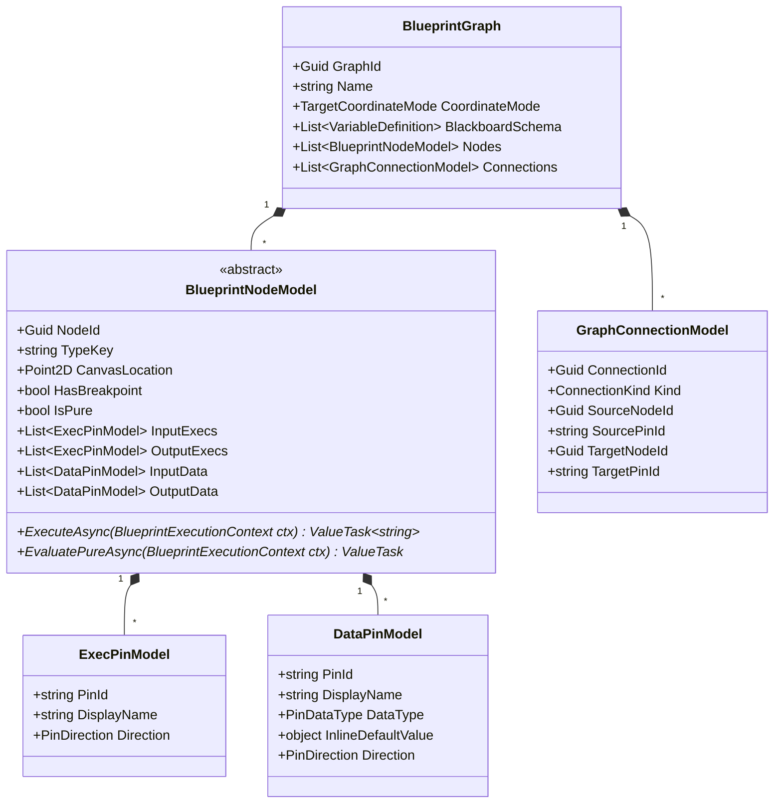
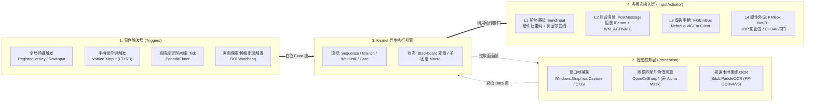
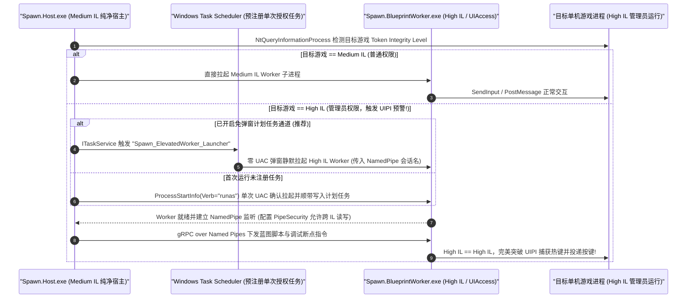
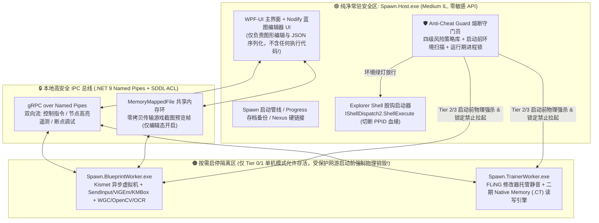
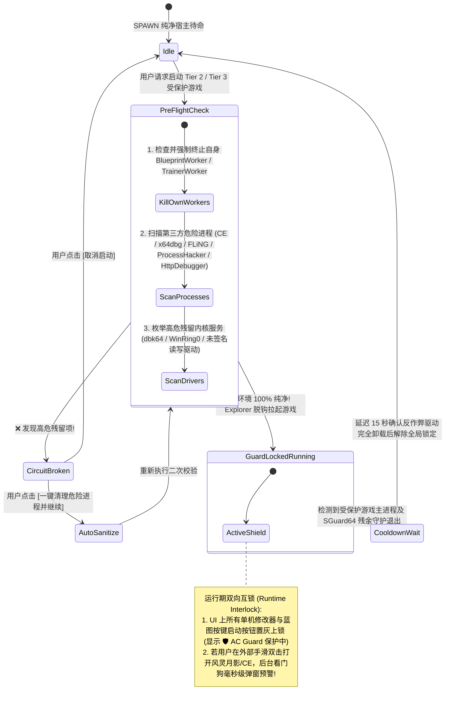

# 01 - SPAWN 纯原生 UI 技术栈评估、类 UE 蓝图可视化脚本引擎与 Anti-Cheat Guard 物理隔离架构

> **所属模块**：`ui-core`（SPAWN 技术底座与安全架构专题）
> **技术红线**：100% 纯原生 C#（`.NET 8 / .NET 9` Windows Desktop），严禁引入任何 WebView2 / Electron / 前端混合渲染层；兼顾单机极客折腾自由度与国产/国际强内核反作弊网游（ACE / HoYoProtect / EAC）零误封安全红线。

---

## 执行摘要与核心架构定案（Executive Summary）

针对 SPAWN 五大核心业务（**Spawn 启动接管、Progress 存档与修改器、Achievement 全渠道成就弹窗、Workflow 二次元外部代肝编排、Nexus Mod 管理**）以及**类 Unreal Engine 蓝图（UE Blueprint）全程可视化自动化脚本**的核心诉求，经过对底层渲染管线、开源生态成熟度、Win32 窗口特权互操作及 UAC 提权兼容性的全方位对比查证，给出以下明确的技术定案：

1. **纯原生 UI 框架选型结论：坚定选择 `WPF (.NET 9)` + `lepoco/wpfui` + `miroiu/nodify` + `CommunityToolkit.Mvvm`，放弃 `WinUI 3`**。
   - **决定性因素 1（UE 蓝图生态断层）**：WPF 拥有目前整个 .NET 生态唯一达到工业级、原生对标 UE Blueprint 交互与高帧率体验的零依赖 MVVM 开源节点库 **[miroiu/nodify](https://github.com/miroiu/nodify)**（支持上千节点丝滑缩放平移、完整执行流/数据流引脚与框选路由）；而 WinUI 3 至今**不存在**成熟的开源原生蓝图控件库，无论用 XAML `Canvas` 还是 `SwapChainPanel + SkiaSharp` 自绘，仅重建空间索引、贝塞尔连线碰撞与节点内复杂控件交互就需耗费数万行代码。
   - **决定性因素 2（管理员权限 UAC 致命缺陷）**：WinUI 3（即便在 Windows App SDK 1.5/1.6+ Unpackaged 模式下）在 `Run as Administrator` 提权状态运行时，**WinRT 拖放系统（Drag & Drop，包括外部拖入 Mod/存档以及应用内 `ListView`/`TabView` 拖拽排序）彻底失效**（官方长期未修 Issue `#7690` / `#4433`），且 `FileOpenPicker` 等现代对话框直接抛异常崩溃；WPF 则与 Win32/COM 原生亲和，提权与非提权状态均高度可控。
   - **决定性因素 3（游戏 Overlay 透明穿透稳定性与行业先例）**：WPF 的无边框全透明穿透置顶窗口（`WS_EX_LAYERED | WS_EX_TRANSPARENT | WS_EX_NOACTIVATE`）历经十余年验证（且 SPAWN 拒绝 WebView2，天然免疫 WPF 唯一的 Airspace 空域缺陷）；同赛道两大开源标杆——全能游戏启动器 **[JosefNemec/Playnite](https://github.com/JosefNemec/Playnite)** 与二次元自动化标杆 **[babalae/better-genshin-impact](https://github.com/babalae/better-genshin-impact)**（采用 `.NET + WPF + WPF-UI + CommunityToolkit.Mvvm`）均验证了该技术栈在游戏工具领域的统治级工程落地性。
2. **类 UE 蓝图可视化脚本引擎定案**：采用 **强类型双引脚有向图模型（白色 `ExecPin` 控制流 + 彩色 `DataPin<T>` 惰性/缓存双模数据流） + 基于 `System.Threading.Channels` 与 `CancellationToken` 的异步有向图解释执行器**。相比表达式树或 Roslyn 动态编译，异步解释器在 I/O 与延时等待占 99% 耗时的自动化场景下零性能劣势，且原生获得**运行态节点实时高亮、连线脉冲流向动画、断点挂起（Breakpoint）、单步步进（Step Over）与引脚值实时监视（Pin Watch）**的极客调试体验。
3. **Anti-Cheat Guard 与主从物理隔离定案**：采用 **Clean Host（`Spawn.Host.exe`，Medium IL 普通权限、PE 导入表零敏感 Win32 API、零自动化/内存库引用） + 按需启停独立子进程（`Spawn.BlueprintWorker.exe` 与 `Spawn.TrainerWorker.exe`，通过 `.NET 8/9` 原生 `gRPC over Named Pipes` + `MemoryMappedFile` 共享内存帧缓冲通信）** 架构，并在游戏启动管线前置 **四级反作弊风险分级与危险进程/驱动预检熔断器**，从物理内存与进程血缘层面彻底根除运行《原神》《鸣潮》《三角洲行动》等强反作弊游戏时的误封隐患。

---

## 第一章：WPF vs WinUI 3 纯原生方案深度技术评估

### 1.1 UE 蓝图节点编辑器生态深度调研（决定性胜负手）

SPAWN 的“自定义按键与视觉自动化脚本”要求全程采用类似 **Unreal Engine Blueprint** 的节点图编排（包含多分支控制流、强类型数据引脚、注释分组框、拐点路由 Knot、子图折叠、实时调试高亮）。节点图编辑器是整个桌面端复杂度最高的重交互组件，其生态成熟度直接决定项目成败。

#### 1.1.1 WPF 开源节点图生态深度横评

| 评估维度 | [`miroiu/nodify`](https://github.com/miroiu/nodify) | [`Wouterdek/NodeNetwork`](https://github.com/Wouterdek/NodeNetwork) | [`PixiEditor/PixiEditor`](https://github.com/PixiEditor/PixiEditor) 节点系统参考 |
| :--- | :--- | :--- | :--- |
| **底层架构与依赖** | **纯原生 WPF 自定义控件**，**零第三方强依赖**，原生契合 `CommunityToolkit.Mvvm` | 重度绑定 `ReactiveUI` 与 `DynamicData`，响应式属性链极重 | 早期为 WPF，v2.0 全面迁移至 Avalonia + 自研 Skia 渲染管线 |
| **UE 蓝图贴合度** | **极高（原生为类 UE Blueprint 设计）**：官方内置 StateMachine、Playground、Calculator 示例，原生支持执行引脚/数据引脚、拐点 `KnotNode`、注释框 `GroupingNode`、多种连线曲率 | 中高（偏向 Shader / 数据流图），改造成 UE 风格双流向引脚需大量重写 ControlTemplate | 专用于 2D 像素/图层程序化合成，与通用游戏自动化逻辑耦合过深，难以直接剥离复用 |
| **海量节点与缩放性能** | **极强（500~2000 节点保持 60+ FPS）**：自定义 `NodifyCanvas` 绕过重型布局传递，利用 `MatrixTransform` 硬件加速视口缩放平移，支持 `EnableRealtimeSelection` 按需开关与增量渲染 | 较弱：超过 150~200 个复杂节点时，ReactiveUI 订阅链与标准 WPF Layout Pass 产生明显拖拽掉帧 | 极强（直接 GPU/Skia 绘制），但脱离标准 WPF 控件模板体系，自研维护成本极高 |
| **维护活跃度** | **极活跃**（持续适配 .NET 8/9，NuGet 下载量数十万，v6/v7 持续迭代手势与路由 API） | **停滞/半归档**（多年未跟进现代 .NET 性能优化） | 活跃（但方向已转向跨平台图形编辑） |

**`miroiu/nodify` 核心底层机制剖析**：
- **坐标空间与无限画布（`NodifyEditor` + `NodifyCanvas`）**：标准 WPF `ItemsControl` 搭配普通 `Canvas` 在平移/缩放时若逐个修改子元素坐标会触发灾难性的 `Measure/Arrange` 风暴。`NodifyEditor` 将所有节点包装在轻量级 `ItemContainer` 中，节点在逻辑画布上的 `Location (Point)` 仅在被拖拽时局部更新；全局画布平移（`ViewportLocation`）与缩放（`ViewportZoom`）直接作用于底层视口层的 `MatrixTransform`，在 DirectX 硬件合成阶段零布局开销完成重绘。
- **开箱即用的蓝图级交互原语**：
  - 引脚与连线：内置 `Node`、`InputConnector`、`OutputConnector`、`PendingConnection`（拖拽悬空预连线，支持拖到空白处松手弹出类似 UE 蓝图的上下文节点搜索菜单！）、`Connection`（三次贝塞尔曲线）、`DirectionalConnection`（带流向箭头/脉冲动画扩展点）、`CircuitConnection`（45° 电路折线）、`StepConnection`。
  - 组织与重构：`GroupingNode`（类似 UE Comment Box，拖动分组框自动带动内部所有节点平移）、`KnotNode`（整理长距离意大利面条连线的 Reroute Node）、边缘自动滚屏（Auto-Panning）、框选（Marquee Selection）及连线切割手势（Alt + 右键划断连线）。

#### 1.1.2 WinUI 3 节点图生态现状与自绘成本测算

在 WinUI 3（Windows App SDK）生态中，目前**没有任何一个对标 `Nodify` 的成熟开源原生 XAML 节点编辑器库**。若强行选择 WinUI 3，开发团队只能面临以下三条高昂代价的路径：
1. **基于 WinUI 3 `Canvas` + XAML `Path` 手搓**：
   - WinUI 3 缺少 WPF 丰富的底层几何命中测试 API（如 WPF 的 `Geometry.FillContains` / `StrokeContains(pen, point)` 可精准以 3px 容差判断鼠标是否点中三次贝塞尔曲线）。
   - 在 WinUI 3 中，每条 `BezierSegment` 都是跨越托管 C# 与原生 C++/WinRT ABI 边界的 COM 对象（`Microsoft.UI.Xaml.Media`）。当画布存在 300 个节点与 500 条动态重算连线时，高频拖拽引发的跨 ABI 边界封送（Marshaling）损耗会导致严重卡顿。
2. **基于 `SwapChainPanel` + `SkiaSharp` / `Win2D` 全自绘（如实验性库 `Blueprints.NET.WinUI`）**：
   - 虽然纯 GPU 光栅化绘制几千条线毫无压力，但一旦进入 `SkiaSharp` 画布，就**彻底失去了 XAML 控件树与数据绑定**！蓝图节点内部需要放置快捷键录制框、窗口句柄选择器、OCR 区域微调数值框、模板小图预览、下拉枚举框——在 Skia 里必须从零实现一套 Immediate-Mode GUI（光标闪烁、IME 中文输入法候选框定位、焦点切换、剪贴板），工程量等同于自研半个游戏引擎编辑器，完全背离快速落地的初衷。
3. **商业闭源组件（如 MindFusion Diagramming for WinUI）**：授权昂贵，且设计范式偏向传统企业级 ER 图/流程图，缺乏 UE 蓝图的双引脚语义与极客定制性。

> [!IMPORTANT]
> **单项结论**：仅“类 UE 蓝图可视化编辑器”这一项核心刚需，`WPF + miroiu/nodify` 就为 SPAWN 节省了至少 **3~4 个月** 的底层图形学与交互轮子研发周期，且交互上限远超自研 WinUI 3 画布。

---

### 1.2 窗口控制、In-Game Overlay 与系统级游戏交互能力对比

SPAWN 并非普通后台表单软件，它需要频繁与全屏/无边框窗口化游戏产生空间与输入交互（成就解锁弹窗、`Alt+Z` 快捷 Overlay、多屏 DPI 坐标映射、托盘常驻、热键监听）。

#### 1.2.1 无边框全透明穿透置顶窗口（Overlay 弹窗）

- **WPF 实现机制与可靠性**：
  - 通过设置 `WindowStyle="None"`、`AllowsTransparency="True"`、`Background="Transparent"`，WPF 自动在底层创建 `WS_EX_LAYERED` 分层窗口，再通过 `WindowInteropHelper` 在 `OnSourceInitialized` 中追加 `WS_EX_TRANSPARENT | WS_EX_NOACTIVATE | WS_EX_TOOLWINDOW` 扩展样式：
    - `WS_EX_TRANSPARENT`：鼠标点击 100% 物理穿透到底层游戏窗口；
    - `WS_EX_NOACTIVATE`：弹窗出现时绝不抢夺前台游戏焦点（防止全屏游戏切回桌面最小化）；
    - `WS_EX_TOOLWINDOW`：不在 `Alt+Tab` 切换列表与任务栏中制造垃圾图标。
  - **关于 WPF 历史遗留痛点的客观澄清**：
    - *Airspace（空域撕裂问题）*：WPF 的 `AllowsTransparency` 唯一死穴是无法与内嵌的 `WebBrowser`/`WebView2`/`WindowsFormsHost` 子 HWND 正常混合透明像素。**由于用户已明确规定 SPAWN 采用 100% 纯原生 C#（零 WebView）**，这一缺陷在 SPAWN 中**完全不存在**！
    - *局部穿透与交互切换*：在 WPF 分层窗口中，纯透明区域（`#00000000`）天然鼠标穿透，而半透明/不透明控件区域（哪怕填充 `#01000000`）可精准响应点击！当用户按下 `Alt+Z` 呼出可交互 Overlay 面板时，只需移除 `WS_EX_TRANSPARENT`，空白处保持 `#00000000` 依然可透视游戏画面，面板卡片区域正常交互，关闭面板再恢复 `WS_EX_TRANSPARENT`，稳如磐石。
- **WinUI 3 实现困境与已知 Bug**：
  - WinUI 3 官方 `AppWindow` 长期缺失开箱即用的异形全透明窗口支持（参见 `microsoft/microsoft-ui-xaml` 旷日持久的 Issue **#1247** 与 **#7276**）。
  - 尽管社区通过 **[dotMorten/WinUIEx](https://github.com/dotMorten/WinUIEx)** 结合 `TransparentTintBackdrop`、`DwmExtendFrameIntoClientArea` 与子类化 `WM_ERASEBKGND` 实现了透明背景，但其底层基于 DirectComposition 交换链合成而非经典 GDI/DWM 分层位图命中测试：
    1. 不加 `WS_EX_TRANSPARENT` 时，哪怕背景为 `{x:Null}` 全透明，鼠标点击透明空白区依然会被 WinUI 3 根视觉层拦截，导致底层游戏丢失鼠标控制！
    2. 加上 `WS_EX_TRANSPARENT` 后，**整个窗口（包括里面的按钮）全部穿透**，无法像 WPF 那样利用 Alpha 通道天然实现“空白处穿透、控件处可点”，必须挂载全局鼠标钩子或高频轮询 `GetCursorPos` 手动计算控件矩形并动态闪烁切换 `SetWindowLongPtr`，极易在多显示器边缘产生竞态 Bug；
    3. 与 `OverlappedPresenter.IsAlwaysOnTop` 混用时，在部分双显卡笔记本或特定 Windows 11 版本上曾多次出现黑底闪烁或首帧白屏闪现问题。

#### 1.2.2 多显示器 Per-Monitor DPI v2 缩放

- **WPF（.NET 8/9）**：在 `.csproj` 或 `app.manifest` 声明 `PerMonitorV2` 后，WPF 布局引擎全程运行在统一的 **96 DPI 设备无关像素（DIPs）** 下，窗口在 4K（200% 缩放）主屏与 1080p（100% 缩放）副屏间跨屏拖拽或定位成就弹窗时，`VisualTreeHelper.GetDpi(visual)` 与 `OnDpiChanged` 自动接管字体与矢量图标重栅格化。与底层截图/鼠标物理坐标换算仅需一行矩阵乘法：`Point physicalPt = PresentationSource.FromVisual(window).CompositionTarget.TransformToDevice.Transform(dipPt)`。
- **WinUI 3**：存在严重的 **坐标系分裂感**——`AppWindow.MoveAndResize(RectInt32)` 接收的是**物理像素**，而窗口内的 XAML 布局（`Width`/`Height`）使用的是 **DIPs**（需手动乘除 `XamlRoot.RasterizationScale`）。在多屏异构 DPI 环境下定位屏幕右下角成就弹窗或绘制蓝图截图框选遮罩时，稍有不慎就会产生 1.5x / 2.0x 的偏移错位。

#### 1.2.3 系统托盘（NotifyIcon）与底层消息钩子（WndProc）

- **系统托盘**：WinUI 3 官方至今未内置 `NotifyIcon` 控件，需依赖第三方库 **[HavenDV/H.NotifyIcon](https://github.com/HavenDV/H.NotifyIcon)**（`H.NotifyIcon.WinUI`）；WPF 既可使用现代化的 `H.NotifyIcon.Wpf`，也可使用久经考验的 **[hardcodet/wpf-notifyicon](https://github.com/hardcodet/wpf-notifyicon)**，支持完整的自定义 XAML 悬浮卡片（例如鼠标悬停托盘图标直接展示当前代肝进度条与修改器开关列表）与原生上下文菜单。
- **Win32 消息循环挂载（处理 `WM_HOTKEY` / `WM_INPUT` / `WM_DEVICECHANGE`）**：
  - WPF：官方提供一等公民托管接口 `HwndSource.FromHwnd(hwnd).AddHook(HwndSourceHook)`，生命周期随窗口自动管理，安全优雅。
  - WinUI 3：无官方托管 Hook API，必须手写 P/Invoke 调用 `SetWindowSubclass`（`comctl32.dll`）或 `SetWindowLongPtr(GWLP_WNDPROC)`，并且必须使用静态字段或 `GCHandle.Alloc` 钉住委托实例，否则 GC 触发瞬间直接引发 `ExecutionEngineException` 原生闪退。

---

### 1.3 管理员权限（UAC `Run as Administrator`）致命坑深度查证

在 SPAWN 的业务版图中，高完整性级别（High Integrity Level，即管理员权限）是绕不开的刚需场景：向管理员启动的单机老游戏投递按键（突破 UIPI）、挂载修改器或内存读写、配置 Windows Defender 沙箱目录排除项、注册睡眠唤醒计划任务等。

我们对 **WinUI 3（Windows App SDK 1.5 / 1.6+ Unpackaged 非打包模式）** 在管理员权限下的真实表现进行了严格查证，发现其存在**架构级硬伤**：

| 提权场景关键能力 | WinUI 3 (Windows App SDK 1.5 / 1.6+ Unpackaged) | WPF (.NET 8 / .NET 9) |
| :--- | :--- | :--- |
| **外部文件拖入（Explorer -> App）** | **彻底失效**（`microsoft-ui-xaml` `#7690` / `#4433`）：底层采用 WinRT CoreDragDrop 跨进程代理，因 Explorer（Medium IL）与 App（High IL）令牌隔离直接拒接，且 `ChangeWindowMessageFilterEx` 无法救活 XAML 控件的 `Drop` 事件 | 默认受 UIPI 拦截 COM OLE `IDropTarget`，但可通过注册经典 Win32 `DragAcceptFiles` + `ChangeWindowMessageFilterEx(hwnd, WM_DROPFILES, MSGFLT_ALLOW)` 完美实现提权态拖入文件；主进程不提权时更是原生支持一切拖放 |
| **应用内部控件拖拽重排** | **连坐瘫痪（致命！）**：在管理员权限下，连 WinUI 3 窗口**内部**的 `ListView` 拖拽排序（Mod 加载顺序调整）、`TabView` 撕裂标签页等内部 DragDrop 都会静默失效或抛异常！微软官方已将此标记为平台底层限制长期搁置 | **100% 正常**：WPF 内部拖拽或基于鼠标捕获（`Mouse.Capture`）的节点/列表重排完全在进程内闭环，不受进程令牌高度影响 |
| **文件/目录选择器（Picker）** | **直接崩溃**：提权下调用 `Windows.Storage.Pickers.FileOpenPicker` / `FolderPicker` 即使调用了 `InitializeWithWindow.Initialize` 仍会抛出 `UnauthorizedAccessException` 或 COM RPC 错误，必须放弃官方 API 退回手写 Win32 `IFileOpenDialog` P/Invoke | **100% 正常**：`Microsoft.Win32.OpenFileDialog` / `.NET 8+ OpenFolderDialog` 直接封装原生 Win32 Common Item Dialog，在任何权限级别下均零异常工作 |
| **运行时启动稳定性与体积** | Framework-Dependent 模式下 `MddBootstrapInitialize` 在管理员令牌读取 `Program Files\WindowsApps` 时曾多次爆发静默闪退（`0xc000027b`，如 1.6.2 紧急撤包事故）；若开启 `WindowsAppSDKSelfContained=true` 规避，则单应用额外膨胀约 **90MB~120MB** 非托管 DLL | `.NET Desktop Runtime` 历经多年锤炼，无论 Framework-Dependent（仅数 MB）还是单文件发布，在 Standard User / Administrator / UIAccess / LocalSystem 下均极度稳定 |

> [!WARNING]
> **对 SPAWN 架构的双重启示**：
> 1. UI 技术栈绝不能选在提权态下连内部列表拖拽都会残废的 WinUI 3；
> 2. 即便使用 WPF，**SPAWN 主进程（`Spawn.Host.exe`）也应当默认以普通用户权限（Medium IL）运行**——这既能保留最丝滑的 Explorer OLE 拖入 Mod 压缩包体验，又能契合第三章 Anti-Cheat Guard 的最小权限安全原则；所有需要管理员权限的操作全部下沉至按需静默拉起的独立高权限 Worker 进程！

---

### 1.4 现代化视觉、图形互操作与最终技术栈工程定案

过去开发者对 WPF 的唯一顾虑是“默认 Aero 皮肤陈旧”，但在 `.NET 9` 与现代开源生态加持下，这一短板已被彻底抹平：

1. **Windows 11 原生 Fluent 视觉体系**：
   - 首推 **[lepoco/wpfui](https://github.com/lepoco/wpfui)（WPF-UI v3/v4）**：在社区拥有极高声誉（`BetterGI` 同款 UI 库）。其 `FluentWindow` 直接通过 Win32 `DwmSetWindowAttribute`（`DWMWA_SYSTEMBACKDROP_TYPE = 38`）调用 Windows 11 DWM 合成器，实现**真正的系统级硬件 Mica（云母）、Mica Alt 与 Acrylic（亚克力）背景材质**，并提供完整的 `NavigationView`、`BreadcrumbBar`、`Snackbar`、`ContentDialog`、`CardExpander`、`SymbolIcon`（Fluent System Icons），视觉观感与原生 WinUI 3 几乎达到像素级一致。
   - 辅以 `.NET 9` 官方内置的原生 Fluent 主题底层优化，并按需引入 **[HandyOrg/HandyControl](https://github.com/HandyOrg/HandyControl)** 的个别重型工具控件（如高级取色器、属性网格 `PropertyGrid` 用于蓝图节点右侧 Inspector 面板）。
2. **高性能 DirectX / SkiaSharp 互操作（蓝图截图框选与实时预览）**：
   - 在蓝图编辑器中配置“图像模板匹配”或“OCR 区域”节点时，玩家需要在实时游戏画面上进行高帧率缩放与矩形 ROI 框选。WPF 支持通过 **[SkiaSharp.Views.WPF](https://www.nuget.org/packages/SkiaSharp.Views.WPF)**（`SKElement` / `WriteableBitmap` 锁定位图后台指针 `BackBuffer`）或 `D3DImage` 桥接 Direct3D11 共享纹理，轻松实现 60FPS 零闪烁的游戏画面实时投射与辅助线叠加绘制。
3. **MVVM 框架定案**：
   - 统一采用微软官方 **[CommunityToolkit.Mvvm](https://github.com/CommunityToolkit/dotnet)**（v8.3+）。基于 Roslyn Source Generator 编译期生成代码（`[ObservableProperty]`、`[RelayCommand]`、`ObservableValidator`、`WeakReferenceMessenger` 跨模块松耦合事件总线），零运行时反射开销，完美适配蓝图上千个 `PinViewModel` 与 `NodeViewModel` 的高频属性通知。

#### WPF vs WinUI 3 综合量化对比矩阵

| 评估维度（权重） | `WPF (.NET 9) + WPF-UI + Nodify` | `WinUI 3 (Windows App SDK 1.6+)` | 胜出方 |
| :--- | :--- | :--- | :--- |
| **UE 蓝图节点图生态与性能（30%）** | `miroiu/nodify` 开箱即用，千级节点 60FPS，零自研画布负担 | 生态空白，XAML 慢、Skia 丢数据绑定，自研成本极高 | **WPF 完胜** |
| **UAC 提权与拖放/对话框兼容性（20%）** | 全权限级别健壮可控，无内部控件连坐 Bug | 提权后内外部 DragDrop 瘫痪、`FileOpenPicker` 报错 | **WPF 完胜** |
| **In-Game Overlay 透明穿透与焦点保护（20%）** | Alpha 通道天然按像素命中穿透，无 WebView 故无 Airspace 问题 | 需第三方 Hack，全窗穿透与局部点击矛盾突出 | **WPF 胜出** |
| **Win32 底层互操作与轻量化部署（15%）** | `HwndSource` 原生优雅，单进程体积小，启动极快 | 需手动子类化 WndProc，Self-Contained 体积臃肿 | **WPF 胜出** |
| **现代 Fluent 外观与动效（15%）** | `WPF-UI` 原生支持 DWM Mica/Acrylic，常规过渡动画充足 | 原生 Composition 隐式动画与 DirectX 12 管线略占优 | WinUI 3 小幅占优 |
| **加权总评结论** | **95 / 100（工程落地性、极客扩展性与稳定性全满）** | **52 / 100（蓝图编辑器与 UAC 两大死穴不可接受）** | **定案选型 WPF** |



#### 子模块 1 核心依赖清单（NuGet & Win32 API）

| 类别 | 包名 / API 名称 | 用途说明 | 参考开源仓库链接 |
| :--- | :--- | :--- | :--- |
| **现代 UI 壳层** | `WPF-UI` (`Lepoco.WpfUi`) | Windows 11 Mica/Acrylic 窗口材质、Fluent 导航与弹窗控件 | `https://github.com/lepoco/wpfui` |
| **UE 蓝图画布** | `Nodify` | 高性能 MVVM 节点图编辑器核心画布、连线、分组框与手势路由 | `https://github.com/miroiu/nodify` |
| **辅助重型控件** | `HandyControl`（按需局部样式引入） | 节点右侧属性检查器 `PropertyGrid`、HSL/RGB 屏幕取色器 | `https://github.com/HandyOrg/HandyControl` |
| **MVVM 与 DI** | `CommunityToolkit.Mvvm` + `Microsoft.Extensions.DependencyInjection` | 编译期无反射 MVVM、模块化服务注册与消息总线 | `https://github.com/CommunityToolkit/dotnet` |
| **系统托盘** | `H.NotifyIcon.Wpf` | 纯原生无 WinForms 依赖的高 DPI 系统托盘与自定义 XAML 弹出窗 | `https://github.com/HavenDV/H.NotifyIcon` |
| **图形互操作** | `SkiaSharp.Views.WPF` | 蓝图视觉节点模板裁剪、ROI 标尺绘制与 OCR 检测框实时叠加渲染 | `https://github.com/mono/SkiaSharp` |
| **Win32 生成器** | `Microsoft.Windows.CsWin32` | 微软官方 Win32 元数据编译期 P/Invoke 生成器（`DwmSetWindowAttribute`, `SetWindowLongPtr` 等） | `https://github.com/microsoft/CsWin32` |

---

## 第二章：类 UE 蓝图的全程可视化按键与自动化脚本系统方案

### 2.1 双流向图模型设计：Execution Pins + Strongly-Typed Data Pins + 子图封装

传统的“按键精灵录制回放”或简单的“顺序动作列表”一旦遇到动态分支（如：如果检测到残血则吃药，否则释放连招；循环刷本直到识别到“体力不足”弹窗或超时 180 秒），就会陷入逻辑死胡同。同时玩家又不愿手写 Python/Lua 代码。**Unreal Engine Blueprint（Kismet 虚拟机模型）** 的“白线控制流 + 彩线数据流”双轨模型是零代码表达任意图灵完备自动化逻辑的最优解。

#### 2.1.1 引脚语义与颜色类型系统（对标 UE5 Blueprint 视觉直觉）

1. **Execution Pins（执行流引脚 —— 白色实心/空心右向楔形图标 `#FFFFFF`）**：
   - **连接拓扑约束**：
     - **Input Exec Pin（输入执行端）**：支持 **多对一（N -> 1）** 汇聚连接（例如两个不同的分支结束后合并进入同一个后续动作节点）。
     - **Output Exec Pin（输出执行端）**：严格限制 **一对一（1 -> 1）** 连接！因为一条执行流在同一时刻只能有确定的下一跳；若需扇出执行多个分支，必须显式连入 `Sequence`（顺序逐分支执行）或 `ParallelFork`（并发协程执行）节点。
   - **内置核心流控节点（Flow Control Nodes）**：
     - `Sequence`：支持动态点击 `[+ Add Pin]` 增加 `Then 0`, `Then 1`, `Then 2...`，按序异步等待每个子链执行完毕后进入下一分支。
     - `Branch`（If-Else）：接收红色 `Boolean` 数据引脚 `Condition`，分流至 `True` 或 `False` 执行引脚。
     - `ForEachLoop` / `ForLoopWithBreak`：包含输入执行引脚 `Exec` 与 `Break`（支持循环体中途回连打断循环！），输出执行引脚 `LoopBody` 与 `Completed`，并附带 `ArrayElement` / `Index` 数据输出端。
     - `Delay` / `RandomGaussianDelay`：支持设定均值与标准差（例如 `120ms ± 18ms` 高斯抖动，规避机械等间隔宏特征），底层完全基于 `Task.Delay(ts, cancellationToken)` 非阻塞挂起。
     - `WaitUntil`（视觉/状态条件等待器）：配置轮询间隔 `PollIntervalMs` 与最大超时 `TimeoutMs`，持续拉取上游布尔条件引脚（如 `MatchTemplate` 的 `IsFound`），分流至 `Matched` 或 `TimedOut` 两个输出执行端！
     - `Gate`（四输入执行端：`Enter`、`Open`、`Close`、`Toggle`，控制事件洪流开关）、`DoOnce`（双输入执行端：`Execute`、`Reset`，确保某段触发逻辑在手动重置前仅触发一次）、`FlipFlop`（奇偶次交替走 `A` / `B` 流，极适合一键开镜/关镜或切换宏状态）。

2. **Data Pins（数据流引脚 —— 强类型彩色圆形图标）**：
   - **连接拓扑约束**：与执行引脚恰好相反！**Output Data Pin 支持一对多（1 -> N）广播读取**，而 **Input Data Pin 严格限制一对一（1 -> 1）**；当某个 Input Data Pin 未连线时，节点内部直接内联显示默认字面量编辑控件（如未连线的 `Point` 引脚直接展示 `[X: 960] [Y: 540] [拾取屏幕坐标🎯]` 按钮，一旦连线则自动隐藏内联输入框，完全复刻 UE 蓝图体验）。
   - **强类型色彩规范与自动转换器（Auto-Cast Reroute）**：
     - `Boolean`（深红 `#CC2929`）：匹配是否成功、按键是否按下、逻辑与或非结果；
     - `Int32`（翠绿 `#1EE6A8`）/ `Double`（亮绿 `#95F204`）：循环次数、血量百分比、匹配配置度 `0.0~1.0`、延迟毫秒数；
     - `Point2D / Vector2`（金黄 `#F7C600`）：屏幕或窗口客户区相对坐标（同时携带坐标系枚举：`ScreenAbsolute` / `ClientNormalized_1080p` 自适应分辨率缩放！）；
     - `RectROI`（琥珀橙 `#FF8800`）：截图与识图感兴趣区域 `(X, Y, Width, Height)`；
     - `ImageRef`（紫罗兰 `#9B51E0`）：对帧缓冲区或预加载模板 `Mat` 的安全托管句柄（防止大图像在节点间深拷贝）；
     - `WindowTarget`（天蓝 `#00A8FF`）：封装目标窗口 `HWND`、进程 PID 与基准分辨率；
     - `String`（洋红 `#F032E6`）：OCR 识别文本、窗口标题正则、日志消息。
   - **Pure Node（纯求值节点） vs Impure Node（有副作用动作节点）**：
     - **Impure Node**（顶部标题栏带图标与深色渐变，拥有白色 `Exec` 引脚）：如 `ClickMouse`、`CaptureWindow`、`RunOCR`。仅当执行流抵达时执行一次，并将产出的输出数据写入当前协程帧的 `NodeOutputCache` 中供下游直接读取。
     - **Pure Node**（紧凑绿色/灰色无 `Exec` 引脚节点）：如 `Add`、`GreaterEqual (Confidence >= 0.85)`、`MakeRectROI`、`ContainsText`、`GetCursorPosition`。不参与执行流调度，仅在某个正在执行的 Impure Node 读取其输入引脚时触发 **按需反向拉取求值（Demand-Driven Pull Evaluation）**。

3. **黑板变量系统（`BlueprintBlackboard`）与子图/宏资产（`MacroSubGraph`）**：
   - 支持用户在侧边栏声明强类型图级变量（如 `RetryCount: Int32`、`BossPhase: Int32`），拖拽到画布自动提示生成 `Get Variable`（Pure）或 `Set Variable`（Impure）节点。
   - 支持框选一组常用连招或“通用弹窗关闭检测”节点，右键执行 **`Collapse to Macro（折叠为宏子图）`**，自动提取悬空边界连线生成 `MacroEntry` 与 `MacroExit` 节点，保存为 `.spmacro.json` 跨游戏脚本复用。



---

### 2.2 运行时引擎选型对比：异步有向图解释器 vs 表达式树 / Roslyn 编译

针对节点图的运行时执行方式，我们在 C# 体系下对三种主流编译/解释架构进行了严密对比：

| 对比维度 | **方案 A：异步有向图解释执行器（基于 `Channel` + `ValueTask`）** | 方案 B：`System.Linq.Expressions` 表达式树编译 | 方案 C：Roslyn C# 源码生成 + `AssemblyLoadContext` 动态编译 |
| :--- | :--- | :--- | :--- |
| **对 `async/await` 与非阻塞延时的支持** | **原生一等公民**：`Delay`、`WaitUntilImage` 直接 `await Task.Delay(...)`，零线程阻塞，成百上千次循环毫无状态机拼接痛点 | **极度痛苦**：.NET 表达式树至今不支持直接构造 `async/await` 状态机（`Expression.Await` 缺失），遇到异步节点需手写极其晦涩的 CPS 变换 | 原生支持生成 `async Task`，但每次修改一个延时参数都要重新走一遍 Roslyn 编译管线 |
| **任意有向有环图（循环连线、Gate、DoOnce）** | **天然契合**：执行器核心是一个 `while` 指令指针游走循环（类似 Kismet VM 的 `FFrame`），回连成环、多入口汇聚 `Gate` 均只需移动 `CurrentNodeId` 指针 | 树形结构天生抗拒任意回边跳转，必须用 `LabelTarget` + `Expression.Goto` 将图强行线性化（CFG 支配树分解算法极易出 Bug） | 若存在非结构化回边（Irreducible CFG），无法生成合法 `while/if`，必须退化为生成 `switch(state)` 状态机代码，脱裤子放屁 |
| **实时节点高亮、断点单步调试、引脚值监视** | **零侵入原生支持**：在游走循环的每一步前后直接向 `ChannelWriter<BlueprintDebugEvent>` 发射当前节点 ID、连线 ID 与引脚快照，遇到断点直接 `await stepGate.WaitAsync(ct)` 挂起！ | 编译为黑盒 IL 委托后难以中断与恢复，插桩成本极高 | 需生成 PDB 符号并挂载 ICorDebug 调试器或全量 AST 插桩，极重且容易引发卸载内存泄漏 |
| **启动延迟与内存开销** | **< 1ms 瞬时启动**，仅占用几十 KB 图对象内存，无程序集膨胀 | 几十毫秒编译开销 | **首次启动耗时 400ms~1200ms**，且需加载庞大的 `Microsoft.CodeAnalysis.CSharp`（数十 MB 内存） |
| **执行吞吐量（游戏自动化真实瓶颈）** | 单步节点调度开销约 **200~500 纳秒（0.0005ms）**；而一次屏幕截图耗时 2ms、OpenCV 匹配 3ms、按键延时 50ms——调度开销占比 **< 0.001%**！ | 纳秒级（仅在每秒百万次纯算术节点时有意义，游戏按键脚本完全用不上） | 纳秒级（同左，算力过剩而工程复杂度爆炸） |

**结论**：**毫不犹豫选择方案 A（异步有向图解释执行器）**。

#### 2.2.1 支持单步调试与实时脉冲高亮的异步解释器核心代码草图

以下展示运行在 `Spawn.BlueprintWorker.exe` 内部、并通过异步管道向 `Spawn.Host.exe` UI 画布实时推送高亮状态的执行器核心骨架：

```csharp
using System.Collections.Concurrent;
using System.Threading.Channels;

namespace Spawn.Blueprint.Runtime;

/// <summary>
/// 推送给主进程 Nodify 画布的实时调试事件（驱动节点发光边框、连线流向粒子与引脚悬浮气泡值）
/// </summary>
public readonly record struct BlueprintDebugFrame(
    Guid ExecutionInstanceId,
    Guid ActiveNodeId,
    Guid? TraversedConnectionId,
    ExecutionStage Stage, // Entering, PausedAtBreakpoint, Completed, Faulted
    IReadOnlyDictionary<string, string>? PinValueSnapshot,
    long ElapsedMicroseconds);

public enum ExecutionStage : byte { Entering, PausedAtBreakpoint, Completed, Faulted }

/// <summary>
/// 单次事件触发产生的独立协程执行上下文（支持同一蓝图内多个热键/定时器并发或排队运行）
/// </summary>
public sealed class BlueprintExecutionContext
{
    public Guid InstanceId { get; } = Guid.NewGuid();
    public BlueprintGraph Graph { get; }
    public ConcurrentDictionary<string, object?> Blackboard { get; } // 共享图级黑板变量
    public Dictionary<(Guid NodeId, string PinId), object?> FramePinCache { get; } = new();
    public Dictionary<Guid, object> NodeLocalStates { get; } = new(); // 存储 Gate 开关、DoOnce 计数等有状态节点内部状态
    public CancellationToken CancellationToken { get; }

    public BlueprintExecutionContext(
        BlueprintGraph graph,
        ConcurrentDictionary<string, object?> blackboard,
        CancellationToken ct)
    {
        Graph = graph;
        Blackboard = blackboard;
        CancellationToken = ct;
    }
}

/// <summary>
/// 类 UE Kismet 异步有向图解释执行器（支持断点暂停、Step Over 单步调试与死循环熔断保护）
/// </summary>
public sealed class BlueprintVirtualMachine
{
    private readonly ChannelWriter<BlueprintDebugFrame> _debugTelemetry;
    private readonly ConcurrentDictionary<Guid, bool> _breakpoints = new();
    private TaskCompletionSource<DebugResumeAction>? _pauseGate;
    private volatile bool _stepSingleMode;

    // 防死循环熔断阈值：若连续 10,000 个节点之间没有任何 await 让出时间片（如忘了连 Delay 的空 While 环），自动强制让出或报错熔断
    private const int MaxSynchronousStepsWithoutYield = 10_000;

    public BlueprintVirtualMachine(ChannelWriter<BlueprintDebugFrame> debugTelemetry)
    {
        _debugTelemetry = debugTelemetry;
    }

    public void StepOver() => _pauseGate?.TrySetResult(DebugResumeAction.StepNext);
    public void Continue() => _pauseGate?.TrySetResult(DebugResumeAction.ContinueRun);

    public async Task RunFromTriggerAsync(
        BlueprintNodeModel triggerNode,
        string initialOutputExecPin,
        BlueprintExecutionContext ctx)
    {
        Guid? currentNodeId = triggerNode.NodeId;
        string? nextExecPin = initialOutputExecPin;
        Guid? incomingConnId = null;
        int syncSpinCounter = 0;

        while (currentNodeId.HasValue && !ctx.CancellationToken.IsCancellationRequested)
        {
            var node = ctx.Graph.GetNode(currentNodeId.Value);

            // 1. 断点与单步模式拦截（支持在 UI 上动态点击节点切换断点！）
            if (_stepSingleMode || node.HasBreakpoint || _breakpoints.ContainsKey(node.NodeId))
            {
                _pauseGate = new(TaskCreationOptions.RunContinuationsAsynchronously);
                _debugTelemetry.TryWrite(new(ctx.InstanceId, node.NodeId, incomingConnId, ExecutionStage.PausedAtBreakpoint, CapturePins(node, ctx), 0));

                using var reg = ctx.CancellationToken.Register(() => _pauseGate.TrySetCanceled());
                var resumeCmd = await _pauseGate.Task.ConfigureAwait(false);
                _stepSingleMode = resumeCmd == DebugResumeAction.StepNext;
            }

            // 2. 发射节点进入事件（UI 侧将该节点边框置为高亮金黄色，将 incomingConnId 连线触发脉冲动画）
            _debugTelemetry.TryWrite(new(ctx.InstanceId, node.NodeId, incomingConnId, ExecutionStage.Entering, null, 0));

            // 3. 按需反向拉取该节点依赖的所有上游输入 Data Pins（含递归求值上游 Pure Nodes）
            await ResolveInputDataPinsAsync(node, ctx).ConfigureAwait(false);

            // 4. 执行当前节点逻辑（如 Sequence 节点内部可通过子调用递归驱动多个分支后再返回 null）
            long startTick = System.Diagnostics.Stopwatch.GetTimestamp();
            nextExecPin = await node.ExecuteAsync(ctx).ConfigureAwait(false);
            long elapsedUs = (long)System.Diagnostics.Stopwatch.GetElapsedTime(startTick).TotalMicroseconds;

            // 5. 无延迟紧环反卡死保护
            if (elapsedUs < 50 && ++syncSpinCounter >= MaxSynchronousStepsWithoutYield)
            {
                syncSpinCounter = 0;
                await Task.Yield();
            }
            else if (elapsedUs >= 500)
            {
                syncSpinCounter = 0;
            }

            _debugTelemetry.TryWrite(new(ctx.InstanceId, node.NodeId, incomingConnId, ExecutionStage.Completed, CapturePins(node, ctx), elapsedUs));

            // 6. 沿返回的 OutputExecPin 查找下一跳连接
            if (string.IsNullOrEmpty(nextExecPin))
                break;

            var conn = ctx.Graph.FindExecTarget(node.NodeId, nextExecPin);
            incomingConnId = conn?.ConnectionId;
            currentNodeId = conn?.TargetNodeId;
        }
    }

    private async ValueTask ResolveInputDataPinsAsync(BlueprintNodeModel node, BlueprintExecutionContext ctx)
    {
        foreach (var inPin in node.InputData)
        {
            var dataConn = ctx.Graph.FindDataSource(node.NodeId, inPin.PinId);
            if (dataConn is null) continue;

            var upstreamNode = ctx.Graph.GetNode(dataConn.SourceNodeId);
            if (upstreamNode.IsPure)
            {
                await ResolveInputDataPinsAsync(upstreamNode, ctx).ConfigureAwait(false);
                await upstreamNode.EvaluatePureAsync(ctx).ConfigureAwait(false);
            }
            ctx.FramePinCache[(node.NodeId, inPin.PinId)] =
                ctx.FramePinCache.GetValueOrDefault((upstreamNode.NodeId, dataConn.SourcePinId), inPin.InlineDefaultValue);
        }
    }

    private static IReadOnlyDictionary<string, string>? CapturePins(BlueprintNodeModel node, BlueprintExecutionContext ctx) => null; // 调试模式开启时序列化引脚当前值
}

public enum DebugResumeAction : byte { ContinueRun, StepNext }
```

---

### 2.3 自动化节点全栈体系设计（触发 -> 视觉感知 -> 决策 -> 多模态输入）

整个蓝图节点库围绕 **“事件触发器（Triggers） -> 视觉与状态感知（Perception） -> 流程与数值运算（Logic） -> 多模态输入执行器（Actuators）”** 四大分类构建，底层全部抽象为可插拔驱动接口。



#### 2.3.1 触发器节点（Event Trigger Nodes）

1. **三级全局热键捕获策略（按需选择，最小化反作弊摩擦）**：
   - **模式一（默认推荐）：`RegisterRawInputDevices` + `RIDEV_INPUTSINK` 消息窗口监听**（参考开源库 **[mfakane/rawinput-sharp](https://github.com/mfakane/rawinput-sharp)**）：创建一个不可见的纯消息窗口（`HWND_MESSAGE`），注册 `HID_USAGE_GENERIC_KEYBOARD (0x06)` 与 `HID_USAGE_GENERIC_MOUSE (0x02)` 并附带 `RIDEV_INPUTSINK (0x00000100)` 标志。
     - *核心优势*：无需挂载臭名昭著的 `SetWindowsHookEx(WH_KEYBOARD_LL)` 全局钩子！不会拖慢系统全局输入鼠标帧率（零鼠标微卡顿），既能捕获任意组合键（如鼠标侧键 `XButton1 + F`），又大幅降低安全软件与反作弊启发式告警概率。
   - **模式二（轻量系统级快捷键）：Win32 `RegisterHotKey`**：用于全局启停蓝图脚本（如 `F10` 启动、`F12` 紧急急停 Panic Kill），系统内核原生支持，100% 绿色无害。
   - **模式三（按键吞噬/重映射专属）：`SetWindowsHookEx(WH_KEYBOARD_LL / WH_MOUSE_LL)`**：**仅当用户明确勾选“拦截并屏蔽原按键向游戏传递（Suppress Original Key）”且当前处于纯单机模式（Tier 0）时按需挂载**，因为只有低级钩子返回非零值才能吞掉原按键。
2. **手柄按键与组合扳机触发**：
   - 基于 **[amerkoleci/Vortice.Windows](https://github.com/amerkoleci/Vortice.Windows)**（`Vortice.XInput`）以 `125Hz~250Hz` 独立异步轮询 `XInputGetState`。原生支持捕获单机玩家极爱的手柄搓招热键（例如按住左扳机 `LeftTrigger > 200` + 按下 `DPadUp` 一键触发自动拾取或连招宏），且 XInput 状态读取完全不受窗口焦点限制。

#### 2.3.2 视觉感知节点（Vision & Perception Nodes）

1. **双引擎零拷贝帧捕获（`ICaptureSource`）**：
   - **主力方案：`Windows.Graphics.Capture` (WGC)**（`BetterGI` 与 OBS 窗口捕获同款主力接口）：
     - 通过 `GraphicsCaptureInterop.CreateForWindow(hwnd)` 直接锁定目标游戏窗口纹理，**即便游戏窗口被浏览器或聊天窗口半遮挡，依然能截取到干净完整的游戏画面**！
     - 适配 Windows 11 / Win10 21H1+ 属性：设置 `session.IsCursorCaptureEnabled = false`（剔除鼠标指针干扰模板匹配）与 `session.IsBorderRequired = false`（彻底消除窗口周围的黄色录制边框）。
     - 通过 COM 接口 `IDirect3DDxgiInterfaceAccess` 拿到 GPU 侧 `ID3D11Texture2D`，拷贝至 `D3D11_USAGE_STAGING` CPU 可读纹理后，使用 `Map` 指针直接包装为 `OpenCvSharp.Mat(height, width, MatType.CV_8UC4, dataBox.DataPointer, dataBox.RowPitch)`，实现极低 CPU 占用的按需取帧（仅当蓝图执行流走到截图/识图节点时才 Copy 帧，平时零开销待命）。
   - **备选极速全屏方案：`DXGI Desktop Duplication` (`IDXGIOutputDuplication`)**：基于 `Vortice.DXGI` 直接读取显卡输出桌面帧，用于个别排斥 WGC 的特殊 Vulkan/OpenGL 全屏老游戏。
2. **高精度图像匹配节点（基于 [`shimat/opencvsharp`](https://github.com/shimat/opencvsharp) `OpenCvSharp4`）**：
   - **带透明通道 Mask 的模板匹配**：游戏内的技能图标、交互键提示往往是圆形或带半透明光效的异形图标，普通矩形匹配极易受动态三维背景干扰导致置信度暴跌。SPAWN 蓝图模板编辑器支持画笔涂抹透明掩码，运行时调用 `Cv2.MatchTemplate(roiMat, templateBgr, resultMat, TemplateMatchModes.CCoeffNormed, alphaMask)`，抗背景干扰能力提升数倍。
   - **基准分辨率归一化**：所有 `RectROI` 与模板图记录制作时的基准客户区分辨率（如 `1920x1080`）；若玩家改用 `2560x1440` 或 `3840x2160` 运行游戏，引擎自动按比例 `scale = currentHeight / 1080.0` 对 ROI 区域及输入帧做双线性缩放后再匹配，一套蓝图跨分辨率通用。
3. **本地毫秒级离线 OCR 节点（基于 [`sdcb/PaddleSharp`](https://github.com/sdcb/PaddleSharp) `Sdcb.PaddleOCR`）**：
   - 严禁全屏大图直接送入 OCR！节点强制引导先框选局部 `RectROI`（如对话框区域、圣遗物/词条面板、体力数字角标），耗时可从全屏的 `180ms` 骤降至 **`8ms~22ms`**。
   - 推理后端支持 `PaddleDevice.Mkldnn()`（Intel/AMD CPU 极速推理，免装数 GB CUDA 库）或 `OnnxRuntime.DirectML`（A卡/N卡/核显通吃硬件加速，避免与大型 3D 游戏争抢 CPU 核心）。输出直接拆解为结构化引脚：`FullText (String)`、`MatchedItems (Array<OcrRegion>)`、`FirstMatchCenter (Point2D)`（识别到“确认”文字直接将其中心点连入 `ClickMouse` 节点的坐标引脚，一气呵成！）。

#### 2.3.3 多模态输入动作节点（`IInputActuator` 四级驱动体系）

为兼顾前台单机宏、后台挂机、手柄映射与硬件极客需求，输入动作层抽象为统一的 `IInputActuator` 策略接口：

| 驱动层级 | 实现技术 / 开源库 | 核心技术细节与避坑要点 | 适用场景与限制 |
| :--- | :--- | :--- | :--- |
| **L1 前台系统合成** | Win32 `SendInput` (`user32.dll`) | 1. **必须使用硬件扫描码**：调用 `MapVirtualKeyEx(vk, MAPVK_VK_TO_VSC_EX, hkl)` 获取扫描码并置位 `KEYEVENTF_SCANCODE`（扩展键加 `KEYEVENTF_EXTENDEDKEY`），否则绝大部分基于 DirectInput 的 3D 游戏会完全无视 `wVk` 虚拟键码！<br/>2. **拟人化防呆**：内置三阶贝塞尔曲线轨迹插值器与正态分布按键驻留时长（如按下 `45ms~75ms` 后抬起）。 | 几乎通吃所有单机与常规窗口程序；但独占前台焦点，且会产生内核 `LLMHF_INJECTED` 注入标志。 |
| **L2 后台窗口消息** | Win32 `PostMessageW` / `SendMessageW` | 1. **精准组装 32 位 `lParam`**：`WM_KEYDOWN` 需按位拼装 `repeatCount \| (scanCode << 16) \| (isExtended << 24)`，`WM_KEYUP` 必须置位第 30、31 位（`0xC0000000`）；<br/>2. **失焦欺骗**：部分引擎切后台会暂停输入监听，需前置投递 `WM_ACTIVATE (WA_ACTIVE)` 与 `WM_SETFOCUS`；鼠标点击坐标需通过 `ScreenToClient` 转换为客户区相对像素后用 `MAKELPARAM(x, y)` 传入。 | 完美支持模拟器、Galgame、回合制/2D 窗口游戏真后台边看视频边挂机；对底层直读 RawInput/DirectInput 设备缓冲区的全 3D 游戏无效。 |
| **L3 虚拟手柄总线** | `ViGEmBus` v1.22.0 + [`ViGEm/ViGEm.NET`](https://github.com/ViGEm/ViGEm.NET) (`Nefarius.ViGEm.Client`) | 调用 `ViGEmClient.CreateXbox360Controller()` 动态插拔虚拟 Xbox 360 或 DualShock 4 手柄，直接驱动左右摇杆 16 位轴量（`-32768 ~ 32767`）、线性扳机与 ABXY 按键。**极客神技**：许多支持手柄的 3D 单机游戏允许“后台手柄输入”或在鼠标不动的情况下用虚拟右摇杆平滑转视角！ | **重要生态现状提示**：`ViGEmBus` 已于 2023 年 11 月由作者归档停更，但 **v1.22.0 拥有永久有效的微软 WHQL 内核签名**，在 Win10/11 24H2 上依然是行业事实标准（Sunshine/DS4Windows 均在用）；集成时需剔除其旧版自动更新服务（或引导运行 Nefarius 官方 `Legacinator`）。 |
| **L4 外置硬件键鼠盒** | **KMBox Net (UDP)** / **KMBox B+ (CH340 串口)** / **RP2040 HID**（参考 [`uve192/KMBox.NET`](https://github.com/uve192/KMBox.NET)） | 1. **KMBox Net 协议**：通过局域网 UDP Socket 发送 `cmd_head_t` 二进制结构（含设备 32 位 `mac` 校验码、`rand` 随机混淆盐、`indexpts` 递增包序号、`cmd` 指令字如 `cmd_mouse_move` / `cmd_bezier_move`）；<br/>2. **KMBox B+ / Pico 串口协议**：通过 `System.IO.Ports.SerialPort`（波特率 `115200`）发送 `km.move(dx, dy)\r\n`、`km.click(1)\r\n` 指令。 | 信号由主板物理 USB 接口以真实外部 HID 外设报文进入系统，**彻底无视 UIPI 权限隔离，且零软件 API 调用栈、零 `LLMHF_INJECTED` 标志**（严禁用于多人竞技作弊，仅限极客硬件折腾与高限制单机自动化）。 |

---

### 2.4 UIPI（用户界面特权隔离）与全屏管理员游戏热键破局方案

#### 2.4.1 痛点根因剖析：为什么普通权限工具在管理员游戏面前“又聋又哑”？

Windows 自 Vista 引入 **MIC（强制完整性控制）** 与 **UIPI（User Interface Privilege Isolation）**。许多老单机游戏、免安装学习版游戏（Steamrip）或挂载了补丁的客户端默认要求以管理员身份运行（进程令牌为 **High Integrity Level, `0x3000`**），而遵循安全最佳实践的 SPAWN 主进程运行在普通用户权限（**Medium Integrity Level, `0x2000`**）。此时在内核 `win32kfull.sys` 层面会发生三大阻断：
1. **输入注入被静默丢弃**：Medium IL 进程调用 `SendInput` 时，若当前前台活动窗口属于 High IL 游戏，内核直接丢弃该输入事件且 API 不报错；调用 `PostMessage(hwndGame, ...)` 直接失败（`ERROR_ACCESS_DENIED = 5`）。
2. **低级钩子彻底失聪**：当焦点切入 High IL 全屏游戏窗口时，Medium IL 进程安装的 `WH_KEYBOARD_LL` 回调被内核跳过，导致玩家在游戏里按热键毫无反应。
3. *注：`RegisterHotKey` 与部分 `RIDEV_INPUTSINK` 虽能捕获按键通知，但后续动作仍因第 1 条无法发往 High IL 游戏。*

#### 2.4.2 SPAWN 三级无感破局工程方案



1. **主力方案：完整性级别自动探测 + Task Scheduler 免 UAC 弹窗按需拉起 High IL Worker**
   - 在启动蓝图脚本前，`Spawn.Host` 通过安全只读句柄 `OpenProcess(PROCESS_QUERY_LIMITED_INFORMATION)` -> `OpenProcessToken(TOKEN_QUERY)` -> `GetTokenInformation(TokenIntegrityLevel)` 读取目标游戏进程的 RID：
     - 若 `RID < 0x3000`（普通权限），直接以普通权限启动 `Spawn.BlueprintWorker.exe`；
     - 若 `RID >= 0x3000`（管理员权限），通过 COM 接口 `TaskScheduler`（NuGet 包 [`dahall/TaskScheduler`](https://github.com/dahall/TaskScheduler)）触发首次安装时单次授权注册的计划任务（配置 `Principal.RunLevel = TaskRunLevel.Highest`，仅允许当前登录用户触发，命令行参数严格校验签名管道 Token 防提权劫持），实现**日常使用零 UAC 黑屏闪烁弹窗**静默拉起 High IL 的 `Spawn.BlueprintWorker.exe`！
2. **进阶协同方案：`uiAccess="true"` 数字签名系统特权（与 `04` 号文档全屏成就 Overlay 共享基础设施）**
   - 若极客用户在设置中运行一次 SPAWN 提供的“一键部署本地受信任自签名证书并迁移至 `%ProgramFiles%\SPAWN`”向导，即可为 `BlueprintWorker` 和 `OverlayHost` 赋予清单属性 `<requestedExecutionLevel level="asInvoker" uiAccess="true" />`。拥有 `UIAccess` 令牌（Integrity Level 介于 Medium 与 High 之间的特殊特权位）的进程不仅能在不触发管理员提权的情况下**直接突破 UIPI 向管理员窗口发送输入**，还能将成就弹窗置于系统最高 Z-Order 层级（与 Xbox Game Bar 同级）！
3. **物理/内核旁路方案**：若用户选用 L3（`ViGEmBus` 虚拟手柄）或 L4（`KMBox` 硬件盒子），输入直接源自内核 HID 类驱动或物理 USB 总线，**在操作系统底层天然无视任何进程级 UIPI 限制**。

#### 子模块 2 核心依赖清单（NuGet & Win32 API）

| 类别 | 包名 / Win32 API | 用途说明 | 参考开源仓库链接 |
| :--- | :--- | :--- | :--- |
| **机器视觉匹配** | `OpenCvSharp4` + `OpenCvSharp4.runtime.win` | 带 Alpha Mask 模板匹配、HSV 颜色阈值过滤、图像缩放裁剪 | `https://github.com/shimat/opencvsharp` |
| **本地离线 OCR** | `Sdcb.PaddleOCR` + `Sdcb.PaddleOCR.Models.Local` | PP-OCRv4/v5 毫秒级中英日游戏文本检测与识别 | `https://github.com/sdcb/PaddleSharp` |
| **DX11 / WGC / 手柄** | `Vortice.Direct3D11` + `Vortice.DXGI` + `Vortice.XInput` | 现代高性能 DX11/DXGI 桌面复制截图互操作与 XInput 手柄轮询 | `https://github.com/amerkoleci/Vortice.Windows` |
| **虚拟手柄客户端** | `Nefarius.ViGEm.Client` | 动态创建虚拟 Xbox 360 / DualShock 4 手柄注入轴与按键 | `https://github.com/ViGEm/ViGEm.NET` |
| **硬件盒子协议参考** | `System.IO.Ports` + 原生 `UdpClient` | 对接 KMBox B+ 串口与 KMBox Net 局域网硬件 HID 注入器 | `https://github.com/uve192/KMBox.NET` |
| **无钩子后台输入** | `RawInput.Sharp` / Win32 `RegisterRawInputDevices` | `RIDEV_INPUTSINK` 无感捕获后台全局键鼠/侧键组合触发 | `https://github.com/mfakane/rawinput-sharp` |
| **免弹窗按需提权** | `TaskScheduler` (`Microsoft.Win32.TaskScheduler`) | 注册单次授权计划任务，按需静默拉起 High IL Worker 突破 UIPI | `https://github.com/dahall/TaskScheduler` |
| **标杆架构参考** | `BetterGI`（原神自动化标杆源码） | 参考其 C# WPF + WGC 截图 + OpenCvSharp 管线工程实践 | `https://github.com/babalae/better-genshin-impact` |

---

## 第三章：Anti-Cheat Guard（反作弊安全熔断）与主从进程物理隔离架构

SPAWN 的目标用户既是“喜欢在《博德之门3》《艾尔登法环》离线版里开风灵月影修改器与连招宏的单机极客”，又是“每天启动《原神》《崩坏：星穹铁道》《绝区零》《鸣潮》《三角洲行动》的重度网游/二游玩家”。**如果在同一个单体 EXE 进程中直接集成内存修改引擎、低级键鼠钩子与 `SendInput` 宏，一旦玩家开着 SPAWN 在后台托盘挂机时启动强反作弊网游，极易触发误封（False Positive Ban）或报错踢下线！**

因此，**Anti-Cheat Guard 与主从进程物理隔离** 不是加分项，而是决定 SPAWN 生死存亡的**最高架构宪法**。

---

### 3.1 国产与国际强内核反作弊（Ring-0 AC）用户态检测向量深度拆解

通过对当前主流内核级反作弊系统——尤其是国产双巨头 **腾讯 ACE 安全中心（Anti-Cheat Expert：用户态守护进程 `SGuard64.exe` / `SGuardSvc64.exe` + 内核驱动 `ACE-BASE.sys` / `ACE-GAME.sys`，广泛用于《鸣潮》《三角洲行动》《暗区突围端游》等）**、**米哈游 HoYoProtect（内核驱动 `HoYoKProtect.sys` / `hyp.sys` + `MHYPBase.dll`，用于《原神》《星铁》《绝区零》）** 以及国际主流 **Easy Anti-Cheat (EAC) / BattlEye (BE) / Riot Vanguard** 的行为边界调研，梳理出以下**六大高危误判检测面**：

| 序号 | 反作弊核心检测向量 | 底层原理与监控机制 | 传统单体全能工具的踩雷死法 |
| :--- | :--- | :--- | :--- |
| **V1** | **进程 PE 导入表（IAT）与内存特征扫描** | Ring-0 驱动配合 `SGuard64.exe` 周期性扫描所有活动进程的磁盘 PE 头导入表（Import Address Table）与托管程序集元数据字符串。 | 单体启动器即便只是“集成了修改器功能但当前没点开启”，只要 EXE 导入了 `WriteProcessMemory`、`VirtualAllocEx`、`CreateRemoteThread` 或打包了 `memory.dll`，就会被直接打上可疑外挂宿主标签。 |
| **V2** | **`ObRegisterCallbacks` 内核句柄权限审计** | 反作弊驱动在内核注册进程/线程对象回调，监控任何进程对游戏 PID 发起的 `NtOpenProcess` 请求，剥离 `PROCESS_VM_READ / WRITE` 权限并**上报发起方进程路径与哈希**！ | 启动器为了监控游戏是否退出或获取游戏可执行文件路径，错误地使用了默认的 `OpenProcess(PROCESS_ALL_ACCESS)`（C# 某些旧封装很容易默认请求过高权限），瞬间触发反作弊红线告警！ |
| **V3** | **`WH_KEYBOARD_LL` 全局钩子与 `LLMHF_INJECTED` 标志** | 检查系统中挂载的全局输入钩子链，并在游戏窗口接收输入时检测内核 `KBDLLHOOKSTRUCT` / `MSLLHOOKSTRUCT` 中的 `LLKHF_INJECTED (0x10)` 与 `LLMHF_INJECTED (0x01)` 软件注入标志位。 | 单机的按键连发宏忘记关闭就切去打《三角洲行动》或《鸣潮》，软件合成的输入流触发高频注入审计导致封禁或“游戏数据异常，请重新登录”。 |
| **V4** | **顶层透明窗口与敏感类名/标题枚举** | 高频调用 `EnumWindows` / `NtUserBuildHwndList`，重点排查覆盖在游戏视口正上方且带有 `WS_EX_TOPMOST \| WS_EX_LAYERED \| WS_EX_TRANSPARENT` 特征的无签名外部窗口（防范外部 ESP 绘制框），以及窗口标题/类名含 `"Cheat Engine"`、`"Trainer"`、`"x64dbg"` 的窗口。 | 游戏内 Overlay 面板或成就弹窗在强竞技反作弊游戏（如 Vanguard / ACE 射击游戏）上长期驻留全屏透明覆盖层，导致被识别为外部透视绘制框（External Overlay）。 |
| **V5** | **父子进程血缘审查（Parent Process ID - PPID）** | 游戏启动时立即溯源自身的 `InheritedFromUniqueProcessId`（父进程 PID），对非标准启动器（非 Explorer / Steam / Epic / 官方 Launcher）拉起游戏的父进程做深度内存取证扫描。 | 由携带钩子或自动化模块的第三方进程直接 `Process.Start` 作为直接父进程启动强反作弊游戏，主动将自己送入显微镜下审查。 |
| **V6** | **宿主机残留调试器与高危驱动枚举** | 通过 `NtQuerySystemInformation(SystemModuleInformation)` 与符号链接目录 `\GLOBAL??` 扫描 `dbk64.sys`（CE 驱动）、`WinRing0x64.sys`、未签名映射驱动及后台挂起的 CE/调试器进程。 | 玩家刚用完单机 CE / 风灵月影修改器忘记彻底退出，直接启动网游，瞬间触发机器环境违规封禁！ |

---

### 3.2 Clean Host + Ephemeral Workers 主从进程物理隔离架构

为 100% 免疫上述六大检测向量，SPAWN 从项目立项第一天起严格执行 **物理级进程拆分与代码仓库程序集隔离（Assembly & Process Isolation）**：



#### 四大工程级隔离铁律：

1. **`Spawn.Host.exe` 纯净导入表门禁（CI/CD 编译期自动化校验）**：
   - `Spawn.Host` 工程仅引用纯 UI 与基础文件/数据库库（`WPF-UI`、`Nodify`、`CommunityToolkit.Mvvm`、`Microsoft.Data.Sqlite`）。**蓝图的图形化编辑模型（`Spawn.Blueprint.Contracts`，纯 POCO 数据类与 JSON 序列化）与蓝图运行时动作库（`Spawn.Blueprint.Runtime`）在物理 `.csproj` 层面彻底分离**！
   - 编写单元测试在每次构建后使用 `System.Reflection.PortableExecutable.PEReader` 扫描 `Spawn.Host.exe` 及其同目录依赖 DLL 的导入表（IAT）与字符串表，一旦发现出现 `ReadProcessMemory`、`WriteProcessMemory`、`VirtualAllocEx`、`CreateRemoteThread`、`SetWindowsHookEx`、`SendInput` 中的任何一个符号，**直接令构建失败（Build Fail）**！
   - 监控游戏运行状态时，全项目统一强制使用最小只读权限：`OpenProcess(PROCESS_QUERY_LIMITED_INFORMATION | SYNCHRONIZE, false, pid)`（注：C# 中切勿在强反作弊游戏 PID 上直接读取 `Process.Modules` 或 `Process.MainModule`，因为 `.NET` 内部实现会尝试申请 `PROCESS_QUERY_INFORMATION | PROCESS_VM_READ` 从而撞上 `ObRegisterCallbacks`！获取路径统一改用 `QueryFullProcessImageNameW` 配合 `PROCESS_QUERY_LIMITED_INFORMATION`！）。
2. **父子进程血缘脱钩启动（Explorer Shell Broker）**：
   - 当启动 `Tier 2`（原神/星铁/鸣潮）或 `Tier 3`（竞技网游）时，`Spawn.Host` 不直接调用 `Process.Start`，而是通过 Windows Shell COM 接口（`Shell32.IShellDispatch2.ShellExecute`）委托给系统桌面进程 **`explorer.exe`** 代为启动游戏，使游戏看到的父进程（PPID）与玩家在桌面双击图标完全一致！
3. **独立子进程按需启停与“用完即焚”（Ephemeral Lifecycle）**：
   - `Spawn.BlueprintWorker.exe` 与 `Spawn.TrainerWorker.exe` 平时**完全不运行**（任务管理器中零驻留）。仅当玩家启动 `Tier 0` 单机游戏或主动点击“运行蓝图脚本”时才拉起；脚本停止或单机游戏退出后 **3 秒内自动优雅退出并校验进程彻底消亡**。
4. **跨权限级别高性能安全 IPC：`.NET 8/9` 原生 gRPC over Named Pipes + `PipeSecurity`**：
   - 摒弃本地 TCP Loopback（避免触发 Windows 防火墙授权弹窗、端口占用冲突以及被其他本地进程轻易探测端口）。
   - 采用 `.NET 8+` 原生支持的 Kestrel `ListenNamedPipe` 与 `NamedPipeClientStream`。**关键坑点攻克**：当 `Spawn.Host` 运行在 Medium IL 而 `BlueprintWorker` 运行在 High IL（为突破 UIPI）时，默认由 High IL 创建的命名管道会拒绝 Medium IL 客户端连接！必须在服务端显式配置 `PipeSecurity` 访问控制列表（ACL）向当前登录用户 SID 授予 `PipeAccessRights.ReadWrite`：

```csharp
using System.IO.Pipes;
using System.Security.AccessControl;
using System.Security.Principal;
using Microsoft.AspNetCore.Builder;
using Microsoft.AspNetCore.Hosting;
using Microsoft.AspNetCore.Server.Kestrel.Core;

namespace Spawn.BlueprintWorker.Ipc;

public static class SecureWorkerPipeHost
{
    public static WebApplication BuildWorkerServer(string sessionPipeName, string[] args)
    {
        var builder = WebApplication.CreateBuilder(args);

        // 构造严格限定“仅当前登录用户 SID 可读写、拒绝网络远程访问”的跨完整性级别 PipeSecurity
        var currentUserSid = WindowsIdentity.GetCurrent().User
            ?? throw new InvalidOperationException("Cannot resolve current Windows user SID.");
        var pipeSecurity = new PipeSecurity();
        pipeSecurity.AddAccessRule(new PipeAccessRule(
            currentUserSid,
            PipeAccessRights.ReadWrite | PipeAccessRights.CreateNewInstance,
            AccessControlType.Allow));
        // 显式拒绝 NETWORK 远程访问，杜绝 SMB 命名管道横向攻击面
        pipeSecurity.AddAccessRule(new PipeAccessRule(
            new SecurityIdentifier(WellKnownSidType.NetworkSid, null),
            PipeAccessRights.FullControl,
            AccessControlType.Deny));

        builder.WebHost.UseNamedPipes(options =>
        {
            options.CreateNamedPipeServerStream = context => NamedPipeServerStreamAcl.Create(
                pipeName: context.NamedPipeEndPoint.PipeName,
                direction: PipeDirection.InOut,
                maxNumberOfServerInstances: NamedPipeServerStream.MaxAllowedServerInstances,
                transmissionMode: PipeTransmissionMode.Byte,
                options: PipeOptions.WriteThrough | PipeOptions.Asynchronous,
                inBufferSize: 64 * 1024,
                outBufferSize: 64 * 1024,
                pipeSecurity: pipeSecurity);
        });

        builder.WebHost.ConfigureKestrel(kestrel =>
        {
            kestrel.ListenNamedPipe(sessionPipeName, listenOpts =>
            {
                listenOpts.Protocols = HttpProtocols.Http2;
            });
        });

        return builder.Build();
    }
}
```

---

### 3.3 Anti-Cheat Guard 四级风险档案与启动前环境熔断状态机

#### 3.3.1 四级反作弊保护策略矩阵（`AntiCheatTier`）

SPAWN 内置一份可持续热更新的已知反作弊特征指纹库（通过扫描游戏安装目录下的特征文件如 `ACE-Tray.exe`、`SGuard64.exe`、`HoYoKProtect.sys`、`EasyAntiCheat_EOS.exe`、`BEService.exe` 自动识别游戏等级，同时支持用户手动覆盖）：

| 安全等级 | 典型代表游戏与反作弊组件 | `BlueprintWorker` (按键/识图) | `TrainerWorker` (修改器/内存) | In-Game Overlay (成就/快捷窗) | 启动器接管方式 |
| :--- | :--- | :--- | :--- | :--- | :--- |
| **`Tier 0`<br/>离线单机自由区** | Steamrip / GOG 单机、《艾尔登法环》离线模式、《赛博朋克2077》《博德之门3》 | **完全允许**（全套 L1~L4 输入与视觉节点解锁） | **完全允许**（FLiNG 一键挂载静音 + 内存引擎） | **允许原生 WPF Topmost 透明穿透层 / UIAccess** | 标准 JobObject / 直接监控，支持全套注入式环境钩子 |
| **`Tier 1`<br/>轻度联机保护区** | 《怪物猎人：荒野/世界》《帕鲁》非反作弊私服 | **默认允许**（界面显示温和提示） | **默认警告拦截**（需玩家手动勾选“我确认在私人/离线房使用”二次解锁） | **允许免注入 Topmost 透明窗口**（严禁 D3D Present Hook） | 标准安全只读句柄监控 |
| **`Tier 2`<br/>二游内核反作弊区** | 《原神》《星铁》《绝区零》(HoYoProtect)、《鸣潮》(ACE) | **熔断内置蓝图按键宏**（外部代肝统一交由 `05` 号模块合规 CLI 调度并提示社区潜规则边界） | **物理级强制熔断锁死**（启动前强杀一切修改器与残留 CE） | **降级为短时瞬态成就卡片或系统原生 Toast**（平时隐藏，绝不常驻全屏透明层） | **Explorer Shell 脱钩启动** + 仅限 `PROCESS_QUERY_LIMITED_INFORMATION` |
| **`Tier 3`<br/>高压电竞核禁区** | 《三角洲行动》《无畏契约》(Vanguard)、《APEX》(EAC)、《PUBG》(BE/ACE) | **物理级强制熔断锁死**（彻底终止 Worker，禁止运行期内启动） | **物理级强制熔断锁死** | **完全关闭一切自绘 Topmost 覆盖窗**（100% 切换为系统原生 Windows Toast 通知） | **最高级别环境预检扫描** + Explorer 脱钩启动 + 运行期互斥锁死 |

#### 3.3.2 启动前环境自检（Pre-Flight Scanner）与双向互斥看门狗



> [!CAUTION]
> **极客细节——退出后的“15 秒反作弊余温冷却期（Post-Exit Grace Cooldown）”**：
> 实测腾讯 ACE 的 `SGuard64.exe` 在《鸣潮》或《三角洲行动》游戏主窗口关闭后，往往还会在后台继续驻留 **5~15 秒** 完成收尾扫描与日志上传后才会真正退出！如果玩家刚关掉网游不到 2 秒就立刻在 SPAWN 里点开单机修改器，极易撞在 `SGuard64.exe` 临终扫描的枪口上。因此 SPAWN 的 `AntiCheatGuardService` 不仅监控游戏主进程退出，还**显式等待 `SGuard64.exe` / `HoYoKProtect` 关联进程彻底消失或经过安全冷却窗口后，才解锁 Worker 启动开关**！

#### 3.3.3 `AntiCheatGuardService` 核心数据结构与预检实现草图

```csharp
using System.Diagnostics;
using System.Security;
using System.ServiceProcess;

namespace Spawn.Core.Security;

public enum AntiCheatTier : byte
{
    Tier0_OfflineFree = 0,
    Tier1_MildCoop = 1,
    Tier2_GachaKernel = 2,
    Tier3_EsportsLockdown = 3
}

public sealed record HazardDetectionItem(
    HazardKind Kind,        // OwnWorker, ThirdPartyProcess, KernelDriverService
    string Identifier,      // 如 "cheatengine-x86_64.exe" 或 "dbk64"
    int? ProcessId,
    string RiskReason,
    bool CanAutoTerminate);

public enum HazardKind : byte { OwnWorker, ThirdPartyProcess, KernelDriverService }

public sealed class AntiCheatGuardService
{
    // 高危第三方逆向/修改/抓包工具进程黑名单（不区分大小写，支持用户自定义扩充）
    private static readonly HashSet<string> BlacklistedProcessNames = new(StringComparer.OrdinalIgnoreCase)
    {
        "Spawn.BlueprintWorker", "Spawn.TrainerWorker",
        "cheatengine-x86_64", "cheatengine-i386", "cheatengine-x86_64-SSE4-AVX2",
        "x64dbg", "x32dbg", "ollydbg", "ida64", "windbg",
        "dnSpy", "ILSpy", "ProcessHacker", "SystemInformer",
        "HttpDebuggerUI", "HttpDebuggerSvc", "Fiddler", "Wireshark",
        "WeMod", "WeModAuxiliaryService"
    };

    // 高危内核驱动服务名黑名单（常导致 ACE / Vanguard 拦截或封禁）
    private static readonly HashSet<string> BlacklistedKernelServices = new(StringComparer.OrdinalIgnoreCase)
    {
        "dbk64", "dbk32", "kdmapper", "iqvw64e", "WinRing0_1_2_0", "RTCore64"
    };

    // 反作弊后台残留守护进程集合（需等待其完全退出后才解除运行期锁定）
    private static readonly HashSet<string> LingeringAcDaemonNames = new(StringComparer.OrdinalIgnoreCase)
    {
        "SGuard64", "SGuardSvc64", "ACE-Tray", "EasyAntiCheat_EOS", "BEService"
    };

    private volatile int _activeProtectedGameCount;
    public bool IsGuardLockdownActive => _activeProtectedGameCount > 0;

    /// <summary>
    /// 启动 Tier 2 / Tier 3 游戏前的强制安全预检（仅使用系统快照枚举，绝不调用高权限 OpenProcess）
    /// </summary>
    public IReadOnlyList<HazardDetectionItem> RunPreFlightScan()
    {
        var hazards = new List<HazardDetectionItem>();

        // 1. 枚举当前进程快照（排查黑名单工具及窗口标题含 "FLiNG Trainer" 的独立修改器）
        foreach (var proc in Process.GetProcesses())
        {
            try
            {
                string name = proc.ProcessName;
                if (name.StartsWith("Spawn.", StringComparison.OrdinalIgnoreCase) && name.EndsWith("Worker", StringComparison.OrdinalIgnoreCase))
                {
                    hazards.Add(new(HazardKind.OwnWorker, name, proc.Id, "SPAWN 自动化/修改器工作子进程仍在运行", CanAutoTerminate: true));
                }
                else if (BlacklistedProcessNames.Contains(name))
                {
                    hazards.Add(new(HazardKind.ThirdPartyProcess, name, proc.Id, "高危逆向调试/内存修改工具驻留内存", CanAutoTerminate: true));
                }
                else if (name.Contains("Trainer", StringComparison.OrdinalIgnoreCase))
                {
                    hazards.Add(new(HazardKind.ThirdPartyProcess, name, proc.Id, "疑似外部单机修改器进程未关闭", CanAutoTerminate: true));
                }
            }
            catch
            {
                // 忽略系统受保护伪进程如 Idle / System
            }
            finally
            {
                proc.Dispose();
            }
        }

        // 2. 枚举当前处于 Running 状态的敏感内核驱动服务
        foreach (var driver in ServiceController.GetDevices())
        {
            try
            {
                if (driver.Status == ServiceControllerStatus.Running && BlacklistedKernelServices.Contains(driver.ServiceName))
                {
                    hazards.Add(new(HazardKind.KernelDriverService, driver.ServiceName, null,
                        $"高危内核驱动 [{driver.ServiceName}] 已加载，极易触发 ACE/HoYoProtect/Vanguard 封禁", CanAutoTerminate: false));
                }
            }
            finally
            {
                driver.Dispose();
            }
        }

        return hazards;
    }

    /// <summary>
    /// 校验当前是否允许拉起 BlueprintWorker 或 TrainerWorker（运行期强互锁）
    /// </summary>
    public void EnsureSafeToSpawnWorker()
    {
        if (IsGuardLockdownActive)
            throw new SecurityException("Anti-Cheat Guard 熔断生效中：当前有受保护反作弊游戏正在运行，严禁启动自动化或修改器子进程！");

        foreach (var proc in Process.GetProcesses())
        {
            try
            {
                if (LingeringAcDaemonNames.Contains(proc.ProcessName))
                    throw new SecurityException($"检测到反作弊守护进程 [{proc.ProcessName}] 仍在后台收尾运行，请等待其完全退出后再启用单机工具！");
            }
            finally
            {
                proc.Dispose();
            }
        }
    }
}
```

#### 子模块 3 核心依赖清单（NuGet & Win32 API）

| 类别 | 包名 / Win32 API | 用途说明 | 参考文档 / 开源项目 |
| :--- | :--- | :--- | :--- |
| **IPC 服务端/客户端** | `Grpc.AspNetCore` + `Grpc.Net.Client` + `Google.Protobuf` | `.NET 8/9` 原生 `ListenNamedPipe` 零网络栈开销双向流 IPC | `https://github.com/grpc/grpc-dotnet` |
| **跨进程共享帧缓冲** | `System.IO.MemoryMappedFiles` (`MemoryMappedFile`) | Worker 到 Host 蓝图编辑器实时画面预览零拷贝内存环 | .NET BCL 原生内置 |
| **PE 导入表自检门禁** | `System.Reflection.PortableExecutable` (`PEReader`) | CI 构建期自动审计 `Spawn.Host.exe` 零敏感 Win32 API 导入 | .NET BCL 原生内置 |
| **安全低权限进程查询** | `OpenProcess(PROCESS_QUERY_LIMITED_INFORMATION)` + `QueryFullProcessImageNameW` | 不触碰 `ObRegisterCallbacks` 红线安全读取游戏路径与退出信号 | `kernel32.dll` (`Microsoft.Windows.CsWin32`) |
| **父进程脱钩启动** | `Shell32.IShellDispatch2.ShellExecute` (COM Interop) | 委托 `explorer.exe` 启动强反作弊网游，切断父子进程树关联 | Windows Shell Automation COM |
| **驱动与快照安全扫描** | `System.ServiceProcess.ServiceController.GetDevices()` + `CreateToolhelp32Snapshot` | 零内存侵入检测 `dbk64` 等残留高危驱动与 CE/调试器进程 | .NET `System.ServiceProcess.ServiceController` |

---

## 第四章：跨模块协同接口契约（与 `02`~`05` 号模块的衔接边界）

为保障 SPAWN 五大子系统无缝组装且不破坏安全边界，`ui-core` 向上游兄弟模块暴露以下三大标准基础设施契约：

1. **与 `02-launcher-process-and-mod-nexus`（启动接管与 Profile 快照）协同**：
   - 任何游戏在进入 `02` 号模块的 `Pre-Launch Pipeline` 第一步时，必须调用 `IAntiCheatGuardService.VerifyAndAcquireSessionLockAsync(gameProfile)`；若该游戏绑定了某个单机蓝图按键配置（Profile 快照的一部分），仅在 `Tier 0 / Tier 1` 校验通过后由 `Spawn.Host` 自动按需唤醒 `Spawn.BlueprintWorker.exe` 加载对应 `.spbp.json` 蓝图资产。
2. **与 `03-save-timemachine-and-trainer`（修改器管家与内存引擎）协同**：
   - `03` 号模块的风灵月影进程托管、WASAPI 动态静音与二期 Cheat Engine `.CT` 内存修改后端统一封装在独立的 `Spawn.TrainerWorker.exe` 中，直接复用本章第 3.2 节设计的 **gRPC over Named Pipes + `PipeSecurity` 跨权限通信基座**，同时共享蓝图的全局热键转发代理（如将手柄按键映射为虚拟小键盘按键发给修改器）。
3. **与 `04-achievement-and-ingame-overlay`（成就弹窗与游戏内快捷面板）及 `05-gacha-workflow`（二次元代肝编排）协同**：
   - `04` 号模块的成就弹窗窗口统一基于 `WPF` 无边框透明穿透窗口构建，并严格订阅 `AntiCheatTier` 状态：在 `Tier 0/1` 下启用华丽全屏置顶动效（支持共享第 2.4 节的 `uiAccess="true"` 证书设施），在 `Tier 3` 竞技网游下自动无感切换为 Windows 原生 Toast 通道。
   - `05` 号模块的顶层代肝 DAG 编排器作为纯外部 CLI/ADB 进程调度器运行在普通权限空间，与内置蓝图微操脚本分层解耦：二次元重度日常交给 `MAA / MaaFgo / BetterGI / March7thAssistant` 成熟生态，单机个性化刷素材、自动对话跳过、高难连招宏则交给 SPAWN 自研的 **UE 蓝图可视化引擎**，两者珠联璧合。
