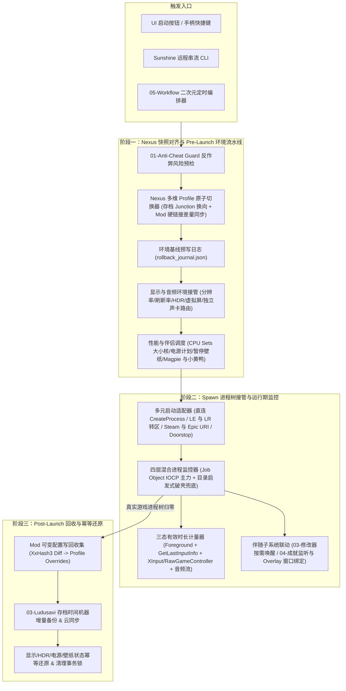
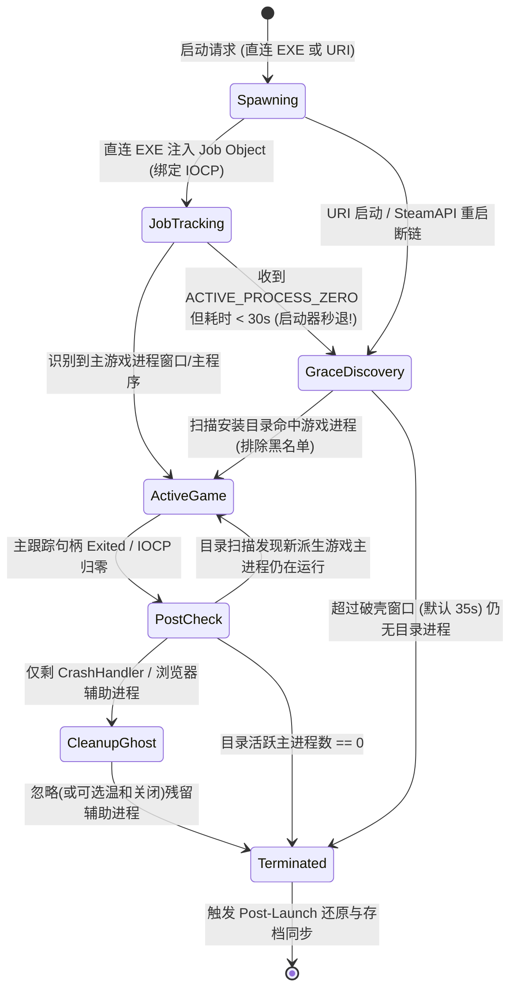
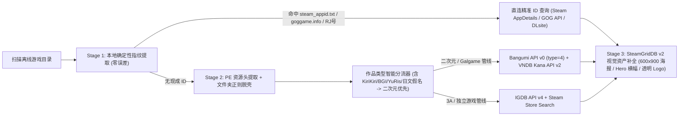
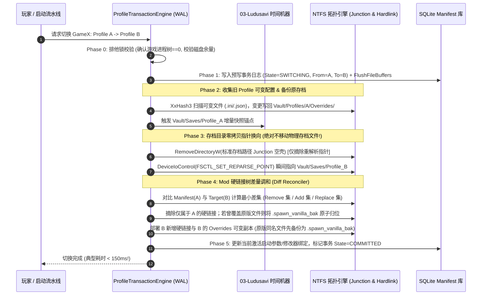

# SPAWN 专题技术调研报告（02）：游戏启动接管、环境流水线与 Nexus Mod 快照编排

> **模块代号**：`spawn-nexus`
> **技术栈基线**：Windows 10 (1903+) / Windows 11 · 纯原生 C# (`.NET 8 / .NET 9` + `Microsoft.Windows.CsWin32` 源生成 P/Invoke)
> **架构红线对齐**：严格遵循 **Clean Host（默认普通权限运行、零内存读写/钩子敏感导入表）** 原则；所有可能触碰反作弊边界的能力（如 3DMigoto 视觉注入、单机沙箱 API Hook、`NtSuspendProcess` 挂起）均受 `Anti-Cheat Guard`（见专题 01）统一熔断管控。

---

## 目录

1. [模块全景架构与跨模块协同定位](#0-模块全景架构与跨模块协同定位)
2. [第一部分：Spawn — 游戏启动接管、进程树追踪与前后置环境流水线](#1-第一部分spawn--游戏启动接管进程树追踪与前后置环境流水线)
   - [1.1 破局“金蝉脱壳”：四层混合进程生命周期监控引擎](#11-破局金蝉脱壳四层混合进程生命周期监控引擎)
   - [1.2 精准有效游玩时长统计（Active / Background / AFK 三态计量）](#12-精准有效游玩时长统计active--background--afk-三态计量)
   - [1.3 Pre/Post-Launch 环境自动化接管流水线与崩溃自愈事务](#13-prepost-launch-环境自动化接管流水线与崩溃自愈事务)
   - [1.4 免平台离线游戏（Steamrip / GOG / Galgame）多源元数据刮削引擎](#14-免平台离线游戏steamrip--gog--galgame多源元数据刮削引擎)
3. [第二部分：Nexus — 非侵入式 Mod 部署、框架编排与多维 Profile 原子快照](#2-第二部分nexus--非侵入式-mod-部署框架编排与多维-profile-原子快照)
   - [2.1 非侵入式文件部署原理深度对比（Hardlink vs. Symlink/Junction vs. USVFS）](#21-非侵入式文件部署原理深度对比hardlink-vs-symlinkjunction-vs-usvfs)
   - [2.2 主流单机引擎与二次元 Mod 框架上层编排器](#22-主流单机引擎与二次元-mod-框架上层编排器)
   - [2.3 杀手级多维 Profile 组合快照与防断电原子切换事务引擎](#23-杀手级多维-profile-组合快照与防断电原子切换事务引擎)
4. [第三部分：面向小圈子极客玩家的 6 大高价值宝藏扩展功能](#3-第三部分面向小圈子极客玩家的-6-大高价值宝藏扩展功能)
   - [3.1 免安装游戏“纯绿色化/便携沙箱”（Portable Sandbox Wrapper）](#31-宝藏功能一免安装游戏纯绿色化便携沙箱portable-sandbox-wrapper)
   - [3.2 NTFS 透明无损压缩管家（WOF 内核压缩 + DirectStorage 智能避障）](#32-宝藏功能二ntfs-透明无损压缩管家wof-内核压缩--directstorage-智能避障)
   - [3.3 DLSS / FSR / XeSS 升频与帧生成补丁管家（Upscaler & FrameGen Swapper）](#33-宝藏功能三dlss--fsr--xess-升频与帧生成补丁管家upscaler--framegen-swapper)
   - [3.4 远程串流无缝联动与虚拟显示器热插拔（Sunshine + Moonlight + VDD）](#34-远程串流无缝联动与虚拟显示器热插拔sunshine--moonlight--vdd)
   - [3.5 进程级独立音频路由与分轨隔离（Per-Game Audio Endpoint Router）](#35-进程级独立音频路由与分轨隔离per-game-audio-endpoint-router)
   - [3.6 极客战术急停与急救箱（过场“时间静止” + 黑屏核按钮 + 顽固老游戏真无边框化）](#36-极客战术急停与急救箱过场时间静止--黑屏核按钮--顽固老游戏真无边框化)
5. [核心 NuGet 技术栈、Win32 API 矩阵与 SQLite 数据模型](#4-核心-nuget-技术栈win32-api-矩阵与-sqlite-数据模型)

---

## 0. 模块全景架构与跨模块协同定位

`Spawn`（启动与生命周期引擎）与 `Nexus`（Mod 与多维环境拓扑引擎）共同构成了整个 **SPAWN** 系统的底座基础设施：任何一次点击“开始游戏”或触发二次元夜间代肝任务，都会经过本模块的标准化流水线。



**核心跨模块协同设计亮点**：
1. **服务于 `01-Anti-Cheat Guard`**：物理文件级硬链接/软链接与 COM 级音频策略、CCD 显示配置**全程无需任何 DLL 注入或高危 `OpenProcess(PROCESS_VM_WRITE)` 权限**，保证 Clean Host 绝对清白。
2. **服务于 `03-Progress`**：切换 Profile 前先通知 Ludusavi 对旧存档槽执行毫秒级快照，再用 NTFS Junction 零拷贝换向存档目录；退出游戏后先收集 Mod 配置变更，再触发存档云同步。
3. **服务于 `04-Achievement & Overlay`**：当 `Magpie` 或 `Lossless Scaling` 开启全屏缩放时，前台窗口 HWND 会变为缩放器宿主窗口而非原游戏窗口——Spawn 将缩放器宿主 HWND 同步共享给时长统计器与 Overlay 渲染层，防止弹窗错位与误判切后台。
4. **服务于 `05-Workflow`**：代肝脚本（如 MAA / BetterGI）强依赖稳定的屏幕分辨率且**极怕 Windows Auto-HDR 导致色调映射过曝使 OpenCV 模板匹配失效**；Pre-Launch 流水线可在代肝模式下自动强制关闭 HDR、锁定标准 16:9 分辨率并静音游戏音频！

---

## 1. 第一部分：Spawn — 游戏启动接管、进程树追踪与前后置环境流水线

### 1.1 破局“金蝉脱壳”：四层混合进程生命周期监控引擎

#### 1.1.1 核心痛点剖析
PC 游戏的启动链路极其混乱，常见的“金蝉脱壳”场景包括：
1. **启动器秒退拉起真进程（Launcher Stub）**：例如 Galgame 启动配置器、`eldenring.exe`（拉起 EAC 后交接）、老游戏 `Launcher.exe` 运行 500ms 后调用 `CreateProcess` 启动 `bin/x64/GameMain.exe` 并自行退出。若仅 `Process.WaitForExit()` 等待初始进程，启动 1 秒就会误判“游戏已退出”，导致分辨率瞬间还原、存档提前备份、游玩时长定格在 1 秒。
2. **跨进程树间接唤醒（URI / IPC 断链——Job Object 的最大盲区！）**：
   - 当游戏通过 `steam://rungameid/1245620` 启动，或者正版游戏内部调用 `SteamAPI_RestartAppIfNecessary()` 时，初始进程会立刻自杀，并通过 IPC 通知后台早已运行的 `steam.exe` 代为拉起真游戏进程。
   - 此时真游戏进程的父进程（Parent PID）是 `steam.exe` 或 `svchost.exe`（DCOM `ShellExecute`），**在内核进程树上与 SPAWN 毫无血缘关系，Windows Job Object 对此完全失效**！
3. **僵尸辅助进程残留（Ghost Helper Processes）**：游戏本体早已关闭，但其拉起的崩溃收集器（`UnityCrashHandler64.exe`、`CrashReportClient.exe`）或内置浏览器（米哈游 `ZFGameBrowser.exe`、CEF `cefprocess.exe`）未退出，若无差别追踪整棵进程树，会导致游戏关了半小时 SPAWN 仍显示“运行中”。

#### 1.1.2 参考开源项目
- **`JosefNemec/Playnite`**（`https://github.com/JosefNemec/Playnite`，重点参考 `source/Playnite/Diagnostic/Processes.cs` 与 `MonitorDirectory` / `MonitorProcessTree` 追踪器实现）：采用初始进程树 + 安装目录进程路径前缀扫描的双保险策略。
- **`Nexus-Mods/NexusMods.App`**（`https://github.com/Nexus-Mods/NexusMods.App`）与 **`CliWrap`**（`https://github.com/Tyrrrz/CliWrap`）：现代 C# 异步进程包装与生命周期取消令牌管理。
- **`microsoft/perfview` (`Microsoft.Diagnostics.Tracing.TraceEvent`)**（`https://github.com/microsoft/perfview`）：微软官方高性能 ETW 事件流解析库。

#### 1.1.3 四大底层监控技术深度横向对比

| 监控方案 | 核心底层机制 / Win32 API | 管理员权限要求 | CPU / 内存开销 | 能否跨 `steam.exe` URI 断链追踪 | 反作弊敏感度与局限性 |
| :--- | :--- | :---: | :---: | :---: | :--- |
| **1. Windows Job Objects + IOCP** | `CreateJobObjectW` + `AssignProcessToJobObject` + `SetInformationJobObject(JobObjectAssociateCompletionPortInformation)`，阻塞等待 `JOB_OBJECT_MSG_ACTIVE_PROCESS_ZERO (4)` | **无需提权**（普通权限可用） | **极致零开销**（纯内核事件推送，0% 轮询） | **否**（IPC 委托给外部已存在进程如 `steam.exe` 时脱离 Job） | 极安全；但若不设 `JOB_OBJECT_LIMIT_SILENT_BREAKAWAY_OK` 需注意嵌套 Job（Win8+ 已原生支持嵌套 Job Objects）；无法过滤僵尸 CrashHandler |
| **2. ETW 内核进程跟踪** | `TraceEvent` 订阅 `Microsoft-Windows-Kernel-Process` 或 `KernelTraceEventParser.Keywords.Process` | **强制要求 Administrator** | 极低（内核环形缓冲区异步回调） | **部分可**（实时拿到全局新进程的 `ImageFileName` 匹配游戏目录） | **权限冲突**：强迫主程序以管理员常驻会破坏文件拖拽（UIPI）并增加工程负担，仅适合作为已提权环境下的可选增强层 |
| **3. WMI 事件 / 查询** | `ManagementEventWatcher` (`Win32_ProcessStartTrace` / `__InstanceCreationEvent WITHIN 2`) | `ProcessStartTrace` **需管理员**；`__InstanceCreationEvent` 免提权但极慢 | **高开销**（WMI 服务 `WmiPrvSE.exe` CPU 占用明显，COM 易泄漏） | 是（按 `ExecutablePath` 匹配） | 轮询延迟大、WMI 仓库偶发损坏导致异常，**工程上明确淘汰**，改用原生快照 API |
| **4. 原生句柄受限路径快照（启发式目录扫描）** | `CreateToolhelp32Snapshot(TH32CS_SNAPPROCESS)` + `OpenProcess(PROCESS_QUERY_LIMITED_INFORMATION)` + `QueryFullProcessImageNameW` | **无需提权**！（普通进程亦可查管理员游戏路径！） | 极低（仅在破壳窗口期与低频校验时按需触发，单次 < 0.8ms） | **完美支持**！（无论谁拉起，只要可执行文件位于游戏安装目录即精准捕获） | **极安全**：`PROCESS_QUERY_LIMITED_INFORMATION (0x1000)` 是微软专为任务栏/桌面工具设计的最低只读权限，**绝不触发 EAC/ACE 对 `PROCESS_VM_READ` 的拦截** |

#### 1.1.4 SPAWN 终极方案：状态机驱动的“Job Object IOCP + 目录破壳观察窗”双引擎

SPAWN 摒弃笨重的 WMI，也无需强制用户提权开 ETW，而是构建如下**四阶段自适应追踪状态机**：



**关键工程实现细节（C# 核心代码草图）**：
1. **辅助进程黑名单过滤（防止统计卡死）**：内置全局正则黑名单排除非游戏主程序：
   `UnityCrashHandler(32|64)\.exe`、`CrashReportClient\.exe`、`CrashSender\d*\.exe`、`ZFGameBrowser\.exe`、`cef_?process\.exe`、`UnrealCEFSubProcess\.exe`、`EasyAntiCheat_EOS\.exe`、`BEService\.exe`。
2. **与 `01-Anti-Cheat Guard` 的 PPID 脱钩协同**：针对单机与普通网游，默认走直连 `CreateProcess` + `JobObject` IOCP 零开销追踪；而针对腾讯 ACE（`SGuard64.exe`）/ Vanguard 等执行严格父进程溯源（PPID 审计）的强反作弊网游，自动切换为 **Explorer Shell COM 代理启动（`IShellDispatch2.ShellExecute`，使游戏父进程变为纯净的 `explorer.exe`）**，此时状态机直接切入上图的 `GraceDiscovery` 分支，依靠 `PROCESS_QUERY_LIMITED_INFORMATION` 目录启发式扫描无缝完成免注入追踪！
3. **原生 Job Object + IOCP 监听核心实现**：

```csharp
using System.ComponentModel;
using System.Runtime.InteropServices;
using Microsoft.Win32.SafeHandles;

public sealed class JobProcessTracker : IDisposable
{
    private const uint JOB_OBJECT_MSG_NEW_PROCESS = 6;
    private const uint JOB_OBJECT_MSG_EXIT_PROCESS = 7;
    private const uint JOB_OBJECT_MSG_ABNORMAL_EXIT_PROCESS = 8;
    private const uint JOB_OBJECT_MSG_ACTIVE_PROCESS_ZERO = 4;
    private const uint JOB_OBJECT_LIMIT_BREAKAWAY_OK = 0x00000800;

    [StructLayout(LayoutKind.Sequential)]
    private struct JOBOBJECT_ASSOCIATE_COMPLETION_PORT
    {
        public IntPtr CompletionKey;
        public IntPtr CompletionPort;
    }

    private readonly SafeFileHandle _jobHandle;
    private readonly SafeFileHandle _iocpHandle;

    public JobProcessTracker()
    {
        // Windows 8+ 原生支持嵌套 Job Object，即使父环境(如 VS/终端)已有 Job 也能安全附加
        _jobHandle = CreateJobObjectW(IntPtr.Zero, null);
        _iocpHandle = CreateIoCompletionPort(new IntPtr(-1), IntPtr.Zero, UIntPtr.Zero, 1);

        var assoc = new JOBOBJECT_ASSOCIATE_COMPLETION_PORT
        {
            CompletionKey = _jobHandle.DangerousGetHandle(),
            CompletionPort = _iocpHandle.DangerousGetHandle()
        };

        // JobObjectAssociateCompletionPortInformation = 7
        if (!SetInformationJobObject(_jobHandle, 7, ref assoc, (uint)Marshal.SizeOf(assoc)))
            throw new Win32Exception(Marshal.GetLastWin32Error());
    }

    public void AttachProcess(IntPtr processHandle)
    {
        // 注意：允许 Breakaway 失败兜底（例如目标进程由于 UAC 提权权限高于当前宿主导致 Access Denied）
        // 若 Assign 失败，自动平滑降级到基于 QueryFullProcessImageNameW 的目录启发式追踪器！
        AssignProcessToJobObject(_jobHandle, processHandle);
    }

    public Task WaitForTreeZeroAsync(CancellationToken ct) => Task.Run(() =>
    {
        while (!ct.IsCancellationRequested)
        {
            if (GetQueuedCompletionStatus(_iocpHandle, out uint msgId, out _, out IntPtr pidPtr, 500))
            {
                if (msgId == JOB_OBJECT_MSG_ACTIVE_PROCESS_ZERO)
                    return; // 整棵直系进程树已完全退出，交由上层状态机决定是否进入破壳扫描窗口
            }
        }
    }, ct);

    public void Dispose()
    {
        _iocpHandle?.Dispose();
        _jobHandle?.Dispose(); // 注意：绝不设置 JOB_OBJECT_LIMIT_KILL_ON_JOB_CLOSE，防止 SPAWN 重启误杀正在玩的游戏！
    }

    [DllImport("kernel32.dll", CharSet = CharSet.Unicode, SetLastError = true)]
    private static extern SafeFileHandle CreateJobObjectW(IntPtr lpJobAttributes, string? lpName);

    [DllImport("kernel32.dll", SetLastError = true)]
    private static extern SafeFileHandle CreateIoCompletionPort(IntPtr fileHandle, IntPtr existingPort, UIntPtr completionKey, uint concurrentThreads);

    [DllImport("kernel32.dll", SetLastError = true)]
    private static extern bool SetInformationJobObject(SafeFileHandle hJob, int infoClass, ref JOBOBJECT_ASSOCIATE_COMPLETION_PORT lpJobObjectInfo, uint cbJobObjectInfoLength);

    [DllImport("kernel32.dll", SetLastError = true)]
    private static extern bool AssignProcessToJobObject(SafeFileHandle hJob, IntPtr hProcess);

    [DllImport("kernel32.dll", SetLastError = true)]
    private static extern bool GetQueuedCompletionStatus(SafeFileHandle completionPort, out uint lpNumberOfBytesTransferred, out UIntPtr lpCompletionKey, out IntPtr lpOverlapped, uint dwMilliseconds);
}
```

> [!IMPORTANT]
> **致命细节避坑**：创建 Job Object 时**严禁设置 `JOB_OBJECT_LIMIT_KILL_ON_JOB_CLOSE`**！如果 SPAWN 自身在游戏运行期间升级重启或意外崩溃，带该标志的 Job 句柄一旦关闭，Windows 内核会瞬间强杀玩家还没存档的游戏进程！不设该标志时，SPAWN 重启后可通过 `rollback_journal.json` 记录的活跃 PID 与游戏目录无缝重连（Re-attach）继续追踪！

---

### 1.2 精准有效游玩时长统计（Active / Background / AFK 三态计量）

#### 1.2.1 解决什么痛点
Steam 或传统启动器的“游玩时长”极其注水：游戏暂停去吃晚饭 2 小时、切到桌面查 Wiki 攻略 1 小时、甚至游戏启动器挂在后台一晚上，全被算进游玩时间。极客玩家需要一眼看穿：**“这款游戏我到底实打实投入了多少有效时间（Active Play），挂机发呆了多久（AFK），切后台多久（Background）？”**

#### 1.2.2 底层 Windows 原理与三大典型盲区破局
1. **盲区一：纯手柄玩家的 `GetLastInputInfo` 假死误判**
   Win32 `user32.dll!GetLastInputInfo` 仅统计进入 Windows 窗口消息子系统的**键盘与鼠标**硬件中断。当玩家躺在椅背上用 Xbox 手柄或索尼 DualSense 手柄连续激战 30 分钟不碰键鼠时，`GetLastInputInfo` 返回的空闲秒数会高达 1800 秒！
   - **破局方案**：构建双通道手柄无感轮询器：
     - **通道 A（XInput 协议）**：使用轻量 NuGet 包 `Vortice.XInput`（或 P/Invoke `xinput1_4.dll!XInputGetState`）检测槽位 `0..3` 的 `dwPacketNumber` 递增与摇杆/扳机变化。**避坑点 ①（摇杆微漂移假活跃）**：旧手柄碳膜磨损会产生 `±1500` 级别的电平噪声导致 `dwPacketNumber` 持续跳变，必须施加死区阈值过滤（左摇杆 `7849`、右摇杆 `8689`、扳机 `30`）；**避坑点 ②（空槽位轮询微卡顿）**：对未连接槽位高频调用 `XInputGetState` 在部分主板上会产生毫秒级 PCIe/USB 总线查询延迟，故未连接槽位必须降频至 **每 5 秒探测一次**，已连接槽位每秒采样 2 次（500ms 周期对时长统计完全足够且零开销）。
     - **通道 B（原生 HID / DualSense / Switch Pro 直连兜底）**：当玩家用 USB/蓝牙直连 DualSense 玩原生支持该手柄的现代游戏（未开 Steam Input 或 DS4Windows 转译 XInput）时，XInput 读不到数据。此时叠加 WinRT 原生 API `Windows.Gaming.Input.RawGameController.RawGameControllers`（读取按钮数组布尔异或与轴变化 > `0.08`），免装任何驱动即可通吃全品类手柄！
2. **盲区二：开启超分/Overlay 后的前台焦点误判**
   通过 `GetForegroundWindow()` + `GetWindowThreadProcessId()` 判断游戏是否在前台时，若玩家开启了 **Magpie**（前台窗口是 `Magpie.exe` 的 `Window_Magpie_967EB565-6F73-4E94-AE53-00CC42592A22` 类全屏窗口）、**Lossless Scaling** 或呼出了 **SPAWN 自身的成就/快捷 Overlay 面板**，直接比对 PID 会误判为“切到了后台”。
   - **破局方案**：维护动态 `TrustedProxyPidsAndClasses` 白名单集合——只要游戏存活且前台窗口属于“当前游戏进程树 PID ∪ SPAWN Overlay 窗口句柄 ∪ 当前激活的超分伴侣全屏缩放窗口”，一律判定为**前台焦点态（Foreground）**！
3. **盲区三：Galgame 自动播放（Auto Mode）与长过场动画误判为 AFK**
   玩视觉小说开 Auto 听声优配音，或看《死亡搁浅》《最终幻想》15 分钟播片时，玩家双手离开键鼠手柄是正常欣赏行为。
   - **破局方案**：引入 **WASAPI 进程级音频峰值辅助判定**（基于 `NAudio.CoreAudioApi` 枚举 `AudioSessionManager` 下匹配当前游戏 PID 的 `AudioSessionControl2`，读取 `AudioMeterInformation.MasterPeakValue`）——对于标记为 `VisualNovel` 类型的游戏（可延长无输入阈值至 15 分钟），或检测到游戏声道存在动态起伏语音/音效且窗口处于前台全屏时，智能延缓 AFK 切入时间（默认普通游戏 180 秒无键鼠/手柄输入转入 `AFK` 态，一旦恢复输入立即切回 `Active` 态）。

#### 1.2.3 三态采样决策逻辑（每秒 1 Tick 极轻量协程）

```text
每个采样周期 Δt = 1s (使用 PeriodicTimer):
1. IsForeground = ForegroundPid ∈ GameTreePids || ForegroundHwnd ∈ TrustedOverlayAndScalerHwnds
2. If (!IsForeground) -> BackgroundSeconds += 1
3. Else:
     IdleMs = Min(Win32KeyboardMouseIdleMs, GamepadLastChangedElapsedMs)
     If (IdleMs <= GameProfile.AfkThresholdMs) -> ActivePlaySeconds += 1
     Else -> AfkSeconds += 1
```

---

### 1.3 Pre/Post-Launch 环境自动化接管流水线与崩溃自愈事务

为了保证无论游戏崩溃、断电还是蓝屏，玩家的桌面分辨率、HDR、主副屏与电源计划绝不陷入错乱，SPAWN 引入 **预写回滚快照（`environment_rollback.json`）**：在执行任何 Pre-Launch 修改前，先将当前硬件原始参数落盘（`FileOptions.WriteThrough`）；每次 SPAWN 启动时首先检查是否存在未闭合的回滚快照，若有则立即幂等还原系统环境。

#### 1.3.1 超分与补帧伴侣无感调度（`Blinue/Magpie` & `Lossless Scaling`）

- **痛点**：老 Galgame（`1280x720` 甚至 `800x600`）在 4K 显示器上模糊发虚，需要 `Magpie` 的 **Anime4K / CuNNy** 算法实时超分；锁 60 帧的日系/老动作游戏需要 **Lossless Scaling（小黄鸭）** 的 **LSFG 3.x** 补帧到 120/180Hz。手动每次先开工具、选算法、切进游戏再按快捷键极其割裂。
- **参考开源项目**：
  - `Blinue/Magpie`（`https://github.com/Blinue/Magpie`，C++ WinRT 高性能窗口捕获超分器，支持 `Windows.Graphics.Capture` 与 DXGI）
- **底层自动化控制原理与 C# 实现方案**：
  1. **`Blinue/Magpie` 无感接管（配置规则注入 + 托盘驻留模式）**：
     - Magpie v0.10 / v0.11+ 支持便携配置（程序同级目录 `config\config.json` 或 `%LOCALAPPDATA%\Magpie\config\config.json`）。其 `profiles` 数组原生支持按 **`pathRule`（游戏可执行文件绝对路径）+ `classNameRule`（窗口类名）** 定义独立规则，并内置 **`autoScale: true`（检测到目标窗口位于前台时自动捕获超分！）** 及指定缩放模式（如 `Anime4K_Upscale_Denoise_L`、`FSR`）。
     - **SPAWN C# 调度流程**：用户在 SPAWN 的游戏设置中勾选“启用 Magpie (预设: Anime4K 4K)”，Pre-Launch 阶段用 `System.Text.Json.Nodes.JsonNode` 无损读写 Magpie 的 `config.json`，幂等写入或更新该游戏 EXE 对应的 `profile` 节点（设 `autoScale = true`，游戏为全屏独占时配合 3.6 节去边框窗口化），随后若 `Magpie.exe` 未运行则调用 `Process.Start("Magpie.exe", "-t")` 静默最小化驻留托盘；游戏窗口一旦弹出获得焦点，Magpie 毫秒级自动吸附放大！Post-Launch 阶段若没有其他超分任务，优雅发送 `WM_CLOSE` 关闭托盘释放显存。
  2. **`Lossless Scaling`（小黄鸭）自动化接管**：
     - 小黄鸭本身不接受 `-exe` 命令行传参，但其所有自动化配置均明文存储在 `%LOCALAPPDATA%\Lossless Scaling\Settings.xml` 的 `<GameProfiles>` 节点下！
     - **SPAWN C# 调度流程**：使用 `System.Xml.Linq.XDocument` 解析 `Settings.xml`，为目标游戏 EXE 路径动态注入/修改 `<Profile>` 条目（配置 `<AutoScale>true</AutoScale>`、`<AutoScaleDelay>3</AutoScaleDelay>`、`<FrameGeneration>LSFG3</FrameGeneration>`、`<LSFGMultiplier>2</LSFGMultiplier>`、`<CaptureApi>WGC</CaptureApi>`），保存 XML 后以最小化方式拉起 `LosslessScaling.exe`；游戏启动 3 秒窗口稳定后小黄鸭自动切入补帧，游戏退出后自动回收进程。

#### 1.3.2 显示器拓扑与画质环境接管（分辨率 / 刷新率 / 多屏 / Win11 HDR）

- **痛点**：OLED 电视/HDR 显示器平时在桌面办公开 HDR 发灰刺眼，进 3A 大作又经常忘记按 `Win+Alt+B` 导致游戏内 HDR 选项灰置；玩竞技或串流需要自动切分辨率/刷新率，或者临时关闭副屏防止鼠标甩出屏幕/跨屏刷新率不同步卡顿。
- **参考开源项目**：
  - `Codectory/AutoActions`（`https://github.com/Codectory/AutoActions`，纯 C# 实现进程联动自动开关 HDR、切换刷新率）
  - `Maassoft/ColorControl`（`https://github.com/Maassoft/ColorControl`，纯 C# 深度封装 CCD API、NVAPI、ADL 显示色彩与 HDR 控制）
  - `falahati/WindowsDisplayAPI`（`https://github.com/falahati/WindowsDisplayAPI`，C# CCD 显示拓扑封装库）
- **底层 Windows 原理与 C# 实现**：
  1. **分辨率与刷新率切换（善用 `CDS_FULLSCREEN` 防崩标志位！）**：
     - 调用 `user32.dll!EnumDisplaySettingsExW` 枚举目标显示器 `\\.\DISPLAY1` 支持的模式表 `DEVMODEW`（校验 `dmPelsWidth`、`dmPelsHeight`、`dmDisplayFrequency` 合法性，防止传入不支持的模式黑屏）。
     - 调用 `ChangeDisplaySettingsExW(deviceName, ref devMode, IntPtr.Zero, CDS_FULLSCREEN, IntPtr.Zero)`：其中 **`CDS_FULLSCREEN (0x00000004)`** 声明此次变更为“临时全屏会话态”（不改写注册表持久化桌面设置），配合 SPAWN 自身的退出还原钩子形成双保险！
  2. **多显示器主副屏切换与单屏专注模式**：
     - 调用 Windows **CCD API（Connecting and Configuring Displays）**：`GetDisplayConfigBufferSizes` -> `QueryDisplayConfig(QDC_ONLY_ACTIVE_PATHS)` 获取当前多屏拓扑数组（`DISPLAYCONFIG_PATH_INFO[]` 与 `DISPLAYCONFIG_MODE_INFO[]`）序列化备份至回滚日志；再通过 `SetDisplayConfig(..., SDC_APPLY | SDC_USE_SUPPLIED_DISPLAY_CONFIG)` 禁用指定副屏路径或将目标游戏电视设为主屏（坐标原点 `(0,0)`）。
  3. **Windows 11 HDR 纯 API 毫秒级开关（零按键模拟）**：
     - 拒绝丑陋且受输入法/锁屏干扰的 `Win+Alt+B` 按键模拟（仅作极端驱动异常兜底），直接调用 `user32.dll!DisplayConfigGetDeviceInfo` 与 `DisplayConfigSetDeviceInfo`：
     - 先传入 `DISPLAYCONFIG_GET_ADVANCED_COLOR_INFO`（`type = 9`）读取当前显示器 `advancedColorSupported` 与 `advancedColorEnabled` 状态（若原本已处于目标状态则跳过，避免屏幕黑闪 1 秒！）。
     - 再构造 `DISPLAYCONFIG_SET_ADVANCED_COLOR_STATE` 数据包（`type = 10`，即 `DISPLAYCONFIG_DEVICE_INFO_SET_ADVANCED_COLOR_STATE`，包含 `uint enableAdvancedColor` 位域；针对 Windows 11 24H2 Build 26100+ 同步兼容新版 `DISPLAYCONFIG_SET_HDR_STATE` 结构体），一键精准启停指定单个显示器的 HDR 状态！

#### 1.3.3 老日系 / Galgame 免安装无感转区启动（x86 + x64 全栈覆盖）

- **痛点**：大量日系原版 Galgame、同人 RPG（RPG Maker / Wolf RPG / KiriKiri2 / BGI / CatSystem2）在简体中文 Windows（ACP = 936 GBK）下直接运行会出现**窗口标题乱码、剧本文字乱码、甚至因为 Shift-JIS 路径解析成半个汉字（如 `0x83 0x5C` 中的 `0x5C` 被当成反斜杠 `\`！）导致直接找不到文件闪退**，更有甚者内置“仅限日本时区运行（Region Lock）”校验。
- **参考开源项目**：
  - **`xupefei/Locale-Emulator`**（`https://github.com/xupefei/Locale-Emulator`，C# 外壳 + C++ 核心 Hook，经典日系转区标杆，**但仅支持 32 位 x86 进程**！）
  - **`InWILL/Locale_Remulator`**（`https://github.com/InWILL/Locale_Remulator`，基于 Detours 重构的现代继任者，**完美支持 64 位 x64 + 32 位 x86 双架构**！）
- **底层原理剖析**：
  - `LEProc.exe` / `LRProc.exe` 以 `CREATE_SUSPENDED` 挂起方式创建游戏进程，注入 `LoaderDll.dll`（LE）或 `LRHookx64.dll` / `LRHookx32.dll`（LR），在用户态拦截进程的 PEB 代码页字段（`AnsiCodePage = 932`、`OemCodePage = 932`）、`ntdll`/`kernel32`/`user32`/`gdi32` 的 ANSI 家族 API（`MultiByteToWideChar`、`CreateWindowExA`、`GetACP`、`GetSystemDefaultLCID = 0x0411`、`CreateFontIndirectA` 日文字体映射）以及注册表时区查询（伪装为 `Tokyo Standard Time`）。
- **SPAWN 免安装内置集成方案**：
  1. 将 `Locale_Remulator`（含 x86/x64 Hook DLL 与 `LRProc.exe`）与 `Locale-Emulator` 作为绿色便携组件随附于 `SPAWN/Assets/Tools/Locale/` 目录，**无需污染用户系统的资源管理器右键菜单**。
  2. **自动 PE 位数嗅探**：SPAWN 读取目标游戏 EXE 的 PE 头 `IMAGE_FILE_HEADER.Machine`：
     - 若为 `IMAGE_FILE_MACHINE_AMD64 (0x8664)` -> 强制路由至 **`Locale_Remulator` (`LRProc.exe`)**；
     - 若为 `IMAGE_FILE_MACHINE_I386 (0x014c)` -> 默认使用兼容性久经考验的 `LEProc.exe`（并允许一键切 `LRProc.exe` 排障）。
  3. **预置多地区 GUID 模板**：在内置 `LRConfig.xml` / `LEConfig.xml` 中固化标准预设 GUID：
     - `ja-JP`（CodePage `932` Shift-JIS，时区 `Tokyo Standard Time`，开启管理员提权透传可选）
     - `zh-TW`（CodePage `950` Big5，解决中国台湾宇峻奥汀/大宇老武侠繁中乱码）
     - `ko-KR`（CodePage `949`，韩系同人游戏）
  4. 启动命令：通过 Job Object 包裹调用 `LRProc.exe -runas <ProfileGuid> "<GameInstallDir>\Game.exe" [args]`，由于 `LRProc.exe` 拉起 `Game.exe` 后会立即退出，1.1 节的 Job Object 会自动继承抓牢子进程 `Game.exe`，完美统计时长！

#### 1.3.4 性能榨取流水线：CPU Sets 大小核调度、防 EcoQoS 降频、电源与动态壁纸管理

- **痛点**：在 Intel 12/13/14/15 代酷睿（Alder Lake ~ Arrow Lake）异构大小核架构上，许多老 DX9/DX11 游戏、法老控老引擎、Unity 单主线程游戏或模拟器常被调度器误扔进能效小核（E-Core），或者无边框窗口被 Windows 11 误上锁 **`EcoQoS`（效率模式）**，导致平均帧尚可但 **1% Low 帧疯狂抽搐掉帧**；同时后台运行的 `Wallpaper Engine` 4K 流体壁纸持续吃掉 10%~25% GPU 3D 算力与 1GB 显存。
- **参考开源项目**：
  - `bitsumllc` / **`AutoAffinity`** / **`SystemInformer`**（`https://github.com/winsiderss/systeminformer`，CPU Sets 与 Power Throttling 底层调用参考）
  - `IgorMundstein/WinMemoryCleaner`（`https://github.com/IgorMundstein/WinMemoryCleaner`，C# 内存 Standby List 清理参考）
- **底层 Windows 原理与 C# 实现**：
  1. **为什么优先用 `SetProcessDefaultCpuSets` 替代老旧的 `Process.ProcessorAffinity`？**
     - 传统 `ProcessorAffinity`（`SetProcessAffinityMask`）存在三大硬伤：① 单个 `UIntPtr` 位掩码受限于 64 逻辑核心（跨 Processor Group 失效）；② 属于硬亲和性（Hard Affinity），一旦系统中断挤占该核，线程宁可排队卡死也不允许内核临时借道，且极易引发部分内核反作弊驱动警觉；③ 无法直接感知哪颗核是 P-Core 还是 AMD 3D V-Cache CCD0（如 7950X3D / 9950X3D）！
     - **现代正解（CPU Sets API + 破除 EcoQoS）**：
       - 调用 `kernel32.dll!GetSystemCpuSetInformation` 枚举全系统逻辑处理器信息结构 `SYSTEM_CPU_SET_INFORMATION`：
         - 在 Intel 混合架构上：筛选 `EfficiencyClass == Max(EfficiencyClass)` 的 `Id` 集合即为纯 **P-Core（性能大核）池**；同理可将后台辅助下载/代肝挂机低优进程绑定到 `EfficiencyClass == Min` 的 **E-Core（小核）池**！
         - 在 AMD 双 CCD X3D 处理器（如 7950X3D / 9950X3D）上：通过 `LastLevelCacheIndex` 识别拥有更大 L3 缓存（3D V-Cache）的 CCD0 核心集合！
       - 调用 `kernel32.dll!SetProcessDefaultCpuSets(hProcess, cpuSetIds, count)` 将游戏软约束在 P-Core / V-Cache 核心池内；
       - 同时调用 `SetProcessInformation(hProcess, ProcessPowerThrottling, ref state, size)`（将 `ControlMask = PROCESS_POWER_THROTTLING_EXECUTION_SPEED (0x1)`，`StateMask = 0`），**强制豁免 Windows 11 EcoQoS 效率模式降频**！
       - *安全边界*：对于接入 Anti-Cheat Guard 的强反作弊网游，不在游戏启动后再 `OpenProcess` 修改，而是由 SPAWN 临时创建一个仅含 P-Core CPU Sets 的辅助启动器跳板进程，利用 Windows 子进程默认继承策略无感传递，或直接对该类网游默认关闭亲和性干预。
  2. **电源计划切换**：
     - P/Invoke `powrprof.dll!PowerGetActiveScheme` 备份当前电源方案 GUID，再调用 `PowerSetActiveScheme(IntPtr.Zero, ref HighOrUltimatePerfGuid)` 切至高性能（`8c5e7fda-e8bf-4a96-9a85-a6e23a8c635c`）或卓越性能（`e9a42b02-d5df-448d-aa00-03f14749eb61`），游戏结束后立即切回平衡节能模式。
  3. **自动冻结 `Wallpaper Engine` 与释放闲置资源**：
     - 通过进程列表检测 `wallpaper32.exe` 或 `wallpaper64.exe` 的可执行文件路径，无需粗暴杀进程，直接调用其官方支持的原生命令行控制接口：
       - Pre-Launch：`Process.Start(weExePath, "-control pause")` + `"-control mute"`（GPU 占用瞬间降至 0.0%！）；
       - Post-Launch：`Process.Start(weExePath, "-control play")` + `"-control unmute"`（桌面壁纸丝滑恢复）。

---

### 1.4 免平台离线游戏（Steamrip / GOG / Galgame）多源元数据刮削引擎

#### 1.4.1 解决什么痛点
极客玩家的 NAS 与大容量硬盘中存放着大量免安装离线游戏（如 Steamrip 预解压版、GOG Offline Backup、DLsite 同人游戏、汉化组 Galgame 硬盘版）。它们的文件夹命名千奇百怪：
- `[240927][ゆずソフト] 天使☆騒々 RE-BOOT! [官中免安装绿色版]`
- `ARMORED.CORE.VI.FIRES.OF.RUBICON.v1.07.1-SteamRIP.com`
- `[RJ01123456] 魔法少女的祈祷 Ver1.04 [云翻汉化]`

直接扔进普通搜索框查 API 命中率不足 20%，且单靠 IGDB 对日系 Galgame/同人作几乎是空白，单靠 VNDB 又查不到欧美 3A。

#### 1.4.2 参考开源项目
- **`kamranayub/igdb-dotnet`**（`https://github.com/kamranayub/igdb-dotnet`，C# IGDB v4 Apicalypse 客户端）
- **`craftersmine/SteamGridDB.Net`**（`https://github.com/craftersmine/SteamGridDB.Net`，C# SteamGridDB v2 封装，获取高颜值竖版海报、横版 Hero 背景、透明 Logo 与高清 Icon）
- **`JosefNemec/PlayniteExtensions`**（`https://github.com/JosefNemec/PlayniteExtensions`）与 **`Universal-VNDB-Metadata`** / **`Playnite-Bangumi-Metadata`**：社区成熟的刮削字段映射范式。

#### 1.4.3 三级漏斗式精准匹配算法设计



1. **Stage 1：本地确定性锚点嗅探（命中即 100% 精准，无需模糊搜索！）**
   - **SteamAppId 锚点**：递归扫描深度 `<= 3` 的 `steam_appid.txt`、`steam_settings/steam_appid.txt`（Goldberg 模拟器）、`steam_emu.ini` / `tenoke.ini` / `rune.ini` / `codex.ini` / `onlinefix.ini` 中的 `AppId=\d+` 字段！一旦拿到 `AppId`，直接请求 `https://store.steampowered.com/api/appdetails?appids={appId}&l=schinese`，瞬间拿到官方简中名称、开发商、发行日期、标签与简介，准确率 100%！
   - **GOG 锚点**：解析根目录下的 `goggame-*.info`（标准 JSON，直接内含 `gameId` 与 `name`）。
   - **DLsite 同人锚点**：正则匹配路径中的 `\b([RVB]J\d{6,8})\b`（如 `RJ01123456` / `RJ398765`），直接映射 DLsite 元数据接口获取社团、CV、画师与高清封面。
2. **Stage 2：PE 版本资源嗅探 + 极客正则清洗管线**
   - **PE 内部真名提取**：使用 `System.Diagnostics.FileVersionInfo.GetVersionInfo(mainExePath)` 读取 `ProductName` 与 `OriginalFilename`（剔除通用引擎壳名如 `"Unity Player"`、`"UnrealGame"`、`"BootstrapPackagedGame"` 后，大量被改成中文绰号的 EXE 内部依然保留着精确的官方英文/日文原名！）。
   - **多阶正则脱壳**：
     - 剥离前缀日期与发售商框：`^(?:\[\d{6,8}\]|\(\d{4}\.\d{2}\.\d{2}\)|\[[^\]]+\])\s*`
     - 剥离版本号与压制组噪音：`(?i)[\.\s_-]*(?:v?\d+(?:\.\d+)+[a-z]?|build[\.\s_]*\d+|steamrip(?:\.com)?|fitgirl[\s-]*repacks?|tenoke|rune|elamigos|gog|portable|repack|goty|deluxe[\.\s_]*edition|免安装.*|官中.*|汉化.*|硬盘版.*|整合版.*)$`
     - 将点号连接符 `.`（仅当词间无空格如 `Cyberpunk.2077` 时）还原为空格，输出候选搜索词列表 `[PE_ProductName, CleanedFolderName]`。
3. **Stage 3：四大核心数据源 C# 对接要点与打分融合**
   - **Bangumi 番组计划 API v0**（中文二次元与日系游戏圣地）：调用 `POST https://api.bgm.tv/v0/search/subjects`（Header 必须按官方规范携带自定义 `User-Agent: SpawnLauncher/1.0`，Body 传入 `{"keyword": query, "filter": {"type": [4]}}`，其中 **`type=4` 专指游戏条目**），返回地道中文译名、日文原名、中文深度简介、Bangumi 评分、开发社团/脚本/原画人物关系网。
   - **VNDB API v2 (Kana)**（全球最权威 Galgame 数据库）：调用 `POST https://api.vndb.org/kana/vn`，无需复杂 OAuth 即可传入结构化过滤 JSON：
     `{"filters": ["search", "=", query], "fields": "title,alttitle,released,length_minutes,rating,image.url,developers.name,tags.name"}`，甚至能直接拿到 VNDB 社区统计的**平均通关时长预估（`length_minutes`）**，在玩家开坑前展示“预计通关需 28 小时”！
   - **IGDB API v4 + SteamGridDB API v2**：使用 Jaro-Winkler / Levenshtein 字符串相似度 + 发行年份交叉校验对候选结果加权打分（`Score >= 0.85` 自动静默刮削入库，`0.50 ~ 0.85` 在 UI 弹出多源融合候选卡片供极客一键点选），最终由 `SteamGridDB` 补齐统一规格的 600×900 竖版封面、1920×620 英雄背景图与透明 PNG 游戏标题 Logo。

---

## 2. 第二部分：Nexus — 非侵入式 Mod 部署、框架编排与多维 Profile 原子快照

### 2.1 非侵入式文件部署原理深度对比（Hardlink vs. Symlink/Junction vs. USVFS）

传统手动打 Mod（直接复制覆盖到游戏安装目录）是不可逆的灾难：一旦两个大型 Mod 文件冲突、或正版游戏想切回联机模式，只能验证游戏完整性甚至重下 100GB 客户端。SPAWN 的 `Nexus` 模块核心使命是实现 **“游戏原版目录 100% 随时毫秒级一键净身还原、多套魔改配置零双倍磁盘占用秒级切换”**。

#### 2.1.1 参考开源项目
- **`Nexus-Mods/NexusMods.App`**（`https://github.com/Nexus-Mods/NexusMods.App`）：Nexus 官方新一代**纯 C# (.NET)** 跨平台 Mod 管理器，其核心 **Loadout Synchronizer（基于内容寻址哈希 Content-Addressed Storage + 硬链接/可变文件增量回收）** 代表了当前工业界最高水准。
- **`Nexus-Mods/Vortex`**（`https://github.com/Nexus-Mods/Vortex`）：开创并大规模验证了 Windows NTFS 硬链接部署（Hardlink Deployment）与 `.vortex_backup` 原版备份清单模式。
- **`ModOrganizer2/usvfs`**（`https://github.com/ModOrganizer2/usvfs`）：B 社（上古卷轴/辐射）社区传奇的用户态虚拟文件系统实现。
- **`winfsp/winfsp`**（`https://github.com/winfsp/winfsp`）与 **`dokan-dev/dokany`**（`https://github.com/dokan-dev/dokany`）：Windows 内核态文件系统代理驱动（类 Linux FUSE）。

#### 2.1.2 四大底层部署机制全景技术矩阵

| 部署机制 | 核心底层 API / 驱动原理 | 是否需管理员 / 开发者模式 | 跨盘符支持 | 运行时 I/O 性能损耗 | 杀软与反作弊兼容性 | 核心缺陷与工程边界 |
| :--- | :--- | :---: | :---: | :---: | :---: | :--- |
| **1. NTFS 硬链接 (Hardlink)** | `kernel32.dll!CreateHardLinkW`：在游戏目录新建目录项直接指向 Mod 仓库文件的同一个 NTFS MFT 记录（共享同一份磁盘扇区） | **完全免提权**（普通用户原生支持） | **不支持**（必须位于同一 NTFS 分区卷） | **0.0% 零损耗**（内核视作 100% 原生真实文件，**完美支持 DirectStorage**！） | **极佳**（无任何注入或重解析点标记，与手动复制在二进制层面等价） | ① 仅支持文件不支持目录（需遍历建目录壳后逐文件硬链）；② 单文件硬链上限 1023；③ **“原地写污染（In-place Write Pollution）”** 需专门隔离处理 |
| **2. 目录联接 (NTFS Junction)** | `DeviceIoControl(FSCTL_SET_REPARSE_POINT)` + `IO_REPARSE_TAG_MOUNT_POINT (0xA0000003)` | **完全免提权**！（自 Win2000 起无需管理员也无需开发者模式！） | **原生支持跨盘符**！（可从 `C:` 指向 `E:` 本地卷） | 极微（仅首次打开目录解析一次路径跳转） | 良好（纯文件系统原生重解析点，无注入） | 仅限**目录级**（不支持单文件），适合挂载独立子目录（如 `Paks/~mods`、`BepInEx/plugins`、游戏存档目录） |
| **3. 符号链接 (Symlink)** | `kernel32.dll!CreateSymbolicLinkW` (`IO_REPARSE_TAG_SYMLINK`) | 需管理员 `SeCreateSymbolicLinkPrivilege` **或开启 Win10/11 开发者模式传入 `0x2` 标志** | **原生支持跨盘符及网络 SMB 路径** | 极微 | 一般（极少数老引擎用 `GetFinalPathNameByHandle` 校验文件必须在游戏根目录下时会报错拒绝加载） | 未开开发者模式的普通权限下调用会返回 `ERROR_PRIVILEGE_NOT_HELD (1314)` |
| **4. 用户态虚拟文件系统 (USVFS) / 内核驱动 (WinFsp)** | **USVFS**：远程注入 DLL Inline Hook `ntdll.dll` 的 `NtCreateFile` / `NtQueryDirectoryFile` 等 30+ API；**WinFsp**：安装内核 `.sys` 驱动挂载虚拟卷 | USVFS 免驱动但需进程注入；WinFsp **需管理员安装 EV 签名内核驱动** | 支持 | 中~高（每次文件打开与目录枚举均需跨共享内存/跨用户态往返，大量碎文件加载慢） | **灾难级雷区**！（Inline Hook `ntdll` 必被杀软报毒、必被 EAC/ACE 封号；Win11 内核更新或异步 `IoRing`/DirectStorage 易直接穿透崩溃） | 自研与维护成本极高，且违背 SPAWN 的 Clean Host 反作弊安全红线 |

#### 2.1.3 深度破局：如何彻底解决 Hardlink 下的“配置文件写污染”？

这是硬链接部署最核心的工程深水区：**如果 Mod A 提供了一个默认配置文件 `plugins/ModA/config.ini`，我们用硬链接将其部署到游戏目录；当玩家在游戏内按快捷键修改了 Mod 设置并保存时，会发生什么？**
- **情况一（原地覆写 In-place Write）**：游戏以 `OPEN_EXISTING | GENERIC_WRITE` 打开文件直接改写字节——由于共享同一个 MFT 节点，**Mod 仓库中原本只读干净的原始安装包/暂存文件被直接篡改污染**！一旦切到另一个本应使用默认配置的 Profile B，配置居然也跟着变了！
- **情况二（原子替换 Atomic Write-and-Rename）**：现代库常先写出 `config.ini.tmp` 再调用 `ReplaceFileW` / `MoveFileExW` 覆盖 `config.ini`——这会**直接切断硬链接**，导致游戏目录留下一个不在清单管辖内的孤立物理文件！

**SPAWN 吸收 `NexusMods.App` Loadout Synchronizer 精华的“双层存储 + 写隔离回收”方案**：
1. **不可变仓库（Immutable Archive Vault）**：Mod 解压后按文件内容 `XxHash3 (128-bit)` 去重存入只读仓库 `Vault/Blobs/`，并对底层 Blob 文件施加 `FileAttributes.ReadOnly`（或剥离写 ACL）防止任何意外穿透篡改。
2. **智能分流部署策略（Static Hardlink + Mutable Copy-on-Deploy）**：
   - **静态重资产（占体积 99.9%）**：`.pak`, `.utoc`, `.ucas`, `.ba2`, `.bundle`, `.assets`, `.dds`, `.png`, `.wem`, `.dll` 等只读二进制资产 -> 同分区一律走 `CreateHardLinkW`（零空间占用、毫秒级创建）；跨分区大目录（如整包 `~mods`）自动降级为免提权 **Directory Junction** 或检测开发者模式启用 `SYMBOLIC_LINK_FLAG_ALLOW_UNPRIVILEGED_CREATE (0x2)` 软链接。
   - **可变配置与缓存文件（占体积 < 0.1%）**：命中可变规则（`.ini`, `.json`, `.toml`, `.xml`, `.cfg`, `.yaml`, `.txt`, `.sav`, `.log` 或 Mod 清单显式声明的 `mutablePaths`） -> **绝不创建硬链接**，而是从当前 Profile 的专属覆盖层 `Profiles/<ProfileId>/Overrides/`（首次从 Mod 模板初始化）**物理复制（Copy）独立副本**到游戏目录，并在部署清单中记录部署时刻的 `XxHash3` 指纹！
3. **Post-Launch 增量差异自动收割（Override Harvesting）**：
   - 游戏退出后，SPAWN 用 SIMD 硬件加速的 `System.IO.Hashing.XxHash3`（吞吐量 > 15 GB/s）在 20ms 内扫描所有可变文件及插件输出目录：
   - 凡发现文件哈希发生变更，或硬链接被游戏原子写切断重生成，自动将该新文件提取回写至 **`Profiles/<ProfileId>/Overrides/`**！从而实现：**每个 Profile 各自拥有完全独立进化的 Mod 配置文件，且底层原始 Mod 库永远一尘不染**！

---

### 2.2 主流单机引擎与二次元 Mod 框架上层编排器

不同游戏引擎拥有截然不同的底层引导器（Bootstrapper）。SPAWN 不止步于“复制文件”，而是内置**四大引擎原生语义编排适配器**：

| 游戏生态 | 核心参考开源框架 | 引导劫持机制 (Proxy DLL) | SPAWN 原生零污染 Profile 编排黑科技 |
| :--- | :--- | :--- | :--- |
| **Unity (Mono & IL2CPP)** | **`BepInEx/BepInEx`** (`https://github.com/BepInEx/BepInEx`)<br/>**`NeighTools/UnityDoorstop`** (`https://github.com/NeighTools/UnityDoorstop`)<br/>**`LavaGang/MelonLoader`** (`https://github.com/LavaGang/MelonLoader`) | `winhttp.dll` (Doorstop 4.x)<br/>`version.dll` (MelonLoader) | **无需在游戏目录反复搬运数千个插件文件**！仅部署 1 个 `winhttp.dll`，在启动命令行动态注入 `--doorstop-enabled true --doorstop-target-assembly "%LOCALAPPDATA%\spawn\Vault\Profiles\P1\BepInEx\core\BepInEx.Preloader.dll"`（MelonLoader 则用 `--melonloader.basedir`）；切回纯净态仅需传 `--doorstop-enabled false`！ |
| **Unreal Engine 4 / 5** | **`UE4SS-RE/RE-UE4SS`** (`https://github.com/UE4SS-RE/RE-UE4SS`) | `Binaries/Win64/dwmapi.dll` | ① 自动管理 `Mods/mods.txt` 与 `LogicMods` 启停；<br/>② **可视化拖拽加载顺序（Load Order）**：针对 UE4 `.pak` 与 UE5 **IoStore 三件套（`.pak` + `.utoc` 索引表 + `.ucas` 数据块）**，在 `Content/Paks/~mods/` 下硬链接时自动冠以三位十进制优先级前缀与补丁后缀（如 `010_BaseTex_P.utoc` -> `090_HairOverride_P.utoc`），利用虚幻引擎字典序挂载覆盖机制实现无损优先级调整！ |
| **日系 / 跨引擎通用注入** | **`Reloaded-Project/Reloaded-II`** (`https://github.com/Reloaded-Project/Reloaded-II`) | 启动器挂起注入 / ASI Loader Shim | 深度统治《女神异闻录 P3R/P4G/P5R》《如龙》《索尼克》Mod 圈；SPAWN 直接双向绑定 `%APPDATA%\Reloaded-Mod-Loader-II\Apps\<AppId>\AppConfig.json` 的 `EnabledMods` 有序列表，并通过 `Reloaded-II.exe --launch "<ExePath>"` 无感托管。 |
| **二次元实时渲染换肤** | **`SpectrumQT/XXMI-Launcher`** (`https://github.com/SpectrumQT/XXMI-Launcher`)<br/>**`bo3b/3Dmigoto`** (`https://github.com/bo3b/3Dmigoto`) | 定制分支 `d3d11.dll` + `d3dcompiler_47.dll`（涵盖 GIMI 原神 / SRMI 星铁 / ZZMI 绝区零 / WWMI 鸣潮 / EFMI 终末地） | ① **显存级零包体篡改**：拦截 DX11 `VSSetConstantBuffers` / `DrawIndexed` 按 Vertex Buffer Hash 实时替换角色模型贴图，客户端原始 `.pck`/`.pak` 校验 100% 原生；<br/>② SPAWN 以子文件夹硬链接/Junction 方式秒级切换单角色多套时装，并持久化备份 `d3dx_user.ini`（记住玩家游戏内切换的裙摆/配饰开关状态）！ |

> [!WARNING]
> **二次元 3DMigoto / XXMI 安全边界与 Anti-Cheat Guard 强耦合规则**：
> 尽管 GIMI / SRMI / ZZMI / WWMI 仅工作在 DX11 渲染管线层且不读写游戏逻辑内存，但强反作弊客户端（HoYoProtect / ACE）具备检测外来 `d3d11.dll` 模块与窗口特征的能力（XXMI 核心库通过特定的进程注入时序绕过启动器自检）。因此 SPAWN 强制执行三条铁律：
> 1. 凡启用 XXMI Profile 的游戏，**严禁同时挂载任何内存修改器（Trainer / CE）或高危后台钩子**（由 `01-Anti-Cheat Guard` 硬件级互斥锁死）；
> 2. 内置 **“UID 水印遮罩强制巡检”**：启动前扫描激活 Mod 列表是否包含对应游戏最新版本的 `HideUID` Shader 补丁，若缺失则弹窗高亮告警，防止玩家直播/截图外传泄露 UID 遭人工封禁；
> 3. 一键切换至 `[纯净日常/深渊联机 Profile]` 时，确保工作目录与进程启动链 0 残留任何 `d3d11.dll` / `d3dx.ini` 痕迹。

**Unity 架构自动嗅探器（C# 零配置识别 Mono vs IL2CPP）**：
玩家拖入任意 Unity 游戏时，SPAWN 自动扫描游戏根目录：
- 若存在 `GameAssembly.dll` + `<Game>_Data/il2cpp_data/` -> 判定为 **Unity IL2CPP**，自动匹配下载 `BepInEx 6.x Bleeding Edge (Unity.IL2CPP-win-x64)`；
- 若存在 `MonoBleedingEdge/` 或 `<Game>_Data/Managed/Assembly-CSharp.dll` -> 判定为 **Unity Mono**，自动匹配 `BepInEx 5.4.x`（并根据 EXE PE 头自动区分 x86 与 x64）！彻底终结新手玩家装错 BepInEx 版本导致不生效的痛点。

---

### 2.3 杀手级多维 Profile 组合快照与防断电原子切换事务引擎

#### 2.3.1 什么是“多维全栈 Profile”？
市面上现有工具各管一摊：Mod 管理器只切 Mod，存档管理器只备份存档，启动器只管启动参数。结果玩家在《艾尔登法环》从“无缝联机大修 Mod 态”切回“正版 DLC 排位态”时，只要漏掉一步（比如忘了切存档或忘了关修改器），当场就会被服务器封禁 180 天或坏档！

在 SPAWN 中，一个 **Profile 快照是一个四位一体的原子状态包**：
$$\text{SPAWN Profile} = \text{Mod 拓扑树 (Loadout)} \oplus \text{独立物理存档槽 (Save Slot)} \oplus \text{启动管线与参数 (Launch Args \& Env)} \oplus \text{外挂伴侣策略 (Trainer / 超分 / 反作弊锁)}$$

#### 2.3.2 断电不丢档、崩溃可自愈的五阶段原子切换协议（WAL + Junction Swap）

为防止在切换数千个 Mod 硬链接或切换存档中途遭遇停电、系统死机导致**存档灰飞烟灭**或**游戏目录半新半旧损坏**，SPAWN 设计了严密的 **预写日志（Write-Ahead Switch Journal）+ 零文件搬运存档换向协议**：



#### 2.3.3 为什么这套设计能做到 **“哪怕拔电源也 0% 概率丢档或毁坏游戏本体”**？
1. **物理存档永不搬家（Vault Isolation）**：
   - 首次启用多存档槽时，SPAWN 在做完整校验备份后，将游戏在 `%APPDATA%\GameName` 下的原始存档安全迁入 `SPAWN_Vault\Saves\<GameId>\Slot_Default\`，随后在原位置建立一个免管理员权限的 **NTFS Directory Junction**。
   - 此后无论在十几个 Profile 之间切换多少万次，**真实的 `.sl2` / `.sav` 物理文件始终静静躺在各自的 `Slot_<ProfileId>` 独立文件夹里纹丝不动**！切换操作仅仅是花 `0.2ms` 更改重解析点指针指向。哪怕在 `RemoveDirectoryW` 与重建 Junction 之间的 `0.1ms` 恰好全市停电，两个槽位的物理存档也 100% 完好无损，下次开机 SPAWN 读到 `State=SWITCHING` 的 WAL 日志即可在 1ms 内自动补建指针！
2. **游戏原版本体文件就地原子更名保护（Vanilla In-Place Guard）**：
   - 当某个 Mod 需要覆盖游戏原版已存在的文件（如 `Data/config.pak`）时，绝不删除原版文件，而是调用 `MoveFileExW("Data/config.pak", "Data/config.pak.spawn_vanilla_bak", MOVEFILE_WRITE_THROUGH)` 同目录原地改名保留，并在 SQLite `DeployedFiles` 表登记 `BackedUpVanilla = true`。
   - 任何时候点击“一键净化还原纯净态（Purge Mods）”，仅需按清单删除硬链接并将所有 `.spawn_vanilla_bak` 原地改回原名，**100GB 游戏在 0.5 秒内即可通过 Steam / EAC / 官服启动器的 SHA-1 完整性校验**！

---
## 3. 第三部分：面向小圈子极客玩家的 6 大高价值宝藏扩展功能

针对极客玩家“囤积大量便携硬盘游戏、压榨存储空间与显卡画质、躺在床上掌机串流、讨厌全屏假死与过场无法暂停”的真实痛点，深度挖掘并落地以下 **6 项杀手级原生 C# 扩展功能**：

---

### 3.1 宝藏功能一：免安装游戏“纯绿色化/便携沙箱”（Portable Sandbox Wrapper）

- **解决什么痛点**：
  许多从 Steamrip / GOG / DLsite 下载的“免安装绿色版”游戏其实一点都不“绿色”——一启动就在宿主机的 `%USERPROFILE%\AppData\LocalLow`、`AppData\Roaming`、`Documents\My Games` 甚至注册表 `HKCU\Software\...` 到处写存档和画质配置。一旦把游戏装在 2TB 移动固态硬盘（PSSD）带去朋友家、笔记本或掌机上插盘即玩，不仅存档全丢，还会在别人的系统盘留下一堆垃圾目录。
- **参考开源项目**：
  - **`Detanup01/gbe_fork`**（`https://github.com/Detanup01/gbe_fork`，Goldberg Steam 模拟器现代活跃分支，原生支持 `local_save.txt` 本地化存档重定向）
  - **`Reloaded-Project/Reloaded.Hooks`**（`https://github.com/Reloaded-Project/Reloaded.Hooks`，纯 C# 编写的高性能 x86/x64 Native API Inline Hook 库）
  - **`sandboxie-plus/Sandboxie`**（`https://github.com/sandboxie-plus/Sandboxie`，Windows 路径与注册表沙箱隔离标杆）
- **底层 Windows 原理与深水区避坑（为什么网上的 `.bat` 改 `%APPDATA%` 80% 会失效？）**：
  - 网上流传的便携批处理 `set APPDATA=%~dp0\AppData` 只能骗过极少数直接调用 `GetEnvironmentVariableW("APPDATA")` 的古老程序。
  - **真相**：现代游戏引擎（Unity 的 `Application.persistentDataPath`、Unreal 的 `FPlatformProcess::UserSettingsDir`、现代 C++ 游戏）底层调用的是 **`shell32.dll!SHGetKnownFolderPath(REFKNOWNFOLDERID rfid, ...)`**（如 `FOLDERID_LocalAppDataLow`、`FOLDERID_RoamingAppData`、`FOLDERID_SavedGames`、`FOLDERID_Documents`）。**`SHGetKnownFolderPath` 完全无视当前进程的环境变量块**，而是直接通过进程访问令牌（Token）读取内核/注册表 `HKCU\Software\Microsoft\Windows\CurrentVersion\Explorer\User Shell Folders`！
- **SPAWN C# 双模实现方案**：
  1. **模式 A：模拟器原生便携配置 + 免注入 Junction 随行挂载（100% 零杀软报毒，默认推荐）**：
     - 对含 Steam 模拟器的离线游戏，自动在 `steam_settings/` 写入 `local_save.txt` 指向 `<GameRoot>\_SpawnPortable\SteamSaves\`；
     - 对普通单机游戏，结合 `03-Ludusavi` 的 PCGamingWiki 存档路径识别库，在启动前将 `<GameRoot>\_SpawnPortable\KnownFolders\<FolderName>` 通过免提权 **NTFS Junction** 临时挂载到宿主机目标路径，游戏退出后自动摘除 Junction 链接（宿主机 C 盘 0 字节残留，所有真实数据全落在移动硬盘 `<GameRoot>\_SpawnPortable\` 内，拔盘即走！）。
  2. **模式 B：真·零痕迹 API 重定向沙箱（纯离线单机专属）**：
     - 针对完全不想触碰宿主机文件系统的洁癖极客，SPAWN 提供一个仅 80KB 的轻量级代理引导器（随附 `version.dll` 代理或基于 `Reloaded.Hooks` / Microsoft `Detours` 的 `SpawnPortableShim_x64.dll`）：
     - 在 `ProcessStartInfo.Environment` 覆写 `USERPROFILE` / `APPDATA` / `LOCALAPPDATA` 的同时，在游戏进程入口精准 Hook **`SHGetKnownFolderPath`** 与 **`SHGetFolderPathW`**——凡请求 `RoamingAppData` / `LocalAppData` / `LocalAppDataLow` / `Documents` / `SavedGames` 5 大 GUID，直接分配 `CoTaskMemAlloc` 返回 `<GameRoot>\_SpawnPortable\Profile\...` 宽字符路径！彻底把任何离线游戏变成真正的“单文件夹纯绿色便携版”。

---

### 3.2 宝藏功能二：NTFS 透明无损压缩管家（WOF 内核压缩 + DirectStorage 智能避障）

- **解决什么痛点**：
  如今虚幻 4/5、Unity 游戏与高清语音 Galgame 动辄占用 60GB~150GB，大量未强压缩纹理与音频白白吞噬昂贵的 NVMe SSD 空间；如果打成 `.7z` 归档，想玩时解压又要苦等 20 分钟。
- **参考开源项目**：
  - **`ImminentFate/CompactGUI`**（`https://github.com/ImminentFate/CompactGUI`，基于 Windows WOF 透明压缩游戏目录的知名开源工具，并维护有数千款游戏的实测压缩率众包 JSON 库 `CompactGUI/CompactGUI` Database）
- **底层 Windows 原理**：
  - 摒弃 Windows NT 时代性能低劣的传统 NTFS 属性压缩（`FSCTL_SET_COMPRESSION` LZNT1），直接调用 Windows 10/11 内核 **`wof.sys`（Windows Overlay Filter）** 文件系统微过滤驱动！
  - 通过 `DeviceIoControl` 向文件句柄下发 **`FSCTL_SET_EXTERNAL_BACKING (0x00090310)`**，采用 **`XPRESS8K` / `XPRESS16K`**（极速均衡）或 **`LZX`（32KB 块极限高压缩）** 算法。压缩后文件在资源管理器、Steam 校验和游戏引擎眼中路径、大小、哈希 **100% 不变**；读取时由现代多核 CPU 在微秒级并发流式解压（实测多数 Unity / 日系 RPG / 老 3A 体积直减 **30%~55%**，NVMe 下加载时间差距在 ±0.2 秒以内！）；若游戏打补丁改写某文件，内核自动将其透明退回普通块。
- **C# 核心技术方案与三大极客级避障创新**：
  1. **DirectStorage 硬件直通冲突智能熔断（关键避坑！）**：
     - 启用微软 DirectStorage 的新世代游戏（如《地平线：西之绝境》《瑞奇与叮当》《魔咒之地》）需要将资产从 NVMe 经 PCIe 直接 DMA 送入显卡 VRAM 由 GPU 解压（`GDeflate`）；若对这类游戏的资产包施加 WOF CPU 压缩，会强行打断 GPU 直通管线回退 CPU，引发灾难性掉帧与爆音！
     - **SPAWN 自动嗅探**：压缩前扫描游戏目录是否存在 **`dstorage.dll` 或 `dstoragecore.dll`**——一旦命中，立即弹出醒目红牌警告并自动排除其 `.pak`/`.utoc`/`.archive` 数据流！
  2. **64KB 香农熵（Shannon Entropy）极速预筛**：
     - 传统工具傻瓜式尝试压缩所有文件，遇到已高强度压缩的 `.bk2`（Bink 视频）、`.mp4`、`.wem` 或 AES 加密 `.pak` 白白空转 CPU 十几分钟却省不出 1MB。
     - SPAWN 在送入 `FSCTL_SET_EXTERNAL_BACKING` 前，先用 C# `RandomAccess.Read` 抽样读取大文件头尾与中段共 `64KB` 数据块计算字节香农熵 $H = -\sum p_i \log_2 p_i$：若 $H > 7.85\text{ bits/byte}$（接近纯随机/高密压缩态），直接毫秒级跳过！整体压缩耗时缩短 **60%~75%**！
  3. **C# 原生 WOF P/Invoke 核心实现（零 `compact.exe` 命令行黑框依赖）**：

```csharp
using System.Runtime.InteropServices;
using Microsoft.Win32.SafeHandles;

public static class WofGameCompressor
{
    private const uint FSCTL_SET_EXTERNAL_BACKING = 0x00090310;
    private const uint FSCTL_DELETE_EXTERNAL_BACKING = 0x00090314;
    private const uint WOF_CURRENT_VERSION = 1;
    private const uint WOF_PROVIDER_FILE = 2;
    private const uint FILE_PROVIDER_CURRENT_VERSION = 1;

    public enum Algorithm : uint { Xpress4K = 0, Lzx = 1, Xpress8K = 2, Xpress16K = 3 }

    [StructLayout(LayoutKind.Sequential)]
    private struct WofFileCompressionPayload
    {
        // 连续内存布局：WOF_EXTERNAL_INFO + FILE_PROVIDER_EXTERNAL_INFO_V1
        public uint WofVersion;
        public uint WofProvider;
        public uint FileProviderVersion;
        public uint CompressionAlgorithm;
        public uint Flags;
    }

    public static unsafe bool CompressFile(string path, Algorithm algo = Algorithm.Xpress8K)
    {
        using SafeFileHandle hFile = File.OpenHandle(
            path, FileMode.Open, FileAccess.ReadWrite, FileShare.Read, FileOptions.None);

        var payload = new WofFileCompressionPayload
        {
            WofVersion = WOF_CURRENT_VERSION,
            WofProvider = WOF_PROVIDER_FILE,
            FileProviderVersion = FILE_PROVIDER_CURRENT_VERSION,
            CompressionAlgorithm = (uint)algo,
            Flags = 0
        };

        return DeviceIoControl(
            hFile, FSCTL_SET_EXTERNAL_BACKING,
            &payload, (uint)sizeof(WofFileCompressionPayload),
            null, 0, out _, IntPtr.Zero);
    }

    [DllImport("kernel32.dll", SetLastError = true)]
    private static extern unsafe bool DeviceIoControl(
        SafeFileHandle hDevice, uint dwIoControlCode,
        void* lpInBuffer, uint nInBufferSize,
        void* lpOutBuffer, uint nOutBufferSize,
        out uint lpBytesReturned, IntPtr lpOverlapped);
}
```

---

### 3.3 宝藏功能三：DLSS / FSR / XeSS 升频与帧生成补丁管家（Upscaler & FrameGen Swapper）

- **解决什么痛点**：
  大量 2021~2025 年发售的 3A 单机大作官方停止更新后，内置的 `nvngx_dlss.dll` 仍停留在老旧的 2.4 / 3.1 版本（水体与铁丝网鬼影严重）；而 NVIDIA 最新发布的 **DLSS 4（310.x+ 系列 DLL，搭载全新 Transformer 视觉模型 Preset J / K）**、AMD **FSR 3.1**、Intel **XeSS 2.x** 只需无损替换对应动态库即可让老游戏画质脱胎换骨！此外，手持 RTX 20/30 系或 AMD 显卡/掌机的玩家也渴望在仅支持 DLSS 的单机中桥接开启帧生成。
- **参考开源项目**：
  - **`beeradmoore/dlss-swapper`**（`https://github.com/beeradmoore/dlss-swapper`，纯 C# 编写的开源超分 DLL 版本库管理标杆）
  - **`optiscaler/OptiScaler`**（`https://github.com/optiscaler/OptiScaler`，开源超分中间层，可将游戏的 DLSS2/3 调用实时转译为 FSR 3.1 / XeSS 并解锁帧生成与抗鬼影 HUD）
  - **`emoose/DLSSTweaks`**（`https://github.com/emoose/DLSSTweaks`，强制指定 DLAA 全分辨率抗锯齿与切换 DLSS Preset J/K 预设）
- **底层原理与安全防线**：
  - 扫描游戏目录定位超分组件家族：`nvngx_dlss.dll`（超分）、`nvngx_dlssg.dll`（DLSS 帧生成）、`nvngx_dlssd.dll`（光线重建 Ray Reconstruction）、`amd_fidelityfx_dx12.dll` / `amd_fidelityfx_vk.dll`（FSR 3.1+）、`libxess.dll`（XeSS），读取 PE 版本号当前值。
  - **双重安全红线**：
    1. **Anti-Cheat Guard 联锁**：凡游戏目录检出 EAC (`EasyAntiCheat`)、BattlEye (`BEService`)、Vanguard、ACE (`AntiCheatExpert`)、HoYoProtect 等任何联网反作弊特征，UI **强制禁用并灰置 DLL 替换按钮**，彻底杜绝联网游戏因 DLL 哈希变动触发误封！
    2. **官方数字签名硬核验真**：C# 下载入库的每一枚官方超分 DLL，必须调用 `wintrust.dll!WinVerifyTrust`（`WINTRUST_ACTION_GENERIC_VERIFY_V2`）校验其 Authenticode 数字证书链确属 `"NVIDIA Corporation"` / `"Advanced Micro Devices, Inc."` / `"Intel Corporation"` 签发且签名未损坏，严防第三方镜像投毒！
- **C# 极客增强体验**：
  - 深度整合进 2.3 节的 **Nexus 硬链接备份机制**（原版 DLL 自动备份为 `.spawn_vanilla_bak`，一键秒回滚）；
  - 内置 **“DLSS Transformer 预设与官方调试 HUD 开关”**：一键读写注册表 `HKLM\SOFTWARE\NVIDIA Corporation\Global\NGXCore` 下的 `ShowDlssIndicator = 0x400`（1024），让玩家进游戏左下角直接看到实时渲染分辨率与当前生效的 Preset K 模型状态！

---

### 3.4 远程串流无缝联动与虚拟显示器热插拔（Sunshine + Moonlight + VDD）

- **解决什么痛点**：
  极客玩家用 Steam Deck（1280×800 16:10）、iPad Pro（2420×1668 约 3:2 120Hz HDR）或客厅 4K 电视通过 Moonlight 串流书房主机（比如主机插着一台 3440×1440 21:9 带鱼屏）时，痛点满满：① 比例不匹配导致掌机上下全是黑边；② 书房物理显示器亮着刺眼且 OLED 易烧屏（要是直接拔显示器电源，显卡又因无 EDID 负载停止硬件渲染！）。
- **参考开源项目**：
  - **`LizardByte/Sunshine`**（`https://github.com/LizardByte/Sunshine`，开源自建低延迟串流服务端霸主）
  - **`VirtualDrivers/Virtual-Display-Driver`**（`https://github.com/VirtualDrivers/Virtual-Display-Driver`，基于微软 `IddCx` 间接显示驱动框架的开源虚拟显示器，原生支持自定义分辨率、240Hz 高刷与 Windows 11 HDR！）
- **底层联动原理**：
  - Sunshine 在 Moonlight 客户端发起串流会话时，会自动向启动命令的环境变量注入客户端实时屏幕规格：
    - `SUNSHINE_CLIENT_WIDTH`（如 `1280` 或 `2420`）
    - `SUNSHINE_CLIENT_HEIGHT`（如 `800` 或 `1668`）
    - `SUNSHINE_CLIENT_FPS`（如 `90` 或 `120`）
    - `SUNSHINE_CLIENT_HDR`（`true` / `false`）
- **SPAWN C# 全自动编排方案**：
  1. **一键导出游戏库与封面至 Sunshine**：SPAWN 直接解析并无损合并 `%ProgramFiles%\Sunshine\config\apps.json`，将选定的收藏游戏（自动转换搭载 SteamGridDB 600×900 高清 PNG 海报封面！）注册为 Sunshine 独立应用，其启动命令指向 `SPAWN.Cli.exe --stream-launch <GameId>`。
  2. **流式会话动态虚拟屏接管**：
     - 当 `SPAWN.Cli.exe` 检测到环境变量含 `SUNSHINE_CLIENT_WIDTH` 时，自动激活 **IddCx 虚拟显示器**，动态下发 `Width × Height @ FPS` 模式与匹配的 `SUNSHINE_CLIENT_HDR` 开关；
     - 调用 CCD API `SetDisplayConfig` 将显示拓扑切换为 **“仅在虚拟屏显示（临时断开书房所有物理屏幕信号输出，物理 OLED 显示器瞬间进入黑屏待机省电态！）”**；
     - 同时自动挂载该游戏的 `[掌机串流专属 Profile]`（例如自动启用 UI 字体放大 Mod、手柄按键图标 Mod，并将音频路由至 Sunshine `Steam Streaming Speakers` 虚拟声卡）；
     - 一旦 Moonlight 断开连接或游戏退出，`Post-Launch` 与 `Crash Recovery` 双重守护在 1 秒内唤醒物理主屏恢复原状！

---

### 3.5 进程级独立音频路由与分轨隔离（Per-Game Audio Endpoint Router）

- **解决什么痛点**：
  1. 玩家希望《战神》《赛博朋克》的轰鸣音效从桌面 Hi-Fi 音箱输出，而 Discord / KOOK 队友语音从无线耳机输出；
  2. 双屏挂二次元游戏自动清体力时，希望把游戏声音静音或切到闲置声卡，不影响主屏看视频；
  3. 用 OBS 录屏/直播时，希望游戏音频走独立虚拟通道实现纯净内录，不把 QQ 提示音录进去。
- **参考开源项目**：
  - **`File-New-Project/EarTrumpet`**（`https://github.com/File-New-Project/EarTrumpet`，微软商店装机必备的纯 C# 音量路由工具，逆向并工程化验证了 Windows 内部音频策略 COM 接口）
- **底层 Windows 原理**：
  - Windows 10 (1803+) 与 Windows 11 的系统音频服务（`Audiosrv`）内部暴露了一个未公开的 WinRT 激活类 **`"Windows.Media.Internal.AudioPolicyConfig"`**。
  - 通过 `combase.dll!RoGetActivationFactory` 获取其工厂接口 `IAudioPolicyConfigFactory`（针对不同系统构建版本做双 IID 自适应匹配：Win10 21H2+ 及 Win11 全系使用 IID **`ab3d4648-e242-459f-b02f-541c70306324`**，旧版 Win10 回退 `2a59116d-6c4f-45e0-a74f-707e3fef9258`）。
  - 调用 `SetPersistedDefaultAudioEndpoint(uint processId, EDataFlow.eRender, ERole.eMultimedia, IntPtr hstringDeviceId)`（同时对 `ERole.eConsole` 设置一次确保兼容所有 DirectSound/WASAPI/XAudio2 游戏）。
  - **巨大安全优势**：这是纯操作系统音频服务层面的路由策略下发，**零游戏进程注入、零内存触碰，连最严苛的内核反作弊网游也 100% 安全兼容**！
- **C# 核心互操作实现**：
  - 结合 NuGet 包 **`NAudio.Wasapi`**（`MMDeviceEnumerator.EnumerateAudioEndPoints`）在 SPAWN 游戏 Profile 界面展示直观的声卡下拉列表；
  - 构造格式为 `\\?\SWD#MMDEVAPI#{EndpointId}#{DEVINTERFACE_AUDIO_RENDER_GUID}`（其中 Render GUID 为 `{e6327cad-dcec-4949-ae8a-991e976a79d2}`）的 WinRT `HSTRING`（通过 `combase.dll!WindowsCreateString` 创建），在游戏进程树捕获到主进程或子音频进程的瞬间完成毫秒级无感切流！

---

### 3.6 极客战术急停与急救箱（过场“时间静止” + 黑屏核按钮 + 顽固老游戏真无边框化）

将老牌极客桌面常备的三个独立小工具合三为一，原生内聚进 SPAWN 运行时管家：

| 子能力 | 解决痛点 | 参考开源项目 | 底层 Win32 / NTAPI 原理与 C# 安全实现 |
| :--- | :--- | :--- | :--- |
| **1. 单机过场“时间静止” (Universal Freeze)** | 魂系离线单机、怪猎单人或长达 20 分钟不可暂停的 Galgame/RPG 过场动画播到一半突然有人敲门或来电话，按 Esc 怕直接跳过剧情！ | **`ryanries/UniversalPauseButton`** (`https://github.com/ryanries/UniversalPauseButton`) | 由独立按需子进程（`Spawn.TrainerWorker.exe`，保持 `Spawn.Host.exe` 纯净 IAT 零敏感导入！）执行 P/Invoke `ntdll.dll!NtSuspendProcess(hProcess)` 瞬间冻结目标进程全部线程，同时通过 WASAPI 将其音频会话静音（防声卡缓冲区循环滋啦声），由 Overlay 置顶显示 `⏸ TIME FROZEN`；再按热键调 `NtResumeProcess` 恢复。<br/>**安全保护**：① **受 Anti-Cheat Guard 严格锁死，仅对纯离线无反作弊进程开放**；② 将被挂起 PID 写入崩溃看门狗，若 Worker 意外退出必先调用 `NtResumeProcess` 解冻防变僵尸进程！ |
| **2. 全屏黑屏死锁“核按钮” (Super-Kill Rescue)** | 老游戏或魔改 Mod 冲突导致独占全屏黑屏死锁，消息队列卡死使 `Alt+F4` 失效，且黑屏死死盖住任务管理器导致鼠标无法点击，只能强按机箱重启键！ | **`stefansundin/superf4`** (`https://github.com/stefansundin/superf4`) | 注册高优先级热键（如 `Ctrl+Alt+Shift+F4` 及长按手柄 `Guide + Start` 3 秒硬件轮询触发！摆脱键盘钩子被吞风险）：直接对当前受管游戏的 Job Object 执行 `TerminateJobObject(hJob, 1)` 或 `TerminateProcess` 瞬杀整棵死锁进程树，**紧接着自动调用 `ClipCursor(IntPtr.Zero)` 释放被囚禁的鼠标指针，并立刻触发 1.3 节显示器分辨率与 HDR 还原**，300ms 内拯救桌面！ |
| **3. 顽固老游戏无损去边框全屏 (Borderless Enforcer)** | 2000~2015 年老日系动作游戏/老 DX9 游戏只有带丑陋白色标题栏的窗口模式，或切屏必崩的独占全屏 | **`Codeusa/Borderless-Gaming`** (`https://github.com/Codeusa/Borderless-Gaming`) | 捕获游戏主窗口 `HWND` 后，调用 `GetWindowLongPtrW` 与 `SetWindowLongPtrW(hWnd, GWL_STYLE, style & ~(WS_CAPTION \| WS_THICKFRAME \| WS_MINIMIZEBOX \| WS_MAXIMIZEBOX \| WS_SYSMENU))` 剥离非客户区边框，再调 `MonitorFromWindow` 获取目标屏幕 `rcMonitor` 尺寸，最后 `SetWindowPos(hWnd, HWND_TOP, x, y, w, h, SWP_FRAMECHANGED \| SWP_NOOWNERZORDER)` 实现丝滑秒切屏！ |

---

## 4. 核心 NuGet 技术栈、Win32 API 矩阵与 SQLite 数据模型

### 4.1 推荐 C# NuGet 依赖包清单（纯原生、AOT/高性能友好）

| 职责域 | NuGet 包名 | 选型理由与用途 |
| :--- | :--- | :--- |
| **Win32 / COM 源生成互操作** | `Microsoft.Windows.CsWin32` | 微软官方编译期 P/Invoke 源生成器，零运行时反射开销自动生成 `JobObject`、`CreateHardLinkW`、`CCD DisplayConfig`、`Shell32`、`PowrProf` 等精确结构声明 |
| **极速非加密内容哈希** | `System.IO.Hashing` (`XxHash3` / `XxHash128`) | .NET 官方内置 AVX2/AVX-512 硬件加速哈希，速度达 15~30 GB/s，用于 Mod Blob 去重与游戏退出后配置文件变更秒级扫描 |
| **进程启动与流式管道包装** | `CliWrap` | 优雅封装 `LEProc` / `LRProc` / `Magpie` / `Reloaded-II` / `Wallpaper Engine` 命令行异步调用与环境变量隔离 |
| **手柄与音频状态感知** | `Vortice.XInput` + `NAudio.Wasapi` | 极轻量 XInput 轮询（配合 WinRT `Windows.Gaming.Input`）+ WASAPI 峰值检测与声卡 Endpoint 枚举 |
| **游戏元数据刮削** | `IGDB` (`igdb-dotnet`) + `System.Text.Json` | 对接 IGDB v4、Steam Store API、SteamGridDB v2、VNDB Kana v2 与 Bangumi v0 REST 接口 |
| **归档解压（Mod 安装包）** | `SharpCompress` + `SevenZipExtractor` (7z.dll 原生封装) | 通吃 NexusMods / GameBanana 下载的 `.7z` (LZMA2)、`.rar` (RAR5)、`.zip` 压缩包高速流式解压入库 |
| **本地持久化事务存储** | `Microsoft.Data.Sqlite` + `Dapper` | 启用 `PRAGMA journal_mode=WAL;` 保证高并发读写与 Profile 切换事务日志断电不损坏 |

---

### 4.2 核心 Win32 / NT 原生 API 速查矩阵

| 子系统 | 核心调用函数 (DLL) | 权限要求 | 备注与安全红线 |
| :--- | :--- | :---: | :--- |
| **进程树生命周期** | `CreateJobObjectW`, `AssignProcessToJobObject`, `SetInformationJobObject`, `GetQueuedCompletionStatus` (`kernel32.dll`) | 普通权限 | **严禁传 `JOB_OBJECT_LIMIT_KILL_ON_JOB_CLOSE`** |
| **破壳目录扫描** | `CreateToolhelp32Snapshot`, `OpenProcess(PROCESS_QUERY_LIMITED_INFORMATION)`, `QueryFullProcessImageNameW` (`kernel32.dll`) | 普通权限 | 仅用 `0x1000` 受限查询标志，100% 避开反作弊 `PROCESS_VM_READ` 监控 |
| **异构大小核与防降频** | `GetSystemCpuSetInformation`, `SetProcessDefaultCpuSets`, `SetProcessInformation(ProcessPowerThrottling)` (`kernel32.dll`) | 普通权限 | 优先于老旧 `SetProcessAffinityMask`，强反作弊网游默认跳过后置修改 |
| **显示拓扑与 HDR** | `ChangeDisplaySettingsExW(CDS_FULLSCREEN)`, `QueryDisplayConfig`, `SetDisplayConfig`, `DisplayConfigSetDeviceInfo` (`user32.dll`) | 普通权限 | 切换前先写 `environment_rollback.json` 预写回滚快照 |
| **Mod 物理部署** | `CreateHardLinkW`, `CreateSymbolicLinkW(0x2)`, `DeviceIoControl(FSCTL_SET_REPARSE_POINT)`, `MoveFileExW` (`kernel32.dll`) | Hardlink & Junction 免提权 | 同分区静态文件走 Hardlink，可变配置走 Copy + XxHash3 回收，存档槽走 Junction |
| **透明磁盘压缩** | `DeviceIoControl(FSCTL_SET_EXTERNAL_BACKING)` (`kernel32.dll` -> `wof.sys`) | 普通/写权限 | 检测到 `dstorage.dll` 强制熔断跳过；先做 64KB 香农熵预筛 |
| **应用独立声卡路由** | `RoGetActivationFactory("Windows.Media.Internal.AudioPolicyConfig")` -> `IAudioPolicyConfigFactory` (`combase.dll`) | 普通权限 | 适配 Win11 IID `ab3d4648-e242-459f-b02f-541c70306324`，零注入 |
| **单机战术挂起** | `NtSuspendProcess`, `NtResumeProcess` (`ntdll.dll`) | 普通权限 | **受 Anti-Cheat Guard 熔断保护**，仅对无反作弊单机进程解锁 |

---

### 4.3 SQLite 核心表结构与 C# 领域模型草图

```sql
-- 1. 游戏主实体与刮削元数据表
CREATE TABLE Games (
    GameId              TEXT PRIMARY KEY,          -- ULID
    Title               TEXT NOT NULL,
    SortTitle           TEXT,
    InstallDir          TEXT NOT NULL,
    ExecutableRelPath   TEXT NOT NULL,
    AntiCheatType       TEXT NOT NULL DEFAULT 'None', -- None / EAC / BattlEye / HoYoProtect / ACE / Vanguard
    EngineType          TEXT NOT NULL DEFAULT 'Unknown', -- UnityMono / UnityIL2CPP / Unreal4 / Unreal5 / KiriKiri / Custom
    SteamAppId          INTEGER,
    VndbId              TEXT,
    BangumiSubjectId    INTEGER,
    IgdbId              INTEGER,
    ActiveProfileId     TEXT NOT NULL,
    TotalActiveSec      INTEGER NOT NULL DEFAULT 0,
    TotalBackgroundSec  INTEGER NOT NULL DEFAULT 0,
    TotalAfkSec         INTEGER NOT NULL DEFAULT 0,
    WofCompressedState  INTEGER NOT NULL DEFAULT 0
);

-- 2. 多维全栈快照 Profile 表 (串联 Mod + 存档槽 + 启动管线 + 伴侣工具)
CREATE TABLE GameProfiles (
    ProfileId           TEXT PRIMARY KEY,
    GameId              TEXT NOT NULL REFERENCES Games(GameId) ON DELETE CASCADE,
    ProfileName         TEXT NOT NULL,             -- 如 "正版纯净排位" / "Seamless Co-op 魔改大修" / "SteamDeck 串流"
    SaveSlotDirName     TEXT NOT NULL,             -- 对应 Vault/Saves/{GameId}/{SaveSlotDirName}
    LaunchArgs          TEXT NOT NULL DEFAULT '',
    LocaleProfile       TEXT NOT NULL DEFAULT 'Native', -- Native / ja-JP-LR64 / ja-JP-LE32 / zh-TW
    UpscalerCompanion   TEXT NOT NULL DEFAULT 'None',   -- None / Magpie / LosslessScaling
    UpscalerPresetJson  TEXT,
    DisplayOverrideJson TEXT,                      -- 分辨率 / 刷新率 / HDR / 虚拟屏策略
    AudioEndpointId     TEXT,                      -- 独立音频输出设备 ID
    CpuCorePolicy       TEXT NOT NULL DEFAULT 'Auto',   -- Auto / PCoresOnly / VCacheCCD0 / ECoresOnly
    AllowTrainer        INTEGER NOT NULL DEFAULT 0,     -- 与 01-Anti-Cheat Guard & 03-Trainer 联锁
    PortableMode        TEXT NOT NULL DEFAULT 'Off'     -- Off / JunctionMount / ApiHookSandbox
);

-- 3. Mod 内容寻址仓库与 Profile 启用顺序表
CREATE TABLE ModPackages (
    ModId               TEXT PRIMARY KEY,
    GameId              TEXT NOT NULL REFERENCES Games(GameId) ON DELETE CASCADE,
    DisplayName         TEXT NOT NULL,
    Version             TEXT,
    FrameworkType       TEXT NOT NULL,             -- RawRoot / BepInEx / UE4SS / PakIoStore / ReloadedII / XXMI_3DMigoto
    SourceArchiveHash   TEXT NOT NULL
);

CREATE TABLE ProfileModOrder (
    ProfileId           TEXT NOT NULL REFERENCES GameProfiles(ProfileId) ON DELETE CASCADE,
    ModId               TEXT NOT NULL REFERENCES ModPackages(ModId) ON DELETE CASCADE,
    LoadPriority        INTEGER NOT NULL,          -- 决定硬链接冲突胜出者与 UE ~mods 数字前缀
    IsEnabled           INTEGER NOT NULL DEFAULT 1,
    PRIMARY KEY (ProfileId, ModId)
);

-- 4. 已部署物理文件精确追踪清单与 WAL 切换事务表 (断电自愈核心)
CREATE TABLE DeployedManifest (
    GameId              TEXT NOT NULL,
    TargetRelPath       TEXT NOT NULL,             -- 相对于游戏根目录的路径
    DeployKind          TEXT NOT NULL,             -- Hardlink / MutableCopy / Junction / Symlink
    BlobXxHash128       TEXT NOT NULL,             -- 部署瞬间的 128位 XxHash3 指纹
    HasVanillaBackup    INTEGER NOT NULL DEFAULT 0,-- 是否存在同目录 .spawn_vanilla_bak 原版备份
    OwnerModId          TEXT,
    PRIMARY KEY (GameId, TargetRelPath)
);

CREATE TABLE ProfileSwitchJournal (
    TxId                TEXT PRIMARY KEY,
    GameId              TEXT NOT NULL,
    FromProfileId       TEXT NOT NULL,
    ToProfileId         TEXT NOT NULL,
    CurrentPhase        TEXT NOT NULL,             -- STARTED / SAVES_SWAPPED / MODS_RECONCILING / COMMITTED
    CreatedAtUtc        TEXT NOT NULL
);
```

---

### 4.4 关键工程避坑总表（供开发阶段 Checklist 核对）

1. **严禁为游戏追踪 Job Object 附加 `KILL_ON_JOB_CLOSE`**：避免 SPAWN 崩溃或热更新重启时连坐杀死正在游玩未保存的游戏进程。
2. **严禁用 `PROCESS_ALL_ACCESS` 或 `PROCESS_VM_READ` 扫描进程路径**：统一强制使用 `PROCESS_QUERY_LIMITED_INFORMATION (0x1000)` + `QueryFullProcessImageNameW`，既免管理员提权跨完整性级别读取路径，又对内核反作弊 100% 免疫。
3. **硬链接配置文件写污染隔离**：`.ini` / `.json` / `.cfg` / `.xml` / `.toml` 等可变文件一律走 Profile 独立副本（`MutableCopy`）并在退出时基于 `XxHash3` 增量回收至 `Overrides/`，绝不硬链接污染只读 Blob 库。
4. **WOF 透明压缩遇 DirectStorage 必熔断**：压缩前扫描 `dstorage.dll` / `dstoragecore.dll`，避免破坏 NVMe -> GPU VRAM 硬件解压直通引发剧烈掉帧。
5. **超分 DLL 替换与战术挂起遇反作弊必熔断**：与 `01-Anti-Cheat Guard` 共享游戏反作弊指纹库，联网强反作弊游戏锁死 `nvngx_dlss.dll` 替换与 `NtSuspendProcess`；二次元 3DMigoto (XXMI) 独立标记灰色视觉层风险并巡检 `HideUID` 遮罩。
6. **移除存档目录 Junction 必须调用 `Directory.Delete` / `RemoveDirectoryW` 而非递归删文件**：在 .NET 8+ 中 `DirectoryInfo.Delete(recursive: false)` 针对 Reparse Point（Junction）仅安全摘除指针本身；写单元测试强制校验绝不误调清空目标物理存档保险箱的逻辑！
