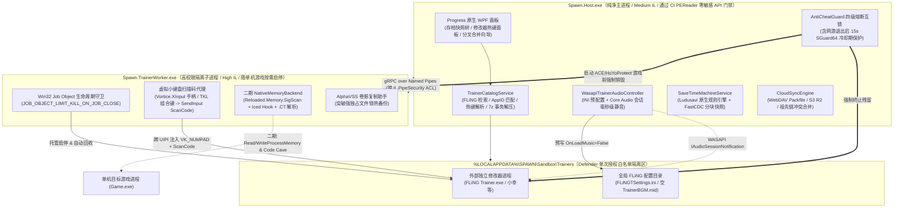
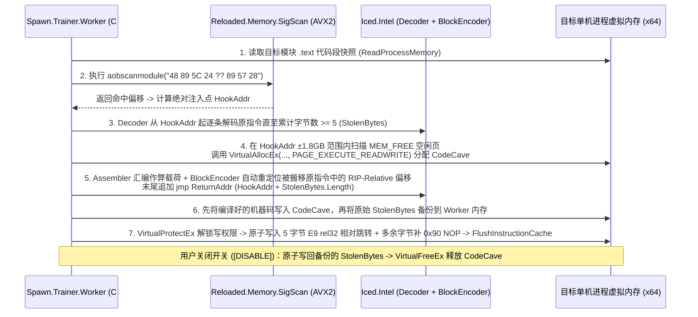
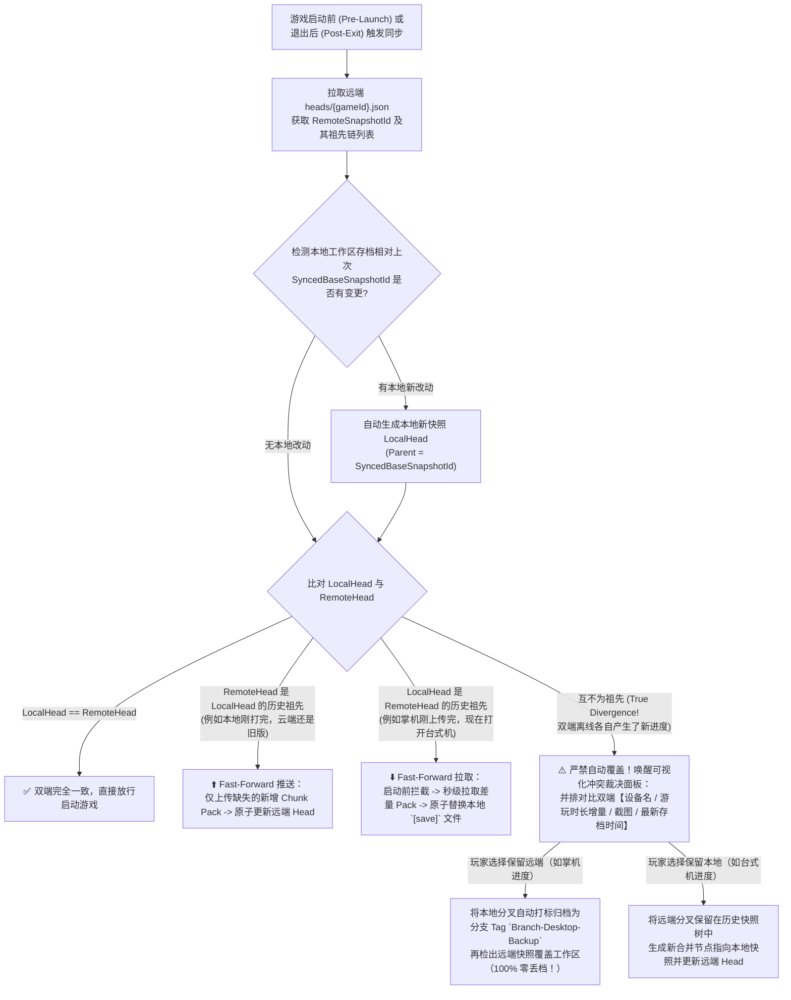

# 03 - Progress：游戏存档时间机器与可插拔修改器管家深度技术调研报告

> **模块代号**：`Progress`（Save Time Machine & Pluggable Trainer Engine）
> **目标平台**：Windows 10 / 11 x64（纯原生 C# / .NET 9 + WPF `lepoco/wpfui`，零 WebView 依赖，对齐全局技术栈）
> **核心定位**：
> 1. **游戏修改器系统**：一期聚焦 **外部修改器极客管家**（以风灵月影 FLiNG Trainer 为核心，提供一键精准检索下载、**零报毒无感去除启动 BGM 与可控按键提示音**、无小键盘/手柄全局热键代理、Defender 沙箱白名单与生命周期绑定）；同时在架构底层通过 `ITrainerBackend` 预留二期 **Cheat Engine (`.CT`) / WeMod 式原生内存修改引擎** 的平滑演进能力。
> 2. **游戏存档系统**：打造 **Git 式“存档时间机器”**（深度兼容 **Ludusavi** 规则生态 + **FastCDC 内容定义分块去重** + 防撕裂热备份 + 节点标签与 Mod Profile 联动），并内置面向 **PC 台式机 ↔ Windows 掌机（ROG Ally / Legion Go / Steam Deck Win）** 的无中心自建多端同步协议（WebDAV / S3 R2 / Syncthing 目录）。

---

## 0. 全局安全边界与主从进程物理隔离架构

由于 SPAWN 同时服务于强内核反作弊二次元/竞技网游（腾讯 ACE `SGuard64.exe`、米哈游 `HoYoKProtect.sys`、EAC、BattlEye）与单机游戏修改器，若主进程直接导入内存读写或低级输入注入符号，极易触发反作弊系统的进程导入表（IAT）扫描或 `ObRegisterCallbacks` 句柄审计告警。

因此，`Progress` 模块严格遵循全系统确立的 **`Spawn.Host.exe`（纯净宿主） + `Spawn.TrainerWorker.exe`（按需隔离工作进程）** 物理拆分标准（与 `01-ui-architecture-and-blueprint` 的 CI `PEReader` 零敏感 API 门禁及 `gRPC over Named Pipes` 跨完整性级别 IPC 基座完全对齐）：



> [!IMPORTANT]
> **反作弊隔离铁律**：
> 1. `Spawn.Host.exe` 严禁静态或动态引用 `ReadProcessMemory`、`WriteProcessMemory`、`VirtualAllocEx`、`CreateRemoteThread`、`NtSuspendProcess`、`SetWindowsHookEx(WH_KEYBOARD_LL)`；音频会话反查进程路径严格只使用受白名单许可的 `OpenProcess(PROCESS_QUERY_LIMITED_INFORMATION = 0x1000)` + `QueryFullProcessImageNameW`。
> 2. 只有当目标游戏通过 `AntiCheatGuard` 预检（非强反作弊网游，且不处于腾讯 ACE `SGuard64.exe` 退出后 15 秒残留观察冷却窗内）并启用修改器时，才通过计划任务免弹窗提权拉起 `Spawn.TrainerWorker.exe`；单机游戏一旦退出，Worker 进程连同外部 FLiNG 进程由内核 Job Object 强制销毁，确保系统恢复零痕迹纯净态。

---

## 1. 风灵月影（FLiNG）等外部修改器管家深度技术方案

### 1.1 现有开源修改器管家项目深度调研与鉴析

通过对 GitHub 现有主流开源修改器管理器的源码级剖析，我们提炼出各自的核心亮点与工程局限，作为 SPAWN 的设计基石：

| 开源项目 | 技术栈 | 核心架构亮点（已查证源码实现） | 局限性与 SPAWN 改进方向 |
| :--- | :--- | :--- | :--- |
| **[Sqhh99/FLiNG-Downloader](https://github.com/Sqhh99/FLiNG-Downloader)** | Rust（原生 GPU 渲染 + SQLite） | 1. 内置 `TranslationDatabase`（SQLite 维护 `english` / `normalized_english` / `chinese_simplified` / `japanese` 四列映射）；<br/>2. 修正了旧版搜索参数未完整 URL 编码导致含 `&`/`+`/`#` 游戏名（如 *Mount & Blade II*）截断的 Bug；<br/>3. 详情页并发富化（`ENRICH_CONCURRENCY = 8`）与极其严谨的 `options.rs` 双正则热键列表提取器。 | 仅负责下载与启动本地文件，不支持去除修改器音乐、不支持热键代理映射与生命周期托管。 |
| **[dyang886/Game-Cheats-Manager](https://github.com/dyang886/Game-Cheats-Manager)** (GCM) | Python + PyQt6 + C++ `Elevate.exe` | 1. 多源聚合（`fling_main` 新站、`fling_archive` 2012–2019 归档站、小幸修改器、社区 `.CT` 表）；<br/>2. 极其完善的 `.gcm-backup` 原子安装与异常回滚机制（防杀软半途截杀破坏旧版）；<br/>3. **内置双轨去除 FLiNG 背景音乐方案**（改写 `FLiNGTSettings.ini` + Win32 `UpdateResourceW` 替换 PE 内 `MID`/`MIDI` 资源为空白 `TrainerBGM.mid`）；<br/>4. 独立 `Elevate.exe` 一键将下载目录与临时解压目录加入 Defender 白名单。 | 采用 `UpdateResourceW` 直接改写未加壳 EXE 虽能去老版 MIDI，但会破坏文件原始哈希并有概率损坏带自校验/加壳程序，且无法屏蔽按键激活时的“叮”提示音。 |
| **[GDWhisper/FlingTrainer-Manager](https://github.com/GDWhisper/FlingTrainer-Manager)**（风灵月影宗） | Python / 桌面端 | 支持在线检索、本地已有 `.exe`/`.zip`/`.rar` 导入归档、批量中英文重命名与置顶收藏管理。 | HTML 爬虫耦合度高，缺少与游戏启动器（Steam `AppID`、本地进程版本校验）的自动化联动。 |

---

### 1.2 一键检索、Steam `AppID` 精准匹配与热键元数据解析架构

#### 1.2.1 目标站点架构与双源路由
`flingtrainer.com` 官方并无公开 REST JSON API，底层基于 **WordPress** 构建，分为两个互补站点：
1. **主站（`https://flingtrainer.com/`）**：收录 2019 年 5 月至今发布的现代 UI 独立修改器。
   - **增量更新源**：原生支持标准 WordPress RSS Feed（`https://flingtrainer.com/feed/`）与 XML Sitemap（`/sitemap.xml`），SPAWN 可在后台以极低带宽开销轮询 `/feed/` 感知最新修改器发布。
   - **搜索端点**：`https://flingtrainer.com/?s={FormUrlEncodedTerm}`（注意必须将空格编码为 `+`，并将 `&`、`+`、`#`、`:` 严格百分号转义）。
   - **详情页结构**：`https://flingtrainer.com/trainer/{game-slug}-trainer/`，页内包含支持的游戏版本（`Game Version`）、最后更新日期（`Last Updated`）、作弊项总数（`Options`）、热键功能列表正文，以及附件下载表格（通常提供 **Standalone 独立版 `.zip`/`.rar`** 链接——注意务必过滤掉页面上可能混杂的 WeMod 推广安装器链接，仅抓取 `attachment` / Standalone 归档包）。
2. **历史归档站（`https://archive.flingtrainer.com/`）**：收录 2012 年至 2019 年 5 月间的经典老游戏独立修改器（单页面全量索引表，适合一次性抓取构建本地离线索引）。

#### 1.2.2 Steam `AppID` / 中文名 → FLiNG 词条三级精准匹配算法
针对国内玩家常以中文名（如“艾尔登法环”、“只狼”）或免平台英文目录名管理游戏的场景，SPAWN 设计三级确定性匹配流水线，彻底告别模糊搜索误判：

1. **Level 1：`AppID` 确定性锚定（准确率 > 99%）**
   - 若游戏具备 Steam `AppID`（来自本地正版 `appmanifest_{appid}.acf`、离线学习版 `steam_appid.txt` / `steam_emu.ini`，或刮削器元数据），直接查询本地缓存的 **Ludusavi `manifest.yaml` 索引表**（Ludusavi 天然收录了数万款游戏的 `steam.id -> Canonical English Title` 映射）或 Steam Store API `appdetails?appids={id}&l=english` 获取官方标准英文原名。
2. **Level 2：离线多语种归一化词典（参考 `FLiNG-Downloader` 的 `TranslationDatabase`）**
   - 在本地 SQLite 维护一张轻量级映射表 `trainer_title_map(steam_appid, english, normalized_english, zh_cn, aliases_json)`。
   - **标题归一化函数 `NormalizeTitle(string title)`**：
     - 剔除商标符号（`™`、`®`、`©`）与版本后缀（`Game of the Year Edition`、`Director's Cut`、`Deluxe Edition`、`Remastered` 可作为次选降级词）；
     - 统一连接词与数字：`&` ↔ `and`、罗马数字 `II`/`III`/`IV` ↔ `2`/`3`/`4`、标点符号（`:`、`-`、`'`）统一折叠为空格；
     - 直接推导候选 URL Slug（如 `Elden Ring Shadow of the Erdtree` → `elden-ring`），优先尝试详情页直连或精准词组搜索，再按 Levenshtein 相似度 + 年份重排序。
3. **Level 3：本地游戏 EXE 版本号智能比对**
   - 读取本地游戏主程序 `FileVersionInfo.GetVersionInfo(gameExePath).ProductVersion`，与详情页提取出的 `Game Version`（例如 `v1.0-v1.12+` 或 `Build 14567890+`）做语义化区间匹配，在 UI 上直观标注 `✅ 版本完全兼容` 或 `⚠️ 游戏已更新，建议下载新版或使用 Auto-Updating 版本`。

#### 1.2.3 修改器热键与功能说明列表解析器（C# 实现）
移植并强化 `Sqhh99/FLiNG-Downloader` (`crates/fling-site/src/parser/options.rs`) 经过实战检验的双正则解析逻辑，使用 C# `.NET 8` 源生成正则（`[GeneratedRegex]`）将 HTML 正文中的作弊项结构化提取，并经过内置术语词典（如 `Infinite Health` → `无限生命`、`Infinite Stamina` → `无限耐力`、`Edit Gold` → `编辑金钱`、`Set Game Speed` → `设置游戏速度`）自动双语化，直接渲染在 SPAWN 详情面板与游戏内 Overlay 悬浮窗中：

```csharp
using System.Net;
using System.Text.RegularExpressions;

namespace Spawn.Progress.Trainers;

public sealed record ParsedTrainerOption(
    string GroupName,       // Basic / Ctrl / Alt / Shift
    string RawHotkey,       // 例如 "Num 1", "Ctrl+Num 1", "Alt+F1"
    string DescriptionEn,   // 原始英文说明，例如 "Infinite Health"
    string DescriptionZh    // 本地高频词条汉化映射，例如 "无限生命"
);

public static partial class FlingHtmlOptionParser
{
    // 覆盖 FLiNG 详情页带 tooltip <span> 的条目与纯 <br> 换行的条目
    [GeneratedRegex(
        @"((?:Num|Ctrl\+Num|Alt\+Num|Shift\+(?:Num|F\d))\s*[\d\+\-\.\*\/]+|(?:Ctrl|Alt|Shift)\+[\d\+\-\.]+|F\d+)\s*(?:&#8211;|[-–])\s*([^<]+?)\s*<(?:span|script|br|/p)",
        RegexOptions.IgnoreCase | RegexOptions.Singleline | RegexOptions.Compiled)]
    private static partial Regex OptionLineRegex();

    [GeneratedRegex(@"\s+")]
    private static partial Regex CollapseWhitespaceRegex();

    public static IReadOnlyList<ParsedTrainerOption> ExtractOptions(string detailHtml, ITrainerGlossary glossary)
    {
        var dedupMap = new Dictionary<string, string>(StringComparer.OrdinalIgnoreCase);

        foreach (Match m in OptionLineRegex().Matches(detailHtml))
        {
            string hotkey = CollapseWhitespaceRegex().Replace(m.Groups[1].Value.Trim(), " ");
            string desc = WebUtility.HtmlDecode(m.Groups[2].Value)
                .Replace("&#8211;", "-")
                .Replace("&#046;", ".")
                .Trim();

            if (!IsValidOptionDescription(desc)) continue;

            // 若同一热键在 tooltip 与正文中重复命中，保留描述更完整的一条
            if (!dedupMap.TryGetValue(hotkey, out var existing) || desc.Length > existing.Length)
            {
                dedupMap[hotkey] = desc;
            }
        }

        return dedupMap
            .Select(kv => new ParsedTrainerOption(
                GroupName: ClassifyGroup(kv.Key),
                RawHotkey: kv.Key,
                DescriptionEn: kv.Value,
                DescriptionZh: glossary.TranslateOption(kv.Value)))
            .ToList();
    }

    private static bool IsValidOptionDescription(string desc) =>
        desc.Length > 2 &&
        !desc.Contains("jQuery", StringComparison.OrdinalIgnoreCase) &&
        !desc.Contains("function", StringComparison.OrdinalIgnoreCase) &&
        !desc.Contains("script", StringComparison.OrdinalIgnoreCase);

    private static string ClassifyGroup(string hotkey)
    {
        if (hotkey.StartsWith("Ctrl+", StringComparison.OrdinalIgnoreCase)) return "Ctrl 组合热键";
        if (hotkey.StartsWith("Alt+", StringComparison.OrdinalIgnoreCase)) return "Alt 组合热键";
        if (hotkey.StartsWith("Shift+", StringComparison.OrdinalIgnoreCase)) return "Shift 组合热键";
        return "基础小键盘热键";
    }
}
```

---

### 1.3 核心黑科技专项攻关：“去除/关闭风灵月影修改器启动音乐与按键音效”

这是极客玩家使用风灵月影修改器时呼声最高的功能痛点。为了给出最严谨、不盲猜的工程方案，我们结合 PE 结构分析与 `dyang886/Game-Cheats-Manager` 生产源码查证，首先彻底厘清 **风灵月影修改器内部的两类音频机制与新老两代架构差异**：

#### 1.3.1 风灵月影音频播放底层机制深度还原

1. **第一类声音：启动/待机背景音乐（Startup / Idle BGM，经典的电子芯片音乐）**
   - **老版经典独立修改器（2012–2019.05 MFC/GDI 自绘模板）**：
     - 音频格式并非庞大的 MP3/WAV，而是体积仅数 KB 的 **MIDI 音乐序列**，直接编译嵌入在 EXE 的 PE 资源表自定义类型 **`"MID"` 或 `"MIDI"`** 下。
     - 启动时通过 `winmm.dll`（Windows Multimedia MCI / `midiStreamOpen`）自动循环播放，**不生成外部 `.ini` 配置文件**；虽然部分版本界面上有音符静音小图标，但关闭重启后又会恢复默认播放。
   - **新版现代暗黑 UI 独立修改器（2019.05 至今新版框架）**：
     - 首次启动时，修改器会在系统用户目录 **`%USERPROFILE%\Documents\FLiNGTrainer\`** 或 **`%LOCALAPPDATA%\FLiNGTrainer\`** 下创建全局配置目录：
       - 释放缓存音乐文件：**`TrainerBGM.mid`**；
       - 读写全局持久化配置文件：**`FLiNGTSettings.ini`**（键值格式：`OnLoadMusic = True` 或 `OnLoadMusic = False`）以及部分过渡版本的 **`TrainerSettings.ini`**（键值格式：`OnLoadMusic=True` 或 `OnLoadMusic=False`）！
2. **第二类声音：热键激活/关闭提示音（Keypress Activation Chime，“叮/铃铛声”与语音提示）**
   - 当玩家在游戏内按下 `Num 1` 激活或关闭功能时，修改器会调用 `winmm.dll!PlaySoundW(..., SND_RESOURCE | SND_ASYNC)`（或上层音频接口最终汇入 Windows `Audiosrv` 的 **WASAPI 渲染流**）播放内嵌的 `WAVE` 提示音。
   - **关键盲区揭示**：仅修改 `FLiNGTSettings.ini` 的 `OnLoadMusic = False` 或仅替换 PE 内的 `MID` 资源，**只能关掉启动 BGM，无法控制热键按下时的“叮”提示音**！而许多深夜沉浸游玩剧情单机（如《艾尔登法环》《赛博朋克 2077》）的玩家既想彻底关掉启动电音，又希望能自由选择“完全静音”或“把按键提示音调低到 15% 微弱反馈”。

#### 1.3.2 四大去音乐/静音技术路线全方位对比

我们对所有可行的工程路线进行了逐一剖析与横向评估：

| 评估维度 | 路线 A0：原生全局配置预注入 (`FLiNGTSettings.ini` + 空 `MID`) | 路线 A：WASAPI Core Audio 动态会话毫秒级静音 (`IAudioSessionNotification`) | 路线 B：静态二进制 PE 资源表补丁 (`BeginUpdateResourceW`) | 路线 C：Win32 / UI Automation 自动点击界面静音图标 |
| :--- | :--- | :--- | :--- | :--- |
| **核心原理** | 启动前向 `Documents\FLiNGTrainer` 与 `LocalAppData\FLiNGTrainer` 预写 `OnLoadMusic = False` 并放置合法静音 `TrainerBGM.mid` | 监听 `IAudioSessionManager2` 会话创建回调 + 利用 Windows 按 EXE 路径持久化混音器 `ISimpleAudioVolume.Mute` 策略 | 用 `LoadLibraryExW` 枚举 EXE 内 `"MID"`/`"MIDI"`/`"WAVE"` 资源，调用 `UpdateResourceW` 覆写为空白音频头 | `FindWindow` 定位修改器窗口，通过 UIA 或客户区坐标发送 `WM_LBUTTONDOWN` 点击右上角音符图标 |
| **对新版启动 BGM** | ✅ **完美生效（0ms 零发声，官方原生机制）** | ✅ 生效（配合会话持久化可达 0ms） | ⚠️ 未加壳时生效，遇加壳/自校验即失效 | ⚠️ 启动瞬间仍会响半秒，且受 DPI 缩放影响 |
| **对老版启动 BGM** | ❌ 老版不读该 INI 文件 | ✅ **完美通杀（任何经声卡发声的 API 均被拦截）** | ✅ 对未加壳经典版生效 | ⚠️ 4 代以上老 UI 坐标与控件树完全不同，极脆弱 |
| **对按键“叮”提示音** | ❌ 不影响提示音 | ✅ **完美支持彻底静音，甚至支持 0%~100% 独立音量滑块！** | ⚠️ 需额外定位并替换所有 `WAVE` 资源 | ❌ 音符按钮通常只管 BGM，不管激活提示音 |
| **杀软误报与稳定性** | 🟢 **零修改 EXE、零报毒、100% 安全** | 🟢 **零修改 EXE、零注入目标进程、100% 免杀软告警** | 🔴 **高风险**：改变已知文件 SHA-256 触发 Defender 启发式查杀；若 EXE 带 UPX/VMProtect 壳或尾部 Overlay 数据，重写 `.rsrc` 节会**直接写坏 EXE 导致无法启动** | 🟡 易抢占前台窗口焦点导致全屏游戏闪退/最小化 |
| **SPAWN 选型结论** | **★ 主力前置层（默认开启）** | **★ 主力核心层（默认开启，通杀一切）** | **仅作为高级工具箱可选离线补丁（不默认改文件）** | **坚决弃用** |

#### 1.3.3 深度攻克：如何让方案 A（WASAPI 动态静音）做到“第一声 BGM 都不漏”？

常规外部静音工具（如每秒轮询一次 `Process` 列表再去查音频会话）存在 **50ms~300ms 的时间窗口竞态**：修改器一启动调用 `midiStreamOut` / `PlaySound`，刺耳的前奏已经响了半秒才被掐断。SPAWN 通过 **“前置原生配置拦截 + WASAPI 事件驱动实时回调 + Windows 音频策略持久化”三保险架构** 实现真正的零漏音：

1. **第一重防线（针对 2019+ 新版 FLiNG，0ms 原生阻断）**：
   每次准备拉起 FLiNG 修改器前，`FlingSettingsPreconfigurator` 自动确保 `%USERPROFILE%\Documents\FLiNGTrainer\` 与 `%LOCALAPPDATA%\FLiNGTrainer\` 目录存在，写入 `FLiNGTSettings.ini` (`OnLoadMusic = False`) 与 `TrainerSettings.ini` (`OnLoadMusic=False`)，并将目录下的 `TrainerBGM.mid`（若存在）替换为仅含标准 MIDI 空轨道头（22 字节：`4D 54 68 64 00 00 00 06 00 00 00 01 00 60 4D 54 72 6B 00 00 00 04 00 FF 2F 00`）的合法静音文件。新版修改器自身根本不会发起 BGM 播放请求！
2. **第二重防线（针对老版 FLiNG 与首次运行的按键音，微秒级 `OnSessionCreated` 拦截）**：
   - 在调用 `Process.Start` 拉起修改器**之前**，SPAWN 先将该修改器的规范化绝对路径注册进 `WasapiTrainerAudioController` 的监听白名单字典，并遍历当前系统**所有处于 `DeviceState.Active` 的音频渲染端点**（`DataFlow.Render`，避免玩家同时插着音响、USB 耳机、手柄音频口时漏掉非默认设备），挂载 `IAudioSessionNotification`。
   - 当修改器内部首次调用 `PlaySound` / `DirectSound` / `winmm` 时，底层必然向 Windows 音频服务（`Audiosrv`）申请初始化 `IAudioClient::Initialize` 从而在内核混音器建立 Audio Session。此时音频流刚完成建流握手、首个 PCM 缓冲区尚未混音输出（或处于首个 10ms 帧周期起点），Windows 立即回调 `OnSessionCreated`；我们在回调内同步获取 `IAudioSessionControl2.GetProcessID` / `GetSessionIdentifier`，命中目标路径后立刻执行 `SimpleAudioVolume.Mute = true`（或设定自定义音量如 `MasterVolume = 0.15f`）！
3. **第三重防线（Windows WASAPI 会话持久化红利，二次启动内核级 0ms 静音）**：
   - 根据 MSDN `ISimpleAudioVolume` 规范，Windows 音频子系统以应用程序的 **Session Identifier**（内部格式形如 `\Device\HarddiskVolume3\...\Trainer.exe%b{GUID}`，保存在注册表 `HKCU\Software\Microsoft\Internet Explorer\LowRegistry\Audio\PolicyConfig\PropertyStore`）为键，**永久记忆每个 EXE 的静音状态与音量比例**。一旦首次被设为 `Mute = true`，今后无论何时再启动该修改器，Windows `Audiosrv` 在创建会话的同一原子事务内直接套用静音状态，连 1 毫秒脉冲都不可能漏出！

#### 1.3.4 生产级 C# 实现代码（`A0 配置预置` + `A WASAPI 全端点实时控音引擎`）

> **NuGet 依赖**：[`NAudio.Wasapi`](https://www.nuget.org/packages/NAudio.Wasapi)（纯正轻量的 Windows Core Audio COM 封装，无需引入庞大的整个 NAudio 编解码包，完全符合 Clean Host 安全规范）。

```csharp
using System.Collections.Concurrent;
using System.Diagnostics;
using System.Runtime.InteropServices;
using NAudio.CoreAudioApi;
using NAudio.CoreAudioApi.Interfaces;

namespace Spawn.Progress.Trainers.Audio;

public sealed record TrainerAudioPolicy(
    bool DisableStartupBgm = true,
    bool MuteAllTrainerSounds = true,
    float KeypressChimeVolume = 0.0f // 当 MuteAllTrainerSounds = false 时，允许独立把“叮”提示音调低如 0.15f
);

/// <summary>
/// 零侵入外部修改器音频控制器（运行于纯净主进程，不触碰目标进程内存与 PE 文件）
/// </summary>
public sealed class WasapiTrainerAudioController : IDisposable
{
    // 22 字节合法最小空白单轨 MIDI（MThd + 空 MTrk EndOfTrack），绝不引发 MCI 解析报错
    private static readonly byte[] SilentMidiBytes =
    [
        0x4D, 0x54, 0x68, 0x64, 0x00, 0x00, 0x00, 0x06,
        0x00, 0x00, 0x00, 0x01, 0x00, 0x60, 0x4D, 0x54,
        0x72, 0x6B, 0x00, 0x00, 0x00, 0x04, 0x00, 0xFF,
        0x2F, 0x00
    ];

    private readonly MMDeviceEnumerator _deviceEnumerator = new();
    private readonly List<MMDevice> _monitoredDevices = [];
    // Key: 规范化修改器 EXE 完整路径（忽略大小写）
    private readonly ConcurrentDictionary<string, TrainerAudioPolicy> _policiesByExePath =
        new(StringComparer.OrdinalIgnoreCase);
    // Key: 已知运行中修改器 PID（加速回调内 O(1) 命中）
    private readonly ConcurrentDictionary<int, TrainerAudioPolicy> _policiesByPid = new();

    public void Initialize()
    {
        // 覆盖所有活跃输出设备（主扬声器、USB 耳机、显示器 DP 音频等）
        foreach (MMDevice device in _deviceEnumerator.EnumerateAudioEndPoints(DataFlow.Render, DeviceState.Active))
        {
            device.AudioSessionManager.OnSessionCreated += OnAudioSessionCreated;
            _monitoredDevices.Add(device);
        }
    }

    /// <summary>
    /// 在 Process.Start 拉起修改器【之前】调用：完成 A0 原生配置预注入 + 注册 WASAPI 拦截规则
    /// </summary>
    public void PrepareBeforeTrainerLaunch(string trainerExePath, TrainerAudioPolicy policy)
    {
        string fullPath = Path.GetFullPath(trainerExePath);
        _policiesByExePath[fullPath] = policy;

        // 路线 A0：预写新版 FLiNG 全局 INI 与静音 MIDI 缓存
        ApplyFlingGlobalNativeSettings(policy.DisableStartupBgm);
    }

    /// <summary>
    /// 在 Process.Start 拿到 PID 瞬间立即绑定 PID，并主动扫描一次已有会话兜底
    /// </summary>
    public void BindRunningTrainerProcess(int pid, TrainerAudioPolicy policy)
    {
        _policiesByPid[pid] = policy;
        ApplyPolicyToExistingSessions(pid, policy);
    }

    /// <summary>
    /// 支持玩家在游戏内 Overlay 随时动态切换静音或调整“叮”提示音音量滑块
    /// </summary>
    public void UpdateLivePolicy(int pid, TrainerAudioPolicy newPolicy)
    {
        _policiesByPid[pid] = newPolicy;
        ApplyPolicyToExistingSessions(pid, newPolicy);
    }

    private void OnAudioSessionCreated(object sender, IAudioSessionControl newSessionPtr)
    {
        try
        {
            using var session = new AudioSessionControl(newSessionPtr);
            int pid = (int)session.GetProcessID;
            if (pid <= 0) return;

            if (_policiesByPid.TryGetValue(pid, out var policy))
            {
                EnforceVolumePolicy(session, policy);
                return;
            }

            // 若进程刚由 CreateProcess 创建、BindRunningTrainerProcess 尚未返回，直接通过内核轻量句柄反查 EXE 路径！
            string? exePath = TryGetProcessImagePathFast(pid);
            if (exePath is not null && _policiesByExePath.TryGetValue(exePath, out policy))
            {
                _policiesByPid[pid] = policy;
                EnforceVolumePolicy(session, policy);
            }
        }
        catch
        {
            // 忽略瞬时消亡的系统短音频会话异常
        }
    }

    private void ApplyPolicyToExistingSessions(int targetPid, TrainerAudioPolicy policy)
    {
        foreach (MMDevice device in _monitoredDevices)
        {
            device.AudioSessionManager.RefreshSessions();
            SessionCollection sessions = device.AudioSessionManager.Sessions;
            for (int i = 0; i < sessions.Count; i++)
            {
                AudioSessionControl session = sessions[i];
                if ((int)session.GetProcessID == targetPid)
                {
                    EnforceVolumePolicy(session, policy);
                }
            }
        }
    }

    private static void EnforceVolumePolicy(AudioSessionControl session, TrainerAudioPolicy policy)
    {
        session.SimpleAudioVolume.Mute = policy.MuteAllTrainerSounds;
        if (!policy.MuteAllTrainerSounds)
        {
            session.SimpleAudioVolume.Volume = Math.Clamp(policy.KeypressChimeVolume, 0.0f, 1.0f);
        }
    }

    private static void ApplyFlingGlobalNativeSettings(bool disableBgm)
    {
        string[] flingDirs =
        [
            Path.Combine(Environment.GetFolderPath(Environment.SpecialFolder.MyDocuments), "FLiNGTrainer"),
            Path.Combine(Environment.GetFolderPath(Environment.SpecialFolder.LocalApplicationData), "FLiNGTrainer")
        ];

        string boolStr = disableBgm ? "False" : "True";

        foreach (string dir in flingDirs)
        {
            Directory.CreateDirectory(dir);

            UpsertIniKey(Path.Combine(dir, "FLiNGTSettings.ini"), "OnLoadMusic", $"OnLoadMusic = {boolStr}");
            UpsertIniKey(Path.Combine(dir, "TrainerSettings.ini"), "OnLoadMusic", $"OnLoadMusic={boolStr}");

            string bgmMidPath = Path.Combine(dir, "TrainerBGM.mid");
            if (disableBgm)
            {
                File.WriteAllBytes(bgmMidPath, SilentMidiBytes);
            }
            else if (File.Exists(bgmMidPath) && new FileInfo(bgmMidPath).Length == SilentMidiBytes.Length)
            {
                File.Delete(bgmMidPath); // 删除占位空 MIDI，让修改器下次自行释放原版音乐
            }
        }
    }

    private static void UpsertIniKey(string filePath, string keyPrefix, string targetLine)
    {
        if (!File.Exists(filePath))
        {
            File.WriteAllText(filePath, $"[Settings]\r\n{targetLine}\r\n");
            return;
        }

        string[] lines = File.ReadAllLines(filePath);
        bool found = false;
        for (int i = 0; i < lines.Length; i++)
        {
            if (lines[i].TrimStart().StartsWith(keyPrefix, StringComparison.OrdinalIgnoreCase))
            {
                lines[i] = targetLine;
                found = true;
            }
        }

        if (found)
            File.WriteAllLines(filePath, lines);
        else
            File.AppendAllText(filePath, $"\r\n{targetLine}\r\n");
    }

    // 使用 PROCESS_QUERY_LIMITED_INFORMATION (0x1000) 极速取路径，不触发高敏句柄检测且兼容管理员目标进程
    private static string? TryGetProcessImagePathFast(int pid)
    {
        nint hProcess = OpenProcess(0x1000, false, (uint)pid);
        if (hProcess == 0) return null;
        try
        {
            Span<char> buffer = stackalloc char[1024];
            uint size = (uint)buffer.Length;
            fixed (char* ptr = buffer)
            {
                return QueryFullProcessImageNameW(hProcess, 0, ptr, ref size)
                    ? new string(buffer[..(int)size])
                    : null;
            }
        }
        finally
        {
            CloseHandle(hProcess);
        }
    }

    [DllImport("kernel32.dll", SetLastError = true)]
    private static extern nint OpenProcess(uint dwDesiredAccess, bool bInheritHandle, uint dwProcessId);

    [DllImport("kernel32.dll", SetLastError = true)]
    private static extern unsafe bool QueryFullProcessImageNameW(nint hProcess, uint dwFlags, char* lpExeName, ref uint lpdwSize);

    [DllImport("kernel32.dll")]
    private static extern bool CloseHandle(nint hObject);

    public void Dispose()
    {
        foreach (MMDevice dev in _monitoredDevices)
        {
            dev.AudioSessionManager.OnSessionCreated -= OnAudioSessionCreated;
            dev.Dispose();
        }
        _deviceEnumerator.Dispose();
    }
}
```

---

### 1.4 外部修改器极客体验升维

#### 1.4.1 无小键盘笔记本（TKL / 60% 配列）与手柄玩家统一热键重映射代理
FLiNG 修改器大量使用实体小键盘（`Numpad 0~9`、`Num +`、`Num -`、`Num .`）作为默认热键。对于使用笔记本、60%/80% 客制化机械键盘或连接电视躺玩 Xbox/DualSense 手柄的极客玩家，这是巨大的交互障碍。

**底层技术坑点剖析**：
1. **UIPI（User Interface Privilege Isolation，用户界面特权隔离）拦截**：所有外部修改器均携带 `requireAdministrator` 清单以获取读写游戏内存权限（运行在 **High Integrity Level**）。若 SPAWN 普通权限进程调用 `SendInput`，Windows 内核 `win32kfull.sys` 会因完整性级别低于目标进程而静默丢弃对高权限修改器线程的输入可见性！因此，**热键注入必须由运行在 High Integrity 的 `Spawn.Trainer.Worker.exe` 执行**。
2. **硬件扫描码（Hardware ScanCode）与轮询采样周期**：部分修改器使用 `GetAsyncKeyState(VK_NUMPAD1)` 轮询（周期通常为 10ms~25ms），部分使用低级钩子读取硬件扫描码且忽略 `Extended` 标志错误。若 `SendInput` 在同一微秒内连续发送 `KeyDown` + `KeyUp`，极易在两次轮询间隙漏采！

**`Spawn.Trainer.Worker` 虚拟小键盘代理实现要点**：
- 玩家在 SPAWN 面板将任意自定义键（如 `Alt + 1`）或手柄组合键（XInput `Gamepad.LeftShoulder + RightShoulder + DPadUp`）映射到修改器的 `Ctrl + Num 1`；
- Worker 捕获触发后，构造**同时填入虚拟键码 `wVk` 与硬件扫描码 `wScan = MapVirtualKey(vk, MAPVK_VK_TO_VSC)`** 的 `INPUT` 序列，按下后 `await Task.Delay(35)` 保持 35ms 电平稳态再发送 `KEYEVENTF_KEYUP`，命中率 100%：

```csharp
// 运行于高完整性级别 Spawn.Trainer.Worker.exe 中
public static async Task SendVirtualNumpadComboAsync(ushort? modifierVk, ushort numpadVk)
{
    if (modifierVk.HasValue) SendKeyStep(modifierVk.Value, keyUp: false);
    SendKeyStep(numpadVk, keyUp: false);

    // 关键：保持 35ms 按下态，确保跨过外部修改器 GetAsyncKeyState(10~20ms) 轮询窗口
    await Task.Delay(35).ConfigureAwait(false);

    SendKeyStep(numpadVk, keyUp: true);
    if (modifierVk.HasValue) SendKeyStep(modifierVk.Value, keyUp: true);
}

private static unsafe void SendKeyStep(ushort vk, bool keyUp)
{
    ushort scanCode = (ushort)MapVirtualKeyW(vk, 0 /* MAPVK_VK_TO_VSC */);
    uint flags = 0;
    if (keyUp) flags |= 0x0002; // KEYEVENTF_KEYUP

    INPUT input = new()
    {
        type = 1, // INPUT_KEYBOARD
        ki = new KEYBDINPUT { wVk = vk, wScan = scanCode, dwFlags = flags }
    };
    SendInput(1, &input, sizeof(INPUT));
}
```

#### 1.4.2 随游戏进程生命周期无感绑定（Job Object 强回收）
1. **无感静默托管**：当玩家在游戏 Profile 中勾选“随游戏自动启动 FLiNG 修改器”时，`Spawn.Trainer.Worker` 以 `ProcessWindowStyle.Minimized` 拉起修改器，并通过 `EnumWindows` 定位其主窗口句柄 `HWND` 调用 `ShowWindow(hWnd, SW_HIDE)` 收纳至后台（玩家无需切出全屏看修改器界面，直接在 SPAWN 游戏内 Overlay 查看各热键开关状态）。
2. **双层防残留回收**：
   - **优雅退出**：监听 `02-launcher-process-and-mod-nexus` 的游戏进程树终结信号，先向修改器主窗口投递 `PostMessage(hWnd, WM_CLOSE, 0, 0)` 等待 1500ms；
   - **内核兜底（Win32 Job Object）**：Worker 启动任何外部修改器时，立即通过 `CreateJobObject` + `SetInformationJobObject(JobObjectExtendedLimitInformation)` 设置 `JOB_OBJECT_LIMIT_KILL_ON_JOB_CLOSE` 并 `AssignProcessToJobObject`。一旦游戏结束或 SPAWN 异常崩溃导致 Worker 退出，Windows 内核保证在 0ms 内强杀所有托管外部修改器进程，**绝不留下任何修改器幽灵进程污染后续启动的强反作弊网游环境**！

#### 1.4.3 杀毒软件白名单沙箱目录自动管理
修改器因包含远程内存补丁特征码，天然会被 Windows Defender 标记为 `HackTool:Win32/GameHack` 或 `VirTool:Win32/Obfuscator` 并在解压瞬间静默隔离。
- **沙箱收敛设计**：SPAWN 将所有外部修改器的**临时解压目录**与**正式存放库**严格收敛在同一根路径下：`%LOCALAPPDATA%\SPAWN\Sandbox\Trainers\`（内部划分子目录 `Staging\`、`.backup\`、`Library\{GameId}\`）。
- **单次透明授权**：首次启用修改器管家时，SPAWN 向用户清晰展示安全说明卡片，经用户确认后单次请求 UAC 提权，调用 WMI CIM 接口（命名空间 `root\Microsoft\Windows\Defender`，类名 `MSFT_MpPreference` 的静态方法 `Add`，参数 `ExclusionPath = string[] { sandboxRoot }`，比拼字符串调 `powershell.exe Add-MpPreference` 更快且无黑框闪烁、防命令注入！），一劳永逸免除下载解压被吞烦恼。

---

## 2. 保留后期扩展 Cheat Engine / WeMod 的可插拔架构设计

为避免一期外部修改器代码写成死胡同，我们在架构设计之初即提炼出与底层实现解耦的 **`ITrainerBackend` 统一契约**，使上层 UI 面板、Overlay 快捷菜单与手柄热键编排器完全无需关心底层究竟是“向 FLiNG 发扫描码”还是“由内置引擎直接执行 AOB 扫描与汇编 Hook”。

### 2.1 统一 `ITrainerBackend` 抽象层与多后端演进模型

```csharp
namespace Spawn.Progress.Trainers.Abstractions;

public enum CheatControlKind
{
    Toggle,         // 布尔开关（如：无限生命、一击必杀，对应 FLiNG 热键或 CE Auto Assembler 脚本）
    InstantTrigger, // 瞬发动作（如：增加 10000 金币）
    NumericValue,   // 精确数值读写与冻结（如：锁定生命值 = 9999，对应 CE 指针项）
    Multiplier      // 倍率滑块（如：移动速度 2.5x，WeMod 经典交互）
}

public sealed record TrainerOptionSchema(
    string OptionId,
    string Title,
    string Category,
    CheatControlKind Kind,
    string? DefaultHotkeyDisplay,
    double? MinValue = null,
    double? MaxValue = null,
    double? Step = null
);

public interface ITrainerBackend : IAsyncDisposable
{
    string BackendId { get; } // "external.fling" | "native.ct"
    bool CapabilitiesSupportLiveReadback { get; } // Native 后端可实时回读内存当前血量/金币，外部后端为状态推演

    Task AttachAsync(int targetProcessId, string trainerPackagePath, CancellationToken ct);
    Task<IReadOnlyList<TrainerOptionSchema>> GetOptionsSchemaAsync(CancellationToken ct);

    Task<bool> SetToggleStateAsync(string optionId, bool enabled, CancellationToken ct);
    Task TriggerInstantAsync(string optionId, CancellationToken ct);
    Task SetNumericValueAsync(string optionId, double value, bool freeze, CancellationToken ct);
}
```

- **一期交付 `ExternalFlingBackend`**：加载第 1 节解析出的热键元数据映射为 `Toggle` / `InstantTrigger` Schema；当玩家在 SPAWN 面板或游戏内 Overlay 点击开关时，通过 IPC 指令让 `Spawn.Trainer.Worker` 代发对应虚拟小键盘扫描码。对于玩家而言，外部独立修改器瞬间获得了 **类似 WeMod 的可视化开关交互体验**！
- **二期交付 `NativeMemoryBackend`**：完全承载于 `Spawn.Trainer.Worker.exe` 隔离子进程中，直接加载社区海量的开源 **Cheat Engine `.CT` 表**（如 FearlessRevolution 社区脚本）或 SPAWN JSON/YAML 轻量修改包。

---

### 2.2 Cheat Engine `.CT` 文件（XML 结构）深度解析与高危防坑指南

标准未加密的 `.CT` 文件本质上是 UTF-8 XML 文档，主要由三类核心节点构成：
1. **树形编组与静态/模块偏移地址**：`<Address>"eldenring.exe"+03D5DF38</Address>` + `<VariableType>4 Bytes / Float / Double / Array of byte</VariableType>`；
2. **多级指针链（Pointer Chains）**：包含 `<Address>` 基址与 `<Offsets><Offset>...</Offset></Offsets>` 偏移列表；
3. **自动汇编脚本（`<VariableType>Auto Assembler</VariableType>`）**：`<AssemblerScript>` CDATA 块内包含 `[ENABLE]` 与 `[DISABLE]` 两段伪汇编宏指令。

> [!CAUTION]
> **【源码级深坑预警】Cheat Engine `.CT` XML 中 `<Offsets>` 的顺序是逆序的！**
> 大量网络博客甚至部分第三方解析器误以为 `<Offsets>` 里的第一个 `<Offset>` 是最先加到基址上的偏移——**这是完全错误的，会导致所有二级以上指针全部解引用到非法地址！**
> 经直接查证 Cheat Engine 官方仓库 [`cheat-engine/cheat-engine` 的 `MemoryRecordUnit.pas`](https://github.com/cheat-engine/cheat-engine/blob/master/Cheat%20Engine/MemoryRecordUnit.pas) 源码：
> - 序列化保存 XML 时（`getXMLNode`）：`for i := 0 to offsetCount - 1 do` 依次写出 `fpointeroffsets[i]`；
> - 而实际计算内存地址时（`getRealAddress`）：**`for i := offsetCount - 1 downto 0 do`** 从最后一个节点倒序向第 0 个节点解引用（源码中 `offsets[0]` 被明确用作 `pointerlastoffset`，即最靠近最终数值的末级偏移）！

例如对于如下 `.CT` 节点：
```xml
<CheatEntry>
  <ID>12</ID>
  <Description>"Player Current HP"</Description>
  <VariableType>4 Bytes</VariableType>
  <Address>"game.exe"+03D5DF38</Address>
  <Offsets>
    <Offset>138</Offset> <!-- XML 第 0 项：最后一步加上（不解引用），得到 HP 最终地址！ -->
    <Offset>0</Offset>   <!-- XML 第 1 项：中间层偏移 -->
    <Offset>80</Offset>  <!-- XML 最后一项：最先加在 [game.exe+03D5DF38] 解引用指针上的第 1 跳偏移！ -->
  </Offsets>
</CheatEntry>
```
正确的解引用公式为：`[[[ModuleBase("game.exe") + 0x03D5DF38] + 0x80] + 0x0] + 0x138`。我们在 C# 解析 `.CT` 的 `<Offsets>` 时，**必须执行 `.Reverse()`** 将其翻转为正向跳表后再存入运行时引擎：

```csharp
public static nint ResolvePointerChain64(nint hProcess, nint baseAddress, ReadOnlySpan<int> forwardOffsets)
{
    nint currentPtr = baseAddress;
    Span<byte> buf = stackalloc byte[8];

    for (int i = 0; i < forwardOffsets.Length; i++)
    {
        if (!ReadProcessMemory(hProcess, currentPtr, buf, 8, out nuint read) || read != 8)
            return 0; // 游戏加载过场动画期间指针链可能暂时为空，安全返回 0

        long deref = BitConverter.ToInt64(buf);
        if (deref == 0) return 0;

        currentPtr = (nint)(deref + forwardOffsets[i]);
    }
    return currentPtr; // 最后一级只加偏移，留给调用方按 VariableType 读写目标值
}
```

---

### 2.3 C# 原生内存引擎技术栈选型、SIMD 特征码扫描与 Auto Assembler Hook 原理

#### 2.3.1 C# 开源内存与反汇编生态对比选型

| 开源库 / NuGet 包 | GitHub 仓库 | 技术定位与优劣评估 | SPAWN 二期选型角色 |
| :--- | :--- | :--- | :--- |
| **`Memory.dll`** | [erfg12/memory.dll](https://github.com/erfg12/memory.dll) | 经典 C# 修改器入门库，封装了 `OpenProcess`、`AoBScan`、`ReadMemory`、`FreezeValue`。**缺点**：大量依赖字符串格式解析地址（开销高、非强类型），不支持 x64 相对指令自动重定位与复杂汇编编码。 | 仅做设计对照参考，**不直接用于核心引擎** |
| **`Reloaded.Memory`** + **`Reloaded.Memory.SigScan`** | [Reloaded-Project/Reloaded.Memory.SigScan](https://github.com/Reloaded-Project/Reloaded.Memory.SigScan) | 现代 C# 游戏 Mod 框架 Reloaded-II 核心基础设施：支持泛型零分配读写，**`SigScan` 内置 AVX2 / SSE2 硬件 SIMD 向量化指令集加速**，支持 `??` 通配符掩码，扫描 150MB 游戏 `.text` 段仅需 **2~5 毫秒**！ | **★ 核心内存读写与 AOB 极速扫描底座** |
| **`Iced` (`Iced.Intel`)** | [icedland/iced](https://github.com/icedland/iced) | 业界公认最快、最准确的零分配 x86/x64 反汇编器（`Decoder`）、汇编器（`Assembler`）与指令块重定位器（`BlockEncoder`）（较老旧的 `SharpDisasm` 全面支持现代 AVX/BMI 指令且自带 RIP 重定位！）。 | **★ 核心反汇编算长、动态汇编与 Trampoline 指令重定位引擎** |

#### 2.3.2 Auto Assembler (`[ENABLE]` / `[DISABLE]`) 核心机制 C# 落地流水线
Cheat Engine `.CT` 表与 WeMod 修改器之所以能跨越游戏小版本更新持续生效，核心在于 **AOB 特征码定位 + 远程 Code Cave 代码注入（Inline Hook）**。在 `NativeMemoryBackend` 中，我们无需移植整套庞大的 CE Pascal/Lua，只需实现覆盖 90% 单机脚本的核心指令流水线（`aobscanmodule`、`alloc`、`label`、`registersymbol`、`dealloc`）：



> [!TIP]
> **x64 Inline Hook 两大工程命门**：
> 1. **±2GB 近邻内存分配算法**：x64 架构下经典的 5 字节相对跳转 `E9 <rel32>` 寻址半径仅为 `±2GB`（`0x7FFFFFFF`）。若直接调用 `VirtualAllocEx(hProcess, 0, ...)`，Windows 往往分配在高位地址空间，距离 `game.exe` 超过 2GB，此时若强行使用 14 字节绝对跳转（`FF 25 00 00 00 00 + 8字节地址`），会覆盖掉原函数内多达 3~5 条指令，极易覆盖到游戏自身的条件跳转目标导致必崩！因此 Worker 必须以 `ModuleBase` 为圆心，按 `AllocationGranularity (64KB)` 步进调用 `VirtualQueryEx` 查找 `State == MEM_FREE` 的近邻地址传入 `VirtualAllocEx`。
> 2. **`RIP-Relative` 寻址重定位**：x64 汇编中大量全局指针访问形如 `mov rax, [rip + 0x1A2B3C]`。一旦把这条原指令从 `HookAddr` 搬家到 `CodeCave`（`originalcode:` 标签处）执行，`RIP` 寄存器变了，直接照搬机器码会读错内存秒崩！使用 `Iced.Intel.BlockEncoder` 并开启 `BlockEncoderOptions.None`，它会自动计算 `CodeCave` 新地址与原目标地址的差值并重写位移（或自动扩展跳转），几行 C# 即可达到工业级 Hook 稳定性。

#### 2.3.3 核心 C# 代码：x64 近邻内存分配与 `Iced` 自动重定位 Hook 实现（`Spawn.TrainerWorker.exe`）

```csharp
using System.Runtime.InteropServices;
using Iced.Intel;

namespace Spawn.TrainerWorker.MemoryEngine;

public sealed record ActiveCodeCaveHook(nint HookAddress, nint CaveAddress, byte[] OriginalStolenBytes);

public static class X64AutoAssemblerHooker
{
    private const uint MEM_COMMIT = 0x1000;
    private const uint MEM_RESERVE = 0x2000;
    private const uint MEM_FREE = 0x10000;
    private const uint PAGE_EXECUTE_READWRITE = 0x40;

    /// <summary>
    /// 在目标 Hook 点 ±1.8GB 范围内寻找空闲 64KB 对齐页分配 CodeCave，确保 5 字节 E9 rel32 跳转 100% 可达
    /// </summary>
    public static unsafe nint AllocateNearCodeCave(nint hProcess, nint targetAddr, nuint size = 0x1000)
    {
        const long maxRadius = 0x7000_0000L; // ±1.75 GB 安全半径（严守 Int32.MaxValue 边界）
        const long granularity = 0x1_0000L;  // Windows 64KB 虚拟内存分配粒度

        long alignedBase = ((long)targetAddr) & ~(granularity - 1);

        for (long offsetStep = granularity; offsetStep < maxRadius; offsetStep += granularity)
        {
            foreach (long candidate in new[] { alignedBase - offsetStep, alignedBase + offsetStep })
            {
                if (candidate <= 0x10000) continue;
                if (VirtualQueryEx(hProcess, (nint)candidate, out MEMORY_BASIC_INFORMATION mbi, (nuint)sizeof(MEMORY_BASIC_INFORMATION)) == 0)
                    continue;

                if (mbi.State == MEM_FREE && mbi.RegionSize >= size)
                {
                    nint allocated = VirtualAllocEx(hProcess, (nint)candidate, size, MEM_RESERVE | MEM_COMMIT, PAGE_EXECUTE_READWRITE);
                    if (allocated != 0) return allocated;
                }
            }
        }
        throw new InvalidOperationException($"无法在 0x{targetAddr:X} ±1.75GB 范围内找到空闲虚拟内存页。");
    }

    /// <summary>
    /// 使用 Iced 解码完整指令边界、拼接自定义载荷并自动重定位 RIP-Relative 原指令后激活 Hook
    /// </summary>
    public static ActiveCodeCaveHook InstallInlineHook(
        nint hProcess,
        nint hookAddr,
        ReadOnlySpan<byte> payloadMachineCode)
    {
        // 1. 读取注入点起始 32 字节并用 Iced.Intel.Decoder 按完整指令边界截取 >= 5 字节
        byte[] headerBuf = new byte[32];
        ReadProcessMemory(hProcess, hookAddr, headerBuf, 32, out _);

        var codeReader = new ByteArrayCodeReader(headerBuf);
        var decoder = Decoder.Create(64, codeReader, (ulong)hookAddr);
        var stolenInstructions = new InstructionList();

        int stolenByteLength = 0;
        while (stolenByteLength < 5)
        {
            decoder.Decode(out Instruction instr);
            if (instr.IsInvalid) throw new InvalidOperationException("注入点反汇编遇到非法指令。");
            stolenInstructions.Add(instr);
            stolenByteLength += instr.Length;
        }

        byte[] originalBytes = headerBuf[..stolenByteLength];
        ulong returnAddr = (ulong)hookAddr + (ulong)stolenByteLength;

        // 2. 分配近邻 CodeCave，先写入自定义作弊载荷字节，紧接着用 BlockEncoder 重定位被搬移的原指令 + 跳回原函数
        nint caveAddr = AllocateNearCodeCave(hProcess, hookAddr);
        ulong relocatedOriginRip = (ulong)caveAddr + (ulong)payloadMachineCode.Length;

        // 追加跳回原函数后续指令的无条件跳转 jmp returnAddr
        stolenInstructions.Add(Instruction.CreateBranch(Code.Jmp_rel32_64, returnAddr));

        var codeWriter = new CodeWriterImpl();
        var block = new InstructionBlock(codeWriter, stolenInstructions, relocatedOriginRip);
        if (!BlockEncoder.TryEncode(64, block, out string? err, out _))
            throw new InvalidOperationException($"Iced RIP-Relative 指令重定位失败: {err}");

        byte[] relocatedTail = codeWriter.ToArray();
        byte[] fullCaveImage = new byte[payloadMachineCode.Length + relocatedTail.Length];
        payloadMachineCode.CopyTo(fullCaveImage);
        relocatedTail.CopyTo(fullCaveImage.AsSpan(payloadMachineCode.Length));

        WriteProcessMemory(hProcess, caveAddr, fullCaveImage, (nuint)fullCaveImage.Length, out _);

        // 3. 构造 5 字节 E9 rel32 + 尾部多余字节填充 0x90 NOP，解锁页面保护并原子覆写注入点
        byte[] patch = new byte[stolenByteLength];
        patch[0] = 0xE9;
        int rel32 = checked((int)((long)caveAddr - ((long)hookAddr + 5)));
        BitConverter.TryWriteBytes(patch.AsSpan(1, 4), rel32);
        for (int i = 5; i < stolenByteLength; i++) patch[i] = 0x90;

        VirtualProtectEx(hProcess, hookAddr, (nuint)stolenByteLength, PAGE_EXECUTE_READWRITE, out uint oldProtect);
        WriteProcessMemory(hProcess, hookAddr, patch, (nuint)patch.Length, out _);
        VirtualProtectEx(hProcess, hookAddr, (nuint)stolenByteLength, oldProtect, out _);
        FlushInstructionCache(hProcess, hookAddr, (nuint)stolenByteLength);

        return new ActiveCodeCaveHook(hookAddr, caveAddr, originalBytes);
    }

    private sealed class CodeWriterImpl : CodeWriter
    {
        private readonly MemoryStream _ms = new();
        public override void WriteByte(byte value) => _ms.WriteByte(value);
        public byte[] ToArray() => _ms.ToArray();
    }

    [StructLayout(LayoutKind.Sequential)]
    private struct MEMORY_BASIC_INFORMATION
    {
        public nint BaseAddress;
        public nint AllocationBase;
        public uint AllocationProtect;
        public ushort PartitionId;
        public nuint RegionSize;
        public uint State;
        public uint Protect;
        public uint Type;
    }

    [DllImport("kernel32.dll", SetLastError = true)]
    private static extern nuint VirtualQueryEx(nint hProcess, nint lpAddress, out MEMORY_BASIC_INFORMATION lpBuffer, nuint dwLength);
    [DllImport("kernel32.dll", SetLastError = true)]
    private static extern nint VirtualAllocEx(nint hProcess, nint lpAddress, nuint dwSize, uint flAllocationType, uint flProtect);
    [DllImport("kernel32.dll", SetLastError = true)]
    private static extern bool VirtualProtectEx(nint hProcess, nint lpAddress, nuint dwSize, uint flNewProtect, out uint lpflOldProtect);
    [DllImport("kernel32.dll", SetLastError = true)]
    private static extern bool ReadProcessMemory(nint hProcess, nint lpBaseAddress, byte[] lpBuffer, nuint nSize, out nuint lpNumberOfBytesRead);
    [DllImport("kernel32.dll", SetLastError = true)]
    private static extern bool WriteProcessMemory(nint hProcess, nint lpBaseAddress, byte[] lpBuffer, nuint nSize, out nuint lpNumberOfBytesWritten);
    [DllImport("kernel32.dll", SetLastError = true)]
    private static extern bool FlushInstructionCache(nint hProcess, nint lpBaseAddress, nuint dwSize);
}
```

---

## 3. Progress 存档“时间机器”与自建多端云同步方案

### 3.1 Ludusavi 生态无缝接入架构

#### 3.1.1 `mtkennerly/ludusavi` 与 `ludusavi-manifest` 深度剖析
[**Ludusavi**](https://github.com/mtkennerly/ludusavi) 是目前开源界最权威的跨平台 PC 游戏存档备份工具，其分离维护的规则库仓库 [**`mtkennerly/ludusavi-manifest`**](https://github.com/mtkennerly/ludusavi-manifest) 自动化抓取并清洗自 **PCGamingWiki**，以单一 YAML 文件（`manifest.yaml`）定义了超过 **16,000+ 款** PC 游戏的存档文件通配路径、配置文件路径、Windows 注册表路径及各平台商店 ID。

经核查 Ludusavi 核心源码 [`src/resource/manifest.rs`](https://github.com/mtkennerly/ludusavi/blob/master/src/resource/manifest.rs)，其完整占位符体系（共 16 个，Windows 环境核心涉及 14 个）及 SPAWN 原生解析映射规则如下：

| `manifest.yaml` 占位符 | Windows 标准解析目标与 SPAWN 增强适配策略 |
| :--- | :--- |
| `<root>` | 游戏库根目录（例如 `<SteamLibraryRoot>\steamapps\common` 或 SPAWN 自定义便携游戏库目录） |
| `<game>` | `installDir` 定义的标准游戏目录名；针对免安装学习版，SPAWN 直接使用玩家绑定游戏的实际目录名覆盖！ |
| `<base>` | `<root>/<game>` 的简写——**在 SPAWN 中直接锚定为该游戏实例的真实安装目录 `GameInstallDir`**（彻底摆脱目录名被汉化组改成《艾尔登法环免安装中文版》导致匹配失败的顽疾！） |
| `<home>` | `%USERPROFILE%`（当前用户个人主目录） |
| `<osUserName>` | `Environment.UserName` |
| `<winAppData>` | `%APPDATA%`（`Roaming`，`Environment.SpecialFolder.ApplicationData`） |
| `<winLocalAppData>` | `%LOCALAPPDATA%`（`Local`，`Environment.SpecialFolder.LocalApplicationData`） |
| `<winLocalAppDataLow>` | `%USERPROFILE%\AppData\LocalLow`（Unity 引擎游戏如《空洞骑士》《原神》单机类作品最常用存档目录，需通过 `SHGetKnownFolderPath(FOLDERID_LocalAppDataLow)` 获取以兼容自定义重定向目录！） |
| `<winDocuments>` | `Environment.SpecialFolder.MyDocuments`（务必走 Shell API 获取真实“我的文档”路径，兼容 OneDrive 文件夹重定向！） |
| `<winPublic>` | `%PUBLIC%`（系统公共用户目录，部分 CODEX / RUNE 未加密补丁默认将存档放于 `%PUBLIC%\Documents\Steam\RUNE`！） |
| `<winProgramData>` | `%PROGRAMDATA%`（系统级共享应用数据目录 `ProgramData`） |
| `<winDir>` | `%WINDIR%`（Windows 系统目录 `%SystemRoot%`） |
| `<storeGameId>` | 对应商店游戏 ID（如 Steam `AppID` 或 GOG `id`） |
| `<storeUserId>` | **多账号/学习版关键变量**：在正版 Steam 下对应 `Steam\userdata\<Steam3AccountId>`；**在离线学习版场景下（联动 `04` 号成就模块）**，SPAWN 自动扩展扫描 Goldberg (`%APPDATA%\GSE Saves\`)、RUNE (`Public\Documents\Steam\RUNE\<AppID>`)、OnlineFix 等模拟器目录通配所有非空 `<storeUserId>`！ |

**`tags`（`save` vs `config`）分离的极客价值**：
`manifest.yaml` 为每条文件或注册表规则标注了 `tags: [save]` 或 `tags: [config]`。在 **PC 台式机（4K + RTX 4090） ↔ Windows 掌机（800p/1080p 15W APU）** 跨端同步时，SPAWN 默认**仅同步 `[save]` 标签数据，隔离本地 `[config]` 画质/分辨率配置文件**，彻底解决传统云存档一同步就把掌机分辨率撑爆或把台式机画质拉成马赛克的痛点！

**Windows 注册表存档解析与备份**：
部分独立游戏（如早年 Unity `PlayerPrefs` 游戏《掘地求升 Getting Over It》《Undertale》部分配置）将进度写入 `registry: HKEY_CURRENT_USER/Software/Developer/Game`。SPAWN 使用 `Microsoft.Win32.Registry` 递归读取对应键下的全部值类型（`REG_SZ`、`REG_DWORD`、`REG_QWORD`、`REG_BINARY`、`REG_MULTI_SZ`），序列化为确定性排序的 `registry_snapshot.json`（二进制数组采用 Base64 编码），纳入统一快照内容寻址池。

#### 3.1.2 集成路线选型：调用 `ludusavi --api` CLI vs 纯 C# 原生解析引擎

| 对比维度 | 方案一：捆绑调用 `ludusavi.exe backup --api` 子进程 | 方案二：纯 C# 原生解析 `manifest.yaml` + SQLite 索引（推荐） |
| :--- | :--- | :--- |
| **实现工作量** | 低（解析 stdout JSON 即可，官方文档提供 `api-output.yaml` Schema） | 中等（使用 `YamlDotNet` 反序列化 `manifest.yaml` 落库 SQLite，约 400 行核心路径展开与 Glob 匹配代码） |
| **增量去重能力** | ❌ `ludusavi` 自身仅支持原样文件夹拷贝或整包 `.zip` 归档，无法直接接入块级去重对象库 | ✅ **无缝直通 FastCDC 分块引擎**，扫描出匹配文件列表后直接流式切块去重 |
| **性能与实时性** | 每次扫描需拉起外部进程并重新解析数 MB 的巨型 YAML，耗时数百毫秒 | 首次后台同步 `manifest.yaml` 编译进本地 SQLite（按 `steam_appid` 与归一化标题建索引），单游戏路径解析耗时 **< 1 毫秒**，且可直接将该路径喂给 `FileSystemWatcher` 做运行中热监听！ |
| **免安装/模拟器兼容** | 对自定义离线模拟器路径（Goldberg / RUNE / 便携改版目录）适配较繁琐 | 可在占位符展开器中原生注入 SPAWN 的游戏实例目录与全渠道 Emu 存档探测规则 |

**明确结论**：**采用“纯 C# 原生规则解析引擎 + 定期从 GitHub Releases / CDN 增量拉取 `ludusavi-manifest/manifest.yaml` 更新本地 SQLite 规则表”**，同时完全兼容用户手动补充自定义存档路径规则。

---

### 3.2 Git 式增量快照引擎（FastCDC 分块去重）与防坏档机制

#### 3.2.1 整包压缩归档 vs FastCDC 内容定义分块去重（Content-Defined Chunking）
现代大型 RPG 与沙盒游戏的单次存档体积极为庞大：
- 《博德之门 3》（*Baldur's Gate 3*）：单个战役存档文件夹往往包含数十个 `.lsv` 快照包，体积高达 **300 MB ~ 1.2 GB**；
- 《星空》（*Starfield*）、《Minecraft》整合包、《帕鲁》本地世界档：单档轻松破百 MB。

若采用传统“每次快照打一个 `.tar.zst` / `.zip` 整包”方案，后台每 15 分钟自动快照一次，玩一个周末产生的 40 个历史时间点就会吞掉 **20 GB ~ 40 GB** SSD 空间！而若采用固定大小分块（Fixed-Size Chunking），只要文件头部插入了几个字节，后续所有块的边界全部错位（Byte-Shifting Problem），去重率瞬间归零。

因此，SPAWN 借鉴开源备份标杆 [**`restic/restic`**](https://github.com/restic/restic) 与 [**`borgbackup/borg`**](https://github.com/borgbackup/borg) 的核心思想，在纯 C# 中实现 **Gear-Hash FastCDC 变长内容分块 + BLAKE3 内容寻址 + Zstd 块级压缩** 引擎：

1. **双轨分流策略（兼顾小档极速与大档高去重）**：
   - **轻量存档文件（`< 2 MB`）**：跳过滑动窗口计算，整文件作为单一 Chunk 计算 `BLAKE3` 哈希并经 `ZstdSharp.Port`（Level 3）压缩入库，微秒级完成；
   - **大型存档文件（`>= 2 MB`）**：启用 **FastCDC**（参数设定：`MinSize = 256 KB`、`AvgSize = 1 MB`、`MaxSize = 4 MB`），利用预生成的 256 项 64-bit 随机伪哈希查找表（Gear Table）做零乘法、单指令移位加法的极速滚动哈希（Rolling Hash），单核吞吐量在 .NET 8 `Span<byte>` 下可达 **1.5 GB/s+**！即便《博德之门 3》存档内部某段数据增长了 50KB，只有局部受影响的 1~2 个 1MB 块会产生新哈希，其余 95% 的块全部零空间复用已有对象！
2. **核心 NuGet 组件清单**：
   - 哈希寻址：[`Blake3`](https://www.nuget.org/packages/Blake3)（SIMD 加速的密码学安全哈希，速度是 SHA-256 的 4~6 倍，零碰撞风险）；
   - 块压缩：[`ZstdSharp.Port`](https://www.nuget.org/packages/ZstdSharp.Port)（纯托管高性能 Zstandard 移植，无需外部非托管 DLL）；
   - 快照元数据 DAG：`Microsoft.Data.Sqlite`。

#### 3.2.2 纯 C# 零分配 FastCDC 分块器核心实现代码

```csharp
using System.Numerics;

namespace Spawn.Progress.TimeMachine.Chunking;

/// <summary>
/// 基于 Gear Rolling Hash 的高性能零分配 FastCDC 变长分块器（参考 Wen Xia et al. USENIX ATC '16 论文标准实现）
/// </summary>
public static class FastCdcChunker
{
    public const int MinChunkSize = 256 * 1024;      // 256 KB（直接跳过前 256KB 窗口计算，大幅提速！）
    public const int NormalChunkSize = 1024 * 1024;  // 1 MB 期望均值 (2^20)
    public const int MaxChunkSize = 4 * 1024 * 1024; // 4 MB 硬上限

    // 归一化双掩码（Normalized Chunking）：前半区使用更严格掩码抑制碎块，后半区使用宽松掩码抑制超大块
    private const ulong MaskS = 0x0003590703530000UL; // 21 bits set (~2MB 严格掩码)
    private const ulong MaskL = 0x0000D90303530000UL; // 19 bits set (~512KB 宽松掩码)

    // 确定性种子生成的 256 项 Gear 64位随机表（确保跨台式机与掌机分块边界 100% 一致！）
    private static readonly ulong[] GearTable = GenerateDeterministicGearTable();

    /// <summary>
    /// 在缓冲区中寻找下一个内容定义切分点，返回块字节长度
    /// </summary>
    public static int NextChunkCutPoint(ReadOnlySpan<byte> buffer)
    {
        int n = buffer.Length;
        if (n <= MinChunkSize) return n;
        if (n > MaxChunkSize) n = MaxChunkSize;

        int normalCenter = Math.Min(NormalChunkSize, n);
        ulong fingerprint = 0;
        ReadOnlySpan<ulong> gear = GearTable;

        // 阶段 1：[MinChunkSize .. NormalChunkSize) 使用严格掩码 MaskS
        int i = MinChunkSize;
        for (; i < normalCenter; i++)
        {
            fingerprint = (fingerprint << 1) + gear[buffer[i]];
            if ((fingerprint & MaskS) == 0)
                return i + 1;
        }

        // 阶段 2：[NormalChunkSize .. MaxChunkSize) 使用宽松掩码 MaskL
        for (; i < n; i++)
        {
            fingerprint = (fingerprint << 1) + gear[buffer[i]];
            if ((fingerprint & MaskL) == 0)
                return i + 1;
        }

        return n;
    }

    private static ulong[] GenerateDeterministicGearTable()
    {
        var table = new ulong[256];
        ulong state = 0x535041574E5F4344UL; // "SPAWN_CD" 固定 SplitMix64 种子
        for (int i = 0; i < 256; i++)
        {
            state += 0x9E3779B97F4A7C15UL;
            ulong z = state;
            z = (z ^ (z >> 30)) * 0xBF58476D1CE4E5B9UL;
            z = (z ^ (z >> 27)) * 0x94D049BB133111EBUL;
            table[i] = z ^ (z >> 31);
        }
        return table;
    }
}
```

#### 3.2.3 运行中热备份：文件锁冲突突破与“防半写撕裂（Anti-Torn-Write）”机制
玩家开启“每 15 分钟自动时间机器快照”或在 Boss 门前按 Overlay 快捷键备份时，游戏正处于运行态。若在游戏引擎刚写了一半存档文件时强行拷贝，反而会备份出一个**损坏坏档**！为此我们设计了严密的两级读取与静默防抖协议：

1. **防撕裂写静默窗口（Write-Quiescence Window）**：
   - `FileSystemWatcher` 监听存档目录的 `Changed` / `Created` / `Renamed` 事件；
   - 一旦检测到磁盘写入活动，重置 **2500ms 静默去抖计时器（Debounce Timer）**；只有当整个存档目录连续 2.5 秒无任何文件变更时，才开始快照读取；
   - **Pre/Post 双重一致性指纹校验**：在开始读取某游戏全部存档文件前，先记录每个文件的 `(Length, LastWriteTimeUtc)` 快照向量 $V_{pre}$；全部流式分块读取完毕后，再次核对磁盘上所有文件的状态向量 $V_{post}$。若 $V_{pre} \neq V_{post}$（说明读取中途游戏恰好触发了自动保存），立即丢弃本次未提交事务并在下一个静默窗口重试，**从数学上保证绝不产生跨文件状态不一致的半写撕裂坏档**！
2. **两级文件锁突破管道**：
   - **Level 1（常规无锁/共享锁流，覆盖 >95% 游戏，无需管理员权限）**：使用 `new FileStream(path, FileMode.Open, FileAccess.Read, FileShare.ReadWrite | FileShare.Delete, 65536, FileOptions.SequentialScan)`。绝大多数游戏写档采用写临时文件再 `MoveFileEx` 覆盖，或允许共享读。
   - **Level 2（强独占文件锁突破——AlphaVSS 卷影复制兜底）**：部分采用内嵌 SQLite / LevelDB 持续持有独占写锁（`dwShareMode = 0`）的游戏在打开时会抛出 `IOException (HResult 0x80070020 ERROR_SHARING_VIOLATION)`。此时捕获该特定错误码，按需通过 Named Pipe 请求高权限 Worker 调用 [**`alphaleonis/AlphaVSS`**](https://github.com/alphaleonis/AlphaVSS) 为存档所在卷创建瞬态 VSS 快照，映射至 `\\?\GLOBALROOT\Device\HarddiskVolumeShadowCopyX\...` 完成无锁快照读取后在 `finally` 块立即删除卷影副本。

#### 3.2.4 时间机器核心 SQLite 数据模型、NTFS Junction 协同与 Mod Profile 护航

```sql
-- 1. Ludusavi 编译缓存索引表（从 manifest.yaml 增量同步落库，查询耗时 < 1ms）
CREATE TABLE IF NOT EXISTS ludusavi_rules (
    canonical_title     TEXT PRIMARY KEY,
    steam_appid         INTEGER,
    gog_id              INTEGER,
    normalized_title    TEXT NOT NULL,
    files_rules_json    TEXT NOT NULL, -- [{pathTemplate, tags:['save'|'config'], whenOs, whenStore}]
    registry_rules_json TEXT NOT NULL
);
CREATE INDEX IF NOT EXISTS idx_ludusavi_steam ON ludusavi_rules(steam_appid) WHERE steam_appid IS NOT NULL;

-- 2. 本地内容寻址块引用计数表（CAS Chunks，支持 Restic 式孤儿块 GC 回收）
CREATE TABLE IF NOT EXISTS cas_chunks (
    blake3_hash         TEXT PRIMARY KEY, -- 64 字符 Hex
    raw_size            INTEGER NOT NULL,
    compressed_size     INTEGER NOT NULL,
    pack_id             TEXT,             -- 若已聚合归档至云端 Packfile 则记录对应 pack_blake3
    pack_offset         INTEGER,
    ref_count           INTEGER NOT NULL DEFAULT 1
);

-- 3. Git 式存档快照树节点表（DAG 有向无环图）
CREATE TABLE IF NOT EXISTS save_snapshots (
    snapshot_id         TEXT PRIMARY KEY, -- 对确定性 Manifest 计算得到的 BLAKE3 ID
    game_id             TEXT NOT NULL,
    profile_slot_id     TEXT NOT NULL,    -- 对应 02-Nexus 模块的多周目存档槽位 (Vault/Saves/Slot_*)
    parent_snapshot_id  TEXT,             -- 指向上一版本快照，构成完整 Git Commit 祖先链
    device_id           TEXT NOT NULL,    -- 机器硬件指纹 GUID
    device_name         TEXT NOT NULL,    -- 如 "Desktop-RTX4090" / "ROG-Ally-X"
    created_at_utc_ms   INTEGER NOT NULL,
    trigger_kind        TEXT NOT NULL,    -- 'PreLaunch' | 'AutoInterval' | 'QuickCheckpoint' | 'PostExit' | 'PreRollbackSafety'
    user_tag            TEXT,             -- 玩家手动里程碑备注，如 "进玛莲妮亚雾门前"
    screenshot_rel_path TEXT,             -- Overlay 联动抓拍的 WebP 缩略图
    pinned              INTEGER NOT NULL DEFAULT 0,
    mod_profile_hash    TEXT,             -- 02-Nexus 当前激活 Loadout 指纹，防少装 Mod 坏档
    playtime_seconds    INTEGER NOT NULL DEFAULT 0,
    total_save_bytes    INTEGER NOT NULL
);

-- 4. 快照内逻辑文件清单与分块映射表
CREATE TABLE IF NOT EXISTS snapshot_files (
    snapshot_id         TEXT NOT NULL REFERENCES save_snapshots(snapshot_id) ON DELETE CASCADE,
    logical_path        TEXT NOT NULL,    -- 如 "<winAppData>/EldenRing/76561198.../ER0000.sl2"
    rule_tag            TEXT NOT NULL,    -- 'save' | 'config' | 'registry'
    file_size           INTEGER NOT NULL,
    mtime_utc_ms        INTEGER NOT NULL,
    chunk_list_json     TEXT NOT NULL,    -- 按序排列的 ["blake3_chunk_0", "blake3_chunk_1", ...]
    PRIMARY KEY (snapshot_id, logical_path)
);
```

- **五大核心极客工程协同**：
  1. **与 `02-Nexus` 多存档槽位（`Vault/Saves/Slot_*` NTFS Junction）无缝协同**：当 `02` 模块将游戏标准存档目录挂载为指向 `Vault/Saves/Slot_A` 的 NTFS Junction（`IO_REPARSE_TAG_MOUNT_POINT`）时，`SaveTimeMachineService` 自动解析重解析点目标并将快照绑定在对应的 `profile_slot_id` 分支下；切换 Profile 槽位前先触发一次毫秒级增量快照，而底层 CAS `cas_chunks` 跨所有槽位全局共享去重池，开 10 个 Mod 分支槽位也几乎不占额外硬盘空间！
  2. **全生命周期节点自动打标与滑动窗口 GC**：覆盖 `[PreLaunch 启动前基线]`、`[AutoInterval 15m 静默快照]`、`[PostExit 退出结算]`；后台执行分层保留策略（默认保留最近 15 个自动节点 + 每日 1 个保留 7 天 + 每周 1 个保留 4 周，所有 `pinned = 1` 手动标签节点永久豁免），对归零引用的 `cas_chunks` 安全回收。
  3. **游戏内一键时间锚点（Quick Checkpoint）**：联动 `04` 号 Overlay 模块，玩家在关键剧情分支或高难 Boss 门前按下热键，自动抓取当前游戏画面缩略图 + 生成永久 Pin 保护标签快照；
  4. **Mod Profile 一致性护航（联动 `02` 号 Nexus 模块）**：每枚快照记录当时的 `mod_profile_hash`。当玩家准备将《博德之门 3》或《上古卷轴 5》回滚到三天前的快照，而当前启用的 Mod 列表与当时不同时，SPAWN 自动弹出差异警告并提供“一键同步切回当时的 Mod Profile 快照”，彻底根治大型 Mod 游戏跨版本读档坏档崩溃！
  5. **回滚前强制安全垫（Zero-Regret Restore）**：执行任何历史回滚覆盖本地存档前，引擎**强制先把当前磁盘上的最新存档生成一枚 `[PreRollbackSafety]` 保护快照**，且先将目标快照的所有 Chunk 在同盘临时目录组装并校验全量 `BLAKE3` 摘要无误后，再执行目录级原子交换（Atomic Directory Swap）。

---

### 3.3 无中心自建多端云同步（台式机 PC ↔ Windows 掌机）

极客玩家普遍拥有一台主力高配 PC 与一台 Windows 掌机（ROG Ally X / Legion Go / Steam Deck 双系统），痛点在于：非 Steam 平台游戏、学习版离线游戏、或关闭了粗糙官方云同步的 Mod 游戏无法在设备间丝滑接力。

#### 3.3.1 多后端存储抽象 `IRemoteSyncBackend`、远端仓库目录布局与 Packfile 二进制协议
SPAWN 不绑定任何中心化商业服务器，所有远端存储统一组织为纯静态、无服务端计算依赖的 **不可变对象树（Immutable Object Layout）**：

```text
<RemoteRoot>/spawn-saves/
├── repo.json                          # 仓库版本、分块种子参数与可选 AEAD (ChaCha20-Poly1305) 端到端加密盐值
├── packs/
│   └── ab/ab91f0...e3.pack            # 聚合多个 Zstd 压缩块的不可变二进制包 (最大 32MB)
├── snapshots/
│   └── 7f3c12...9a.json               # 单次快照完整元数据与文件->Chunk 清单 (仅含 [save] 标签条目)
└── heads/
    └── steam_1245620_slot_default.json # 每款游戏/槽位的当前头指针与最近 64 代祖先链摘要
```

- **`packs/{hash}.pack` 紧凑二进制布局**（彻底消灭坚果云等 WebDAV 小文件 HTTP 429 限流）：
  `[4B Magic "SPPK"] + [1B Version = 1] + [Chunk 0 Zstd Bytes] + [Chunk 1 Zstd Bytes] + ... + [Footer JSON/MsgPack Index: {blake3 -> (offset, compLen, rawLen)}] + [4B FooterLength LE] + [32B Pack BLAKE3 Checksum]`。恢复或拉取时甚至支持 HTTP `Range: bytes=start-end` 按需只拉取单个缺失块！
- **三大自建后端适配**：
  1. **S3 兼容对象存储（极客首选：Cloudflare R2 10GB 免费额度且零出口流量费 / 自建 MinIO / 阿里云 OSS）**：通过轻量级 AWS Signature V4 REST 客户端（或 [`Minio`](https://www.nuget.org/packages/Minio) NuGet 包）并发上传/下载不可变数据块，并天然支持 HTTP `If-Match: "{ETag}"` 原子条件更新 `heads/*.json` 头指针！
  2. **WebDAV 协议（国内开箱即用：坚果云 / 群晖 Synology NAS / OpenList / Alist / Nextcloud）**：使用 [`WebDav.Client`](https://github.com/skazantsev/WebDavClient) 或定制 `HttpClient`，配合上述 Packfile 聚合，单次同步仅需 **3 次 HTTP 请求（`GET head` → `PUT pack` → `PUT head`）**，在坚果云严苛限流下依然秒级跑满带宽！
  3. **本地文件夹映射（OneDrive / Syncthing / 局域网 SMB 共享盘）**：直接将远端仓库指向本地同步盘目录。由于所有 `.pack` 与 `snapshots/{id}.json` 均采用内容哈希命名、**一次写入永不原地修改（Immutable Append-Only）**，天然免疫网盘后台异步同步半截文件导致的数据库锁死与损坏（切勿把 SQLite 数据库文件直接放进网盘同步，远端仅存放不可变 JSON 清单与二进制 Pack 包！）。

#### 3.3.2 基于祖先链（Git Commit Lineage）的防覆盖冲突检测与三路合并协议
**为什么严禁只靠时间戳（`LastModified`）决定谁覆盖谁？**
Windows 掌机经常处于 **Modern Standby 睡眠断网游玩** 状态。假设玩家周五晚在掌机断网打了 5 小时存档 A（时间戳周五 23:00，尚未联网上传）；周六中午玩家在台式机误点开游戏看了一眼主菜单自动生成了初始档 B（时间戳周六 12:00，上传到了云端）；周六下午掌机连上 Wi-Fi——如果按无脑“谁时间新听谁的”，台式机的主菜单空档 B 会瞬间抹杀掌机 5 小时的心血！

为此，SPAWN 为每款游戏维护一个轻量级远端头指针文件 `heads/{gameId}.json`，采用 **有向无环图（DAG）单调祖先链判定协议**：



---

## 4. 技术栈选型与核心依赖矩阵汇总

| 子系统模块 | 推荐 NuGet 包 / 开源库 / Win32 API | 开源许可证 | 核心用途说明 |
| :--- | :--- | :--- | :--- |
| **外部修改器网页抓取与解压** | `System.Net.Http` + `[GeneratedRegex]` + [`SharpCompress`](https://github.com/adamhathcock/sharpcompress)（或 `7z.dll`） | MIT | 抓取解析 `flingtrainer.com` 版本与热键说明，流式解压 `.zip`/`.rar`/`.7z` 归档包 |
| **零侵入动态静音引擎** | [`NAudio.Wasapi`](https://github.com/naudio/NAudio) + Win32 `QueryFullProcessImageNameW` | MIT | 预置 `FLiNGTSettings.ini` + 全输出端点 `IAudioSessionNotification` 毫秒级会话静音与独立音量滑块 |
| **跨权限热键重映射与进程回收** | Win32 `SendInput` (`MAPVK_VK_TO_VSC`) + `XInputGetState` + `CreateJobObject` | Windows SDK | 运行于 `Spawn.Trainer.Worker`：无小键盘/手柄映射注入 `VK_NUMPAD` 扫描码、绑定内核作业对象防残留 |
| **Defender 沙箱白名单配置** | `System.Management` / `Microsoft.Management.Infrastructure` (`MSFT_MpPreference`) | MIT | 单次 UAC 授权将 `%LOCALAPPDATA%\SPAWN\Sandbox\Trainers` 注册为 Defender 排除目录 |
| **二期原生内存修改引擎** | [`Reloaded.Memory.SigScan`](https://github.com/Reloaded-Project/Reloaded.Memory.SigScan) + [`Iced`](https://github.com/icedland/iced) (`Iced.Intel`) | LGPLv3 / MIT | AVX2/SSE2 硬件加速 AOB 特征码扫描、`.CT` 逆序指针链解析、x64 近邻 Code Cave 分配与 RIP 指令重定位 |
| **Ludusavi 规则解析与热备份** | [`YamlDotNet`](https://github.com/aaubry/YamlDotNet) + [`AlphaVSS`](https://github.com/alphaleonis/AlphaVSS) | MIT | 原生解析 `ludusavi-manifest/manifest.yaml` 16 种占位符与注册表规则，突破强独占文件锁热备份 |
| **FastCDC 内容寻址快照库** | 自研 `FastCdcChunker` (`Span<byte>`) + [`Blake3`](https://github.com/xoofx/Blake3.NET) + [`ZstdSharp.Port`](https://github.com/oleg-st/ZstdSharp) + `Microsoft.Data.Sqlite` | BSD / MIT | 1MB 变长内容分块去重、极速密码学哈希寻址、Zstd 块压缩与本地快照 DAG 管理 |
| **无中心自建多端云同步** | [`WebDav.Client`](https://github.com/skazantsev/WebDavClient) + [`Minio`](https://github.com/minio/minio-dotnet)（或轻量 AWS SigV4 REST） | MIT / Apache-2.0 | Packfile 聚合包防 WebDAV 429 限流、Cloudflare R2 / NAS / Syncthing 祖先链防覆盖多端同步 |

---

## 5. 分阶段工程落地路线图（Roadmap）

1. **Phase 1（MVP 极客核心闭环）**：
   - 落地 **Ludusavi 原生 `manifest.yaml` 解析器 + SQLite 索引** 与 **FastCDC + BLAKE3 + Zstd 存档时间机器**（含启动前/退出后自动快照、2.5s 防撕裂写静默检测、回滚前自动保护备份）；
   - 落地 **FLiNG 外部修改器管家 (`ExternalFlingBackend`)**：支持基于 Steam `AppID` / 双语词典精准检索下载、解析热键说明面板、**`A0 (FLiNGTSettings.ini) + A (WASAPI OnSessionCreated)` 双保险零报毒去音乐与独立提示音控音**、Defender 沙箱单次授权白名单及 Job Object 生命周期绑定。
2. **Phase 2（多端掌机同步与交互升维）**：
   - 上线 **WebDAV Packfile / S3 (Cloudflare R2) / 本地目录多端云同步** 与双端分叉可视化对比合并向导（默认隔离 `[config]` 仅同步 `[save]`）；
   - 在 `Spawn.Trainer.Worker` 落地 **TKL 无小键盘与 XInput 手柄组合键 → 虚拟小键盘扫描码代理**，并与 `04` 号游戏内 Overlay 面板打通（游戏内免切屏查看修改器热键开关状态、一键创建带截图的存档 Checkpoint）；
   - 集成 `AlphaVSS` 强独占文件锁卷影复制兜底。
3. **Phase 3（内置原生修改引擎演进）**：
   - 在隔离进程 `Spawn.Trainer.Worker` 中实装 **`NativeMemoryBackend`**，支持直接挂载社区开源 `.CT` 表（支持静态/多级逆序指针数值冻结、`Reloaded.Memory.SigScan` AVX2 扫描与 `Iced` x64 Auto Assembler 代码注入 Hook），与一期外部管家共享同一套上层 UI 与热键控制总线。
