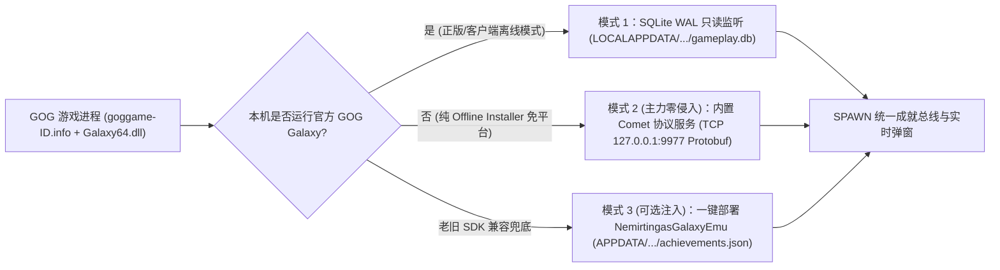
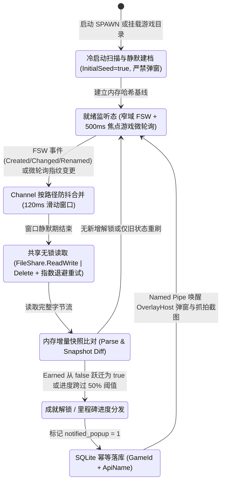
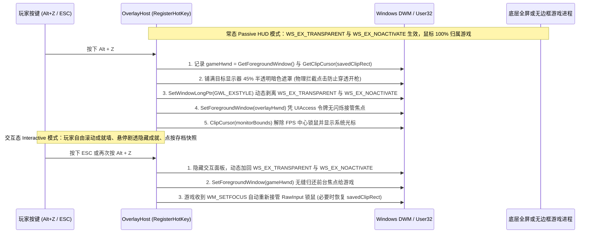
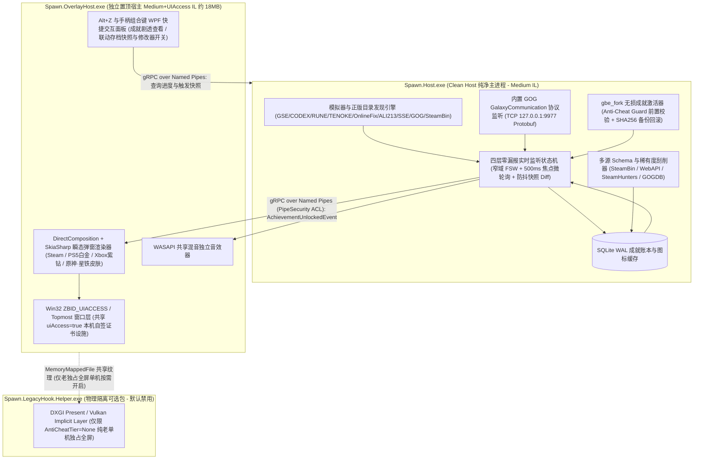

# 04 — 全渠道离线/正版成就引擎与游戏内 Overlay 深度技术调研报告

> **所属模块**：`Achievement & In-Game Overlay`（SPAWN 核心极客模块之四）
> **技术栈约束**：Windows 10/11 纯原生 C#（.NET 8/9），拒绝 WebView2 / Electron 前端套壳，严格遵循 **Anti-Cheat Guard 主从进程物理隔离** 红线。
> **核心目标**：打通 **Steamrip / 学习版全流派模拟器、GOG 离线安装包、Steam / Epic / Xbox 正版平台** 的统一成就感知、零配置中文元数据（含隐藏成就真相与全球稀有度）刮削、毫秒级多主题仪式感弹窗（Steam / PS5 白金 / Xbox 紫钻 / 原神·星铁定制皮肤）以及 `Alt + Z` 游戏内可交互快捷面板。

---

## 目录

1. [标杆开源项目源码级架构剖析](#1-标杆开源项目源码级架构剖析)
2. [免平台离线游戏与全渠道成就底层原理解析](#2-免平台离线游戏与全渠道成就底层原理解析)
   - [2.1 全流派 Steam 模拟器存储路径、格式与判定规则全表](#21-全流派-steam-模拟器存储路径格式与判定规则全表)
   - [2.2 重点二进制与异构文本格式逐字节/逐字段拆解](#22-重点二进制与异构文本格式逐字节逐字段拆解)
   - [2.3 GOG 离线安装包（Offline Installer）成就黑洞与双模捕获方案](#23-gog-离线安装包offline-installer成就黑洞与双模捕获方案)
   - [2.4 正版平台（Steam / Epic / Xbox）统一聚合读取方案](#24-正版平台steam--epic--xbox统一聚合读取方案)
   - [2.5 零漏报实时监听状态机设计（FSW + 防抖 + 焦点微轮询 + 快照 Diff）](#25-零漏报实时监听状态机设计fsw--防抖--焦点微轮询--快照-diff)
   - [2.6 极客辅助杀手锏：一键无损注入/升级 `gbe_fork` 成就引擎（Achievement Enabler）](#26-极客辅助杀手锏一键无损注入升级-gbe_fork-成就引擎achievement-enabler)
3. [离线成就元数据（Schema）抓取与小圈子免配置方案](#3-离线成就元数据schema抓取与小圈子免配置方案)
   - [3.1 免平台游戏 AppID 四级自动反查链](#31-免平台游戏-appid-四级自动反查链)
   - [3.2 多源 Schema 瀑布流与“隐藏成就描述被剥离”破局方案](#32-多源-schema-瀑布流与隐藏成就描述被剥离破局方案)
   - [3.3 SQLite 核心表结构与本地灰/彩图标缓存规范](#33-sqlite-核心表结构与本地灰彩图标缓存规范)
4. [游戏内实时成就弹窗 & In-Game Overlay 深度技术方案](#4-游戏内实时成就弹窗--in-game-overlay-深度技术方案)
   - [4.1 多主题视觉动效与低延迟独立音轨设计](#41-多主题视觉动效与低延迟独立音轨设计)
   - [4.2 Windows 显示合成器（DWM）全屏渲染路径底层差异](#42-windows-显示合成器dwm全屏渲染路径底层差异)
   - [4.3 免注入主力安全方案：Win32 无焦点穿透窗口 + `UIAccess=true` (`ZBID_UIACCESS`) 核武器](#43-免注入主力安全方案win32-无焦点穿透窗口--uiaccesstrue-zbid_uiaccess-核武器)
   - [4.4 Windows 原生 Toast Notification vs 自绘 DirectComposition 硬件加速置顶窗对比](#44-windows-原生-toast-notification-vs-自绘-directcomposition-硬件加速置顶窗对比)
   - [4.5 可选图形 Hook 注入方案（DXGI Present / Vulkan Layer / RTSS OSD）与反作弊熔断边界](#45-可选图形-hook-注入方案dxgi-present--vulkan-layer--rtss-osd与反作弊熔断边界)
   - [4.6 `Alt + Z` 可交互游戏内快捷面板（In-Game Overlay）无缝焦点与鼠标接管状态机](#46-alt--z-可交互游戏内快捷面板in-game-overlay无缝焦点与鼠标接管状态机)
5. [C# 工程选型清单、进程隔离拓扑与核心接口草图](#5-c-工程选型清单进程隔离拓扑与核心接口草图)

---

## 1. 标杆开源项目源码级架构剖析

在设计 SPAWN 成就子系统前，我们对社区最核心的六大标杆开源项目进行了源码级复盘，提炼其规则库并规避其历史缺陷：

| 开源项目 | 仓库链接 | 技术栈 | 核心源码模块与工程价值提炼 | 历史局限与 SPAWN 改进方向 |
| :--- | :--- | :--- | :--- | :--- |
| **Achievement Watcher** | [`xan105/Achievement-Watcher`](https://github.com/xan105/Achievement-Watcher) | Electron / Node.js | 离线成就监控开山鼻祖。`app/parser/userDir.js` 确立了 `.ini` 向上回溯目录寻址规则；`sse.js` 逆向了 SmartSteamEmu 24 字节定长 CRC32 记录；`greenluma.js` 梳理了 `GLR`/`GL2020` 注册表键值结构。 | 主仓停留在 `1.x` 归档状态；未原生适配新版 `gbe_fork` 默认的 `GSE Saves` 目录及 TENOKE/新版 OnlineFix 格式；Electron 常驻内存重，依赖 Windows 原生 Toast 或外部 PowerShell 弹窗易被游戏模式屏蔽。 |
| **Achievements (AW 现代演进同类标杆)** | [`PSerban93/Achievements`](https://github.com/PSerban93/Achievements) | Electron + Rust Native 工具链 | `utils/steam-appcache.js` 实现了极其严谨的 Steam 本地二进制 VDF (`UserGameStatsSchema_*.bin` / `UserGameStats_*.bin`) 解析器；`utils/gog-galaxy-local.js` 实现了对 GOG `galaxy-2.0.db` 与 `gameplay.db` (WAL) 的稳定性轮询；内置 `achievement-enabler`。 | 仍采用 Electron 渲染层，前端 DOM 动画在高刷游戏下开销高于原生 DirectComposition。SPAWN 将其解析逻辑 100% 纯 C# 原生化。 |
| **Goldberg Steam Emu Fork (`gbe_fork`)** | [`Detanup01/gbe_fork`](https://github.com/Detanup01/gbe_fork) & [`gbe_fork_tools`](https://github.com/Detanup01/gbe_fork_tools) | C++ / Python | 当代最活跃的开源 `steam_api(64).dll` 模拟器替代品。将旧版默认目录迁移至 `%APPDATA%\GSE Saves`，引入模块化 `steam_settings\configs.user.ini`；配套 `generate_emu_config` 工具支持直接从 Steam CM 节点拉取全套 Schema 与图标。 | 自带实验性 ImGui Overlay 需侵入游戏渲染管线且审美简陋。SPAWN 将其作为标准离线成就底座，接管外置高颜值 Overlay 渲染。 |
| **Playnite SuccessStory (主仓及模拟器增强分支)** | [`Lacro59/playnite-successstory-plugin`](https://github.com/Lacro59/playnite-successstory-plugin) / [`eFMann/playnite-successstory-plugin`](https://github.com/eFMann/playnite-successstory-plugin) | C# / WPF | *(注：社区常误传作者名，Playnite `SuccessStory` 官方主仓为 `Lacro59`，而支持全流派本地模拟器的著名社区分支为 `eFMann`)*。`source/Clients/SteamEmulators.cs` 与 `Gog/Epic/XboxAchievements.cs` 提供了完整的 C# 多格式文件解析与多平台 OAuth 聚合范本。 | 仅作为 Playnite 静态统计插件，只在游戏退出后同步列表，**缺乏游戏运行中毫秒级监听与全屏实时弹窗能力**。 |
| **SamRewritten / SAM** | [`PaulCombal/SamRewritten`](https://github.com/PaulCombal/SamRewritten) / [`gibbed/SteamAchievementManager`](https://github.com/gibbed/SteamAchievementManager) | C++ (GTK) / C# | 通过设置环境变量 `SteamAppId` 并调用 `SteamAPI_Init()` 连接本地正在运行的 `steamclient64.dll` 命名管道，使用 `ISteamUserStats` 读写正版成就与统计值。 | 调用 `SteamAPI_Init()` 会让 Steam 将管理端识别为“正在运行该游戏”，若同时运行受 EAC/BattlEye/VAC 保护的游戏存在冲突与风控隐患。**SPAWN 对正版 Steam 监控优先采用零句柄侵入的 `appcache/stats/*.bin` 只读解析**，仅将 SAM 式解锁器置于独立手动工具进程中。 |
| **Comet & NemirtingasGalaxyEmu** | [`imLinguin/comet`](https://github.com/imLinguin/comet) / [`Yepoleb/NemirtingasGalaxyEmu`](https://github.com/Yepoleb/NemirtingasGalaxyEmu) | Rust / C++ | `comet`（被 Heroic Launcher 采用）逆向实现了 GOG 官方 `GalaxyCommunication` 本地 TCP `9977` 端口 Protobuf 通信协议；`NemirtingasGalaxyEmu` 则实现了免客户端的 `Galaxy64.dll` 替换包装器。 | 两者均未在 Windows 桌面端提供开箱即用的离线弹窗闭环。SPAWN 结合二者优势彻底攻克 GOG 离线安装包成就黑洞。 |

---

## 2. 免平台离线游戏与全渠道成就底层原理解析

免平台离线游戏（如 Steamrip 直装包、各 Scene 组镜像、在线联机补丁版）在移除 Steam DRM 后，游戏主程序依然会正常调用 `steam_api.dll` / `steam_api64.dll` 导出的 `ISteamUserStats::SetAchievement(const char *pchName)` 与 `StoreStats()` 接口。各流派补丁本质上是**替换了 `steam_api(64).dll`**，将原本发往 Steam 客户端 IPC 管道的调用重定向到本地磁盘的 JSON、INI、二进制文件或注册表中。

### 2.1 全流派 Steam 模拟器存储路径、格式与判定规则全表

以下路径、文件名与判定字段均经由 `xan105/Achievement-Watcher` (`userDir.js`/`steam.js`/`sse.js`/`greenluma.js`)、`eFMann/playnite-successstory-plugin` (`SteamEmulators.cs`) 及 `Detanup01/gbe_fork` 源码交叉核验确认：

| 模拟器 / 补丁流派 | 识别特征文件（通常位于 `steam_api(64).dll` 同级） | 默认成就存储精确路径（Windows 环境变量展开前） | 存储格式 | 解锁判定字段与时间戳结构 | 关键坑点与特例说明 |
| :--- | :--- | :--- | :--- | :--- | :--- |
| **Goldberg Emu (原版 Mr_Goldberg)** | `steam_settings\steam_appid.txt` | `%APPDATA%\Goldberg SteamEmu Saves\<AppID>\achievements.json` | UTF-8 JSON (Object) | 键为 `API_Name`，对象内 `"earned": true`（布尔），`"earned_time": 1710000000`（Unix 秒级整型） | 进度型成就含 `"progress"` 与 `"max_progress"` 数值字段；支持 `local_save.txt` 重定向至游戏本地目录。 |
| **`Detanup01/gbe_fork` (现代主流)** | `steam_settings\configs.user.ini` | `%APPDATA%\GSE Saves\<AppID>\achievements.json` | UTF-8 JSON (Object) | 同原版 Goldberg：`"earned": true` 且 `"earned_time" > 0` | **重大目录变化**：默认根目录由 `Goldberg SteamEmu Saves` 改为 **`GSE Saves`**！且可在游戏本地 `steam_settings\configs.user.ini` 的 `[user::saves]` 下通过 `saves_folder_name=...` 自定义根目录名，扫描器必须优先解析该 INI。 |
| **EMPRESS** | 基于 Goldberg 魔改 DLL | 1. `%PUBLIC%\Documents\EMPRESS\<AppID>\remote\<AppID>\achievements.json`<br>2. `%APPDATA%\EMPRESS\<AppID>\remote\<AppID>\achievements.json` | UTF-8 JSON (Object) | 同 Goldberg：`"earned": true`，`"earned_time": <uint64>` | 注意路径中多一层嵌套的 **`\remote\<AppID>\`**；部分游戏（如《极限竞速：地平线4》）JSON Key 带额外单引号转义，解析时需清洗。 |
| **CODEX / PLAZA** | `steam_emu.ini` | 1. `%PUBLIC%\Documents\Steam\CODEX\<AppID>\achievements.ini`<br>2. `%APPDATA%\Steam\CODEX\<AppID>\achievements.ini` | INI 文本 | `[<API_Name>]` 节下：`Achieved=1`（解锁）或 `0`，`CurProgress=0`，`MaxProgress=0`，`UnlockTime=1526071671` | 文件末尾带有 `[SteamAchievements]` 汇总索引节（含 `00000=ACH_X` 与 `Count=N`），解析时必须加入黑名单过滤，避免把 `[SteamAchievements]` 误判为成就项。 |
| **RUNE** | `steam_emu.ini` | 1. `%PUBLIC%\Documents\Steam\RUNE\<AppID>\achievements.ini`<br>2. `%APPDATA%\Steam\RUNE\<AppID>\achievements.ini` | INI 文本 | 与 CODEX 完全同构：`[<API_Name>]` 节下 `Achieved=1` 且 `UnlockTime=<unix_sec>` | 作为 CODEX 继任组，沿用了完全一致的 INI 状态机，同目录常伴生 `stats.ini`。 |
| **TENOKE** | `tenoke.ini` | `<GameExeDir>\SteamData\user_stats.ini`（少数重打包映射至 `%PUBLIC%\Documents\Steam\TENOKE\<AppID>\user_stats.ini`） | 类 TOML 混合 INI | `[ACHIEVEMENTS]` 节下键值：<br>• 新版：`"<API_Name>" = {unlocked = true, time = 1710000000}`<br>• 旧版：`<API_Name> = 1` 或 `true` | 文件通常生成在游戏本地 `SteamData\` 子目录而非 `%APPDATA%`；旧版无 `time` 字段时，由 SPAWN 监听引擎以捕获时刻 `DateTimeOffset.UtcNow` 补全落库。 |
| **Online-Fix (`online-fix.me`)** | `OnlineFix.ini`、`OnlineFix64.dll` | `%PUBLIC%\Documents\OnlineFix\<AppID>\Stats\Achievements.ini`（伴生 `Stats.ini`） | INI 文本 | `[<API_Name>]` 节下：`achieved=true`（**全小写布尔文本**），`timestamp=1710000000` | 联机补丁常借用 `AppID=480` (Spacewar) 转发大厅，但其 `OnlineFix\<RealAppID>\` 目录使用的是游戏真实 AppID（可从 `OnlineFix.ini` 的 `RealAppId` 核对）。 |
| **ALI213（游侠）** | `ALI213.ini` / `valve.ini` / `SteamConfig.ini` | 由 INI `[Settings]` 中 `SaveType` 与 `PlayerName`（常为 `VALVE` 或 `ALI213`）决定：<br>• `SaveType=0`：`<GameRoot>\Profile\<PlayerName>\Stats\Achievements.Bin`<br>• `SaveType=1`：`%USERPROFILE%\Documents\VALVE\<AppID>\<PlayerName>\Stats\Achievements.Bin`<br>• 未设 `SaveType`：`<GameRoot>\Profile\Stats\Achievements.Bin` | **伪装成 `.Bin` 的纯文本 INI** | `[<API_Name>]` 节下：`HaveAchieved=1`，`HaveAchievedTime=1710000000` | **经典反直觉坑**：`Achievements.Bin` 并非二进制文件，而是标准 ASCII/UTF-8 INI 文本！未解锁项常见 `HaveAchievedTime=0000000000`，且需跳过 `[Steam]` 节。 |
| **3DM (`3DMGAME`)** | `3DMGAME.ini` | `<GameRoot>\3DMGAME\<PlayerName>\stats\achievements.ini` 或 `%ProgramData%\Steam\<PlayerName>\<AppID>\stats\achievements.ini` | 双节映射 INI | `[State]` 节：`<API_Name>=0101`（表示已解锁）；<br>`[Time]` 节：`<API_Name>=<8位Hex字符串>` | `[Time]` 中的 8 位十六进制字符串是 **小端序（Little-Endian）`UInt32` Unix 时间戳**（例如 `7719F65A` 需按字节反转或 `Convert.FromHexString` 后 `BinaryPrimitives.ReadUInt32LittleEndian`）。 |
| **Reloaded (`RLD!`)** | `steam_api.ini` (`RLD!`) | `%ProgramData%\Steam\<PlayerName>\<AppID>\stats\achievements.ini`（默认 `PlayerName=RLD!`） | Hex 编码 INI | `[<API_Name>]` 节下：`State = 01000000`（非全 0 即解锁），`Time = <Hex LE UInt32>`，`CurProgress = <Hex LE UInt32>` | 需过滤 `[Steam]` 头节，所有数值均为 Hex 字节串小端序编码。 |
| **SKIDROW / Hoodlum / DARKSiDERS** | `steam_api.ini` / `hlm.ini` / `ds.ini` | 由 `[GameSettings]` `UserDataFolder` 决定：<br>• `.`：`<GameRoot>\SteamEmu\UserStats\achiev.ini`（或 `stats.ini`）<br>• `mydocs`：`%USERPROFILE%\Documents\<UserName>\<AppID>\SteamEmu\UserStats\achiev.ini`<br>• 独立目录变体：`%USERPROFILE%\Documents\SKIDROW\<AppID>\SteamEmu\UserStats\achiev.ini` 或 `%LOCALAPPDATA%\SKIDROW\<AppID>\` | 双节分离 INI | `[Achievements]` 节：`<API_Name>=1`；<br>`[AchievementsUnlockTimes]` 节：`<API_Name>=1710000000` | 2019 年前早期 Hoodlum 曾短暂混用类 ALI213 结构（`<GameRoot>\Profile\VALVE\Stats`），需按 `userDir.js` 降级回退链兼容。 |
| **FLT (Fairlight)** | `flt.ini` | `%APPDATA%\FLT\<AppID>\`（仅含 `steam_id.txt` 等基础标识） | **默认不落盘成就** | **原生不支持持久化成就解锁记录** | **高频痛点**：FLT 模拟器对 `SetAchievement` 仅做空桩返回 `true` 而不写盘。SPAWN 扫描到 FLT 游戏时，应主动提示使用 **[2.6 节 一键无损注入 `gbe_fork`]** 激活成就系统！ |
| **SmartSteamEmu (SSE)** | `SmartSteamEmu.ini` | `%APPDATA%\SmartSteamEmu\<AppID>\stats.bin` | **紧凑二进制** | 4B Header + N × 24B 定长块（详见 2.2 节逐字节拆解） | 文件中**不存明文 `API_Name`**，仅存 `API_Name` 的 4 字节 CRC32 校验和！必须加载游戏 Schema 预建 CRC32 反向映射表后方可解析。 |
| **GreenLuma (GLR / GL2020 / 2024+)** | 注入官方 Steam 进程 | Windows 注册表：<br>• `HKCU\SOFTWARE\GLR\AppID\<AppID>\Achievements`<br>• `HKCU\SOFTWARE\GL2020\AppID\<AppID>\Achievements` | Windows Registry (`REG_DWORD`) | 父键 `SkipStatsAndAchievements == 0` 时生效；子键内：`<API_Name> = 1` (`DWORD`)，`<API_Name>_Time = 1710000000` (`DWORD`) | 借壳正版 Steam 客户端但无服务端 License 时，Steam 云端拒绝同步成就，GreenLuma 会将其拦截写入注册表或本地 `appcache`。 |
| **CreamAPI / SmokeAPI** | `cream_api.ini` / `SmokeAPI.config.json` | 1. 正版本体 + DLC 解锁：直接写入正版 Steam `appcache\stats\UserGameStats_*.bin`<br>2. 独立本地模式：`%APPDATA%\CreamAPI\<AppID>\stats\CreamAPI.Achievements.cfg` | Binary VDF 或 INI | 本地 `.cfg` 为 `[<API_Name>]` 下 `achieved=true`、`unlocktime=...` | 旧版 CreamAPI 本地 `.cfg` 存在 `unlocktime` 仅 7 位数的截断 Bug（需判长 `* 1000` 修正）；`acidicoala/SmokeAPI` 纯代理 DLC 校验，成就 100% 走正版 Steam 通道。 |

---

### 2.2 重点二进制与异构文本格式逐字节/逐字段拆解

为确保 C# 解析器零误差，以下列出三种最易踩坑格式的精确结构规范：

#### (1) SmartSteamEmu `stats.bin` 二进制内存布局（Little-Endian）
经 `xan105/Achievement-Watcher/app/parser/sse.js` 与 `SuccessStory/SteamEmulators.cs` 双重验证，`stats.bin` 并非 24 字节文件头，而是 **4 字节文件头 + N 个 24 字节记录块**（总文件长度必满足 `(FileLength - 4) % 24 == 0`）：

```text
Offset (Hex) | Size | Type    | Field Name       | 说明与判定逻辑
-------------+------+---------+------------------+---------------------------------------------------------
0x00         | 4 B  | Int32LE | EntryCount       | 记录块总数 N；校验：( stream.Length - 4 ) / 24 == EntryCount
-------------+------+---------+------------------+---------------------------------------------------------
[Record i: 起始偏移 = 4 + i * 24, 共 24 Bytes]
+0x00 (0..3) | 4 B  | UInt32LE| ApiNameCrc32     | ASCII 编码 API_Name 的标准 IEEE 802.3 CRC32 值
+0x04 (4..7) | 4 B  | UInt32LE| Reserved / Type  | 内部保留/条目分类标志
+0x08 (8..11)| 4 B  | Int32LE | UnlockTime       | Unix 秒级解锁时间戳（UTC）
+0x0C(12..19)| 8 B  | Byte[8] | Padding / Extra  | 附加统计区
+0x14(20..23)| 4 B  | Int32LE | Value            | 0 = 未解锁成就；1 = 已解锁成就；> 1 = 普通累加型 Stat（解析成就时跳过！）
```

> **C# 高性能反查策略**：利用 `System.IO.Hashing.Crc32`（.NET 官方高性能包），在加载游戏 Schema 时一次性对所有成就 `api_name`（同时计算原始大小写与 `.ToUpperInvariant()` / `.ToLowerInvariant()` 兜底）生成 `Dictionary<uint, string> crcToApiName`，再用 `MemoryMarshal.Cast<byte, SseStatEntry>(span[4..])` 零拷贝读取全部记录。

#### (2) `gbe_fork` 运行时状态 vs 定义配置双 `achievements.json` 区分
极易混淆的是，`gbe_fork` 体系中存在两个同名但结构截然不同的 `achievements.json`：
- **配置定义文件（Schema，只读输入）**：`<GameDir>\steam_settings\achievements.json`，顶层为 **JSON Array**，定义内部名、多语言显示名、图标相对路径：
  ```json
  [
    {
      "name": "ACH_FIRST_BLOOD",
      "displayName": { "english": "First Blood", "schinese": "第一滴血" },
      "description": { "english": "Defeat your first enemy.", "schinese": "击败你的第一个敌人。" },
      "hidden": "0",
      "icon": "img/ach_01.jpg",
      "icon_gray": "img/ach_01_gray.jpg"
    }
  ]
  ```
- **运行时存档状态（Save State，实时监控目标）**：`%APPDATA%\GSE Saves\<AppID>\achievements.json`，顶层为 **JSON Object**，以 `name` 为键：
  ```json
  {
    "ACH_FIRST_BLOOD": {
      "earned": true,
      "earned_time": 1715084210
    },
    "ACH_COLLECTOR_50": {
      "earned": false,
      "earned_time": 0,
      "progress": 26,
      "max_progress": 50
    }
  }
  ```

---

### 2.3 GOG 离线安装包（Offline Installer）成就黑洞与双模捕获方案

#### 底层痛点还原：未装 GOG Galaxy 时成就去哪了？
当玩家使用 **GOG Offline Installer**（`setup_xxx.exe`）安装游戏且机器上**未安装或未运行 GOG Galaxy 客户端**时：
1. 游戏根目录必定生成一份元数据清单 **`goggame-<gameId>.info`**（JSON 格式，包含 `"gameId"`、`"clientId"`、`"name"` 与 `"playTasks"` 启动项），游戏进程旁附带官方 SDK 动态库 **`Galaxy64.dll`**（或 32 位 `Galaxy.dll`）。
2. 游戏启动调用 `galaxy::api::Init({ clientID, clientSecret })` 时，`Galaxy64.dll` 会在后台尝试通过 **本地回环 TCP Socket `127.0.0.1:9977`** 连接 GOG 官方后台守护进程 `GalaxyCommunication.exe`，使用 **Protocol Buffers (Protobuf)** 交换认证令牌与统计数据。
3. **黑洞真相**：若未安装 GOG Galaxy，`127.0.0.1:9977` 无人监听，`Galaxy64.dll` 握手超时失败，所有后续 `Stats()->SetAchievement("ACH_ID")` 与 `StoreStatsAndAchievements()` 调用在 SDK 内部直接短路丢弃——**磁盘上不会产生任何成就文件！** 此外，部分采用 `ghost_api64.dll` 包装层的 GOG 游戏（如《四海兄弟：最终版》《古墓丽影：崛起》）还会检查注册表 `HKLM\SOFTWARE\WOW6432Node\GOG.com\GalaxyClient`，缺失时甚至会引发异常或彻底跳过成就初始化。

#### SPAWN 针对 GOG 游戏的“三态全覆盖”技术方案



1. **模式 1（已装 GOG Galaxy 客户端，含客户端离线模式）**：
   - 官方客户端会将每个游戏的成就定义与解锁时间落盘在本地 SQLite 数据库：
     - 全局库：`%ProgramData%\GOG.com\Galaxy\storage\galaxy-2.0.db`
     - 单游戏实时库：`%LOCALAPPDATA%\GOG.com\Galaxy\Applications\<clientId>\Storage\Shared\Files\gameplay\<userId>\gameplay.db`（开启了 SQLite WAL 模式，伴生 `gameplay.db-wal` 与 `gameplay.db-shm`）。
   - SPAWN 使用 `Microsoft.Data.Sqlite` 以 `Mode=ReadOnly;Cache=Shared` 打开 `gameplay.db`，监听 `.db-wal` 文件变更，读取 `achievements` 表的 `key`、`name`、`description`、`unlock_time`（ISO 8601 字符串）、`rarity` 与图标 URL。
2. **模式 2（主力零文件侵入方案：内置类 `imLinguin/comet` 的 `GalaxyCommunication` 本地协议守护服务）**：
   - **核心原理**：参考 Heroic Games Launcher 所集成的开源项目 [`imLinguin/comet`](https://github.com/imLinguin/comet)，GOG 官方原版 `Galaxy64.dll` 并没有复杂的二进制反篡改校验，只要本地 `127.0.0.1:9977` 存在符合 Galaxy Communication Service Protobuf 握手协议的服务端，原版 `Galaxy64.dll` 就会认为官方客户端在线，主动将 `SetAchievement` / `StoreStatsAndAchievements` 报文推送过来！
   - **C# 落地实现**：
     - SPAWN 启动免平台 GOG 游戏前，自动扫描 `<GameRoot>\goggame-*.info` 提取 `gameId` 与 `clientId`，并确保注册表兼容项存在；
     - 若检测到 `127.0.0.1:9977` 空闲（官方 Galaxy 未运行），SPAWN 直接启动内置轻量 C# Protobuf Socket Listener（或直接调度内嵌编译好的 `comet.exe` 离线/Webhook 子进程并配置事件回调至 SPAWN 命名管道）；
     - **极大优势**：**完全不修改、不替换游戏目录任何 DLL 文件**，100% 保持 GOG Offline Installer 原始纯净校验和，解锁延迟 `< 5ms`！
3. **模式 3（兼容兜底方案：集成 `Yepoleb/NemirtingasGalaxyEmu` 一键包装器）**：
   - 对于极早期不使用 `9977` 端口通信的老版 `Galaxy.dll` 游戏，SPAWN 提供与 `gbe_fork` 类似的无损代理选项：备份原 `Galaxy64.dll` 为 `Galaxy64.dll.spawn.bak`，放入开源 [`Yepoleb/NemirtingasGalaxyEmu`](https://github.com/Yepoleb/NemirtingasGalaxyEmu) 的 `Galaxy64.dll`，自动生成 `ngalaxye_settings\NemirtingasGalaxyEmu.json`（填入从 `.info` 解析的 `product_id` 与 `client_id`），并实时监听 `%APPDATA%\NemirtingasGalaxyEmu\` 下输出的 `achievements.json`（字段 `"earned": true, "earned_time": ...`）。

---

### 2.4 正版平台（Steam / Epic / Xbox）统一聚合读取方案

SPAWN 作为全能游戏中心，同样需要对正版渠道提供统一成就墙展示与自定义皮肤弹窗覆盖（例如玩家嫌弃 Steam 默认弹窗，想在正版 Steam 游戏里使用 PS5 白金奖杯或原神皮肤弹窗）：

#### (1) 正版 Steam：纯本地 `UserGameStats_*.bin` 毫秒级二进制监控 vs Web API
- **为什么首选本地 `.bin` 监控而非 Steamworks API / Web API？**
  - Steam Web API (`ISteamUserStats/GetPlayerAchievements/v1`) 存在云同步延迟（很多游戏退出时才同步或有数十秒缓存），且要求玩家 Steam 个人资料“游戏详情”设为公开；
  - `SamRewritten` 式的 `SteamAPI_Init()` IPC 挂接在强反作弊正版游戏（如 Apex、艾尔登法环 EAC）运行时属于敏感操作；
  - **最优解**：正版 Steam 客户端每当游戏触发 `SetAchievement` + `StoreStats` 时，会**立即在毫秒级内**刷新本地磁盘文件：`<SteamInstallPath>\appcache\stats\UserGameStats_<SteamAccountId32>_<AppID>.bin`（其中 `SteamAccountId32 = SteamID64 - 76561197960265728`），而成就位映射表则保存在同目录 `UserGameStatsSchema_<AppID>.bin` 中！
- **Binary VDF (Valve KeyValues) 精确字节流解析规范**（基于 `PSerban93/Achievements/utils/steam-appcache.js` 实证）：
  - 类型标记字节（1 Byte）：
    - `0x00`：嵌套字典对象开始（后接 UTF-8 `\0` 结尾的 Key 名，内部递归读取子节点直至遇到 `0x08`）
    - `0x01`：UTF-8 字符串（`\0` 结尾 Key + `\0` 结尾 Value）
    - `0x02`：`Int32LE`（`\0` 结尾 Key + 4 字节小端整数；用于成就位掩码 `data` 与时间戳！）
    - `0x03`：`FloatLE`（`\0` 结尾 Key + 4 字节小端单精度浮点数；用于浮点型进度条统计！）
    - `0x07`：`UInt64LE`（`\0` 结尾 Key + 8 字节无符号整数）
    - `0x08`：当前字典层级结束标记（无后续 Key）
  - **位掩码（Bitmask）与解锁时间映射算法**：
    1. 从 `UserGameStatsSchema_<AppID>.bin` 的 `stats -> <statId> -> bits -> <bitIndex>` 节点提取每个成就的元组 `(ApiName, StatId, BitIndex)`（每个 `StatId` 块最多承载 0..31 共 32 个成就位）；
    2. 从 `UserGameStats_<AccountId32>_<AppID>.bin` 读取对应 `<statId>` 节点下的 `int32 data`（强转为 `uint dataU32`）及子节点 `AchievementTimes`；
    3. **解锁判定**：`bool isEarned = ((dataU32 >> BitIndex) & 1U) == 1U;`
    4. **解锁时间**：若 `isEarned == true`，读取 `AchievementTimes[BitIndex.ToString()]` 即为精确的 `Int32` Unix 时间戳！

#### (2) Epic Games Store (EOS)
- **公开成就定义（免登录）**：`GET https://api.epicgames.dev/epic/achievements/v1/public/achievements/product/{sandboxId_or_productId}/locale/zh-CN`，直接返回完整标题、解锁/未解锁描述、图标 URL 及稀有度 XP 权重。
- **玩家解锁进度**：
  - 方案 A（OAuth Web 聚合）：复用用户在 SPAWN 绑定的 Epic OAuth Token（或从 Heroic / Legendary 本地 `auth.json` 导入），请求 EOS Player Achievements 接口同步历史进度；
  - 方案 B（本地缓存监听）：监听 `%LOCALAPPDATA%\EpicGamesLauncher\Saved\` 日志与 EOS Overlay 本地缓存变更实现近实时刷新。

#### (3) Xbox / PC Game Pass (XGP / GDK)
- **Xbox Live V2 REST 契约**（参考 `SuccessStory/XboxAchievements.cs`）：
  - 用户通过微软 OAuth2 授权一次获取 `XSTS Token` 与 `uhs`（User Hash）及 64 位 `xuid`；
  - 请求：`GET https://achievements.xboxlive.com/users/xuid({xuid})/achievements?titleId={titleId}&maxItems=1000`
  - 必填 Header：`Authorization: XBL3.0 x={uhs};{xstsToken}`、`x-xbl-contract-version: 2`、`Accept-Language: zh-CN`；
  - 针对 Xbox 360 向下兼容老游戏，回退至 `x-xbl-contract-version: 1` 接口；返回的 `rarity.currentPercentage` 原生自带精确全球稀有度百分比（用于激活 SPAWN 的 **Xbox 稀有紫钻动效**）。

---

### 2.5 零漏报实时监听状态机设计（FSW + 防抖 + 焦点微轮询 + 快照 Diff）

#### 为什么单纯用 C# `FileSystemWatcher` 必然掉坑？
在 Windows 桌面工程实践中，直接裸用 `new FileSystemWatcher()` 监听成就文件会遭遇**四大经典故障**：
1. **原子替换漏事件（Atomic Rename Blindness）**：`gbe_fork` 与众多现代模拟器为防止断电损坏存档，写盘时采用 **“先写 `achievements.json.tmp` -> 调用 `MoveFileEx` / `ReplaceFile` 原子覆盖 `achievements.json`”**。若仅监听 `NotifyFilters.LastWrite` 的 `Changed` 事件，极易漏掉 `Renamed` / `Created` 事件！
2. **文件独占写锁异常（`IOException: ERROR_SHARING_VIOLATION`）**：`FSW` 内核回调在游戏调用 `CreateFile` 写入尚未 `CloseHandle` 的微秒级瞬间即触发。此时 C# 若直接调用 `File.ReadAllText()`（内部 `FileShare.Read`），若游戏句柄未开共享写或正在刷盘，将立刻抛出 `0x80070020` 占用异常导致本次解锁丢失，甚至读到截断的半截 JSON（`JsonException`）！
3. **单次保存事件风暴（Event Storm）**：一次 `WriteFile` + `FlushFileBuffers` + `CloseHandle` 在 NTFS 上会连续触发 3~6 次 `Changed` 通知。
4. **缓冲区溢出与软链接盲区**：若递归监听整个 `%APPDATA%` 或大容量游戏盘，`FSW` 默认 8KB 非分页内存缓冲池极易溢出（`InternalBufferOverflowException`），且对目录 Junction / 符号链接（与 `02` 号模块 Mod/存档软链接强相关！）穿透行为不稳定。

#### SPAWN 四层混合零漏报监听状态机架构



**四大核心工程保障细节**：
1. **窄域挂载 + 缓冲扩容**：绝不全盘挂载 `FSW`！仅对已存在的全局模拟器根目录（如 `%APPDATA%\GSE Saves`、`%PUBLIC%\Documents\Steam\CODEX`、`%PUBLIC%\Documents\Steam\RUNE`、`%PUBLIC%\Documents\OnlineFix`、`Steam\appcache\stats`）及**当前由 SPAWN 启动的活跃游戏本地目录**建立监听，`InternalBufferSize` 显式设为 `65536` (64KB)。
2. **焦点游戏进程微轮询（Active Game Focused Micro-Poller）**：当 SPAWN 的进程追踪器（`02` 号模块）感知到某款游戏 `PID` 正在运行时，针对该游戏绑定的 1~2 个精确成就文件路径启动 `PeriodicTimer(TimeSpan.FromMilliseconds(500))`，调用底层 `Win32 GetFileAttributesExW` 比对 `(LastWriteTime, FileSize)` 结构体。**零文件内容 IO、CPU 占用 `< 0.01%`**，哪怕玩家使用了复杂的软链接盘、RAMDisk 或网络映射盘导致 `FSW` 失效，也能在 500ms 内 100% 兜底捕获！
3. **无锁安全读取与半截写入自愈（Resilient Shared Reader）**：
   ```csharp
   public static async ValueTask<byte[]?> ReadSharedWithRetryAsync(string path, CancellationToken ct)
   {
       int[] delaysMs = [25, 60, 120, 250];
       for (int attempt = 0; attempt <= delaysMs.Length; attempt++)
       {
           try
           {
               using var fs = new FileStream(
                   path, FileMode.Open, FileAccess.Read,
                   FileShare.ReadWrite | FileShare.Delete, bufferSize: 4096, useAsync: true);
               if (fs.Length == 0) return Array.Empty<byte>();
               var buffer = new byte[fs.Length];
               await fs.ReadExactlyAsync(buffer, ct);
               return buffer;
           }
           catch (IOException) when (attempt < delaysMs.Length)
           {
               await Task.Delay(delaysMs[attempt], ct);
           }
       }
       return null;
   }
   ```
   若上层 JSON/VDF 解析器抛出格式残缺异常（游戏正写到一半尚未刷完磁盘），状态机自动标记为 `RetryPending`，200ms 后重读一次，彻底杜绝因并发写导致的漏报。
4. **冷启动静默建档 vs 热会话增量 Diff**：首次扫描到的所有已解锁成就一律标记为 `Seeded` 写入 SQLite 而不触发弹窗；仅当某 `ApiName` 从未解锁跃迁为已解锁（且不在内存 `UnlockedSet` 与 SQLite 历史表中）时，才生成 `AchievementUnlockedEvent`；对于支持 `progress / max_progress` 的模拟器（`gbe_fork`、CODEX、Steam `.bin`），当进度首次跨过 `50%` 或用户配置的里程碑时，触发轻量级**左下角/右下角进度条微提示**（复刻 Steam 新版成就进度通知体验！）。

---

### 2.6 极客辅助杀手锏：一键无损注入/升级 `gbe_fork` 成就引擎（Achievement Enabler）

#### 真实痛点场景
许多 Steamrip 游戏内置的是 **FLT 补丁**（根本不记录成就）、**十年前古早 3DM/SKIDROW 补丁**（无进度或编码混乱），或是内置了 `gbe_fork` / 原版 Goldberg 却**漏放了 `steam_settings\achievements.json`**（导致模拟器虽然跑通了游戏，但 `ISteamUserStats::GetAchievement` 查不到有效定义列表，直接拒绝向 `%APPDATA%\GSE Saves\<AppID>\achievements.json` 写入任何记录！）。

#### SPAWN “一键无损激活离线成就”四步事务流水线

> [!IMPORTANT]
> **安全前提**：执行前首先查询 SPAWN 的 `Anti-Cheat Guard` 特征库与正版库标记——若目标目录属于正版 Steam 库目录（位于 `steamapps\common` 下）或包含 EAC / BattlEye / ACE / HoYoProtect 反作弊组件，**硬性拦截并隐藏该按钮**，严防误改线上正版客户端文件！

1. **深度二进制定位与架构嗅探**：
   - 递归扫描游戏根目录（深度 $\le 5$，精准覆盖 Unity `<Game>_Data\Plugins\x86_64\` 与 Unreal Engine `Engine\Binaries\ThirdParty\Steamworks\Steamv*\Win64\`），定位 `steam_api64.dll` 与 `steam_api.dll`。
   - 解析 PE 头 `Machine` 字段确认位数（`0x8664` x64 / `0x014C` x86），校验数字签名与导出表特征：
     - **情况 A（已是 Goldberg / `gbe_fork`，仅缺 `achievements.json`）**：**无需替换任何 DLL**！直接在 `steam_api(64).dll` 同级创建/补全 `steam_settings\achievements.json` 与 `steam_settings\steam_appid.txt` 即可无损激活！
     - **情况 B（FLT / 老旧无成就补丁）**：进入无损 DLL 升级事务。
2. **SHA-256 事务级备份与可逆回滚账本**：
   - 将原始 `steam_api64.dll`（及伴生 `flt.ini` 等）重命名备份为 `steam_api64.dll.spawn_orig.bak`，并将原始文件路径、SHA-256 校验值写入 `<GameDir>\.spawn_enabler_manifest.json` 与 SPAWN 主 SQLite 库，支持随时**一键毫秒级无损还原**。
3. **部署纯净 `Detanup01/gbe_fork` 核心与标准化配置**：
   - 写入 SPAWN 本地工具箱缓存的最新稳定版 `gbe_fork` `steam_api(64).dll`；
   - 生成 `<DllDir>\steam_settings\configs.user.ini`：
     ```ini
     [user::general]
     account_name=SPAWN_Player
     language=schinese

     [user::saves]
     saves_folder_name=GSE Saves
     ```
4. **自动合成 `steam_settings\achievements.json` 与本地图标包**：
   - 调用第 3 节的 SPAWN Schema 引擎拉取该 `AppID` 的全套中英双语 Schema 与灰/彩图标，按 `gbe_fork` 规范输出至 `<DllDir>\steam_settings\achievements.json` 及 `steam_settings\img\`，并在 SPAWN 监听引擎中自动绑定 `%APPDATA%\GSE Saves\<AppID>\achievements.json`！整个过程全自动 3 秒完成，极客体验拉满。

---

## 3. 离线成就元数据（Schema）抓取与小圈子免配置方案

免平台游戏本地解锁文件里只有冷冰冰的内部代号（例如只狼的 `ACH_01`、艾尔登法环的 `ACH00`、空洞骑士的 `CHARMED`），没有任何中文标题、描述、彩色/灰色图标与全球稀有度百分比。

### 3.1 免平台游戏 AppID 四级自动反查链

当用户把一个刚解压的 Steamrip / 学习版文件夹拖入 SPAWN 时，按以下优先级零交互自动锁定 `AppID`（或 GOG `ProductID`）：

1. **Level 1 — 显式标识文件直读（准确率 100%）**：
   - 扫描游戏目录及 `steam_api(64).dll` 所在子目录：`steam_settings\steam_appid.txt`、根目录 `steam_appid.txt`、FLT `%APPDATA%\FLT\...\steam_id.txt`、GOG `goggame-<id>.info` (`gameId`)。
2. **Level 2 — 模拟器配置 INI 键值提取（准确率 99.5%）**：
   - 依次解析 `OnlineFix.ini`（优先读 `RealAppId`，避开联机伪装用的 `480` Spacewar！）、`tenoke.ini` (`id`)、`steam_emu.ini` (`AppId`)、`ALI213.ini` / `valve.ini` (`AppID`)、`hlm.ini` / `ds.ini` / `steam_api.ini` (`AppId`)、`SmartSteamEmu.ini` (`AppId`)。
3. **Level 3 — PE 版本资源 + 文件夹名降噪与 Steam Store Search API 模糊匹配（免 Key！）**：
   - 若游戏既无 `steam_appid.txt` 也无 `.ini`，提取主 `.exe` 的 `FileVersionInfo.ProductName`，并对文件夹名执行极客正则降噪（剥离 `SteamRIP.com`、`FitGirl-Repacks`、`v1.04.2`、`Build.142310`、`[RUNE]`、`Deluxe Edition` 等后缀）；
   - 调用 **完全免 API Key** 的 Steam 商店搜索接口：`GET https://store.steampowered.com/api/storesearch/?term={cleanedName}&l=schinese&cc=CN`（秒级返回前 10 个匹配项的 `id`、`name` 与封面缩略图，计算归一化编辑距离自动命中，置信度低于 0.85 时在 UI 弹出候选卡片供一键确认）。

---

### 3.2 多源 Schema 瀑布流与“隐藏成就描述被剥离”破局方案

> [!WARNING]
> **Steam 官方 Web API 的著名大坑**：调用官方 `ISteamUserStats/GetSchemaForGame/v2` 接口时，凡是标记为隐藏成就（`"hidden": 1`）的条目，**Valve 服务端会在返回的 JSON 中直接删掉 `"description"` 字段！** 如果直接用该接口入库，玩家在离线游戏里辛辛苦苦解锁了一个隐藏剧情成就，弹出的通知和成就墙里却没有成就描述！

我们对五大可用元数据与稀有度数据源进行了实测级对比，并设计了**“免配置优先 + 隐藏描述自动补全”**的多级瀑布流方案：

| 数据源 / 接口 | 是否需要个人 API Key / 登录 | 简体中文支持 (`schinese`) | **是否包含隐藏成就 (`hidden=1`) 真实描述？** | 全球解锁稀有度 (`percent`) | 速度与稳定性评估 |
| :--- | :--- | :--- | :--- | :--- | :--- |
| **1. 本机 Steam 客户端 `appcache/stats/UserGameStatsSchema_<appid>.bin`** | **完全免 Key** | 原生内嵌全语种字典（含 `schinese`、`tchinese`、`japanese`、`english`） | **包含完整真实描述！**（Steam 客户端需支持断网解锁时立即展示描述） | 不含（需拼合源 3） | 极快（纯本地二进制解析 `< 2ms`），但仅对本机 Steam 曾加载过 Schema 的 AppID 存在。 |
| **2. `SteamKit2` (CM 协议匿名/账号请求 `GetUserStats`) / `gbe_fork` `generate_emu_config`** | 匿名 CM 连接或复用本机缓存 | 原生全语种 | **包含完整真实描述！**（直接拉取与源 1 完全一致的原始二进制 KV Schema） | 不含 | 极高可靠性，原生 C# NuGet 包 `SteamKit2` 即可直接对接 Valve CM 服务器。 |
| **3. Steam Web API `GetGlobalAchievementPercentagesForApp/v2`** | **完全免 Key 公开接口！** | 不涉及语种（按 `name` 键对齐） | 不涉及 | **官方权威全球解锁百分比（精确到小数）** | `GET https://api.steampowered.com/ISteamUserStats/GetGlobalAchievementPercentagesForApp/v0002/?gameid={appid}`，零门槛必调！ |
| **4. Steam Web API `GetSchemaForGame/v2`** | **需要 Steam Web API Key** | 支持（`&l=schinese`） | **不含！（`hidden=1` 时 `description` 被服务端剥离）** | 不含 | 官方最稳 HTTP JSON 接口，适合作为标准主干，但隐藏描述需源 1/2/5 补全。 |
| **5. SteamHunters API / Exophase 多语种页 (`zh-CN`)** | 免 Key 公开访问 | Exophase 原生支持 `/achievements/zh-CN/` 中文描述 | **包含社区已解密的完整隐藏成就描述！** | 含猎人社区稀有度与点数 | SteamHunters REST API (`steamhunters.com/api/apps/{appid}/achievements`) 结构规整，是补全隐藏成就真相的最佳轻量补充源。 |
| **6. GOG DB (`gogdb.org`) + Steam 同名跨平台映射** | `gogdb.org` 纯静态 JSON 免 Key | 支持多语种 | 包含 | 可由 GOG Gameplay 库或同款游戏 Steam 全球稀有度映射 | 纯离线未登录 GOG 时，若 `gogdb.org/data/products/{id}/product.json` 无完整成就文本，自动通过游戏名匹配同款游戏的 Steam 中文 Schema + 图标（GOG 与 Steam 95% 游戏的成就 `API_KEY` 命名一致！）。 |

#### 小圈子极客免配置体验闭环（Zero-Config Onboarding）
1. **开箱零配置默认通道**：用户刚装好 SPAWN **无需填写任何 API Key**，即可通过 **`本机 Steam appcache 二进制解析` / `SteamHunters & Exophase 补全` + 免 Key 的 `GetGlobalAchievementPercentagesForApp/v2`** 直接拿到简体中文名称、隐藏成就真实描述、高清灰/彩图标 URL 与全球稀有度百分比！
2. **极客增强可选通道**：在设置页提供“一行配置个人 Steam Web API Key”（附一键打开 `https://steamcommunity.com/dev/apikey` 快捷按钮并使用 Windows `DPAPI` `ProtectedData` 加密存储），或支持小圈子服主部署一个 30 行代码的 **Cloudflare Worker 共享只读 Schema 缓存网关**（同一个游戏只要圈内任意一人刮削过一次，全员秒级命中缓存并自带隐藏成就真相）。

---

### 3.3 SQLite 核心表结构与本地灰/彩图标缓存规范

成就模块复用 SPAWN 主数据库（`Microsoft.Data.Sqlite`，开启 `PRAGMA journal_mode=WAL;`），核心表结构设计如下：

```sql
-- 1. 游戏成就元数据总表（支持多平台同一游戏归并与跨渠道复用）
CREATE TABLE IF NOT EXISTS achievement_game_schemas (
    game_id             TEXT PRIMARY KEY,          -- SPAWN 内部统一游戏 UUID
    platform            TEXT NOT NULL,             -- 'SteamEmu', 'Steam', 'GOG', 'Epic', 'Xbox'
    external_app_id     TEXT NOT NULL,             -- Steam AppID / GOG GameID / Epic SandboxID
    schema_lang         TEXT NOT NULL DEFAULT 'schinese',
    total_achievements  INTEGER NOT NULL DEFAULT 0,
    has_hidden_spoiled  INTEGER NOT NULL DEFAULT 0,-- 1 表示已补全隐藏成就真实描述
    schema_updated_utc  INTEGER NOT NULL           -- Unix 秒级时间戳
);

-- 2. 单项成就静态定义表（含稀有度分级缓存）
CREATE TABLE IF NOT EXISTS achievement_definitions (
    game_id             TEXT NOT NULL,
    api_name            TEXT NOT NULL,             -- 内部代号，如 'ACH_WIN_ONE_GAME'
    api_name_crc32      INTEGER NOT NULL,          -- 预计算标准 IEEE CRC32 (专为 SmartSteamEmu O(1) 匹配!)
    display_name        TEXT NOT NULL,             -- 本地化标题（如简体中文）
    description         TEXT NOT NULL DEFAULT '',  -- 本地化解锁条件（含补全后的隐藏成就描述）
    is_hidden           INTEGER NOT NULL DEFAULT 0,-- 0: 公开, 1: 隐藏成就（未解锁前 UI 默认遮罩模糊，悬停可剧透）
    global_percent      REAL    NOT NULL DEFAULT 100.0, -- 全球解锁率 (0.0 ~ 100.0)
    rarity_tier         TEXT    NOT NULL DEFAULT 'Common', -- 'Common'(>=20%), 'Rare'(5~20%), 'UltraRare'(1~5%), 'Legendary'(<1% / 白金全成就)
    icon_unlocked_rel   TEXT    NOT NULL,          -- 相对图标缓存根目录路径: 'steam_1245620/ach01_color.webp'
    icon_locked_rel     TEXT    NOT NULL,          -- 灰度图标相对路径: 'steam_1245620/ach01_gray.webp'
    progress_min        REAL,
    progress_max        REAL,
    PRIMARY KEY (game_id, api_name)
);
CREATE INDEX IF NOT EXISTS idx_ach_def_crc32 ON achievement_definitions(game_id, api_name_crc32);

-- 3. 玩家解锁状态与进度实时账本（幂等防重核心）
CREATE TABLE IF NOT EXISTS achievement_unlocks (
    game_id             TEXT NOT NULL,
    api_name            TEXT NOT NULL,
    is_earned           INTEGER NOT NULL DEFAULT 0,
    earned_time_utc     INTEGER NOT NULL DEFAULT 0,-- Unix 秒级解锁时间
    current_progress    REAL,
    source_emulator     TEXT NOT NULL,             -- 'gbe_fork', 'RUNE', 'TENOKE', 'CometGOG', 'SteamBin' 等
    source_file_path    TEXT NOT NULL,
    screenshot_rel_path TEXT,                      -- 解锁瞬间自动抓拍纪念截图路径（可选开启）
    notified_popup      INTEGER NOT NULL DEFAULT 0,-- 1: 已弹过窗或属于首次静默建档，严防重复弹窗
    PRIMARY KEY (game_id, api_name)
);
```

**本地图标缓存与缺失灰度图自愈目录规范**：
- 缓存路径：`%LOCALAPPDATA%\SPAWN\Cache\Achievements\<Platform>_<AppID>\`
- 并发下载时通过 `HttpClient` 连接池批量拉取 Steam CDN (`https://cdn.akamai.steamstatic.com/steamcommunity/public/images/apps/{appid}/{hash}.jpg`) 或 GOG CDN 图标；
- **灰度图兜底细节**：不少独立游戏开发者在 Steamworks 后台把 `icongray` 传成了与彩色 `icon` 完全相同的图片（导致成就墙里未解锁成就也是彩色的，毫无区分度）。SPAWN 在下载入盘时比对两张图的字节哈希：若相同，直接用 `SkiaSharp` / WIC 应用标准亮度矩阵（Rec.709 Grayscale + 降低 35% 对比度）自动生成真正的本地灰度图标！

---

## 4. 游戏内实时成就弹窗 & In-Game Overlay 深度技术方案

### 4.1 多主题视觉动效与低延迟独立音轨设计

在纯原生 C# 架构下，弹窗绝不能做成生硬的静态方框，而要精准复刻主机与二次元大作的视听爽感：

| 内置主题预设 | 视觉动效关键帧拆解（60/120/144Hz 硬件加速插值） | 稀有度联动与全成就（100% 白金）彩蛋 | 音效仪式感设计 |
| :--- | :--- | :--- | :--- |
| **Steam Modern / Deck 风格** | 深灰毛玻璃胶囊底板从右下角上滑入场 -> 左侧彩色图标脉冲放大 -> 底部稀有度金色流光条扫过（`global_percent < 10%` 时激活外圈金辉粒子）。 | 进度型成就（如 `25/50`）显示紧凑型蓝色进度条填充动画。 | Steam Deck 清脆双音木琴提示音 / 稀有成就专属重低音混响。 |
| **PS5 Trophy 白金奖杯风格** | 右上角圆角黑曜石横幅展开 -> 根据 `rarity_tier` 映射 **铜杯 / 银杯 / 金杯** 3D 序列帧旋转微光 -> 标题与奖杯等级滑入。 | **当解锁最后一个成就达成 100% 全收集时**：自动追加触发一条**「白金奖杯（Platinum）」华丽全息流光弹窗**！ | 区分普通奖杯清脆叮声与 PS5 白金奖杯史诗级空灵合唱音效。 |
| **Xbox Series 稀有紫钻风格** | 底部居中圆角胶囊由圆球向两侧丝滑撑开 -> 图标翻转切换为 Xbox 分数徽章。 | 当 `global_percent < 10.0%` 时，强制切换为**菱形立体紫钻（Rare Diamond）波纹扩散动效**与紫色流光背景。 | 经典 Xbox 解锁音 vs **Xbox Rare Diamond 标志性深邃低音弦乐音效**。 |
| **原神「天地万象」/ 星铁车票定制皮肤** | • **原神风**：屏幕底部正上方展开米白色烫金羊皮卷轴，左侧原石星辉徽章旋转点亮，右侧衬线体（思源宋体/汉仪文黑）浮现成就名；<br>• **星铁风**：右侧斜切黑金星穹列车车票滑入，伴随金色星轨光效闪烁。 | 隐藏成就解锁时附带专属「隐藏成就达成」金色印章敲击帧动画。 | 支持加载用户自定义 `.wav`/`.ogg` 主题音效包，打造小圈子独享二次元仪式感。 |

- **独立非阻塞音频管线**：采用 `NAudio` 的 `WasapiOut`（**Shared Mode 共享模式**，`AudioClientShareMode.Shared`，缓冲 40ms），预加载常用音效 PCM 到内存环形池中：
  1. 绝不使用 `Exclusive` 独占音频模式，确保与游戏自身的 FMOD / Wwise 音频流完美混音，绝不抢占声卡；
  2. 提供独立弹窗音量滑块（`0% ~ 100%`）与“深夜静音仅弹视觉卡片”定时开关。

---

### 4.2 Windows 显示合成器（DWM）全屏渲染路径底层差异

要理解为什么有些弹窗能浮在游戏上、有些却看不见甚至把游戏切回桌面，必须穿透到 Windows 10/11 **DWM（Desktop Window Manager）与 DXGI 呈现模型**的底层：

| 游戏显示模式 | 底层图形呈现模型（PresentMon 状态） | DWM 与硬件扫描输出行为 | 外部非注入置顶窗口（External Overlay）可见性与风险 |
| :--- | :--- | :--- | :--- |
| **1. 窗口化（Windowed）** | `Composed: Flip` 或 `Copy with GPU GDI` | 游戏帧提交给 DWM 统一合成到桌面后备缓冲区。 | **100% 可见**。只要窗口不获取焦点，零闪烁、零副作用。 |
| **2. 无边框全屏（Borderless Fullscreen）**<br>*(DX12 全系游戏强制标准、现代 UE5/Unity 主流)* | `Hardware: Independent Flip` 或 `Hardware Composed: Independent Flip` (MPO) | 游戏独占直接翻转以实现媲美独占全屏的超低输入延迟；**但一旦屏幕上出现透明置顶小窗**：若显卡支持 **MPO（Multiplane Overlay，硬件多平面叠加）**，GPU 显示控制器在扫描输出级直接硬件混合游戏平面与弹窗平面（**零性能损耗！**）；若不支持 MPO，DWM 在弹窗存续的 4 秒内无感瞬时切换为合成翻转，弹窗消失后自动恢复 `Independent Flip`。 | **100% 可见**！需注意若外部窗口在同一 Z-Order Band 被游戏反复 `SetWindowPos(HWND_TOPMOST)` 压制，需使用 `ZBID_UIACCESS` 彻底压过游戏窗口。 |
| **3. 开启“全屏优化（FSO）”的老 DX9/DX11“独占全屏”** | `Hardware Composed: Independent Flip` | Windows 10 (1809+) 与 Windows 11 默认全局开启 **Fullscreen Optimizations (FSO)**，系统底层自动将老游戏的伪 Exclusive Fullscreen 拦截升级为 DWM 托管的 Flip Model（即 Xbox Game Bar 能浮在绝大多数“全屏”DX11 游戏上的根本原因！）。 | **普通 `WS_EX_TOPMOST` 有时被压在底下，但拥有 `ZBID_UIACCESS` 窗口带的免注入窗口 100% 可见！** |
| **4. 顽固纯独占全屏（True Legacy FSE）**<br>*(玩家手动勾选了“禁用全屏优化”，或 Vulkan/OpenGL 绕过 DWM 强占硬件主表面)* | `Hardware: Legacy Flip` / `Hardware: Legacy Copy to front buffer` | DWM 被彻底挂起旁路，显卡直接扫描输出游戏独占表面。此时如果普通外部窗口强行抢前台，会导致显示器黑屏闪烁 1~2 秒并将游戏最小化切回桌面！ | **所有外部窗口（含 `ZBID_UIACCESS`）均不可见**（或仅能在唤醒 DWM 时打断独占）。此类场景（占比 `< 5%`）要么在游戏退出后补看，要么按需启用 4.5 节的**单机安全图形 Hook / Vulkan Layer**。 |

---

### 4.3 免注入主力安全方案：Win32 无焦点穿透窗口 + `UIAccess=true` (`ZBID_UIACCESS`) 核武器

对于 SPAWN 管理的 **95% 以上现代游戏及全部含反作弊的二次元/网游（原神、星铁、鸣潮、绝区零、艾尔登法环等）**，必须采用**100% 进程外免注入置顶渲染方案**。

#### 第一层防护：防抢焦点与防鼠标断触的黄金 Win32 样式组合
成就自动弹窗（Passive Notification 模式）创建窗口时，必须严格设置以下扩展样式组合，并调用 `ShowWindow(hwnd, SW_SHOWNOACTIVATE)`（常量 `4`，**严禁调用 `Show()` 默认的 `SW_SHOW` = `5`！**）：

```csharp
const uint WS_POPUP          = 0x80000000;
const uint WS_EX_TOPMOST     = 0x00000008; // 保持当前窗口带内置顶
const uint WS_EX_TRANSPARENT = 0x00000020; // 鼠标点击与移动 100% 物理穿透到底层游戏（防 FPS 甩枪断触！）
const uint WS_EX_TOOLWINDOW  = 0x00000080; // 隐藏 Alt+Tab 视图与任务栏图标
const uint WS_EX_NOACTIVATE  = 0x08000000; // 核心护城河：禁止窗口激活抢夺键盘焦点，防止全屏游戏最小化！
const uint WS_EX_NOREDIRECTIONBITMAP = 0x00200000; // 配合 DirectComposition/SwapChain 免除多余 GDI 位图分配

// 在 WndProc 中双重兜底拦截 WM_MOUSEACTIVATE (0x0021)
const int MA_NOACTIVATE = 3;
if (msg == WM_MOUSEACTIVATE) return (nint)MA_NOACTIVATE;
```

> [!TIP]
> **与 `01` 号 WPF 主栈架构的渲染分层协同（Dual-Tier Rendering）**：
> `01` 号文档已定案 SPAWN 主进程采用 **`WPF (.NET 9)` + `lepoco/wpfui`**，其 `AllowsTransparency="True"` 在无 WebView2 空域干扰下天然支持按 Alpha 像素命中穿透，非常适合快速构建 `Alt + Z` 复杂交互控件树（虚拟化成就列表、搜索框、剧透折叠面板）；
> 而针对**游戏中频繁弹出的高刷（144Hz/240Hz + HDR）轻量成就通知卡片**，由于传统 WPF `AllowsTransparency` 底层走 `WS_EX_LAYERED` + `UpdateLayeredWindow` 会打断部分显卡的 MPO Independent Flip，我们的独立宿主 **`Spawn.OverlayHost.exe`** 对瞬态弹窗采用 **Win32 原生窗体 + `WS_EX_NOREDIRECTIONBITMAP` + `DirectComposition` (`IDCompositionDevice`) + `Vortice.Direct2D1` / `SkiaSharp` GPU 交换链 (`DXGI_SWAP_EFFECT_FLIP_DISCARD`, `DXGI_ALPHA_MODE_PREMULTIPLIED`)**，常驻内存 `< 18MB`，对底层游戏帧率影响为 **0.0 FPS**；呼出 `Alt + Z` 全屏面板时再按需挂载 WPF 交互视图，兼顾极致帧率与开发效率！

#### 第二层重磅极客技巧：`uiAccess="true"` + `CreateWindowInBand` (`ZBID_UIACCESS`) 原理与可行性评估

##### 1. 为什么普通 `WS_EX_TOPMOST` 有时压不住无边框/FSO 全屏游戏？
在 Windows 10/11 内核 `win32kfull.sys` 中，窗口 Z-Order 并不是扁平的一维链表，而是严格划分为 **19 个相互隔离的 Z-Order Bands（`enum ZBID`）**，高序号 Band 永远压在低序号 Band 之上：

```text
高 Z-Order ──────────────────────────────────────────────────────────
  ZBID_ABOVELOCK_UX (18) / ZBID_LOCK (17)       -> 锁屏界面层
  ZBID_SYSTEM_TOOLS (16)                        -> 任务管理器(置顶时)、Alt+Tab 视图、Xbox Game Bar 核心组件
  ZBID_IMMERSIVE_NOTIFICATION (4) ~ RESTRICTED  -> 系统级沉浸式通知与 UWP 壳层
  ZBID_UIACCESS (2)                             -> ★ 屏幕键盘 (osk.exe)、放大镜、经签名的无障碍/Overlay 工具！
  ZBID_DESKTOP (1) / ZBID_DEFAULT (0)           -> 所有普通 Win32 应用与游戏的 WS_EX_TOPMOST 均被困在此层！
低 Z-Order ──────────────────────────────────────────────────────────
```
当一款全屏游戏自身也设置了 `WS_EX_TOPMOST` 并在每帧或焦点事件中刷新置顶时，同处于 `ZBID_DEFAULT (0)` 的普通置顶弹窗就会发生“Z 序打架”闪烁甚至被压到游戏后面；更致命的是，如果游戏以**管理员权限（Elevated）**运行而工具以普通权限运行，受 **UIPI（用户界面特权隔离）** 限制，普通置顶窗与热键交互均会受阻。
而一旦进程合法取得 **`UIAccess` 令牌标志**并通过 `user32.dll` 的 `CreateWindowInBand` 创建位于 **`ZBID_UIACCESS (2)`** 窗口带的窗口，该弹窗将在内核级永久高于一切 `ZBID_DEFAULT` 全屏游戏（包括开启 FSO 的 DX9/DX11 全屏游戏与管理员权限游戏）！

##### 2. 合规启用 `uiAccess="true"` 的三大硬性安全条件（微软官方规范）
Windows 的 `AppInfo` 服务仅在可执行文件同时满足以下三项官方安全校验时，才会在启动进程令牌中授予 `TokenUIAccess = 1`：
1. **嵌入式 Application Manifest 声明**：
   ```xml
   <trustInfo xmlns="urn:schemas-microsoft-com:asm.v3">
     <security>
       <requestedPrivileges>
         <requestedExecutionLevel level="asInvoker" uiAccess="true" />
       </requestedPrivileges>
     </security>
   </trustInfo>
   ```
2. **受信任的数字签名（Authenticode Code Signing）**：`Spawn.OverlayHost.exe` 必须具有有效的数字签名，且签名证书链根证书位于本机 `LocalMachine\Root`（受信任的根证书颁发机构）。
3. **受保护的安全安装路径（Secure Location）**：可执行文件必须位于仅管理员可写的系统受保护目录中——即 **`%ProgramFiles%\SPAWN\`**（或 `%ProgramFiles(x86)%\SPAWN\`）。若放在 `<NonProtectedDir>\Tools\` 等普通非受保护目录下运行，系统会返回 `ERROR_ELEVATION_REQUIRED (740)` 或剥离特权。

##### 3. 面向小圈子极客工具的工程可行性与双轨部署方案
对于非商业小圈子软件，购买每年数千元的商业 EV 代码签名证书显然不划算，但**自签名证书自动化部署在小圈子极客群体中 100% 可行且极为成熟**（开源项目如 `PSerban93/Achievements` 打包脚本及多款硬件监控 OSD 工具均采用此标准路径）：
- **模式 A（推荐极客完整安装模式 — 激活 `ZBID_UIACCESS` 满血置顶）**：
  - 提供一键式安装向导 `Spawn.Setup.exe`（申请一次 UAC 管理员权限）：
    1. 在用户本机使用 .NET `CertificateRequest` 原地生成一张本机独享的 4096-bit RSA 自签名代码签名证书（私钥生成后签完本机 `Spawn.OverlayHost.exe` 即刻销毁私钥，**绝不使用全网共享私钥以彻底杜绝安全风险！**）；
    2. 将该本机公钥证书导入 `StoreName.Root` & `StoreName.TrustedPublisher` (`StoreLocation.LocalMachine`)；
    3. 将轻量独立的 `Spawn.OverlayHost.exe` 部署至 `%ProgramFiles%\SPAWN\Overlay\Spawn.OverlayHost.exe`；
    4. 运行时动态 P/Invoke `user32.dll!CreateWindowInBand(..., dwBand: 2 /* ZBID_UIACCESS */)` 创建高阶置顶层。
- **模式 B（绿色免安装便携模式 — 优雅自动降级）**：
  - 若极客玩家坚持将 SPAWN 解压在 `<PortableRoot>\SPAWN\` 且拒绝写 `Program Files` 或导入证书，主进程直接启动不带 `uiAccess` 清单的便携版 `OverlayHost`，自动降级使用 `CreateWindowExW` (`ZBID_DEFAULT` + `WS_EX_TOPMOST | WS_EX_NOACTIVATE` + 定时 `SetWindowPos(HWND_TOPMOST, ..., SWP_NOACTIVATE)` 保活)，依然完美支持 90%+ 的窗口化与现代 DX12 无边框全屏游戏！

---

### 4.4 Windows 原生 Toast Notification vs 自绘 DirectComposition 硬件加速置顶窗对比

| 评估维度 | Windows 原生 Toast Notification (`Microsoft.Toolkit.Uwp.Notifications`) | SPAWN 自绘 DirectComposition 置顶窗 (`Spawn.OverlayHost.exe`) |
| :--- | :--- | :--- |
| **被系统静默吞没风险** | **极高（致命伤）**！玩家启动全屏游戏时，Windows 10/11 会自动激活「专注助手 / 请勿打扰（当我在玩游戏时）」，直接把所有原生 Toast 静默塞进通知中心，游戏中完全不弹出！ | **零风险**！不受系统通知中心勿扰策略拦截，100% 受 SPAWN 自身规则控制。 |
| **视觉与皮肤定制能力** | 极度死板。仅限系统固定方框模板（左小图 + 三行纯文本），**完全无法实现** PS5 白金流光、Xbox 紫钻翻转、原神「天地万象」卷轴或星铁车票斜切动效。 | **无限自由度**！支持自定义矢量路径、粒子光效、60/144Hz 贝塞尔曲线插值动画、任意屏幕九宫格锚点定位。 |
| **音频控制精度** | 只能绑定简单本地短音频或系统默认叮咚声，受系统通知静音开关一刀切限制。 | `WASAPI` 独立混音通道，支持按普通/稀有/白金三级动态切换专属无损音效并独立控音。 |
| **全屏穿透能力** | 由系统壳层 (`ZBID_IMMERSIVE_NOTIFICATION = 4`) 渲染，FSO 游戏可见，纯独占全屏同样不可见。 | 启用 `UIAccess` (`ZBID_UIACCESS = 2`) 时覆盖范围与系统 Toast 完全平齐；便携模式下覆盖全部窗口化/无边框游戏。 |
| **SPAWN 架构定位** | **仅作为设置页可选“极简系统通知兜底开关”**。 | **默认主力核心方案**。 |

---

### 4.5 可选图形 Hook 注入方案（DXGI Present / Vulkan Layer / RTSS OSD）与反作弊熔断边界

针对那 **不到 5% 关闭了全屏优化（FSO）的顽固老单机独占全屏游戏**（如部分锁死 D3D9 `D3DSWAPEFFECT_DISCARD` 全屏的老日式移植单机、老 OpenGL/Vulkan 全屏游戏），外部窗口无法穿透硬件独占扫描面。为此 SPAWN 提供**严格受控、默认关闭、仅允许在单机白名单游戏手动开启**的图形层 OSD 方案，按侵入性从低到高提供三级策略：

#### 策略 1（零注入借船出海）：对接 RivaTuner Statistics Server (`RTSSSharedMemoryV2`)
- **原理**：硬核 PC 玩家十有八九常驻运行 MSI Afterburner + **RTSS** 看帧率。RTSS 拥有业内公认兼容性最强（连部分反作弊白名单都放行其微软EV签名 DLL）的图形引擎，且对外暴露了标准命名共享内存 **`RTSSSharedMemoryV2`**。
- **C# 落地**：SPAWN 通过 `MemoryMappedFile.OpenExisting("RTSSSharedMemoryV2")` 占用一个独立 `RTSS_SHARED_MEMORY_OSD_ENTRY` 槽位，支持写入格式化富文本及嵌入式位图（Embedded Object Graph / Overlay Texture），零注入成本直接在老独占全屏画面上渲染解锁提示！

#### 策略 2（Vulkan 官方免注入标准）：Vulkan Implicit Layer
- **原理**：对于 Vulkan 独占全屏游戏（如部分模拟器 RPCS3 / ShadPS4 / RDR2 Vulkan 模式），**完全不需要任何 `CreateRemoteThread` DLL 注入**！根据 Khronos Vulkan Loader 官方规范，只需在 `HKCU\Software\Khronos\Vulkan\ImplicitLayers` 注册一个 `REG_DWORD = 0` 的 JSON 清单路径（或由 SPAWN 启动器仅针对该游戏子进程注入环境变量 `VK_ADD_IMPLICIT_LAYER_PATH` + `VK_LOADER_LAYERS_ENABLE`——**仅作用于单次启动的单机进程，绝不污染全局系统！**）。
- 游戏内的 `vulkan-1.dll` 会官方合法加载 `SpawnVulkanOverlayLayer.dll`，拦截 `vkQueuePresentKHR` 在交换链图像提交前绘制成就弹窗纹理。

#### 策略 3（纯老单机兜底）：DXGI `Present` / D3D9 `EndScene` VTable Hook
- **原理**（参考开源 C# 标杆 [`spazzarama/Direct3DHook`](https://github.com/spazzarama/Direct3DHook) 与 `Special K`）：
  - 由独立原生 C++/Rust 辅助模块（比托管 CLR 注入目标进程更轻量稳定，避免目标老游戏因 CLR 版本冲突崩溃！）先创建临时隐藏窗口实例化 Dummy `IDXGISwapChain`，定位虚函数表（VTable）：
    - **D3D10 / D3D11 / D3D12 (`dxgi.dll`)**：Hook `IDXGISwapChain::Present`（**VTable Index `8`**）、`IDXGISwapChain::ResizeBuffers`（**VTable Index `13`**，处理分辨率切换与 Alt+Tab 释放 RenderTargetView 防止设备崩溃！）及 `IDXGISwapChain1::Present1`（**VTable Index `22`**）；
    - **D3D9 (`d3d9.dll`)**：Hook `IDirect3DDevice9::EndScene`（Index `42`）与 `Reset`（Index `16`）。
  - `Spawn.OverlayHost` 在进程外将渲染好的弹窗帧写入命名共享内存纹理（或 DXGI Shared Handle `IDXGIResource1::CreateSharedHandle`），Hook DLL 在 `Present` 回调内仅做一次极简纹理 Alpha 混合绘制，与游戏逻辑完全解耦！

> [!CAUTION]
> **Anti-Cheat Guard 绝对禁区与进程物理隔离红线（与 `01` / `02` 号文档全局标准严格对齐）**
> 1. **Clean Host 零脏导入门禁**：`Spawn.Host.exe`（Medium IL 纯净主进程）与 `Spawn.OverlayHost.exe` 均纳入 CI 构建期 `PEReader` 静态导入表（IAT）门禁，**严禁引用** `OpenProcess(PROCESS_VM_WRITE)`、`VirtualAllocEx`、`WriteProcessMemory`、`CreateRemoteThread`、`SetWindowsHookEx` 等任何敏感 API。图形 Hook 注入器被物理隔离在按需启停的可选独立进程 `Spawn.LegacyHook.Helper.exe` 中，且遵守 `SGuard64.exe` 退出后 15 秒余温冷却互锁。
> 2. **硬件级反作弊熔断名单**：启动或附加前，查询全局四级 `AntiCheatTier` 预检结果。凡命中以下任一特征，**永久锁死图形 Hook 开关并强制走纯进程外免注入 `OverlayHost`**：
>    - 腾讯 **ACE (Anti-Cheat Expert)**：`AntiCheatExpert`、`ACE-Base64.dll`、`SGuard64.exe`、`UniFairy.sys`（鸣潮、三角洲、腾讯系全线）；
>    - 米哈游 **HoYoProtect / mhyprot**：`HoYoKProtect.sys`、`mhyprot2.sys`、`mhyprot3.sys`（原神、崩铁、绝区零）；
>    - 国际主流内核反作弊：**EasyAntiCheat** (`EasyAntiCheat_EOS.exe`)、**BattlEye** (`BEService.exe`)、**Riot Vanguard** (`vgk.sys`)、**EA Javelin**、**RICOCHET**、Valve **VAC** 多人游戏。

---

### 4.6 `Alt + Z` 可交互游戏内快捷面板（In-Game Overlay）无缝焦点与鼠标接管状态机

除了自动一闪而过的成就解锁弹窗，极客玩家在游戏卡关或收集全成就时，按下 **`Alt + Z`** 即可呼出 SPAWN 游戏内快捷面板（查看当前游戏未解锁成就列表、点击悬停刮开隐藏成就剧透、查看成就解锁攻略备注、联动 `03` 号模块开关修改器项或一键打存档快照！）。

#### 核心难点：如何呼出时捕获鼠标且防止点击穿透到游戏开枪，按 ESC 后又无缝归还游戏视角？



**四大关键工程细节避坑**：
1. **拒绝 `WH_KEYBOARD_LL` 全局低级键盘钩子，坚持使用 `RegisterHotKey`**：
   - 全局 `WH_KEYBOARD_LL` 不仅要求每一次游戏按键都跨进程上下文切换到 C# 消息泵（一旦 GC 停顿就会造成玩家游戏按键粘滞！），更是国产反作弊（ACE / HoYoProtect）重点标记的外挂特征！
   - 标准 Win32 API `RegisterHotKey(hwnd, id, MOD_ALT | MOD_NOREPEAT, 'Z')` 由内核直接分发 `WM_HOTKEY`，**零输入延迟、零反作弊风险**；当 `OverlayHost` 拥有 `UIAccess` 权限时，即使前台游戏是管理员权限运行，`RegisterHotKey` 也能跨 UIPI 正常响应！
2. **防止鼠标点击穿透开枪与视角乱转的双重保险**：
   - 许多第一人称/动作游戏（如《艾尔登法环》《赛博朋克2077》）使用 **Raw Input (`WM_INPUT`)** 读取鼠标位移。如果 Overlay 只是一个局部小面板且没有切换前台焦点，即使面板挡住了 `WM_LBUTTONDOWN`，底层游戏依然可能通过非后台过滤的 `WM_INPUT` 感应到鼠标移动导致镜头狂转！
   - **解法**：呼出 `Alt + Z` 时，先检测游戏是否处于脆弱的 Legacy 独占全屏（通过 `SHQueryUserNotificationState` 返回 `QUNS_BUSY` vs `QUNS_RUNNING_D3D_FULL_SCREEN` 精准区分！若为脆弱老 DX9 独占全屏，避免强切前台把游戏最小化，改为切非激活键盘导航 HUD 模式或走图形 Hook 内部 ImGui 面板）；对于 95%+ 的无边框/窗口化/FSO 游戏，铺满全显示器半透明遮罩并调用 `SetForegroundWindow(overlayHwnd)` 让游戏自然进入失焦暂停态（触发游戏自身的 `WM_KILLFOCUS` 停止读取 `RawInput` 并自动呼出游戏内暂停菜单），彻底根绝误开枪与镜头乱转！
3. **手柄玩家友好支持（XInput / RawGameController 组合键呼出）**：
   - 客厅/手柄极客玩家常不用键鼠。`OverlayHost` 复用 `01`/`02` 模块同款只读 `Vortice.XInput` + WinRT `RawGameController`（每 100ms 低频轮询，零注入、零虚拟设备驱动）检测 **`Guide 键` 或 `View + Menu` 同时长按 400ms**，即可呼出同一套支持十字键/摇杆焦点导航的游戏内成就面板！
4. **跨模块极客联动（活跃时长白名单 & 魂类单机失焦真暂停）**：
   - **活跃时长无缝续计**：`Spawn.OverlayHost.exe` 的窗口句柄已注册进 `02` 号模块三态时长统计器的 `ForegroundWhitelist`，玩家呼出 `Alt + Z` 查阅成就攻略时，游戏依然计入有效 `Active` 游玩时长而不会误判为切出挂机；
   - **魂类不暂停单机可选“时间静止”**：针对《艾尔登法环》《黑神话》等切出焦点怪仍会砍人的纯单机（`AntiCheatTier == None`），设置页可勾选“呼出 `Alt + Z` 时挂起游戏进程”，通过 `gRPC over Named Pipes` 委托隔离 `TrainerWorker` 调用 `NtSuspendProcess`，关面板后 `NtResumeProcess`，安心慢慢翻成就列表！
5. **瞬间关闭与状态自愈看门狗**：
   - 注册游戏进程退出回调与 `OverlayHost` 异常恢复钩子：一旦游戏进程退出或用户 `Alt + Tab` 切换到其他窗口，立即自动收起交互遮罩并释放 `ClipCursor(IntPtr.Zero)`，绝不把玩家鼠标锁死在半空。

---

## 5. C# 工程选型清单、进程隔离拓扑与核心接口草图

### 5.1 全模块 C# NuGet 与系统组件选型清单

| 职责领域 | 推荐库 / Win32 组件 | 选型理由 |
| :--- | :--- | :--- |
| **Win32 P/Invoke 互操作** | `Microsoft.Windows.CsWin32` | 编译期源生成 `CreateWindowExW`、`SetWindowLongPtr`、`RegisterHotKey`、`SHQueryUserNotificationState`、`XInputGetState`，零运行时反射开销、NativeAOT 友好。 |
| **硬件加速 Overlay 渲染** | `Vortice.Direct3D11` + `Vortice.DirectComposition` + `SkiaSharp` + `WPF (.NET 9)` | 瞬态成就弹窗采用 DirectComposition + Skia Flip-Model 预乘透明交换链保障 144Hz MPO 零掉帧；`Alt + Z` 交互大面板复用主栈 WPF + `lepoco/wpfui` 控件生态，共享 `01` 模块 `uiAccess="true"` 自签证书设施。 |
| **音频播放引擎** | `NAudio.Wasapi` | 轻量纯 C# WASAPI 共享模式混音，支持 `.wav`/`.ogg` 内存流零延迟播放与独立音量通道控制。 |
| **文件格式解析** | `System.Text.Json` (Source Gen) + `System.IO.Hashing` (`Crc32`) + 自研 150 行 `BinaryVdfReader` & 容错 `IniStreamParser` | 针对各家模拟器奇葩 INI（如 TENOKE `{unlocked = true}`、ALI213 `.Bin`、3DM Hex 小端时间戳）定制容错流式解析器比通用 INI 库更稳健；`System.IO.Hashing.Crc32` 原生硬件指令加速 SSE 匹配。 |
| **GOG 离线通信协议** | `Google.Protobuf` + `System.Net.Sockets` (或托管调度 `imLinguin/comet` 二进制) | 监听 `127.0.0.1:9977` 零侵入捕获原版 `Galaxy64.dll` 离线成就报文。 |
| **Steam CM 协议与数据库** | `SteamKit2` (可选增强) + `Microsoft.Data.Sqlite` | `SteamKit2` 拉取含隐藏成就真实描述的原始 Schema；SQLite WAL 统一承载离线与正版成就库。 |
| **进程间通信 (IPC)** | `.NET 9 gRPC over Named Pipes` (`Grpc.Net.Client` + `PipeSecurity` ACL) | 与全局主从标准对齐：因 `uiAccess="true"` 进程令牌会被 Windows 内核自动抬升至 `Medium+0x10` (`0x2010`) 完整性级别，管道服务端必须显式配置跨 IL `PipeSecurity` ACL 与 `Spawn.Host.exe` (`0x2000`) 双向通信。 |

### 5.2 主从进程隔离拓扑图



### 5.3 核心 C# 领域模型与解析器抽象接口草图

```csharp
namespace Spawn.Achievement.Core;

public enum EmulatorFlavor
{
    GoldbergLegacy, GbeFork, Empress, Codex, Rune, Tenoke,
    OnlineFix, Ali213, ThreeDm, Reloaded, Skidrow, SmartSteamEmu,
    GreenLumaRegistry, CreamApi, GogGalaxyDb, GogCometLive, NemirtingasGog,
    SteamOfficialBin, EpicOnline, XboxLive
}

public enum RarityTier { Common, Rare, UltraRare, PlatinumComplete }

public sealed record AchievementStateSnapshot(
    string ApiName,
    bool IsEarned,
    long EarnedUnixTimeSeconds,
    double? CurrentProgress = null,
    double? MaxProgress = null);

public sealed record AchievementPopupPayload(
    string GameId,
    string GameTitle,
    string ApiName,
    string DisplayName,
    string Description,
    bool WasHidden,
    double GlobalUnlockPercent,
    RarityTier Tier,
    string UnlockedIconLocalPath,
    double? ProgressCurrent,
    double? ProgressMax,
    bool TriggerPlatinumFollowUp); // 当解锁本项后达成 100% 全成就时自动连发白金弹窗!

/// <summary>
/// 各流派模拟器与本地缓存统一解析契约（无状态纯函数式解析，接收共享安全读取后的只读字节流）
/// </summary>
public interface IAchievementFormatParser
{
    EmulatorFlavor SupportedFlavor { get; }

    /// <param name="rawBytes">由 ReadSharedWithRetryAsync 安全读取的文件快照</param>
    /// <param name="crcLookup">供 SmartSteamEmu 等哈希型格式反查 API_Name 的预计算字典</param>
    IReadOnlyDictionary<string, AchievementStateSnapshot> Parse(
        ReadOnlySpan<byte> rawBytes,
        IReadOnlyDictionary<uint, string>? crcLookup = null);
}
```

---

## 6. 核心结论摘要（供总纲架构集成）

1. **全流派离线成就一网打尽**：完整梳理并查证了 **Goldberg / `gbe_fork` (`GSE Saves`)、CODEX、RUNE、EMPRESS、TENOKE (`SteamData\user_stats.ini`)、Online-Fix、ALI213 (`.Bin` 文本 INI)、3DM / RLD! (小端 Hex 时间戳)、SKIDROW、SmartSteamEmu (4B 头 + 24B CRC32 定长块)、GreenLuma 注册表** 共十余种格式的精确路径与字节规则；针对默认不落盘成就的 **FLT 补丁**，设计了带 SHA-256 备份回滚的 **`gbe_fork` 一键无损成就激活器**。
2. **GOG 离线安装包成就黑洞彻底破局**：结合 `goggame-<id>.info` 自动识别与类 **`imLinguin/comet` 本地 `127.0.0.1:9977` Protobuf 守护服务**（辅以 `NemirtingasGalaxyEmu` 兜底），在**不修改游戏目录任何文件**的前提下，首次在 Windows 原生桌面端实现纯 GOG Offline Installer 实时成就捕获与弹窗。
3. **零配置中文元数据与隐藏成就真相**：通过 **本机 Steam `appcache` 二进制 KV 解析 + 免 Key 全球稀有度接口 + SteamHunters/Exophase 隐藏描述补全**，既免除了普通用户繁琐的 API Key 配置，又完美绕开了官方 `GetSchemaForGame/v2` 剥离隐藏成就描述的缺陷。
4. **安全与极致体验兼备的 Overlay 体系**：独立轻量宿主进程 `Spawn.OverlayHost.exe` 采用 **DirectComposition + SkiaSharp Flip-Model 透明交换链**，配合符合微软安全规范的 **本机自签名证书 + `Program Files` + `uiAccess="true"` (`ZBID_UIACCESS`)**（便携模式自动优雅降级），在不注入任何游戏进程、100% 免疫 ACE/HoYoProtect/EAC 反作弊误伤的前提下，实现对窗口化、无边框全屏及 FSO 全屏游戏的丝滑多主题弹窗（Steam / PS5 白金 / Xbox 紫钻 / 原神·星铁）与 `Alt + Z` 可交互快捷面板。
