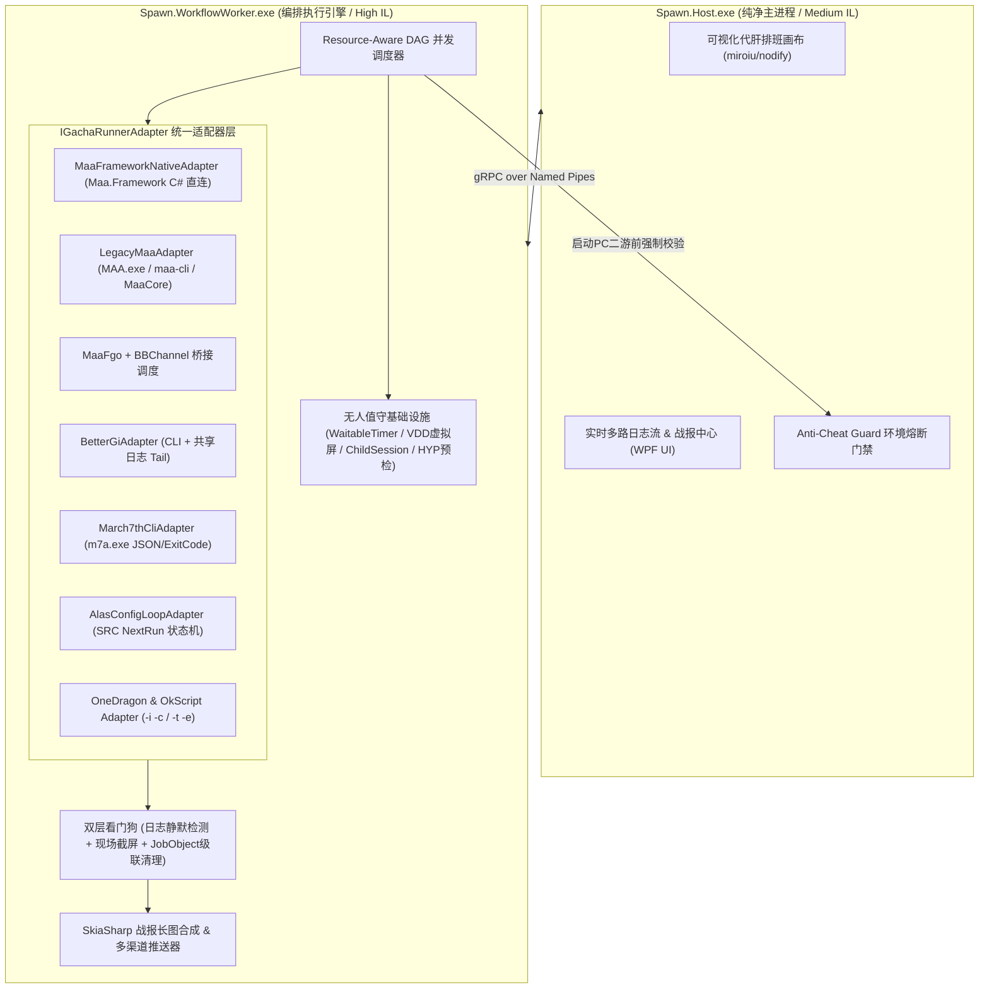
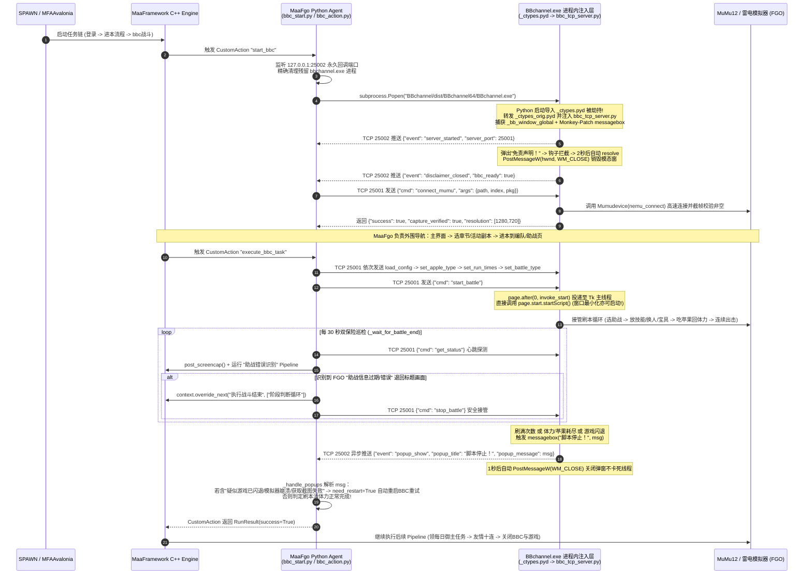
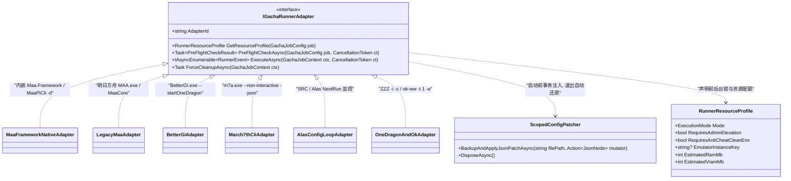
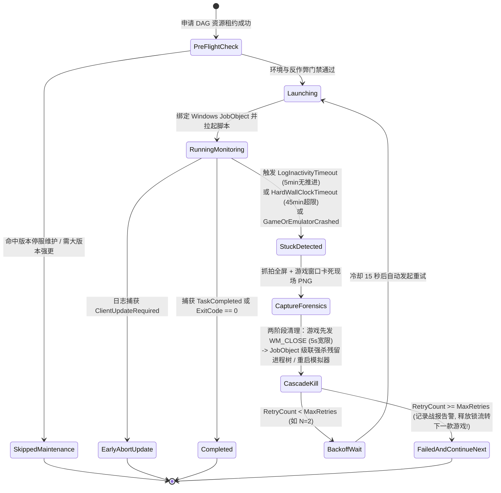
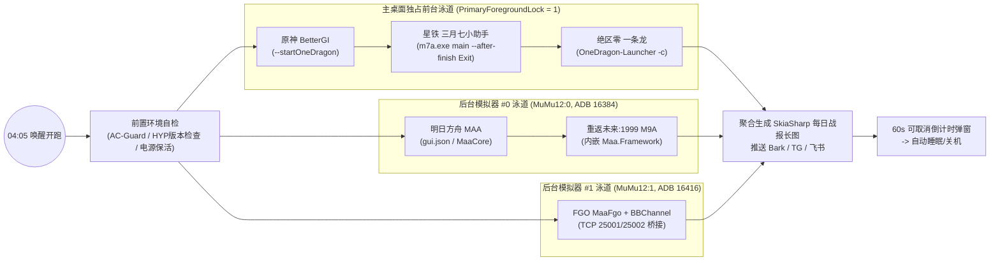

# 05 - 二次元代肝脚本管理与顶层流程编排（Gacha Workflow Meta-Orchestrator）深度技术调研报告

> **模块代号**：`Spawn.Workflow`（顶层编排与无人值守基础设施）
> **目标平台与技术栈**：Windows 10/11 x64 · 纯原生 C# (`.NET 9` + `WPF` + `lepoco/wpfui` + `miroiu/nodify`)
> **核心架构原则**：**绝不重复造轮子编写游戏内识图与战斗逻辑，专注打造工业级“元编排器（Meta-Orchestrator）”**——向下无感统合 `MaaFramework` 家族、FGO `MaaFgo` + `BBChannel`、米哈游全家桶（`BetterGI` / `March7thAssistant` / `StarRailCopilot` / `ZenlessZoneZero-OneDragon`）及鸣潮（`ok-wuthering-waves`）等成熟脚本生态；向上提供**资源感知型并发 DAG 排班、睡眠唤醒与防锁屏黑屏基础设施、版本预检、看门狗自愈及全渠道战报推送**。

---

## 第 1 章：模块定位、设计边界与跨进程安全架构

### 1.1 为什么“不做自研游戏内识图，专做顶层元编排”是唯一正确的极客路线？

二次元长线运营游戏（Gacha Games）以 3~6 周一次大版本迭代著称，每次版本更新均伴随新活动 UI、新深渊/肉鸽机制、新角色技能轴与分辨率微调。社区头部垂类开源项目（如明日方舟 `MAA`、原神 `BetterGI`、星铁 `March7thAssistant`、FGO `MaaFgo`）背后均有数十至数百名核心贡献者高频维护图像模板、ONNX 检测模型与战斗策略。任何试图在单一客户端内自研全游戏识图逻辑的方案，都会在三个月内因维护算力枯竭而沦为废品。

然而，极客双修/多修玩家在日常“收菜”中面临真正的痛点并不在单款脚本内部，而在**跨脚本、跨运行环境的系统级协同真空**：
1. **键鼠焦点踩踏与显存爆炸**：PC 端游脚本（如 `BetterGI` 与 `March7thAssistant`）均需抢占前台窗口焦点与物理键鼠，用 Windows 任务计划程序简单定时极易因前序脚本超时导致两个脚本同时抢鼠标互殴；
2. **夜间睡眠唤醒即黑屏死锁**：电脑从睡眠唤醒后若处于 `Win+L` 锁屏界面，或夜间关闭物理显示器电源，Windows 图形捕获管线（`DXGI Desktop Duplication` / `Windows.Graphics.Capture`）直接断开或输出全黑帧，导致所有 PC 端游脚本全军覆没；
3. **异构接入协议碎片化**：有的脚本用标准 CLI 与退出码（`March7thAssistant`），有的靠内置死循环调度器（`StarRailCopilot`），有的具备通用 `interface.json` 与官方 C# 绑定（`MaaFramework`），还有的如 FGO 老牌闭源工具 `BBChannel` 甚至完全没有 CLI 接口且满屏模态弹窗；
4. **反作弊跨界污染风险**：SPAWN 同时承载单机游戏的风灵月影/Cheat Engine 修改器与按键宏，若不经环境净化直接拉起搭载 `HoYoProtect`（米哈游）或 `ACE 安全中心`（鸣潮/少前2）的二游客户端，存在极高的封号隐患。

因此，`Spawn.Workflow` 的核心工程边界十分明确：**以纯原生 C# 打造全生态兼容的顶层流程编排器与系统级无人值守底座**。

---

### 1.2 与 SPAWN 主从物理隔离（Clean Host）及 Anti-Cheat Guard 的协同架构

与 `01-ui-architecture-and-blueprint` 模块的 **Clean Host + Isolated Worker** 安全红线完全对齐，`Spawn.Workflow` 采用主从双进程分层设计：

- **`Spawn.Host.exe`（纯净主进程，Medium IL）**：
  - 仅负责渲染基于 `miroiu/nodify` 的**可视化代肝排班 DAG 编辑器**、实时日志流面板、战报预览与配置管理；
  - 零敏感 Win32 API 导入，不直接加载第三方 Native 视觉推理库，也不持有任何高权限进程句柄。
- **`Spawn.WorkflowWorker.exe`（工作流编排守护子进程，按需常驻或计划唤醒，High IL）**：
  - 通过 `.NET 9` 原生 `gRPC over Named Pipes` 与 `Spawn.Host.exe` 双向流式通信；
  - 内部承载 `Maa.Framework`（`MaaBinding.CSharp` 原生引擎）、外部子进程适配器（Job Object 生命周期管控）、模拟器控制器（`MuMuManager` / `ldconsole`）、电源与唤醒定时器（`WaitableTimer` / `SetThreadExecutionState`）以及看门狗截图服务；
  - **强制反作弊前置门禁（Pre-Launch Anti-Cheat Gate）**：每当 DAG 调度器准备拉起任何标记为 `AntiCheatProtected = true` 的 PC 二游任务（原神、星铁、绝区零、鸣潮、少前2）前，必须先通过主进程调用 `IAntiCheatGuardService.EnsureCleanEnvironmentAsync()`——强制确认 `Spawn.TrainerWorker.exe`（单机修改器子进程）、`Spawn.BlueprintWorker.exe`（低级钩子/宏子进程）及外部黑名单进程（`cheatengine-x86_64.exe`、`x64dbg.exe` 等）已彻底退出，且距离上一款强反作弊游戏（如残留 `SGuard64.exe`）退出已满足 **15 秒余温冷却互锁**后，方才放行启动。



---

### 1.3 主流二次元自动化生态全景技术矩阵

| 游戏名称 | 代表开源/社区项目 | 核心开发栈 | 运行载体 | 图像捕获与推理引擎 | 输入控制方式 | 外部无人值守接入机制 | 前后台资源锁属性 |
| :--- | :--- | :--- | :--- | :--- | :--- | :--- | :--- |
| **明日方舟** | [MaaAssistantArknights](https://github.com/MaaAssistantArknights/MaaAssistantArknights) | C++20 (`MaaCore`) + C# WPF | 安卓模拟器 / PlayCover | ADB Screencap / `minicap` / `nemu_ipc` + OpenCV / FastDeploy PP-OCR | ADB / `minitouch` / `maatouch` / `nemu` | `MAA.exe --config` / `maa-cli` / `MaaCore.dll` C API | **纯后台**（绑定独立模拟器实例） |
| **重返未来：1999 / 少前2 / 阴阳师 / 终末地等** | [MaaXYZ/MaaFramework](https://github.com/MaaXYZ/MaaFramework) 家族 (`M9A`, `MaaGF2Exilium`, `MaaYYs`, `MaaEnd`) | C++20 核心 + JSON Pipeline + Python/C# Agent | 安卓模拟器 / Win32 PC 端 | `nemu_ipc` / `ldopengl` / WGC / DXGI + ONNX YOLOv8 / PP-OCRv4 | `maatouch` / `nemu` / Win32 `SendMessage` 或 `Seize` | **`Maa.Framework` C# NuGet 内嵌** 或 `MaaPiCli.exe -d` | 模拟器为**纯后台**；PC `Seize` 模式需**前台锁** |
| **FGO (命运-冠位指定)** | [xlxyvergil/MaaFgo](https://github.com/xlxyvergil/MaaFgo) + 闭源 `BBChannel` | MaaFramework + Python Agent + `_ctypes.pyd` 注入 Tkinter | 安卓模拟器（推荐 MuMu12 1280×720） | MaaFramework 视觉 + BBC 内置 Airtest / MuMu 高速接口 (`Mumudevice`) | ADB / MuMu SDK / 雷电窗口消息 | `MaaFgo` `interface.json` + **本地双端口 TCP (`25001`/`25002`) 操控 BBC** | **纯后台**（BBC 支持最小化与 MuMu 后台高速截图） |
| **原神** | [babalae/better-genshin-impact](https://github.com/babalae/better-genshin-impact) | **C# (.NET 8/9) + WPF (`Wpf.Ui`)** + ClearScript V8 | PC 端游 / 云原神 WebView / ChildSession | `BitBlt` / `WindowsGraphicsCapture` / `DwmGetDxSharedSurface` + ONNX Runtime (DML/CUDA) | `SendInput`（前台键鼠）+ 局部 `PostMessage` | `BetterGI.exe --startOneDragon <配置>` / `--startGroups` | **独占物理前台锁**（开启 ChildSession 桌面分身除外） |
| **崩坏：星穹铁道** | [moesnow/March7thAssistant](https://github.com/moesnow/March7thAssistant) | Python + PyQt-Fluent-Widgets | PC 端游 (1920×1080) / 云星铁 / Desktop Twin | `BitBlt` / WGC + PP-OCR / ONNX | 前台 `SendInput` / `pyautogui` / `pywin32` | `m7a.exe [task] --non-interactive --after-finish Exit --json` | **独占物理前台锁**（开启 Desktop Twin 或无头云星铁除外） |
| **崩坏：星穹铁道** | [LmeSzinc/StarRailCopilot](https://github.com/LmeSzinc/StarRailCopilot) | Python + Alas 框架 + PyWebIO | 安卓模拟器 / 云星铁 | `nemu_ipc` / `DroidCast_raw` + OpenCV / cnocr | `maatouch` / `minitouch` / `nemu_ipc` | 修改 `config/*.json` 中 `NextRun` + `python src.py` 监控 | **纯后台**（模拟器后台独立触控） |
| **绝区零** | [OneDragon-Anything/ZenlessZoneZero-OneDragon](https://github.com/OneDragon-Anything/ZenlessZoneZero-OneDragon) | Python + PySide6 + `one_dragon` 框架 | PC 端游 (1920×1080) | `BitBlt` / WGC / DXGI + YOLOv8 ONNX + OCR | 前台 `SendInput` / 虚拟手柄 (`ViGEm`) | `OneDragon-Launcher.exe -i 1,2 -c` (`--instance`, `--close-game`) | **独占物理前台锁** |
| **崩坏3** | [MaaXYZ/MAABH3](https://github.com/MaaXYZ/MAABH3) / [Aues6uen11Z/HonkaiHelper](https://github.com/Aues6uen11Z/HonkaiHelper) | MaaFramework / Python | 安卓模拟器 / PC 桌面端 | MaaFramework 标准管线 / OpenCV+OCR | ADB 触控 / Win32 键鼠 | `Maa.Framework` C# 直连 / `MaaPiCli.exe -d` | 模拟器**纯后台** / PC 端**独占前台锁** |
| **鸣潮** | [ok-oldking/ok-wuthering-waves](https://github.com/ok-oldking/ok-wuthering-waves) | Python/Cython + PySide6 (`ok-script` 框架) | PC 端游 (16:9) | `WindowsGraphicsCapture` / DXGI + DirectML ONNX | 前台 `SendInput` / PostMessage | `ok-ww.exe -t 1 -e` (`--task 1 --exit`) | **独占物理前台锁** |

---

## 第 2 章：明日方舟 MAA 与 `MaaFramework` 通用生态深度拆解

### 2.1 一代标杆 `MaaAssistantArknights` 的四种外部调度途径源码级对比

`MaaAssistantArknights`（仓库：[MaaAssistantArknights/MaaAssistantArknights](https://github.com/MaaAssistantArknights/MaaAssistantArknights)）采用 **C++ 核心动态库 `MaaCore.dll` + C# WPF 外壳 `MAA.exe`（基于 `Stylet` MVVM 框架）** 的经典架构。经查证其 `src/MaaWpfGui/Main/Bootstrapper.cs` 源码及官方文档，外部调度器共有 **4 种接入途径**：

#### 途径 1：`MAA.exe --config <配置名>` 命令行拉起（GUI 托管模式）
- **源码级执行机理**（见 `Bootstrapper.cs` `OnStart()` 与 `Config()` 方法）：
  1. `MAA.exe` 启动后首先基于自身所在目录创建全局命名互斥量 `"MAA_" + BaseDir.Replace("\\", "_").Replace(":", "")`——这意味着**同一安装目录严禁双开**（会弹出 `MultiInstanceUnderSamePath` 模态警告窗阻塞！），若需同时双开刷两个模拟器账号，必须使用软硬链接克隆目录或改用下文 `maa-cli` / `MaaCore.dll` 途径；
  2. 解析 `--config <desiredConfig>` 参数：若当前 `./config/gui.json` 中的激活配置名 `Current` 不等于 `<desiredConfig>`，`MAA.exe` 会修改 `gui.json` 切换配置并调用 `ShutdownAndRestartWithoutArgs()` **立即退出当前进程并拉起一个新的无参 `MAA.exe` 子进程**！（**关键避坑点**：外部调度器绝不能只 `WaitForExit` 第一个带 `--config` 的 `MAA.exe` PID，否则会在 1 秒内误判任务已完成！更好的做法是**由 SPAWN 在启动 `MAA.exe` 前直接修改 `./config/gui.json` 中的 `"Current": "<配置名>"`，然后直接无参启动 `MAA.exe`**，彻底规避自重启 PID 漂移）；
  3. **无人值守闭环配置**：在 `config/gui.json` 对应配置的 `Configurations.<配置名>` 节点下，预先确保：
     - `"StartUp.AutoConnect": "True"`（启动 MAA 后自动连接模拟器并立即开始任务链）；
     - `"AfterCompleted": "ExitMaaAndEmulator"`（或 `"ExitMaa"`，任务链全部完成后自动关闭 MAA 进程与对应模拟器）；
  4. **日志监控文件**：实时以 `FileShare.ReadWrite` 尾随读取 `./debug/gui.log`（UI 级任务状态，如 `任务已全部完成！`、`连接模拟器失败`）与 `./debug/asst.log`（底层 C++ 核心识图详情）。

#### 途径 2：官方无头命令行工具 `maa-cli`（Rust CLI 模式）
- **仓库**：[MaaAssistantArknights/maa-cli](https://github.com/MaaAssistantArknights/maa-cli)
- **原理与调用协议**：官方使用 Rust 编写的无 GUI 跨平台命令行前端，直接动态加载 `MaaCore.dll` 并通过 TOML/JSON Profile 描述任务链：
  ```powershell
  # 执行预设的日常 Profile 并在完成后直接返回标准进程退出码（0=成功，非0=异常）
  maa run daily_official
  # 或单步链式调用：唤醒官服 -> 刷 1-7 理智 -> 基建换班 -> 公开招募 -> 领奖励 -> 关闭游戏
  maa startup Official && maa fight 1-7 && maa infrast && maa recruit && maa award && maa closedown Official
  ```
- **优缺点**：天然无窗口、无自重启 PID 漂移、支持标准 `stdout/stderr` 与进程退出码；缺点是大多数普通玩家本地下载的是 `MAA.exe` GUI 整合包，未必额外安装了 `maa-cli`。

#### 途径 3：`MaaCore.dll` 原生 C API P/Invoke 内存直连（内嵌核心模式）
- `MAA` 根目录下的 `MaaCore.dll` 导出了极为稳定的纯 C ABI 接口（头文件 `include/AsstCaller.h`）：
  - `AsstSetUserDir(path)` -> `AsstLoadResource(path)` -> `AsstCreateEx(AsstApiCallback callback, void* custom_arg)`；
  - `AsstAsyncConnect(handle, adb_path, address, "MuMuEmulator12")`；
  - `AsstAppendTask(handle, "StartUp", json_params)`、`AsstAppendTask(handle, "Fight", ...)`、`AsstAppendTask(handle, "Infrast", ...)`、`AsstAppendTask(handle, "Mall", ...)`、`AsstAppendTask(handle, "Award", ...)`；
  - `AsstStart(handle)`。
- **独特优势**：回调函数 `void(int msg, const char* details_json, void* custom_arg)` 会实时推送结构化 JSON（例如 `AsstMsg::SubTaskExtraInfo = 10003` 直接包含**本次掉落材料名称与数量、企鹅物流上报明细、公招识别出的资深/高资 Tag 词条**！`TaskChainCompleted = 10001` 精确通知完成），是采集高质量战报数据的最佳数据源。

#### 途径 4：参考 `AUTO-MAS` 的配置托管模式
- 社区主流多脚本管理器 [AUTO-MAS-Project/AUTO-MAS](https://github.com/AUTO-MAS-Project/AUTO-MAS) 对一代 MAA 采用的是**“独立维护多账号 JSON 快照 -> 启动前覆写 `config/gui.json` -> 启动 `MAA.exe` -> 异步监控 `debug/gui.log` 增量时间戳与关键词 -> 完成后回收进程与模拟器”**的混合策略，最大程度兼容玩家已有的 GUI 习惯与自动更新能力。

> **SPAWN 对一代明日方舟 MAA 的工程选型**：采用 **“默认 `gui.json` 预置覆写 + 无参拉起 `MAA.exe` + `debug/gui.log` 监控”**（零迁移门槛，保留 MAA 自身的资源热更新 `OTA` 能力），同时可选开启 **`MaaCore.dll` P/Invoke 轻量内嵌模式**（实现零 GUI 纯后台极速多开与企鹅物流级精细战报提取）。

---

### 2.2 新一代通用底座 `MaaXYZ/MaaFramework` 架构原理与 `interface.json` 规范

为了将明日方舟 MAA 验证成功的图像自动化能力泛化至所有游戏，MAA 原班核心团队打造了次世代开源黑盒自动化框架 **[MaaXYZ/MaaFramework](https://github.com/MaaXYZ/MaaFramework)**（C++20 编写，Apache-2.0 / LGPL-3.0 协议）。

#### 1. 核心架构三要素
1. **多模态控制器（`MaaController`）**：
   - `AdbController`：支持标准 ADB、高速触控 `minitouch` / `maatouch`，以及模拟器共享内存超高速截图 **`nemu_ipc`**（直接调用 MuMu12 的 `external_renderer_ipc.dll`，截屏延迟 `< 3ms` 且支持模拟器窗口最小化隐藏！）与雷电 `ldopengl`（`ldengl64.dll`）；
   - `Win32Controller`：面向 PC 桌面端游戏，支持 `GDI`、`FramePool`（即 `Windows.Graphics.Capture`）、`DXGI_DesktopDup`、`PrintWindow` 截图，以及 `SendMessage`（后台窗口消息点击）与 `Seize`（前台键鼠抢占）两种输入模式；
   - `PlayCoverController` / `GamepadController`（基于 `ViGEmBus` 模拟 Xbox360/DS4 手柄输入）。
2. **声明式流水线引擎（Pipeline V1/V2 JSON 状态机）**：
   - 将游戏自动化抽象为有向图节点（Node），每个节点声明 `recognition`（`DirectHit`、`TemplateMatch`、`FeatureMatch`、`ColorMatch`、`OCR` [基于 ONNX PP-OCRv4]、`NeuralNetworkClassify` / `NeuralNetworkDetect` [基于 ONNX YOLOv8] 或 `Custom`）与 `action`（`Click`、`Swipe`、`InputText`、`StartApp`、`StopApp`、`Key` 或 `Custom`），以及后继分支列表 `next`、`on_error`（或 V2 命名空间语法）。
3. **跨语言 `AgentServer` 进程间通信机制**：
   - 对于 JSON 状态机难以表达的复杂算法（如 FGO 编队算力规划、1999 出牌决策、公招组合求解），`MaaFramework` 设计了 `MaaAgentClient` <-> `MaaAgentServer` 本地 Socket IPC 协议。主框架加载资源时自动拉起外部 Python / C# / Rust / Node.js 编写的 Agent 进程，将 `CustomRecognition` 和 `CustomAction` 回调透明路由至外部进程执行。

#### 2. `ProjectInterface V2`（`interface.json`）标准协议
所有遵循 `MaaFramework` 标准的二游脚本项目，在其发布包根目录下**必定存在一份 `interface.json`**（遵循 `ProjectInterface V2` Schema）。它是整个脚本项目的“自描述元数据清单”：
- `interface_version`: `2`；
- `name` / `version` / `github` / `mirrorchyan_rid`（对接 Mirror酱 高速增量更新源的唯一项目 ID）；
- `controller`: 声明该项目支持 `Adb` 还是 `Win32`（含目标窗口类名 `class_regex` / `window_regex`、推荐截图与输入方法）；
- `resource`: 声明多渠道资源叠加数组（例如官服加载 `["resource/base"]`，B服叠加加载 `["resource/base", "resource/bilibili"]`）；
- `agent`: 声明需要伴随启动的自定义逻辑子进程，例如 `{"child_exec": "python", "child_args": ["../agent/main.py"]}`；
- `task` 与 `option`: 声明所有可供用户勾选的任务入口（`entry`）及下拉框/开关动态覆写规则（`pipeline_override`）；
- `import`: 支持模块化拆分导入子 JSON 文件（如 `MaaFgo` 将上百个副本与助战配置拆分在 `options/` 和 `tasks/` 下导入）。

---

### 2.3 基于 `MaaFramework` 构建的二次元脚本矩阵全景

| 游戏名称 | 项目名称与 GitHub 仓库 | 控制器类型 | 自定义 Agent | 核心自动化覆盖能力 |
| :--- | :--- | :--- | :--- | :--- |
| **重返未来：1999** | **M9A** ([MaaXYZ/M9A](https://github.com/MaaXYZ/M9A)) | `Adb` / `Win32` | 纯 Pipeline 为主 | 自动登录、荒原收菜基建、意志解析、心相/素材本清体力、人工梦游、肉鸽、邮件与日常任务 |
| **命运-冠位指定 (FGO)** | **MaaFgo** ([xlxyvergil/MaaFgo](https://github.com/xlxyvergil/MaaFgo)) | `Adb` (1280×720) | Python `AgentServer` + 可选 `BBChannel` | 登录、种树蓝苹果、迦勒底之门、Free本、主线/幕间自动推进、无限池摸兔兔、搓丸子、原生或 BBC 战斗 |
| **崩坏3** | **MAABH3** ([MaaXYZ/MAABH3](https://github.com/MaaXYZ/MAABH3)) | `Adb` / `Win32` | Python / Pipeline | 家园金币体力、打工与远征、材料活动一键减负、舰团委托回收、后勤终端碎片购买、万象虚境 |
| **少女前线2：追放** | **MaaGF2Exilium** ([MaaXYZ/MaaGF2Exilium](https://github.com/MaaXYZ/MaaGF2Exilium)) | `Adb` / `Win32` | Pipeline + Custom | 公共区收菜、调度室、补给作战清体力、实兵演习竞技场、班组每日要务、边界推进 |
| **阴阳师** | **MaaYYs** ([MaaXYZ/MaaYYs](https://github.com/MaaXYZ/MaaYYs)) | `Adb` / `Win32` | Python Agent | 御魂/觉醒/探索组队或单刷、结界突破、地域鬼王、寮每日、悬赏封印、百鬼夜行 |
| **明日方舟：终末地** | **MaaEnd** ([MaaXYZ/MaaEnd](https://github.com/MaaXYZ/MaaEnd)) | `Win32` / `Adb` | Pipeline + Custom | 日常资源收割、基建工业产线巡检、体力本循环、每日活跃度领取 |
| **边狱巴士 / 代号鸢等** | [MaaXYZ/MaaLimbusCompany](https://github.com/MaaXYZ/MaaLimbusCompany) / [MaaXYZ/MaaYuan](https://github.com/MaaXYZ/MaaYuan) | `Win32` / `Adb` | Pipeline / Agent | 镜牢周常日常、采买收菜、心纸君/据点派遣等全套日常减负 |
| **通用跨游戏 UI 外壳** | **MFAAvalonia** ([SweetSmellFox/MFAAvalonia](https://github.com/SweetSmellFox/MFAAvalonia)) | 通用宿主 | 自动托管 | 社区最成熟的基于 Avalonia 的通用前端，通过读取任意项目的 `interface.json` 动态生成 UI 并支持 CLI 自启 |

---

### 2.4 SPAWN 原生内嵌 `Maa.Framework` (`MaaBinding.CSharp`) 的可行性与双轨融合方案

用户特别提出关键架构命题：**SPAWN 本身就是纯原生 C# (`.NET 9`) 应用，能否直接解析 `interface.json` 并调用官方 C# 绑定 `MaaBinding.CSharp`，从而天然兼容所有 `MaaFramework` 衍生二游脚本？**

#### 1. 深度查证结论：**100% 可行，且是 SPAWN 形成代际技术壁垒的杀手锏！**
经查证官方绑定仓库 **[MaaXYZ/MaaFramework.Binding.CSharp](https://github.com/MaaXYZ/MaaFramework.Binding.CSharp)**，官方已发布面向 `.NET 7+`（完美兼容 `.NET 9`）的现代化 NuGet 包体系：
- `Maa.Framework`（元包，聚合托管封装与原生二进制）；
- `Maa.Framework.Binding.Native` + `Maa.Framework.Runtimes`（针对 `win-x64` / `win-arm64` 预编译的 `MaaFramework.dll`、`MaaToolkit.dll`、`MaaAgentClient.dll` 与 ONNX Runtime / FastDeploy 原生库）。

#### 2. 为什么要采用“原生内嵌 `Maa.Framework`（主推） + 外部 `MaaPiCli.exe -d` / `MFAAvalonia`（兼容兜底）”的双轨方案？

| 评估维度 | 轨道 A：在 `Spawn.WorkflowWorker.exe` 内直接引用 `Maa.Framework` C# 绑定 | 轨道 B：子进程调用项目自带的 `MaaPiCli.exe -d` 或 `MFAAvalonia.exe` |
| :--- | :--- | :--- |
| **UI 与交互体验** | **极致统一**：SPAWN 直接解析脚本目录下的 `interface.json`（及 `import` 子文件），在 SPAWN 原生 `lepoco/wpfui` 界面内自动渲染该游戏的渠道选择、任务列表、下拉参数（苹果种类、刷本次数等），无需弹出十几个五花八门的第三方窗口！ | 每次运行仍需弹出控制台窗口或第三方 Avalonia 窗口，参数修改需先去外部软件配好生成 `config/maa_pi_config.json` 后再用 `-d`（Direct 模式）免交互拉起 |
| **状态感知粒度** | **微秒级强类型事件**：直接挂载 `maaTasker.Callback += OnMaaEvent`，精确捕获每一个 Pipeline 节点的 `Recognition.Succeeded`、`Action.Failed`、OCR 识别文本与截图帧 | 只能靠解析标准输出或 `debug/maa.log` 文本日志推断进度 |
| **多模拟器并发开销** | 多个后台模拟器任务在同一个 `WorkflowWorker` 进程内共享线程池管理各自的 `MaaTasker` 实例，内存开销极低 | 每个游戏脚本各自加载一套 GUI 框架运行时 |
| **C++ 核心版本差异隔离** | 若某个冷门脚本锁死了极其古老的 `MaaFramework v1.x` 破坏性旧接口，统一内嵌最新版 `Maa.Framework` 可能出现 Schema 不兼容 | **100% 原生兼容**：调用脚本自带目录下的 `MaaPiCli.exe -d`，使用脚本打包时绑定的原装 DLL |

因此，**SPAWN 采用“默认内嵌 `Maa.Framework` 直驱 + 一键切换外部 `MaaPiCli.exe -d` 隔离执行”的双轨融合架构**。

#### 3. C# 原生解析 `interface.json` V2 并联动 `MaaAgentClient` + `MaaTasker` 核心实现代码

以下代码展示了 `Spawn.WorkflowWorker` 如何在纯 C# 中加载任意 `MaaFramework` 二游脚本目录（甚至完美支持如 `MaaFgo` 这样带有外部 Python `AgentServer` 的复杂项目）：

```csharp
using System.Diagnostics;
using System.Text.Json;
using System.Text.Json.Nodes;
using MaaFramework.Binding;
using MaaFramework.Binding.Buffers;

namespace Spawn.Workflow.Runners.MaaFw;

public sealed class EmbeddedMaaFwRunner : IAsyncDisposable
{
    private MaaTasker? _tasker;
    private MaaAgentClient? _agentClient;
    private Process? _agentSubProcess;

    public async Task<bool> ExecuteProjectAsync(
        string projectRootDir,
        string selectedResourceName,
        string adbPath,
        string adbSerial,
        string muMuInstallPath, // 若使用 MuMu12，优先启用 nemu_ipc 共享内存超高速截图
        IReadOnlyList<(string Entry, JsonObject PipelineOverride)> tasksToRun,
        IProgress<string> progress,
        CancellationToken ct)
    {
        // 1. 初始化 MaaToolkit 全局配置目录
        MaaToolkit.Shared.Config.InitOption(Path.Combine(projectRootDir, "config"));

        // 2. 解析 ProjectInterface V2 (interface.json)
        var interfacePath = Path.Combine(projectRootDir, "interface.json");
        var piRoot = JsonNode.Parse(await File.ReadAllTextAsync(interfacePath, ct))!.AsObject();

        // 3. 按选定渠道（如 "官服" / "B服"）按序叠加加载 Resource 目录
        var maaResource = new MaaResource();
        var resourceNode = piRoot["resource"]!.AsArray()
            .First(r => r!["name"]!.GetValue<string>() == selectedResourceName)!;
        var rawPaths = resourceNode["path"] is JsonArray arr
            ? arr.Select(x => x!.GetValue<string>())
            : [resourceNode["path"]!.GetValue<string>()];

        foreach (var relPath in rawPaths)
        {
            var fullResPath = relPath.Replace("{PROJECT_DIR}", projectRootDir);
            if (!Path.IsPathRooted(fullResPath))
                fullResPath = Path.Combine(projectRootDir, fullResPath);

            maaResource.PostBundle(fullResPath).Wait().ThrowIfNot(MaaJobStatus.Succeeded);
        }

        // 4. 初始化 AdbController（自动探测或挂载 MuMu12 nemu_ipc 高速渲染器）
        var controller = new AdbController(
            adbPath: adbPath,
            address: adbSerial,
            screencapMethods: AdbScreencapMethods.All, // 自动优选 nemu_ipc / RawWithGzip
            inputMethods: AdbInputMethods.Maatouch | AdbInputMethods.AdbShell,
            config: JsonSerializer.Serialize(new { extras = new { mumu = new { enable = true, path = muMuInstallPath, index = 0 } } }));
        controller.PostConnect().Wait().ThrowIfNot(MaaJobStatus.Succeeded);

        // 5. 若 interface.json 声明了外部 AgentServer（如 MaaFgo 的 ../agent/main.py），自动拉起并建立 Socket IPC！
        if (piRoot["agent"] is JsonObject agentObj && agentObj["child_exec"] is not null)
        {
            _agentClient = MaaAgentClient.Create(maaResource);
            var identifier = _agentClient.Id; // 生成本地随机 IPC Socket 标识符

            var childExec = agentObj["child_exec"]!.GetValue<string>()
                .Replace("{PROJECT_DIR}", projectRootDir);
            var childArgs = agentObj["child_args"]?.AsArray()
                .Select(a => a!.GetValue<string>().Replace("{PROJECT_DIR}", projectRootDir))
                .ToList() ?? [];
            childArgs.Add(identifier); // MaaFramework Agent 协议约定末尾传入 socket_id

            var psi = new ProcessStartInfo(childExec)
            {
                WorkingDirectory = projectRootDir,
                UseShellExecute = false,
                CreateNoWindow = true
            };
            foreach (var arg in childArgs) psi.ArgumentList.Add(arg);
            _agentSubProcess = Process.Start(psi);

            if (!_agentClient.LinkStart())
                throw new InvalidOperationException($"无法连接 {piRoot["name"]} 的 AgentServer 子进程 (ID={identifier})");
        }

        // 6. 构建 MaaTasker 并订阅细粒度节点回调
        _tasker = new MaaTasker
        {
            Controller = controller,
            Resource = maaResource,
            DisposeOptions = DisposeOptions.All
        };

        _tasker.Callback += (_, args) =>
        {
            progress.Report($"[MaaFW] {args.Message}: {args.Details}");
        };

        // 7. 顺序投递用户编排的各子任务（携带动态生成的 pipeline_override JSON）
        using var stopReg = ct.Register(() => _tasker.PostStop());
        foreach (var (entry, overrideJson) in tasksToRun)
        {
            ct.ThrowIfCancellationRequested();
            var job = _tasker.AppendTask(entry, overrideJson.ToJsonString());
            var status = await Task.Run(() => job.Wait(), ct);
            if (status != MaaJobStatus.Succeeded)
            {
                progress.Report($"[MaaFW] 任务入口 '{entry}' 执行未成功，终态: {status}");
                return false;
            }
        }

        return true;
    }

    public async ValueTask DisposeAsync()
    {
        _agentClient?.LinkStop();
        _agentClient?.Dispose();
        _tasker?.Dispose();
        if (_agentSubProcess is { HasExited: false })
        {
            _agentSubProcess.Kill(entireProcessTree: true);
            await _agentSubProcess.WaitForExitAsync();
        }
    }
}
```

---

## 第 3 章：FGO 未开源工具 `BBChannel` 与 `xlxyvergil/MaaFgo` 桥接链路源码级全解

在《命运-冠位指定》（FGO）圈子中，B 站开发者 **@小阮绵绵咩** 开发的 **`BBChannel`（简称 BBC）** 长期以来是国内玩家刷无限池、3T 周回与高难爬塔最普及的工具，但其**闭源、无命令行参数、强依赖人工点击窗口与模态弹窗确认**的特性使其极难接入无人值守体系。而开源仓库 **[xlxyvergil/MaaFgo](https://github.com/xlxyvergil/MaaFgo)** 实现了一套极具极客巧思的桥接控制方案。

我们对 `xlxyvergil/MaaFgo` 仓库的核心代码（`bbcdll/`、`agent/custom/bbc_*.py`、`assets/interface.json`、`assets/resource/base/pipeline/bbc战斗.json`）进行了逐文件源码审计，现将其底层实现机制完整还原如下。

---

### 3.1 `BBChannel` 本体技术画像与自动化接入障碍

通过分析 `MaaFgo` 中与其交互的内部符号，可以清晰拼出未开源软件 `BBChannel` 的真实内部结构：
1. **运行时与打包方式**：基于 **Python + `Tkinter`（GUI 界面库） + `Airtest` / 自研设备层（`Mumudevice` 调用 MuMu12 高速接口 `nemu_connect`、`LDdevice` 雷电接口、`Android` Minicap/ADB 接口）** 编写，使用 **`PyInstaller --onedir`** 打包发布，主程序路径固定为 `BBchannel\dist\BBchannel64\BBchannel.exe`（工作目录也在 `dist\BBchannel64` 下）；
2. **数据存储**：用户的队伍编成、从者技能释放顺序、礼装与指令卡策略以 JSON 文件保存在 `BBchannel\settings\<方案名>.json` 中，加载到内存后挂载在主页面对象 `page.SS` 字典上；
3. **三大无人值守死穴**：
   - **完全没有外部 CLI 启动接口**：启动后停留在待机主窗口，且每次启动还会弹出一个阻塞主线程的 **`tkinter.messagebox`“免责声明！”模态对话框**；
   - **控件为自绘/动态缩放 Tkinter 画布**：传统基于坐标截图点击 `BBChannel` 窗口的方式，一旦玩家调整了 DPI 缩放（`CT.Scale`）、折叠了子面板或将 BBC 窗口最小化，点击即刻失效；
   - **所有结束与异常均通过模态 `messagebox` 阻塞弹出**：无论是刷完预定轮次、**AP 体力耗尽且苹果用光**、助战排序不符、还是游戏闪退崩溃，BBC 均直接调用 `tkinter.messagebox.showwarning` / `askyesno` / `askokcancel` 弹出 Windows 原生模态对话框，不人工点掉就会永远挂起线程！

---

### 3.2 四层完整桥接链路拆解：`MaaFgo` 如何彻底驯服 `BBChannel`？

**核心结论先行**：`MaaFgo` **既不是靠脆弱的桌面 UI 识图去点 `BBChannel` 窗口，也不是仅仅改个离线 JSON 后盲跑**！它采用的是 **“PyInstaller 原生扩展劫持（`_ctypes.pyd` Proxy DLL） + 进程内 Tkinter 对象反射与 `messagebox` 钩子 + 本地双端口全双工 TCP RPC（`25001`/`25002`） + `MaaFramework` Python `AgentServer` CustomAction + 30s 视觉巡检”** 的硬核四层架构！



#### 第 1 层：闭源进程注入层（`bbcdll/_ctypes.pyd` 代理劫持）
在 `xlxyvergil/MaaFgo` 仓库的 `bbcdll/` 目录下，存放着三个核心文件：
- `bbcdll/_ctypes.pyd`（自定义的代理 Python C 扩展 DLL）
- `bbcdll/_ctypes_orig.pyd`（原版 Python 标准库的 `_ctypes.pyd` 备份）
- `bbcdll/bbc_tcp_server.py`（1166 行纯 Python 服务端脚本）

**注入原理**：由于 `BBChannel` 是 `PyInstaller --onedir` 打包的 Windows Python 程序，其运行目录 `BBchannel\dist\BBchannel64` 下直接平铺了所有 `.pyd` 扩展。只要用户在初始化时将 `bbcdll/` 下的三个文件拷入该目录替换原 `_ctypes.pyd`，每当 `BBchannel.exe` 启动并在底层导入 `ctypes`（Airtest 与 Win32 窗口控制必用库）时，代理 `_ctypes.pyd` 就会首先加载 `_ctypes_orig.pyd` 保证原生功能无损，紧接着在 `BBChannel` **同一进程内存空间内**导入并启动 `bbc_tcp_server.py`！`bbc_tcp_server.py` 直接拿到 `BBChannel` 的根窗口对象 `_bb_window_global` 及其核心状态页 `page = _bb_window_global.pages[0]`。

#### 第 2 层：双端口全双工本地 TCP 协议（`127.0.0.1:25001` & `127.0.0.1:25002`）
为了彻底杜绝多线程并发下“请求响应粘包”与“异步弹窗推送冲突”，`MaaFgo` 设计了严谨的双通道 CS 协议：
- **统一二进制分帧格式**：`[4 字节 Big-Endian 无符号整数 payload 长度 (最大 65535)] + [UTF-8 编码 JSON 字节流]`（即 Python `len(data).to_bytes(4, 'big') + data`）。
- **正向 RPC 命令通道（端口 `25001`，`BBCServer` -> `CommandDispatcher`）**：由 `MaaFgo` 的 `BbcConnectionManager`（客户端，持线程互斥锁 `_cmd_lock`）向 `BBChannel` 发送 `{"cmd": "<指令名>", "args": {...}}`，共支持 **22 个反射操控指令**：
  1. **模拟器连接族（`connect_mumu` / `connect_ld` / `connect_adb` / `disconnect` / `get_connection`）**：
     - 直接在 `BBChannel` 内部实例化 `Mumudevice(path, index, app_index, pkg_name, use_manager=True)` 并挂载至 `page.snapshotDevice` 与 `page.operateDevice`，随后立即调用 `device.snapshot()` 校验返回图像尺寸非空；
     - **极客细节**：源码专门编写了 `_RetiredMumuApi` 桩类替换旧设备对象的 `device.nemu`，防止 Python GC 延迟执行旧 `Mumudevice.__del__` 时调用 `nemu_disconnect` 误断被 MuMu SDK 复用的底层句柄（否则会导致后续截图出现 `displayid=-1` 黑屏故障！）。
  2. **配置与参数热注入族（`load_config` / `save_config` / `get_config` / `set_apple_type` / `set_run_times` / `set_battle_type` / `get_settings`）**：
     - `load_config`：从 `BBchannel/settings/<filename>.json` 读取队伍配置字典 `SS`，保留当前已连接的 `connectMode/snapshotDevice/operateDevice` 后直接赋值给 `page.SS`，并调用 `page.reset()` 与 `_bb_window_global.saveJsons()` 即时生效，无需重启 BBC；
     - `set_apple_type`：直接修改 `page.appleSet.appleType`（支持 `gold` 金苹果、`silver` 银苹果、`copper` 铜苹果、`blue` 青铜树苗、`colorful` 圣晶石）；
     - `set_run_times`：调用 `page.appleSet.runTimes.set(times)` 设置刷本轮次；
     - `set_battle_type`：传入索引 `0~6`（`0`=连续出击/强化本，`1`=自动编队爬塔序列，`2`=爬塔AI，`3`=幕间，`4`=清自由本，`5`=类主线，`6`=大奥），直接设置 `page.battletype.set(CT.BATTLE_TYPE[idx])`。
  3. **零点击战斗启停族（`start_battle` / `stop_battle` / `get_status` / `get_ui_status`）**：
     - `start_battle`：**完全不模拟鼠标点击窗口**！它先校验前三位出战从者槽 `page.servantGroup[0..2].exist` 非空、未处于动画或序列编辑态，然后通过 **`page.after(0, invoke_start)` 将回调投递至 Tkinter GUI 主线程**，直接调用 `page.start.startScript(SimpleNamespace(x=center, y=center))`！因此**哪怕 `BBChannel` 窗口处于最小化隐藏状态，也能 100% 稳定触发战斗**！

#### 第 3 层：`tkinter.messagebox` 进程内 Monkey-Patch 模态弹窗劫持
在 `bbc_tcp_server.py` 的 `start_tcp_server()` 中，代码直接劫持替换了 `tkinter.messagebox` 的全部 6 个弹窗入口（`showinfo`, `showwarning`, `showerror`, `askokcancel`, `askyesno`, `askretrycancel`），专门接管 8 类关键模态弹窗：
`["免责声明！", "自动连接失败", "助战排序不符合", "队伍配置错误！", "正在结束任务！", "脚本停止！", "其他任务运行中", "自动关机中！"]`。
- **自动消解启动阻塞**：拦截到 `"免责声明！"` 时，后台线程延迟 2 秒自动标记 `resolved='ok'`，监控线程通过 `ctypes.windll.user32.FindWindowW(None, title)` + `PostMessageW(hwnd, WM_CLOSE, 0, 0)` 关掉模态窗，并向回调端口 **`127.0.0.1:25002`** 主动推送 `{"event": "disclaimer_closed", "bbc_ready": true}`；
- **交互式询问弹窗远程代理**：当弹出 `"助战排序不符合"`（`askyesno`）或 `"队伍配置错误！"`（`askokcancel`）时，立即向 `25002` 推送 `popup_show` 事件并阻塞等待，`MaaFgo` 根据用户在界面预设的布尔策略调用 `25001` 的 `popup_response` 接口传回 `True/False`，钩子收到后发 `WM_CLOSE` 销毁窗口并将该布尔值原样返回给 `BBChannel` 战斗逻辑！
- **单按钮结束通知秒关上报**：当弹出 `"脚本停止！"`（`showwarning`）时，立即向 `25002` 推送包含完整 `popup_title` 与 `popup_message` 的 JSON，并在 1 秒后自动发 `WM_CLOSE` 关闭弹窗，彻底消灭无人值守卡死。

#### 第 4 层：`MaaFramework` `AgentServer` 闭环与“刷本完成 vs 异常报错”双重判定机制
`MaaFgo` 在 `assets/interface.json` 中通过 `"agent": {"child_exec": "python", "child_args": ["../agent/main.py"]}` 注册了三个核心 `CustomAction`（`start_bbc`、`execute_bbc_task`、`stop_bbc`）以及一个任务停止事件监听器 `BbcStopOnTaskStop`（监听 `MaaTaskerPostStop` 信号，一旦用户在外部点停止，立即通过 `psutil` 精确按可执行文件名 `bbchannel.exe` / `bbchannel64.exe` 强杀进程，绝不按路径子串匹配以防误杀安装在同名目录下的自身进程）。

在 `agent/custom/bbc_action.py` 中，**判断 `BBChannel` 刷本清体力完成还是异常报错**依靠严密的双通道交叉验证：
1. **主判定通道（`25002` 异步弹窗事件分析，见 `_handle_popups`）**：
   - 当收到 `popup_title` 含 `"脚本停止"` 的回调时，检查 `popup_message` 内容：
     - **异常崩溃分支**：若 `popup_message` 包含 `'疑似游戏已闪退'`、`'疑似模拟器崩溃'` 或 `'高速接口获取截图失败'`，则判定为**运行期故障**，置 `state['need_restart'] = True`；外层 `ExecuteBbcTask.run()` 捕获该标志后，自动调用 `停止bbc` -> 等待 3 秒 -> `启动bbc` 重连模拟器并重新挂载战斗（最多自动重试 2 次）！
     - **正常清体力/刷本完成分支**：若不包含上述崩溃关键词（例如已完成指定 `run_count` 轮次，或**自然 AP 体力耗尽且设定的苹果数量不足，BBC 自动停止脚本**），则输出 `[Callback] 任务正常结束`，置 `state['finished'] = True` 且返回 `RunResult(success=True)`，Pipeline 顺畅流转至 `"bbc任务完成"` 节点执行后续收尾任务！
2. **兜底巡检通道（`30s` TCP 心跳 + MaaFramework 视觉 `"助战错误识别"`，见 `_wait_for_battle_end`）**：
   - 每隔 30 秒向 `25001` 发送 `get_status` 心跳：若 Socket 断开或无响应，立即判定 `BBC服务异常` 并触发 `need_restart = True`；
   - 心跳正常时，**`MaaFgo` 主动调用自身 `MaaFramework` 控制器的 `post_screencap()` 截屏，运行 `"助战错误识别"` 模板匹配子任务**——因为 FGO 在好友更新助战礼装/从者时会弹出“助战信息过期/助战错误”提示，点击后会强制退回游戏标题登录页，导致只会刷战斗的 `BBChannel` 迷失卡死。一旦 `MaaFgo` 识别到 `"有助战错误"` 节点完成，立即调用 `context.override_next("执行战斗结束", ["阶段判断循环"])` 动态篡改状态机回退重登，并向 BBC 发送 `stop_battle` 安全停机！

---

### 3.3 `MaaFgo` 原生战斗演进与 SPAWN 对 FGO 生态的接入定案

值得注意的是，`xlxyvergil/MaaFgo` 目前已演进出极为强大的**内置原生自动战斗引擎（`agent/battle/`）**，支持合成指令卡面归属识别、前排从者身份感知、羁绊满自动截图停刷以及本地 Web 编队编辑器（甚至在 `agent/battle_editor/bbc_import.py` 中支持直接将老玩家的 `BBChannel` `settings/*.json` 离线一键转换为原生/Chaldea 战斗方案）。

**因此，SPAWN 调度 FGO 的工程定案极为优雅**：
1. **统一以 `MaaFgo` 作为 FGO 标准接入宿主**：直接复用第 2.4 节实现的 SPAWN `MaaFramework` 适配器加载 `MaaFgo` 的 `assets/interface.json`；
2. **双内核自由切换**：普通日常清 AP 种火/QP 本可直接在 SPAWN 界面选用 `MaaFgo` **原生自动战斗**（零外部依赖）；遇到复杂高难爬塔或老玩家已有现成 `BBChannel` 顶配轴时，勾选 `启动bbc` + `BBC 战斗模式`，由 `MaaFgo` 的 Python Agent 自动通过 `25001/25002` TCP 桥接拉起并闭环管控 `BBChannel`；
3. **极端独立直连能力（Bonus）**：若某位硬核玩家只想单独排班纯 `BBChannel` 而不装 `MaaFgo`，SPAWN 仅需内置 `bbcdll` 补丁并在 C# 中用 `TcpClient` 实现 50 行代码的 `4-byte Big-Endian + JSON` 客户端连接 `127.0.0.1:25001/25002`，即可原生直控 `BBChannel`！

---

## 第 4 章：米哈游全家桶与主流 3D 二游脚本架构及 CLI 无人值守协议

与明日方舟、FGO 等 2D 回合制手游普遍在安卓模拟器后台挂机不同，以《原神》、《崩坏：星穹铁道》、《绝区零》、《鸣潮》为代表的现代跨端 3D 动作二次元游戏，由于画质与帧率需求极高、键鼠视角旋转（3D Camera Panning）操作密集，社区主流脚本绝大多数选择直接操控 **Windows PC 原生客户端**。

### 4.1 原神：`babalae/better-genshin-impact` (BetterGI) 深度剖析

- **仓库**：[babalae/better-genshin-impact](https://github.com/babalae/better-genshin-impact)（Star 数破万，**纯原生 C# `.NET` + `WPF` + `lepoco/wpfui` 开发**，与 SPAWN 技术栈同源！）
- **底层实现架构**（基于 `BetterGenshinImpact/App.xaml.cs` 与核心模块源码查证）：
  1. **图像捕获层（`GameCaptureFactory`）**：支持三种本地桌面捕获策略——`BitBlt`（GDI 窗口句柄截图，兼容性最好但无法捕获部分开启 HDR 或独占渲染窗口）、`WindowsGraphicsCapture (WGC)`（现代 WinRT 帧池，支持去黄框 `IsBorderRequired = false` 与 60FPS 高速采帧）、`DwmGetDxSharedSurface`（DWM 共享纹理），并额外实现了 `WebPageRuntimeProvider`（内嵌 WebView 宿主运行《云·原神》）；
  2. **视觉与 AI 推理层（`OnnxRuntimeLoader` + `OcrFactory`）**：启动阶段根据 `HardwareAccelerationConfig` 动态绑定 CPU / DirectML（A卡/N卡/核显通用硬件加速） / CUDA 原生 ONNX 运行库，驱动小地图特征点匹配（局部特征 + 尺度不变追踪）、Yap 自动拾取词条识别、离线 PP-OCR 与 YOLOv8 目标检测（古树、矿石、晶蝶、敌人定位）；
  3. **输入与脚本扩展层**：主输入采用 Win32 `SendInput`（含 3D 游戏视角平移所需的相对鼠标移动 `MOUSEEVENTF_MOVE`），局部按键支持 `PostMessage`；内置 **`Microsoft.ClearScript.V8`** 引擎，支持社区海量 JavaScript 地图追踪脚本（采集、锄地、自动秘境战斗策略 DSL）与订阅仓库自动拉取更新（`ScriptRepoUpdater`）；
  4. **桌面分身黑科技（`ChildSessionService`）**：近期版本内置了基于 Windows 本地 RDP 子会话的“桌面分身”模式（详见第 6.2 节）。

#### 外部无人值守 CLI 调度协议（源自 `Helpers/CommandLineOptions.cs` 源码实证）
通过审计 `BetterGenshinImpact/Helpers/CommandLineOptions.cs` 与 `Service/ApplicationHostService.cs`，BetterGI 支持以下精确命令行启动参数：

| 命令行调用语法 | 内部 `CommandLineAction` 枚举 | 行为详解与无人值守配合要点 |
| :--- | :--- | :--- |
| `BetterGI.exe --startOneDragon` | `StartOneDragon` (`OneDragonConfigName = null`) | 启动后自动跳转至「一条龙」页面并运行上次选中的默认配置（自动通过内置 `StartGameTask` 拉起 `YuanShen.exe`、开门进游戏、清合成树脂/秘境/每日委托/探索派遣/尘歌壶/领纪行邮件） |
| `BetterGI.exe --startOneDragon "ConfigA"` | `StartOneDragon` (`OneDragonConfigName = "ConfigA"`) | 指定运行名为 `ConfigA` 的一条龙配置方案（**最佳实践**：配置名建议使用纯英文/数字，规避批处理环境下编码错乱；支持多账号切换不同配置） |
| `BetterGI.exe --startGroups "晶蝶" "狗粮"` | `StartGroups` (`GroupNames = ["晶蝶", "狗粮"]`) | 启动后自动跳转至「调度器」页面，按顺序批量执行指定的 JS 地图追踪配置组（命令行模式下若开启了 `AutoUpdateBeforeCommandLineRun`，会在进游戏期间并行静默更新订阅脚本） |
| `BetterGI.exe --TaskProgress "锄地进度1"` | `TaskProgress` | 按断点续跑模式恢复执行指定的多脚本任务进度 |
| `BetterGI.exe start` | `Start` | 仅开启主页截图器与实时后台触发器（自动拾取、自动剧情、自动钓鱼），供玩家手动游玩时伴随辅助（**非常适合挂载在 SPAWN 启动原神时的 Pre-Launch Hook！**） |
| `--instance childsession` / `--instance webview --instance-name "小号1"` | `InstanceType` 修饰符 | 可与上述任务参数组合使用，例如在子会话或《云·原神》网页实例中静默执行一条龙 |

- **退出闭环与日志监控机制**：
  1. **自动关闭游戏与自身**：需在 BetterGI 的一条龙配置（`User/config.json` 或 `User/OneDragon/*.json`）中将完成后的操作设为 **“关闭游戏和 BetterGI”**，任务链执行完毕后 `BetterGI.exe` 会自行优雅调用 `Shutdown()` 退出进程；
  2. **实时日志流读取**：在 `App.xaml.cs` 第 75~98 行可见，BetterGI 使用 `Serilog` 将全量 `Debug` 级别日志实时写入 `{BetterGI目录}\log\better-genshin-impactYYYYMMDD.log`，且**显式配置了 `shared: true`**！这意味着 SPAWN 的 `WorkflowWorker` 可以安全使用 `new FileStream(path, FileMode.Open, FileAccess.Read, FileShare.ReadWrite | FileShare.Delete)` 零冲突实时 Tail 日志，精准匹配一条龙各阶段状态、树脂耗尽与 `[FATAL]` 异常；
  3. **权限要求**：BetterGI 带有 `.UseElevated()` 提权需求（因 `YuanShen.exe` 默认以管理员权限运行，普通权限进程受 UIPI 拦截无法向其发送 `SendInput`），SPAWN 必须从已提权的 `WorkflowWorker` 中直接拉起 `BetterGI.exe`，避免弹出 UAC 确认框卡死夜间流程。

---

### 4.2 崩坏：星穹铁道双雄对比：`March7thAssistant` vs `StarRailCopilot` (SRC)

星铁开源社区形成了极具代表性的两大流派：**PC 窗口接管派（三月七小助手）** 与 **模拟器后台/Alas 派（SRC）**。

#### 1. 核心底层差异对比

| 对比维度 | **三月七小助手 (`moesnow/March7thAssistant`)** | **StarRailCopilot (`LmeSzinc/StarRailCopilot`)** |
| :--- | :--- | :--- |
| **仓库地址** | [moesnow/March7thAssistant](https://github.com/moesnow/March7thAssistant) | [LmeSzinc/StarRailCopilot](https://github.com/LmeSzinc/StarRailCopilot) |
| **主要接管终端** | **Windows PC 客户端 (`StarRail.exe`，强制 1920×1080 窗口/全屏)**，兼顾网页版《云·星穹铁道》（Playwright 浏览器）与 Desktop Twin 桌面分身 | **安卓模拟器（首选 MuMu12 1280×720）**，兼顾《云·星穹铁道》安卓端/网页端 |
| **截图与输入原理** | Win32 `BitBlt` / WGC 截取 PC 游戏窗口 + 前台物理键鼠模拟（运行期间占用键鼠焦点，不可最小化 PC 窗口） | 继承自碧蓝航线神级框架 `AzurLaneAutoScript (Alas)`，采用 **`nemu_ipc` 共享内存极速截图 + `maatouch` / `nemu_ipc` 触控注入**，100% 纯后台无感运行！ |
| **高阶玩法深度** | **极强的大世界锄大地（`fight`）与差分宇宙/模拟宇宙/货币战争（`divergent`/`universe`/`currencywars`）全自动寻路通关能力**，以及忘却之庭/虚构叙事/末日幻影自动凹分 | 日常清开拓力（凝滞虚影/侵蚀隧洞/拟造花萼/饰品提取）、委托、每日实训极其稳健高速，内置完整的圣遗物/遗器算力排程器 |
| **对外部编排友好度** | **天花板级（原生专为脚本与 AI Agent 设计了标准化 CLI、JSON 输出与退出码！）** | 需通过**外部读写 `config/<name>.json` 的 `NextRun` 时间戳 + 日志/配置变更监听**打破其内置 `loop()` 死循环 |

#### 2. `March7thAssistant` 无人值守 CLI 协议详解（源自 `main.py` 源码审计）
通过直接审计 `moesnow/March7thAssistant` 仓库根目录下的 `main.py`（共 724 行），该项目在近期版本中专门增设了 **`脚本与 AI Agent 参数组`**，是目前整个二游脚本圈 CLI 工程化最规范的典范：

- **双入口设计**：
  - `March7th Launcher.exe`：PyQt 图形配置界面（仅供玩家首次阅读免责声明与日常可视化修改配置）；
  - **`m7a.exe`**（无 UAC 清单的轻量 CLI 入口）与 **`March7th Assistant.exe`**（管理员 CLI 执行体）：当外部调用 `m7a.exe` 时，若已配置免 UAC 计划任务或由高权限 `WorkflowWorker` 调用，会自动转交管理员进程执行、最小化控制台窗口（`--minimize-console` 不抢焦点）、流式转发 UTF-8 输出并在结束时原样返回真实退出码！
- **黄金无人值守调用命令**：
  ```powershell
  # 执行完整一条龙（版本检查 -> 启动游戏 -> 清开拓力+实训+委托+奖励 -> 关闭游戏并退出自身）
  # 关键：--non-interactive 禁止任何按回车暂停；--after-finish Exit 仅通过环境变量覆盖本次完成后关闭游戏退出，不污染用户的 config.yaml！
  m7a.exe main --non-interactive --after-finish Exit --json

  # 单独执行特定子模块（可选值：daily / power / fight / divergent / universe / currencywars / forgottenhall / purefiction / apocalyptic / redemption）
  m7a.exe divergent --non-interactive --after-finish Exit --json

  # 执行用户在三月七内部编排的自定义多步工作流
  m7a.exe --workflow-name "周常差分+清体力" --non-interactive --after-finish Exit --json

  # 运行中外部平滑控制（暂停 / 恢复 / 安全停止）與状态查询
  m7a.exe --status
  m7a.exe --control current pause
  m7a.exe --control current stop
  ```
- **标准语义化进程退出码表（`utils/runs.py` 定义，SPAWN 可直接零正则精确分支处理！）**：
  - `0` (`EXIT_OK`)：任务圆满成功完成；
  - `1` (`EXIT_FAILED`)：运行期执行失败（同时在 `logs/` 下自动保存错误现场截图 `save_error_screenshot`）；
  - `2`：命令行参数错误；
  - `3` (`EXIT_FIRST_RUN_REQUIRED`)：用户首次下载尚未打开 `March7th Launcher.exe` 确认免责声明（SPAWN 捕获退出码 `3` 后可直接弹窗友好引导用户点开一次 GUI，绝不盲目重试！）；
  - `4` (`EXIT_BUSY`)：已有另一个三月七任务持有互斥运行锁；
  - `5` (`EXIT_ELEVATION_FAILED`)：未获得管理员权限；
  - `6` (`EXIT_STOPPED`)：收到外部 `--control current stop` 指令后安全中止。

#### 3. `StarRailCopilot` (SRC) 的 `NextRun` 调度机制与“破除死循环”托管方案
审计 `LmeSzinc/StarRailCopilot` 的 `src.py` 可见，其入口极为精简：
```python
if __name__ == '__main__':
    src = StarRailCopilot('src')  # 默认读取 ./config/src.json（可传多账号实例名）
    src.loop()                    # 进入 Alas 永驻调度死循环！
```
在 `./config/<instance_name>.json` 中，每一个子任务（如 `Dungeon`、`DailyQuest`、`Assignment`、`BattlePass`、`Freebies`、`DataUpdate`、`Rogue`、`Ornament`）下均包含一个 `Scheduler` 节点：
```json
{
  "Dungeon": {
    "Scheduler": {
      "Enable": true,
      "NextRun": "2026-11-14 04:00:00",
      "Command": "Dungeon",
      "ServerUpdate": "04:00"
    }
  }
}
```
**核心痛点**：`src.loop()` 设计初衷是 7×24 小时挂在后台，当所有任务执行完并把各自的 `NextRun` 推迟到明天凌晨 `04:00`（或体力回满时刻）后，`src.py` **不会退出进程**，而是打印 `INFO | Wait until 2026-11-15 04:00:00 for task 'Dungeon'` 后进入休眠等待！

**SPAWN 针对 SRC / Alas 系脚本的“单轮静默托管”标准工程协议**：
1. **启动前配置归一化（Pre-Flight JSON Patch）**：读取 `./config/<instance>.json`，将本次排班需要执行的任务节点 `Scheduler.Enable` 置为 `true`；若用户希望“立即强制清一次当前体力”，将对应任务的 `Scheduler.NextRun` 覆写为 `"2020-01-01 00:00:00"`；同时确保 `Restart` 与 `Error.HandleError` 开启；
2. **静默启动进程**：通过项目自带便携环境 `./toolkit/python.exe -u -c "from src import StarRailCopilot; StarRailCopilot('<instance>').loop()"` 拉起（传入多实例名即可完美支持多账号隔离，且 `-u` 禁用 Python stdout 缓冲！）；
3. **完成态精准判定（双重收敛条件）**：
   - 监听 `stdout` / `./log/YYYY-MM-DD_<instance>.txt`：当捕获到 `Wait until (\d{4}-\d{2}-\d{2} \d{2}:\d{2}:\d{2})` 日志行，**且**重新读取 `./config/<instance>.json` 验证所有 `Enable == true` 任务的 `NextRun` 均大于 `DateTime.Now.AddMinutes(10)` 时，即 100% 确认本轮所有到期日常已全部清完！
   - 若捕获到 `CRITICAL | Game stuck` 连续超限或 `Game client update is required`，则判定异常失败；
4. **优雅回收**：由 SPAWN 主动终止该 `python.exe` 子进程，并通过 `MuMuManager.exe api -v <idx> close_app com.miHoYo.hkrpg`（或关闭模拟器）释放内存。这套适配器不仅通杀 `StarRailCopilot`，还**零成本兼容整个 Alas 家族（碧蓝航线 `AzurLaneAutoScript`等）**！

---

### 4.3 绝区零、崩坏3 与鸣潮主流脚本无人值守协议

#### 1. 绝区零：`OneDragon-Anything/ZenlessZoneZero-OneDragon`（一条龙生态）
- **仓库**：[OneDragon-Anything/ZenlessZoneZero-OneDragon](https://github.com/OneDragon-Anything/ZenlessZoneZero-OneDragon)
- **技术架构**：基于 `OneDragon-Anything` 统一 Python 自动化底座（`PySide6` + `OpenCV` + `ONNX Runtime YOLOv8` 空洞/战斗闪避检测 + `RapidOCR/PaddleOCR`），支持 PC 端 `1920×1080` 键鼠或 `ViGEmBus` 虚拟手柄战斗接管。
- **精确 CLI 无人值守协议**（源自 `src/one_dragon/launcher/launcher_base.py` 与 `application_launcher.py` 源码实证）：
  - 发布包提供 `OneDragon-Launcher.exe`（或通过内置环境执行 `zzz_application_launcher.py`），其基类 `LauncherBase` 原生内置 `argparse` 参数：
    ```powershell
    # 运行默认账号实例的一条龙（登录 -> 咖啡店 -> 刮刮卡/录像店 -> 实战模拟室清电量 -> 零号空洞/恶名狩猎 -> 领活跃度与邮件），完成后关闭游戏并自动退出启动器进程！
    OneDragon-Launcher.exe -c
    # 等价长参数形式：OneDragon-Launcher.exe --close-game

    # 多账号串联执行：依次跑完账号实例 1 和账号实例 2，全部跑完后关闭游戏并退出（返回码 0；若实例无效返回码 1）
    OneDragon-Launcher.exe -i 1,2 -c
    ```
  - **关键编排红线**：`LauncherBase` 虽然还支持 `-s / --shutdown [秒]`、`--hibernate`、`--sleep` 参数，但 **SPAWN 严禁向任何单个子脚本传递关机/休眠参数**！所有电源收尾动作必须收口至 SPAWN 顶层 DAG 全部节点跑完后的统一电源管理器中执行，否则排在绝区零后面的明日方舟任务还没跑电脑就被关机了。

#### 2. 崩坏3：`MaaXYZ/MAABH3` 与 `Aues6uen11Z/HonkaiHelper`
- **首选方案 [MaaXYZ/MAABH3](https://github.com/MaaXYZ/MAABH3)**：官方 `MaaFramework` 生态成员，包含标准 `interface.json`，同时支持安卓模拟器 `Adb` 与官服桌面端 `Win32` 控制器，覆盖家园金币体力领取、打工远征、材料活动一键减负、舰团委托、万象虚境与每日奖励。**直接通过 SPAWN 第 2.4 节的 `EmbeddedMaaFwRunner` 原生内嵌驱动，无需额外开发专用适配器**。
- **备选方案 [Aues6uen11Z/HonkaiHelper](https://github.com/Aues6uen11Z/HonkaiHelper)**：纯 Python 编写的 PC 端崩坏3减负助手，可通过通用 Python CLI 适配器（传入配置文件路径并监控退出码）接入。

#### 3. 鸣潮（及 `ok-script` 家族）：`ok-oldking/ok-wuthering-waves`
- **仓库**：[ok-oldking/ok-wuthering-waves](https://github.com/ok-oldking/ok-wuthering-waves)
- **底层实现**：基于作者自研的高性能 Python/Cython 视觉框架 **`ok-script`**，采用 `Windows.Graphics.Capture` 低延迟截屏 + `ONNX DirectML` 声骸/怪物识别 + 自动声骸锁定合成与角色连招轴。
- **标准化无人值守 CLI 协议**：
  ```powershell
  # -t 1 (--task 1)：启动后自动运行任务列表中索引为 1 的任务（即“一条龙日常任务”：启动游戏 -> 领月卡 -> 清结晶波片副本 -> 每日活跃度 -> 合成/领先约电台）
  # -e (--exit)：任务完成后自动关闭鸣潮客户端并退出 ok-ww.exe 自身进程！
  ok-ww.exe -t 1 -e
  ```
  - **生态复用红利**：`ok-script` 框架还驱动了《少女前线2》（`ok-gf2`）、《明日方舟：终末地》（`ok-ef`）等一系列同系高人气工具，它们的 CLI 协议完全一致（均为 `<exe> -t <task_index> -e`），SPAWN 一个 `OkScriptRunnerAdapter` 即可通杀全系！

---

### 4.4 现有多脚本综合调度器标杆（`AUTO-MAS`）剖析与 SPAWN 的四大超越

社区目前最具代表性的跨脚本调度器是 **[AUTO-MAS-Project/AUTO-MAS](https://github.com/AUTO-MAS-Project/AUTO-MAS)**（*Make ALL Scripts AUTO*）。
- **值得 SPAWN 吸收的优秀设计**：
  1. **配置快照与运行时隔离**：在调度器侧集中保存各账号参数，仅在子脚本启动瞬间动态注入目标脚本配置文件，避免多账号互相污染；
  2. **日志活性监控（Log Liveness Check）**：不盲信进程存活（`Process.HasExited == false`），而是监控日志文件最后修改时间与特定报错行，解决游戏网络连接转圈卡死导致的“僵尸挂机”；
  3. **前置/后置扩展脚本钩子（`ScriptBeforeTask` / `ScriptAfterTask`）**。
- **`AUTO-MAS` 的架构局限与 SPAWN 的四大代际超越**：
  1. **运行时体量降维打击**：`AUTO-MAS` 采用 `Electron (Chromium) + Vue3 + Python FastAPI` 重型双栈架构，仅空载待机即常驻数百 MB 内存；SPAWN 采用 **`.NET 9 + WPF` 纯原生单栈**，待机内存仅数十 MB，且可直接在同一进程加载 `Maa.Framework` C# 绑定；
  2. **从“串行排队”跃迁至“资源感知并发 DAG”**：`AUTO-MAS` 主要按线性队列逐一串行执行；而 SPAWN 引入前台键鼠锁、桌面分身槽与模拟器实例锁，支持 **“主桌面跑原神 `BetterGI` + 后台 MuMu#0 跑明日方舟 `MAA` + 后台 MuMu#1 跑 FGO `MaaFgo`”三路并行收菜**，将每天 90 分钟的串行代肝压缩至 25 分钟以内！
  3. **打通操作系统底层无人值守闭环**：`AUTO-MAS` 无法解决“睡眠唤醒后锁屏/关显示器导致 WGC 截图黑屏”与“大版本更新前米哈游 `Sophon` 预下载”等系统级顽疾，而 SPAWN 将 `WaitableTimer` 硬件唤醒、`Virtual-Display-Driver` 虚拟显示器、OLED 软件防窥黑幕、`ChildSession` 桌面分身与 `HoYoPlay` API 预检全部原生集成；
  4. **原生反作弊熔断联动**：与 SPAWN 的单机修改器/宏模块共享 `Anti-Cheat Guard` 锁，彻底消除极客玩家“白天用 CE 改单机，晚上定时跑原神被封号”的致命隐患。

---

## 第 5 章：SPAWN 顶层编排器（Meta-Workflow Engine）完整工程方案

### 5.1 统一适配器模型（`IGachaRunnerAdapter`）与事务型配置热注入

为了将第 2~4 章形态迥异的外部脚本统一纳入可视化 DAG 编排画布，SPAWN 定义了强类型的 **`IGachaRunnerAdapter`** 契约，并抽象出 6 个标准适配器实现类：



#### 核心接口与事务型配置补丁（`ScopedConfigPatcher`）C# 实现

在修改外部脚本的 JSON/YAML 配置文件（如修改 `MAA` 的 `gui.json` 当前配置名、修改 `SRC` 的 `NextRun` 时间戳、或开启 `BetterGI` 的完成后自动退出开关）时，最忌讳脚本中途崩溃导致用户原本的手动配置被永久篡改。因此我们设计基于 `IAsyncDisposable` 的原子备份还原器：

```csharp
using System.Text;
using System.Text.Json;
using System.Text.Json.Nodes;

namespace Spawn.Workflow.Abstractions;

public enum ExecutionMode
{
    PrimaryForegroundExclusive, // 必须独占物理主桌面焦点与键鼠 (BetterGI / M7A / ZZZ / ok-ww)
    ChildSessionIsolated,       // 在 Windows 本地 RDP 子会话内隔离运行 (不抢主桌面键鼠)
    BackgroundEmulatorAdb,      // 纯后台模拟器 ADB / nemu_ipc 独立运行 (MAA / MaaFgo / SRC)
    BackgroundCloudHeadless     // 纯后台无头云游戏网页实例
}

public sealed record RunnerResourceProfile(
    ExecutionMode Mode,
    bool RequiresAdminElevation,
    bool RequiresAntiCheatCleanEnv,
    string? EmulatorInstanceKey, // 如 "MuMu12:0", "MuMu12:1", "LD9:0"
    int EstimatedRamMb = 4096,
    int EstimatedVramMb = 2048);

public enum RunnerSemanticSignal
{
    ProgressInfo,
    HeartbeatActive,
    TaskCompleted,          // 今日任务全部正常完成
    StaminaDepleted,        // 理智/开拓力/电量/AP耗尽
    ClientUpdateRequired,   // 游戏客户端需大版本/强制热更 -> 立即熔断终止，不盲目重试!
    LoginOrMonthlyAnomaly,  // 登录态失效需扫码 / 月卡点击异常 -> 立即截屏推送紧急通知!
    GameOrEmulatorCrashed,  // 游戏闪退或模拟器崩溃 -> 触发看门狗重启重试
    FatalConfigError        // 首次未确认免责声明 / 编队为空 -> 终止并提示用户修复配置
}

public sealed record RunnerEvent(
    DateTimeOffset Timestamp,
    RunnerSemanticSignal Signal,
    string RawMessage,
    IReadOnlyDictionary<string, string>? ExtractedMetrics = null,
    string? ScreenshotPath = null);

public interface IGachaRunnerAdapter
{
    string AdapterId { get; }
    RunnerResourceProfile GetResourceProfile(GachaJobConfig config);
    IAsyncEnumerable<RunnerEvent> ExecuteAsync(GachaJobContext context, CancellationToken ct);
    Task ForceCleanupAsync(GachaJobContext context);
}

/// <summary>
/// 事务型配置文件热补丁：采用同目录临时文件原子替换 (File.Replace)，并在 finally/Dispose 中确保恢复用户原配置
/// （注意：针对 SRC 等需保留更新后 NextRun 的脚本，支持指定 SelectiveRestore 策略）
/// </summary>
public sealed class ScopedConfigPatcher : IAsyncDisposable
{
    private readonly List<(string TargetPath, byte[] OriginalBytes, bool RestoreOnExit)> _backups = [];

    public async Task PatchJsonAsync(
        string filePath,
        Action<JsonNode> patchAction,
        bool restoreOnExit = true,
        CancellationToken ct = default)
    {
        var originalBytes = await File.ReadAllBytesAsync(filePath, ct);
        _backups.Add((filePath, originalBytes, restoreOnExit));

        var node = JsonNode.Parse(originalBytes, documentOptions: new JsonDocumentOptions
        {
            CommentHandling = JsonCommentHandling.Skip,
            AllowTrailingCommas = true
        }) ?? throw new InvalidDataException($"无法解析 JSON 配置: {filePath}");

        patchAction(node);

        var tempPath = $"{filePath}.spawn.tmp";
        var jsonText = node.ToJsonString(new JsonSerializerOptions { WriteIndented = true });
        await File.WriteAllTextAsync(tempPath, jsonText, new UTF8Encoding(encoderShouldEmitUTF8Identifier: false), ct);
        File.Move(tempPath, filePath, overwrite: true);
    }

    public async ValueTask DisposeAsync()
    {
        for (int i = _backups.Count - 1; i >= 0; i--)
        {
            var (target, bytes, restore) = _backups[i];
            if (!restore) continue;
            try { await File.WriteAllBytesAsync(target, bytes); }
            catch { /* 记录告警日志，不掩盖主异常 */ }
        }
    }
}
```

---

### 5.2 非侵入式实时日志流 Tail 引擎与语义正则解析矩阵

许多 Windows GUI 脚本（如 `MAA.exe` 和 `BetterGI.exe`）为避免黑框闪烁，编译为 `WinExe` 子系统，不向标准输出（`stdout`）打印任何内容，仅向磁盘日志文件追加写入。因此，SPAWN 必须内置一套同时监听 **`Process.StandardOutput/StandardError` 管道** 与 **磁盘滚动日志文件（Shared File Tailer）** 的双路流式解析引擎。

#### 1. 主流脚本核心语义日志正则特征库（内置默认规则集，支持 YAML 热更新）

| 语义信号 (`RunnerSemanticSignal`) | 明日方舟 `MAA` (`debug/gui.log`) | 原神 `BetterGI` (`log/better-genshin-impact*.log`) | 星铁 `March7th` (`stdout` / `logs/*.log`) | 星铁 `SRC` (`log/*_src.txt`) | FGO `MaaFgo+BBC` (`debug/maa.log`) |
| :--- | :--- | :--- | :--- | :--- | :--- |
| **`TaskCompleted`** | `任务已全部完成\|完成所有任务` | `一条龙任务执行完成\|全部配置组执行完毕` | 退出码 `0` 或 `任务全部完成` | `Wait until 20\d{2}-\d{2}-\d{2}` (且 `NextRun > Now`) | `\[Callback\] 任务正常结束\|bbc任务完成` |
| **`StaminaDepleted`** | `理智不足，停止作战\|药剂使用次数已达上限` | `原粹树脂不足\|浓缩树脂耗尽` | `开拓力不足` | `Trailblaze power exhausted\|不够消耗` | `AP不足\|苹果数量不足` |
| **`ClientUpdateRequired`** | `客户端版本过低\|请更新客户端` | `检测到游戏版本更新\|需要更新游戏客户端` | `游戏需要更新` | `Game client update is required` | `请前往应用商店下载最新版本` |
| **`LoginOrMonthlyAnomaly`** | `登录失效\|账号在其他设备登录\|B服安全验证` | `空月祝福点击超时\|需要输入账号密码\|人机验证` | `登录状态失效\|触发验证码` | `Account login required\|Captcha` | `引继码\|登录态已过期` |
| **`GameOrEmulatorCrashed`** | `连接模拟器失败\|ADB 断开连接\|截图失败次数过多` | `游戏窗口已丢失\|DXGI_ERROR_ACCESS_LOST\|截图返回黑屏` | `游戏进程意外退出\|截图黑屏` | `Game stuck\|Emulator died` | `疑似游戏已闪退\|疑似模拟器崩溃\|高速接口获取截图失败` |

#### 2. 支持文件共享锁与跨天滚动切换的 C# `SharedLogTailer` 实现

```csharp
using System.Runtime.CompilerServices;
using System.Text;
using System.Text.RegularExpressions;

namespace Spawn.Workflow.Monitoring;

public sealed class SharedLogTailer(string logDirectory, string filePattern, Encoding encoding)
{
    public async IAsyncEnumerable<string> TailLinesAsync([EnumeratorCancellation] CancellationToken ct)
    {
        string? currentFile = ResolveLatestLogFile();
        long currentOffset = currentFile is not null && File.Exists(currentFile)
            ? new FileInfo(currentFile).Length // 从启动时刻的文件末尾开始读取，忽略历史旧日志!
            : 0;

        while (!ct.IsCancellationRequested)
        {
            var latestFile = ResolveLatestLogFile();
            if (latestFile is not null && !string.Equals(latestFile, currentFile, StringComparison.OrdinalIgnoreCase))
            {
                // 跨午夜 00:00 Serilog 自动滚动切分新日志文件时无缝跟随
                currentFile = latestFile;
                currentOffset = 0;
            }

            if (currentFile is not null && File.Exists(currentFile))
            {
                // 关键：必须携带 FileShare.ReadWrite | FileShare.Delete，绝不阻塞脚本自身的 Serilog/logging 写入!
                using var fs = new FileStream(
                    currentFile,
                    FileMode.Open,
                    FileAccess.Read,
                    FileShare.ReadWrite | FileShare.Delete);

                if (fs.Length < currentOffset)
                    currentOffset = 0; // 日志被脚本启动时覆写截断 (mode='w')

                if (fs.Length > currentOffset)
                {
                    fs.Seek(currentOffset, SeekOrigin.Begin);
                    using var reader = new StreamReader(fs, encoding, detectEncodingFromByteOrderMarks: true, leaveOpen: true);
                    while (await reader.ReadLineAsync(ct) is { } line)
                    {
                        yield return line;
                    }
                    currentOffset = fs.Position;
                }
            }

            await Task.Delay(350, ct);
        }
    }

    private string? ResolveLatestLogFile() =>
        Directory.Exists(logDirectory)
            ? new DirectoryInfo(logDirectory)
                .EnumerateFiles(filePattern)
                .OrderByDescending(f => f.LastWriteTimeUtc)
                .FirstOrDefault()?.FullName
            : null;
}
```

---

### 5.3 双层超时看门狗（Watchdog）与进程树级联自愈状态机

在夜间无人值守场景下，最危险的故障不是“脚本报错退出”，而是**“游戏卡在网络重连弹窗或着色器编译界面，脚本死等某张模板图出现，双方进程都活着但 6 小时寸步未进”**。为此，SPAWN 设计了**双层超时看门狗（Dual-Horizon Watchdog）**：

1. **硬超时（`HardWallClockTimeout`，默认 45~60 分钟，差分宇宙等大型周常可单独设 120 分钟）**：限制单个游戏任务的最大墙钟总耗时；
2. **静默心跳超时（`LogInactivityTimeout`，默认 300 秒）**：每次从 `stdout` 或日志文件读到有效状态推进日志时刷新心跳计时器；一旦连续 5 分钟无任何新进展输出（或连续重复输出同一条等待重试日志超过 20 次），立即判定**逻辑死锁卡死（Stuck）**！



#### Windows `JobObject` 进程树防泄漏绑定 + 反作弊友好两阶段清理代码

由于许多脚本是一个“启动器壳拉起 Python 子进程，再拉起 ADB / WebDriver 孙进程”的多级进程树（例如 `m7a.exe` -> `March7th Assistant.exe` -> `StarRail.exe`，或 `MaaFgo` -> `python.exe` -> `BBchannel.exe`），单纯 `Process.Kill()` 根进程极易留下孤儿僵尸进程占用端口或锁死文件。同时，针对带内核反作弊的 PC 端游，直接暴力 `TerminateProcess` 偶发会导致反作弊驱动残留句柄未即时卸载。SPAWN 采用 **Windows 内核 `JobObject` 追踪 + 两阶段优雅回收**：

```csharp
using System.Diagnostics;
using System.Runtime.InteropServices;

namespace Spawn.Workflow.Supervision;

public sealed partial class ProcessTreeGuardian : IDisposable
{
    private IntPtr _hJob;

    public ProcessTreeGuardian(string jobName)
    {
        _hJob = CreateJobObjectW(IntPtr.Zero, $"Local\\SpawnWorkflow_{jobName}_{Guid.NewGuid():N}");
        var info = new JOBOBJECT_EXTENDED_LIMIT_INFORMATION
        {
            BasicLimitInformation = new JOBOBJECT_BASIC_LIMIT_INFORMATION
            {
                // 当 Job 句柄关闭（包括 WorkflowWorker 自身意外崩溃）时，Windows 内核自动清理整个子孙进程树!
                LimitFlags = 0x00002000 // JOB_OBJECT_LIMIT_KILL_ON_JOB_CLOSE
            }
        };
        int length = Marshal.SizeOf<JOBOBJECT_EXTENDED_LIMIT_INFORMATION>();
        IntPtr pInfo = Marshal.AllocHGlobal(length);
        try
        {
            Marshal.StructureToPtr(info, pInfo, false);
            SetInformationJobObject(_hJob, 9 /* JobObjectExtendedLimitInformation */, pInfo, (uint)length);
        }
        finally
        {
            Marshal.FreeHGlobal(pInfo);
        }
    }

    public void AttachProcess(Process process) => AssignProcessToJobObject(_hJob, process.Handle);

    /// <summary>
    /// 看门狗自愈清理：先保存现场截图，再向 PC 游戏主窗口发送 WM_CLOSE 请求优雅退出反作弊驱动，超时后再终结整个 Job 树
    /// </summary>
    public async Task CaptureAndCleanUpAsync(
        string? gameExeName,
        string forensicSavePath,
        Func<string, Task> screenshotFunc)
    {
        // 1. 第一现场取证截图（用于战报推送展示“究竟卡在哪个弹窗”）
        try { await screenshotFunc(forensicSavePath); } catch { /* 忽略锁屏等极端截屏异常 */ }

        // 2. 若有关联 PC 端游（如 YuanShen.exe / StarRail.exe），优先发 WM_CLOSE 给 5 秒优雅卸载反作弊驱动窗口
        if (!string.IsNullOrEmpty(gameExeName))
        {
            foreach (var gameProc in Process.GetProcessesByName(Path.GetFileNameWithoutExtension(gameExeName)))
            {
                try
                {
                    if (gameProc.MainWindowHandle != IntPtr.Zero)
                        PostMessageW(gameProc.MainWindowHandle, 0x0010 /* WM_CLOSE */, IntPtr.Zero, IntPtr.Zero);
                }
                catch { }
            }
            await Task.Delay(TimeSpan.FromSeconds(5));
        }

        // 3. 内核级原子终结 JobObject 内所有存活的脚本、Agent、子服务进程
        if (_hJob != IntPtr.Zero)
        {
            TerminateJobObject(_hJob, 1);
        }

        // 4. 补刀由于独立管理员计划任务脱离了父子继承链的已知目标进程
        if (!string.IsNullOrEmpty(gameExeName))
        {
            foreach (var leftover in Process.GetProcessesByName(Path.GetFileNameWithoutExtension(gameExeName)))
            {
                try { leftover.Kill(entireProcessTree: true); } catch { }
            }
        }
    }

    public void Dispose()
    {
        if (_hJob != IntPtr.Zero)
        {
            CloseHandle(_hJob);
            _hJob = IntPtr.Zero;
        }
    }

    [LibraryImport("kernel32.dll", StringMarshalling = StringMarshalling.Utf16, SetLastError = true)]
    private static partial IntPtr CreateJobObjectW(IntPtr lpJobAttributes, string lpName);

    [LibraryImport("kernel32.dll", SetLastError = true)]
    [return: MarshalAs(UnmanagedType.Bool)]
    private static partial bool SetInformationJobObject(IntPtr hJob, int infoClass, IntPtr lpJobObjectInfo, uint cbJobObjectInfoLength);

    [LibraryImport("kernel32.dll", SetLastError = true)]
    [return: MarshalAs(UnmanagedType.Bool)]
    private static partial bool AssignProcessToJobObject(IntPtr hJob, IntPtr hProcess);

    [LibraryImport("kernel32.dll", SetLastError = true)]
    [return: MarshalAs(UnmanagedType.Bool)]
    private static partial bool TerminateJobObject(IntPtr hJob, uint uExitCode);

    [LibraryImport("kernel32.dll", SetLastError = true)]
    [return: MarshalAs(UnmanagedType.Bool)]
    private static partial bool CloseHandle(IntPtr hObject);

    [LibraryImport("user32.dll", SetLastError = true)]
    [return: MarshalAs(UnmanagedType.Bool)]
    private static partial bool PostMessageW(IntPtr hWnd, uint msg, IntPtr wParam, IntPtr lParam);

    [StructLayout(LayoutKind.Sequential)]
    private struct JOBOBJECT_BASIC_LIMIT_INFORMATION
    {
        public long PerProcessUserTimeLimit, PerJobUserTimeLimit;
        public uint LimitFlags;
        public UIntPtr MinimumWorkingSetSize, MaximumWorkingSetSize;
        public uint ActiveProcessLimit;
        public UIntPtr Affinity;
        public uint PriorityClass, SchedulingClass;
    }

    [StructLayout(LayoutKind.Sequential)]
    private struct IO_COUNTERS { public ulong r, w, o, rb, wb, ob; }

    [StructLayout(LayoutKind.Sequential)]
    private struct JOBOBJECT_EXTENDED_LIMIT_INFORMATION
    {
        public JOBOBJECT_BASIC_LIMIT_INFORMATION BasicLimitInformation;
        public IO_COUNTERS IoInfo;
        public UIntPtr ProcessMemoryLimit, JobMemoryLimit, PeakProcessMemoryUsed, PeakJobMemoryUsed;
    }
}
```

---

### 5.4 资源互斥锁与并行编排引擎（Resource-Aware DAG Scheduler）

这是 SPAWN 超越传统线性脚本队列的核心大脑。我们将系统硬件与桌面交互资源抽象为 **4 类并发控制令牌（Resource Leases）**：

1. **`PrimaryForegroundLock`（容量 = `1`，全局强互斥锁）**：
   - 代表物理主桌面的前台活动窗口焦点与物理键鼠输入队列（`SendInput`）。
   - 任何以 `ExecutionMode.PrimaryForegroundExclusive` 模式运行的任务（如主桌面跑原神 `BetterGI`、星铁 `March7thAssistant`、绝区零 `ZZZ-OD`、鸣潮 `ok-ww`）在启动前必须独占获取此锁。**从架构根源上 100% 杜绝两个 PC 脚本同时抢鼠标、乱按技能的灾难！**
2. **`ChildSessionSlot`（容量 = `1`，Windows 桌面分身槽）**：
   - 由于 Windows 本地 RDP 子会话机制限制每个控制台父会话最多同时激活 1 个子会话（见 `March7th` 的 `Global\March7thAssistant_DesktopTwin` 设计），若玩家在 Windows 10/11 专业版开启了桌面分身，调度器可将 1 个支持分身的 PC 任务分配到 `ChildSessionSlot`，与主桌面的另一个前台任务（或玩家本人的日常办公）**真正并行**！
3. **`EmulatorInstanceLock(EmulatorKey)`（按模拟器多开实例 Key 细粒度独立加锁）**：
   - 例如 `MuMu12:0`（端口 `16384`）运行明日方舟 `MAA`，`MuMu12:1`（端口 `16416`）运行 FGO `MaaFgo + BBChannel`。两者锁键不同，且均为纯后台截图触控，因此**不仅彼此之间可以并行，还能与正在主桌面跑的原神 `BetterGI` 同时并行运行**！
   - 若两个游戏（如明日方舟与重返未来：1999）被玩家安装在**同一个模拟器实例 `MuMu12:0`** 内，它们竞争同一个 `EmulatorInstanceLock("MuMu12:0")`，调度器会自动将它们串行化，而无需人工手动连线。
4. **`SystemMemoryAndVramGate`（动态硬件水位准入信号量）**：
   - 启动新节点前，通过 Win32 `GlobalMemoryStatusEx` 与 `DXGI`（`IDXGIAdapter3::QueryVideoMemoryInfo`）读取实时可用物理内存与可用显存：若 `AvailableRamMb < job.EstimatedRamMb + 2048`（保留 2GB 系统安全垫）或显存余量不足，该任务自动挂起排队，直到前序游戏退出释放内存后再行拉起——自动适配 16GB 轻薄本（退化为安全串行）与 64GB + RTX 4090 极客主机（满血三路并发）！



---

## 第 6 章：无人值守全链路基础设施（夜间/上班自动收菜痛点全解）

### 6.1 睡眠定时唤醒：Win32 `WaitableTimer` + Task Scheduler 双保险机制

为了让电脑在凌晨 `04:05`（各大二游服务器日常刷新时间为 `04:00`）自动从 S3 睡眠（Sleep）或 S4 休眠（Hibernate）中硬件唤醒，SPAWN 采用 **内核可等待定时器（主唤醒源） + Windows 任务计划程序 `WakeToRun`（进程冷启动兜底）** 双重保障：

1. **前置系统电源门禁自检**：Windows 默认在部分电源计划（尤其是平衡模式或电池供电）下将“允许唤醒定时器（Allow Wake Timers）”设为禁用，导致所有软件唤醒请求被 ACPI 固件静默丢弃。SPAWN 在开启夜间排班时，自动检查子组 `238c9fa8-0aad-41ed-83f4-97be242c8f20`（睡眠）下的设置项 `bd3b718a-0680-4d9d-8ab2-e1d2b4ac806d`（允许唤醒定时器），若为 `0`（禁用），一键通过 `PowerWriteACValueIndex` / `powercfg /SETACVALUEINDEX SCHEME_CURRENT SUB_SLEEP RTCWAKE 1` 激活；
2. **S0 Modern Standby（现代待机）机型兼容**：针对近年新款笔记本砍掉传统 S3 仅支持 S0 低功耗待机的特性，额外调用 `SetThreadExecutionState` 配合高优多媒体/系统唤醒请求唤醒 SoC。

#### C# 硬件唤醒定时器（`HardwareWakeScheduler`）完整实现代码

```csharp
using System.ComponentModel;
using System.Runtime.InteropServices;
using Microsoft.Win32.SafeHandles;

namespace Spawn.Workflow.Infrastructure;

public sealed partial class HardwareWakeScheduler : IDisposable
{
    private SafeWaitHandle? _timerHandle;

    /// <summary>
    /// 注册可唤醒 S3/S4 睡眠主板的硬件 RTC 定时器，并异步等待唤醒时刻到来
    /// </summary>
    public async Task WaitUntilWakeTimeAsync(DateTimeOffset wakeTime, CancellationToken ct)
    {
        _timerHandle?.Dispose();
        IntPtr rawHandle = CreateWaitableTimerExW(
            IntPtr.Zero,
            null,
            0x00000001, // CREATE_WAITABLE_TIMER_MANUAL_RESET
            0x1F0003);  // TIMER_ALL_ACCESS

        if (rawHandle == IntPtr.Zero)
            throw new Win32Exception(Marshal.GetLastWin32Error(), "创建硬件唤醒定时器失败");

        _timerHandle = new SafeWaitHandle(rawHandle, ownsHandle: true);

        // 正值为 UTC FILETIME 绝对时间（100ns 刻度）；fResume: true 向 ACPI 注册 RTC 硬件中断唤醒!
        long dueTimeUtcFileTime = wakeTime.ToFileTime();
        if (!SetWaitableTimer(_timerHandle, ref dueTimeUtcFileTime, 0, IntPtr.Zero, IntPtr.Zero, fResume: true))
            throw new Win32Exception(Marshal.GetLastWin32Error(), "设置 RTC 唤醒触发器失败");

        // Error_Not_Supported (50) 检测：若 GetLastError() == 0x40000025 (STATUS_TIMER_RESUME_IGNORED)，提示用户在 BIOS 开启 RTC Wake
        var waitEvent = new ManualResetEvent(false) { SafeWaitHandle = _timerHandle };
        var tcs = new TaskCompletionSource(TaskCreationOptions.RunContinuationsAsynchronously);

        RegisteredWaitHandle regWait = ThreadPool.RegisterWaitForSingleObject(
            waitEvent,
            (_, _) => tcs.TrySetResult(),
            null,
            Timeout.Infinite,
            executeOnlyOnce: true);

        try
        {
            using var cancelReg = ct.Register(() => tcs.TrySetCanceled(ct));
            await tcs.Task;
        }
        finally
        {
            regWait.Unregister(null);
        }
    }

    public void Dispose() => _timerHandle?.Dispose();

    [LibraryImport("kernel32.dll", StringMarshalling = StringMarshalling.Utf16, SetLastError = true)]
    private static partial IntPtr CreateWaitableTimerExW(IntPtr lpTimerAttributes, string? lpTimerName, uint dwFlags, uint dwDesiredAccess);

    [LibraryImport("kernel32.dll", SetLastError = true)]
    [return: MarshalAs(UnmanagedType.Bool)]
    private static partial bool SetWaitableTimer(
        SafeWaitHandle hTimer, ref long pDueTime, int lPeriod,
        IntPtr pfnCompletionRoutine, IntPtr lpArgToCompletionRoutine,
        [MarshalAs(UnmanagedType.Bool)] bool fResume);
}
```

---

### 6.2 深度剖析与根治：为什么睡眠唤醒后在锁屏（Win+L）或关显示器下，PC 端游截图必黑屏？

这是无数玩家使用 Windows 任务计划程序跑 `BetterGI` 或 `March7thAssistant` 失败的**头号技术深坑**。必须从 Windows NT 窗口站（Window Station）与 WDDM 显卡驱动底层彻底拆穿其两大物理根因：

#### 1. 两大内核级黑屏根因剖析
- **根因一：`WinSta0\Default` 与 `WinSta0\Winlogon` 安全桌面隔离（锁屏导致黑屏与按键失效）**
  - 在交互式用户会话（如 Session 1）内部，Windows 维护着多个逻辑桌面对象：日常应用程序与游戏窗口均运行在 `WinSta0\Default` 桌面；而按下 `Win+L` 锁屏、睡眠唤醒要求输入 PIN/密码、或远程桌面（`mstsc.exe`）断开连接时，内核会将当前**活动输入桌面（Active Input Desktop）** 强制切换至最高安全隔离的 **`WinSta0\Winlogon`**（Secure Desktop）。
  - 一旦输入桌面切入 `Winlogon`：
    1. **DXGI 桌面复制直接崩断**：`IDXGIOutputDuplication::AcquireNextFrame` 立即返回致命错误 **`DXGI_ERROR_ACCESS_LOST (0x887A0026)`**，因为非 `SYSTEM` 进程无权复制安全桌面，且 `Default` 桌面的合成交换链被 DWM 挂起；
    2. **WGC (`Windows.Graphics.Capture`) 停帧或全黑**：DWM 停止为后台非活动桌面的窗口更新重定向表面（Redirected Surface），且游戏引擎检测到窗口遮挡/失焦后暂停 `IDXGISwapChain::Present` 渲染，导致 `Direct3D11CaptureFramePool` 要么不触发 `FrameArrived`，要么截出纯黑纹理；
    3. **`SendInput` 硬件输入被内核丢弃**：`SendInput` 只能向当前线程关联且处于 Active Input 状态的桌面注入输入事件；处于 `Default` 桌面的脚本在 `Winlogon` 激活期间调用 `SendInput` 会因跨桌面 UIPI 权限拒绝而返回 `0`（完全点不动游戏！）。
- **根因二：DisplayPort HPD 热插拔断电与无头 EDID 丢失（关物理显示器导致黑屏/分辨率塌缩）**
  - 夜间睡觉时玩家习惯按下物理显示器电源键关屏防刺眼。对于现代 **DisplayPort (DP)** 显示器，断电会直接拉低 **HPD（Hot-Plug Detect，热插拔检测引脚）** 电平！
  - GPU 驱动（NVIDIA / AMD WDDM 驱动）收到 HPD 断开中断后，判定系统中已无任何连接显示器（Headless 状态），随即销毁显示输出拓扑（VidPN Target），导致游戏窗口要么缩回虚拟的 `800×600 / 1024×768` 桌面破坏所有 `1920×1080` 识图坐标，要么令 DirectX 交换链进入 **`DXGI_STATUS_OCCLUDED`（遮挡挂起态）** 彻底停止渲染！

---

#### 2. SPAWN 三大极客工程根治方案（按场景自由组合）

| 解决方案 | 解决的核心痛点 | 原理与推荐开源组件 | 适用人群与限制 |
| :--- | :--- | :--- | :--- |
| **方案一：挂载 `IddCx` 虚拟显示器驱动 (`Virtual-Display-Driver`)** | **彻底根治“关物理显示器电源 / 无头主机无 HDMI 欺骗器”导致的黑屏与分辨率塌缩** | 采用开源标杆 **[VirtualDrivers/Virtual-Display-Driver](https://github.com/VirtualDrivers/Virtual-Display-Driver)**（基于微软官方 `IddCx` Indirect Display Driver UMDF 框架，带有效驱动签名），在系统中虚拟出一块永不拔出、EDID 恒定 `1920×1080@60Hz` 的硬件加速显示器。夜间可直接按物理显示器开关关屏睡觉，显卡照常在虚拟屏上满血硬件渲染！ | 全版本 Windows 10/11 通用，无需购买物理 HDMI 显卡欺骗器（Dummy Plug） |
| **方案二：睡眠唤醒免密码 + `SetThreadExecutionState` + SPAWN 原生“OLED 软件防窥黑幕”** | **彻底根治“睡眠唤醒落入 `Winlogon` 锁屏”导致的 DXGI/WGC 失效，同时兼顾夜间零光污染与防室友误触** | 1. 引导玩家在「Windows 设置 -> 账户 -> 登录选项」将“从睡眠状态唤醒时要求登录”设为**从不**（若需冷启动开机自跑，集成微软官方 Sysinternals `Autologon` 机制，利用 `LsaStorePrivateData` 将登录凭据加密存入 LSA 机密区而非注册表明文！）；<br/>2. 任务运行期调用 `SetThreadExecutionState(ES_CONTINUOUS \| ES_SYSTEM_REQUIRED \| ES_DISPLAY_REQUIRED)` 禁止系统自动息屏断开显示管线；<br/>3. **极客独创：SPAWN 原生“OLED 软件黑幕（Software Blackout Curtain）”**——开启一个覆盖物理显示器的 `Topmost` 全屏纯黑 `#000000` WPF 窗口（注意：**使用 `WGC` 指定游戏 `HWND` 窗口级捕获而非全屏捕获**，因此顶层盖一张纯黑窗口既让屏幕物理不发光、拦截路人误触，又完全不触发 `Winlogon` 安全桌面切换，后台的游戏 `HWND` 在 WGC 中依然 100% 清晰可见！按特定解锁热键才撤除黑幕） | 家用卧室 / 宿舍极客玩家首选方案 |
| **方案三：Windows 原生 `WTSEnableChildSessions` 本地 RDP 桌面分身托管** | **彻底解放主桌面！白天上班敲代码/看视频时，PC 端游在后台独立子会话里全速自动代肝，互不抢鼠标** | 深度对齐第 4 章查证的 `BetterGI` (`ChildSessionService`) 与 `March7th` (`desktop_twin.py`) 方案：在 Windows 10/11 Pro/Enterprise/Workstation 上调用 `wtsapi32.dll!WTSEnableChildSessions(TRUE)`，通过内嵌 `AxMSTSCLib` (`EnableChildSession = true`) 建立本机回环 `1920×1080` 子会话连接，将脚本与 PC 端游投放到该独立子会话内运行。子会话拥有独立的虚拟 RDP 显示驱动 `rdpidd.dll` 与独立前台输入队列，主桌面最小化分身窗口甚至完全不影响子会话内部 WGC 截屏与 `SendInput`！ | 需 Windows 专业版/企业版，且未安装篡改 `termsrv.dll` 的旧版 RDP Wrapper（SPAWN 启动前自动校验 `HKLM\SYSTEM\CurrentControlSet\Services\TermService\Parameters\ServiceDll` 是否为原生 `%SystemRoot%\System32\termsrv.dll`） |

> [!TIP]
> **跨模块联动防坑：Windows 11 HDR / Auto-HDR 导致模板匹配“泛白过曝”自动治理**
> 除黑屏外，极客玩家的 OLED / MiniLED 显示器常开启 Windows 11 系统级 HDR。当 `BetterGI` / `March7thAssistant` / `ZZZ-OneDragon` 通过 `WGC` 或 `BitBlt` 抓取 `R16G16B16A16_FLOAT` (`scRGB`) 缓冲并强转 `BGRA8` SDR 图像时，若脚本未做 SDR White Level 色调映射（Tone Mapping），截出的画面会严重泛白过曝，导致 OpenCV 模板匹配与颜色阈值判定全线失效。为此，`Spawn.WorkflowWorker` 在拉起任何主桌面 PC 端游 CV 脚本前，直接复用 `02` 启动器模块封装的 Win32 CCD API **`DisplayConfigSetDeviceInfo(DISPLAYCONFIG_SET_ADVANCED_COLOR_STATE)`** 临时静默关闭目标显示器 HDR，并在代肝队列结束后自动恢复玩家原有的 HDR 状态。

```csharp
// SPAWN 运行期防息屏与显示管线保活守卫 (ExecutionStateKeepAlive.cs)
public static partial class ExecutionStateKeepAlive
{
    [Flags]
    private enum EXECUTION_STATE : uint
    {
        ES_SYSTEM_REQUIRED   = 0x00000001,
        ES_DISPLAY_REQUIRED  = 0x00000002,
        ES_AWAYMODE_REQUIRED = 0x00000040,
        ES_CONTINUOUS        = 0x80000000
    }

    [LibraryImport("kernel32.dll")]
    private static partial EXECUTION_STATE SetThreadExecutionState(EXECUTION_STATE esFlags);

    public static IDisposable AcquireDisplayAndSystemAwake()
    {
        // 强制维持系统与 DWM 显示管线活跃，防止自动息屏导致 WGC/DXGI 断流
        SetThreadExecutionState(
            EXECUTION_STATE.ES_CONTINUOUS |
            EXECUTION_STATE.ES_SYSTEM_REQUIRED |
            EXECUTION_STATE.ES_DISPLAY_REQUIRED |
            EXECUTION_STATE.ES_AWAYMODE_REQUIRED);

        return new DisposableAction(() => SetThreadExecutionState(EXECUTION_STATE.ES_CONTINUOUS));
    }

    private sealed class DisposableAction(Action onDispose) : IDisposable
    {
        public void Dispose() => onDispose();
    }
}
```

---

### 6.3 安卓模拟器生命周期精准控制（MuMu 模拟器 12 与雷电模拟器 9）

为了避免模拟器 24 小时常驻吃光 8~16GB 内存，SPAWN 在后台任务启动前**按需拉起指定多开序号的模拟器、自动发现动态 ADB 端口、静默隐藏窗口**，并在该模拟器上的所有关联游戏跑完后**精准关闭该多开实例**。

#### 1. MuMu 模拟器 12（V4.0+ 官方 `shell\MuMuManager.exe` JSON 管控协议）
- **核心优势**：MuMu 12 的多开实例 ADB 端口并非固定 `7555`（0 号实例默认 `16384`，1 号默认 `16416`，端口冲突时还会动态递增），硬编码端口必翻车！而 `MuMuManager.exe info -v <index>` 直接返回标准 JSON，包含精确的实时 `adb_host_ip`、`adb_port`、`is_android_started` 与 `pid`，且支持 `api -v <index> hide_player_window` **将模拟器连同任务栏图标一起彻底隐藏在后台挂机**！

#### 2. 雷电模拟器 9（`ldconsole.exe` 命令行管控协议）
- 通过 `ldconsole.exe list2` 返回 CSV 行：`index,title,topWnd,bindWnd,androidStarted(0/1),pid,vboxPid,width,height,dpi`；其本地 ADB 序列号遵循确定性映射规则 `emulator-{5554 + index * 2}` 或 `127.0.0.1:{5555 + index * 2}`。

#### 3. C# 原生模拟器生命周期控制器完整实现代码

```csharp
using System.Diagnostics;
using System.Text.Json;

namespace Spawn.Workflow.Emulators;

public sealed record EmulatorEndpoint(int VmIndex, string AdbSerial, int Pid, bool IsAndroidReady);

public interface IEmulatorController
{
    Task<EmulatorEndpoint> EnsureLaunchedAndReadyAsync(int vmIndex, bool hideWindow, CancellationToken ct);
    Task ShutdownInstanceAsync(int vmIndex, CancellationToken ct);
}

/// <summary>
/// MuMu 模拟器 12 精准管控实现（基于官方 shell\MuMuManager.exe）
/// </summary>
public sealed class MuMu12Controller(string muMuInstallDir) : IEmulatorController
{
    private string ManagerExe => Path.Combine(muMuInstallDir, "shell", "MuMuManager.exe");

    public async Task<EmulatorEndpoint> EnsureLaunchedAndReadyAsync(int vmIndex, bool hideWindow, CancellationToken ct)
    {
        var info = await QueryInstanceAsync(vmIndex, ct);
        if (!info.IsAndroidReady)
        {
            await RunCliAsync(["api", "-v", vmIndex.ToString(), "launch_player"], ct);

            // 轮询等待 Android 系统桌面完全启动并分配有效 adb_port（最长 90 秒）
            using var timeoutCts = CancellationTokenSource.CreateLinkedTokenSource(ct);
            timeoutCts.CancelAfter(TimeSpan.FromSeconds(90));

            while (!info.IsAndroidReady || string.IsNullOrEmpty(info.AdbSerial))
            {
                await Task.Delay(1500, timeoutCts.Token);
                info = await QueryInstanceAsync(vmIndex, timeoutCts.Token);
            }
        }

        if (hideWindow)
        {
            // 极客体验：去除窗口与任务栏占用，纯后台配合 nemu_ipc 零打扰刷本!
            await RunCliAsync(["api", "-v", vmIndex.ToString(), "hide_player_window"], ct);
        }

        return info;
    }

    public async Task ShutdownInstanceAsync(int vmIndex, CancellationToken ct) =>
        await RunCliAsync(["api", "-v", vmIndex.ToString(), "shutdown_player"], ct);

    public async Task<EmulatorEndpoint> QueryInstanceAsync(int vmIndex, CancellationToken ct)
    {
        var json = await RunCliAsync(["info", "-v", vmIndex.ToString()], ct);
        using var doc = JsonDocument.Parse(json);
        var root = doc.RootElement;

        bool started = root.TryGetProperty("is_android_started", out var s) && s.GetBoolean();
        string ip = root.TryGetProperty("adb_host_ip", out var h) ? h.GetString() ?? "127.0.0.1" : "127.0.0.1";
        int port = root.TryGetProperty("adb_port", out var p) && p.ValueKind == JsonValueKind.Number ? p.GetInt32() : 0;
        int pid = root.TryGetProperty("pid", out var pidProp) && pidProp.ValueKind == JsonValueKind.Number ? pidProp.GetInt32() : 0;

        return new EmulatorEndpoint(vmIndex, port > 0 ? $"{ip}:{port}" : string.Empty, pid, started);
    }

    private async Task<string> RunCliAsync(IReadOnlyList<string> args, CancellationToken ct)
    {
        var psi = new ProcessStartInfo(ManagerExe)
        {
            UseShellExecute = false,
            CreateNoWindow = true,
            RedirectStandardOutput = true,
            StandardOutputEncoding = System.Text.Encoding.UTF8
        };
        foreach (var arg in args) psi.ArgumentList.Add(arg);

        using var proc = Process.Start(psi) ?? throw new InvalidOperationException("无法启动 MuMuManager.exe");
        var output = await proc.StandardOutput.ReadToEndAsync(ct);
        await proc.WaitForExitAsync(ct);
        return output;
    }
}

/// <summary>
/// 雷电模拟器 9 精准管控实现（基于 ldconsole.exe）
/// </summary>
public sealed class LdPlayerController(string ldInstallDir) : IEmulatorController
{
    private string ConsoleExe => Path.Combine(ldInstallDir, "ldconsole.exe");

    public async Task<EmulatorEndpoint> EnsureLaunchedAndReadyAsync(int vmIndex, bool hideWindow, CancellationToken ct)
    {
        var state = await QueryInstanceAsync(vmIndex, ct);
        if (!state.IsAndroidReady)
        {
            await RunCliAsync(["launch", "--index", vmIndex.ToString()], ct);
            using var timeoutCts = CancellationTokenSource.CreateLinkedTokenSource(ct);
            timeoutCts.CancelAfter(TimeSpan.FromSeconds(90));
            while (!state.IsAndroidReady)
            {
                await Task.Delay(1500, timeoutCts.Token);
                state = await QueryInstanceAsync(vmIndex, timeoutCts.Token);
            }
        }
        return state;
    }

    public async Task ShutdownInstanceAsync(int vmIndex, CancellationToken ct) =>
        await RunCliAsync(["quit", "--index", vmIndex.ToString()], ct);

    private async Task<EmulatorEndpoint> QueryInstanceAsync(int vmIndex, CancellationToken ct)
    {
        // list2 输出格式: index,title,topHwnd,bindHwnd,androidStarted,pid,vboxPid,width,height,dpi
        var raw = await RunCliAsync(["list2"], ct);
        foreach (var line in raw.Split(['\r', '\n'], StringSplitOptions.RemoveEmptyEntries))
        {
            var cols = line.Split(',');
            if (cols.Length >= 6 && int.TryParse(cols[0], out int idx) && idx == vmIndex)
            {
                bool ready = cols[4] == "1";
                int.TryParse(cols[5], out int pid);
                string adbSerial = $"127.0.0.1:{5555 + vmIndex * 2}";
                return new EmulatorEndpoint(vmIndex, adbSerial, pid, ready);
            }
        }
        throw new KeyNotFoundException($"未找到雷电模拟器多开实例 Index={vmIndex}");
    }

    private async Task<string> RunCliAsync(IReadOnlyList<string> args, CancellationToken ct)
    {
        var psi = new ProcessStartInfo(ConsoleExe)
        {
            UseShellExecute = false,
            CreateNoWindow = true,
            RedirectStandardOutput = true
        };
        foreach (var a in args) psi.ArgumentList.Add(a);
        using var proc = Process.Start(psi)!;
        var text = await proc.StandardOutput.ReadToEndAsync(ct);
        await proc.WaitForExitAsync(ct);
        return text;
    }
}
```

---

### 6.4 客户端大版本/热更新前置预处理（Pre-Flight Updater）

每逢周三早晨 `06:00 ~ 11:00` 米哈游或库洛大版本更新，传统定时脚本最大的痛点是：**不知道游戏已经进入停服维护或落后一个大版本**，结果打开游戏卡在“请前往启动器更新客户端”弹窗上盲点 45 分钟直至超时。

SPAWN 引入了参考社区知名开源启动器 **[CollapseLauncher/Collapse](https://github.com/CollapseLauncher/Collapse)** 与 **[CollapseLauncher/Hi3Helper.Sophon](https://github.com/CollapseLauncher/Hi3Helper.Sophon)** 的 **Pre-Flight 版本预检机制**：

1. **本地版本号读取**：解析原神/星铁/绝区零游戏安装根目录下的 `config.ini`（INI 键值对：`game_version=5.x.0`、`channel=1`、`cps=mihoyo`）；
2. **云端 HoYoPlay (`HYP`) 版本清单比对**：
   - 使用 `HttpClient` 请求米哈游新一代统一启动器 HoYoPlay 的官方公开元数据接口（国服 `https://hyp-api.mihoyo.com/hyp/hyp-connect/api/getGamePackages?launcher_id=jGHBHlcOq1` 或对应的 `Sophon` `getBuild` 接口）；
   - 解析对应 `game_biz`（`hk4e_cn` 原神、`hkrpg_cn` 星铁、`nap_cn` 绝区零、`bh3_cn` 崩坏3）的 `main.major.version` 与 `pre_download`（预下载包）字段；
3. **三级智能预处理策略**：
   - **发现预下载包已开放（大版本更新前 2 天）**：在夜间空闲时段自动静默拉起 `HYP.exe`（或直接内嵌 NuGet 包 **`Hi3Helper.Sophon`** 进行免解压双倍空间占用的 Chunk 流式分块预下载！），确保版本更新日当天秒进游戏；
   - **发现本地 `game_version` 低于云端最新正式版**：
     - 若当前时间处于官方停服维护窗口（`06:00 ~ 11:00`），**直接将该游戏节点标记为 `Skipped (Maintenance)`**，跳过执行并在战报中提示“大版本维护中已智能跳过，更新包已准备就绪”；
     - 若维护已结束，先触发客户端更新落盘，更新完成后再放行启动代肝脚本（注：大版本首日部分 UI 坐标可能微调，同步检查脚本自身的 GitHub / Mirror酱 更新源！）。

---

### 6.5 代肝战报聚合渲染（`SkiaSharp`）与多渠道推送 + 安全关机收尾

全部 DAG 节点跑完后，玩家早上醒来拿手机只需看一眼推送卡片，即可掌控昨晚全账号收菜成果。

#### 1. 结构化战报采集与 `SkiaSharp` 纯原生极客长图渲染
- **采集维度**：
  - 总耗时、并发加速比（例如“串行需 78m -> SPAWN 并发实耗 26m”）、各游戏终态徽章（`SUCCESS` / `RETRIED_OK` / `SKIPPED` / `FAILED`）；
  - 核心指标提取：明日方舟（理智消耗、公招稀有词条、赤金/作战记录收益、掉落材料）、原神（浓缩/原粹树脂消耗、每日委托 `4/4`、探索派遣、晶蝶采集数）、星铁（开拓力消耗、每日实训 `500/500`）、绝区零（电量消耗、活跃度 `400/400`、刮刮卡结果）、FGO（周回轮次、剩余金/银/铜苹果）；
  - 关键截图缩略图拼贴：自动抓取每个游戏退出前的最终主界面/背包结算帧，若某款游戏失败则高亮附上**看门狗捕获的卡死第一现场截图**。
- **纯原生零 WebView 渲染**：由于 SPAWN 严禁引入 WebView2，我们选用跨平台高性能 2D 图形库 **`SkiaSharp`**，在 `WorkflowWorker` 内存中直接绘制带有暗黑毛玻璃质感、圆角状态徽章、耗时甘特条与缩略图网格的 `1080px` 宽高清 PNG 战报长图（单张渲染耗时 `< 40ms`）！

#### 2. 多通道统一推送中心（`INotificationChannel`）
原生基于 `IHttpClientFactory` 实现零外部依赖的多通道并发推送：
- **Bark（iOS 极客首选）**：支持 `level=timeSensitive`（时效性通知穿透专注模式），当捕获 `LoginOrMonthlyAnomaly`（需人工扫码）时自动切为 `level=critical` 紧急响铃；
- **Telegram Bot API**：调用 `sendPhoto` 直接上传 `SkiaSharp` 合成的战报长图，配 MarkdownV2 摘要 Caption；
- **飞书 / 企业微信 / 钉钉自定义机器人**：先上传图片拿 `image_key` / Base64 MD5，组装精美的交互式富文本消息卡片（Interactive Card）；
- **OneBot v11（对接 NapCat / Lagrange QQ 机器人）**：支持直接把战报长图发到极客小圈子 QQ 群或私聊；
- **Server酱（Turbo / Sc3）与标准 SMTP 邮件（`MailKit`）**。

#### 3. 任务全清后的 60 秒可取消倒计时休眠/关机守卫
当所有队列节点结束且战报推送确认返回 `HTTP 200` 后，若用户为该排班计划勾选了收尾电源动作（`Sleep` 睡眠 / `Hibernate` 休眠 / `Shutdown` 关机）：
1. 由 `Spawn.Host.exe` 在主屏幕中央弹出高优置顶 **`60 秒可取消倒计时警报框`**（若玩家此时正好坐在电脑前，按 `ESC` 或点击“取消休眠”即可立即中止）；
2. 若 60 秒无人工干预：
   - **睡眠 / 休眠**：调用 `PowrProf.dll!SetSuspendState(bHibernate: isHibernate, forceCritical: false, disableWakeEvent: false)`（**切记第三个参数 `disableWakeEvent` 必须传 `false`，否则会把明早 `04:05` 的硬件 `WaitableTimer` 唤醒事件一并屏蔽掉！**）；
   - **安全关机**：提权启用 `SeShutdownPrivilege` 后调用 `Advapi32.dll!InitiateSystemShutdownExW`。

---

## 第 7 章：技术选型清单、参考开源仓库索引与落地路线图

### 7.1 核心 NuGet 包与原生 Win32 API 选型汇总

| 职责领域 | 选用 NuGet 包 / 原生系统 API | 选型理由与工程价值 |
| :--- | :--- | :--- |
| **MaaFramework 原生内嵌** | `Maa.Framework` / `Maa.Framework.Runtimes` ([MaaBinding.CSharp](https://github.com/MaaXYZ/MaaFramework.Binding.CSharp)) | 官方 `.NET 7+` 原生绑定，使 SPAWN 天然零外壳直驱 `M9A`、`MaaFgo`、`MAABH3`、`MaaGF2` 等全部 PI V2 脚本 |
| **可视化排班节点画布** | `Nodify` ([miroiu/nodify](https://github.com/miroiu/nodify)) | 与 `01-ui-architecture` 共享同一套 WPF 高性能节点画布，直观拖拽编排游戏依赖与并行分支 |
| **定时 Cron 与计划调度** | `Cronos` (`HangfireIO/Cronos`) + Win32 `CreateWaitableTimerExW` / `Microsoft.Win32.TaskScheduler` | 轻量精准解析 Cron 表达式（支持凌晨 `04:05` 跨日与周常特定日），配合 RTC 硬件唤醒睡眠主板 |
| **米哈游版本检测与预下载** | `Hi3Helper.Sophon` ([CollapseLauncher/Hi3Helper.Sophon](https://github.com/CollapseLauncher/Hi3Helper.Sophon)) | 开源社区逆向验证成熟的米哈游 Sophon Chunk 流式下载/清单解析库，原生 C# `.NET` 编写 |
| **战报长图渲染合成** | `SkiaSharp` (`2.88+` / `3.x`) | 纯原生 C# GPU/CPU 2D 矢量与排版绘图引擎，零 WebView 依赖，毫秒级生成高颜值极客战报图 |
| **配置解析（JSON/YAML/INI）** | `System.Text.Json` + `YamlDotNet` + 轻量 INI 解析器 | 分别读写 `MAA/BetterGI/SRC/MaaFgo` 的 JSON、`March7thAssistant` 的 `config.yaml` 与米哈游 `config.ini` |
| **进程树管控与电源保活** | `CreateJobObjectW` (`KILL_ON_JOB_CLOSE`) / `SetThreadExecutionState` / `SetSuspendState` (`PowrProf.dll`) | 内核级杜绝僵尸脚本/ADB 残留，防止自动息屏切断 WGC 帧流，确保睡眠唤醒闭环不中断 |
| **硬件水位感知** | `GlobalMemoryStatusEx` (`kernel32.dll`) + `Vortice.DXGI` (`IDXGIAdapter3::QueryVideoMemoryInfo`) | 实时感知物理内存与显存余量，动态决策多路模拟器与前台 PC 游戏的并发度 |
| **桌面分身与无头渲染支撑** | `wtsapi32.dll!WTSEnableChildSessions` + [Virtual-Display-Driver](https://github.com/VirtualDrivers/Virtual-Display-Driver) | 彻底攻克夜间关屏黑屏与白天前台抢鼠标两大终极痛点 |

---

### 7.2 重点参考开源项目权威索引表

1. **通用自动化框架与多脚本调度参考**：
   - `MaaFramework` 核心引擎：[https://github.com/MaaXYZ/MaaFramework](https://github.com/MaaXYZ/MaaFramework)
   - `MaaFramework` 官方 C# 绑定：[https://github.com/MaaXYZ/MaaFramework.Binding.CSharp](https://github.com/MaaXYZ/MaaFramework.Binding.CSharp)
   - `MFAAvalonia` 通用 `interface.json` 前端：[https://github.com/SweetSmellFox/MFAAvalonia](https://github.com/SweetSmellFox/MFAAvalonia)
   - `AUTO-MAS` 多脚本集中代理器：[https://github.com/AUTO-MAS-Project/AUTO-MAS](https://github.com/AUTO-MAS-Project/AUTO-MAS)
2. **明日方舟与 MaaFramework 垂类生态**：
   - 明日方舟 `MAA` 主仓：[https://github.com/MaaAssistantArknights/MaaAssistantArknights](https://github.com/MaaAssistantArknights/MaaAssistantArknights)
   - 明日方舟官方 CLI `maa-cli`：[https://github.com/MaaAssistantArknights/maa-cli](https://github.com/MaaAssistantArknights/maa-cli)
   - 重返未来：1999 `M9A`：[https://github.com/MaaXYZ/M9A](https://github.com/MaaXYZ/M9A)
   - 少女前线2：追放 `MaaGF2Exilium`：[https://github.com/MaaXYZ/MaaGF2Exilium](https://github.com/MaaXYZ/MaaGF2Exilium)
   - 阴阳师 `MaaYYs`：[https://github.com/MaaXYZ/MaaYYs](https://github.com/MaaXYZ/MaaYYs)
   - 崩坏3 `MAABH3`：[https://github.com/MaaXYZ/MAABH3](https://github.com/MaaXYZ/MAABH3)
3. **FGO 自动化与 `BBChannel` 桥接生态**：
   - `MaaFgo`（含 `bbcdll/_ctypes.pyd` + `bbc_tcp_server.py` 桥接源码）：[https://github.com/xlxyvergil/MaaFgo](https://github.com/xlxyvergil/MaaFgo)
4. **米哈游全家桶与主流 3D 二游脚本生态**：
   - 原神 `BetterGI`（C# WPF 标杆）：[https://github.com/babalae/better-genshin-impact](https://github.com/babalae/better-genshin-impact)
   - 崩坏：星穹铁道 `March7thAssistant`（三月七小助手）：[https://github.com/moesnow/March7thAssistant](https://github.com/moesnow/March7thAssistant)
   - 崩坏：星穹铁道 `StarRailCopilot`（SRC / Alas 系）：[https://github.com/LmeSzinc/StarRailCopilot](https://github.com/LmeSzinc/StarRailCopilot)
   - 绝区零 `ZenlessZoneZero-OneDragon`：[https://github.com/OneDragon-Anything/ZenlessZoneZero-OneDragon](https://github.com/OneDragon-Anything/ZenlessZoneZero-OneDragon)
   - 鸣潮 `ok-wuthering-waves`：[https://github.com/ok-oldking/ok-wuthering-waves](https://github.com/ok-oldking/ok-wuthering-waves)
   - 米哈游启动器与 Sophon 更新协议参考：[https://github.com/CollapseLauncher/Collapse](https://github.com/CollapseLauncher/Collapse)
5. **底层显示基础设施**：
   - Windows 签名的开源 `IddCx` 虚拟显示器驱动：[https://github.com/VirtualDrivers/Virtual-Display-Driver](https://github.com/VirtualDrivers/Virtual-Display-Driver)

---

### 7.3 分阶段工程落地路线图与关键避坑清单

1. **Phase 1（MVP 核心闭环，2~3 周）**：
   - 完成 `Spawn.WorkflowWorker.exe` 基础框架、`JobObject` 进程树守卫、`ScopedConfigPatcher` 与 `SharedLogTailer`；
   - 首批落地四大主力适配器：`LegacyMaaAdapter`（明日方舟）、`BetterGiAdapter`（原神）、`March7thCliAdapter`（星铁）、`OneDragonAndOkAdapter`（绝区零 + 鸣潮），打通 `Anti-Cheat Guard` 启动前安全检查；
   - 实现 `PrimaryForegroundLock` + `MuMu12Controller`（`MuMuManager.exe`）前后台双路并发调度，以及 Bark / Telegram / Webhook 文本卡片推送。
2. **Phase 2（全生态统合与夜间无人值守增强，2~3 周）**：
   - 集成 `Maa.Framework` C# 绑定与 `interface.json` V2 动态表单生成器，一键打通 **`xlxyvergil/MaaFgo`（含 `BBChannel` 双端口 TCP 桥接）**、`M9A`、`MAABH3`、`MaaGF2Exilium` 以及 `AlasConfigLoopAdapter`（`SRC`）；
   - 交付 `HardwareWakeScheduler`（`WaitableTimer` 睡眠唤醒）、`SetThreadExecutionState` 防息屏、**SPAWN 原生 OLED 软件防窥黑幕**、虚拟显示器驱动状态体检向导与 60 秒倒计时安全休眠；
   - 接入 `SkiaSharp` 极客每日战报长图渲染器。
3. **Phase 3（极客终极体，持续演进）**：
   - 在 `Spawn.Host` 中基于 `miroiu/nodify` 开放完整的条件分支代肝蓝图（如“若周三检测到停服维护则跳过米家游戏先跑方舟，待 11:30 自动触发 `Hi3Helper.Sophon` 热更后补跑”）；
   - 集成 Windows Pro/Enterprise 统一的 `ChildSession` 桌面分身托管池与 Mirror酱 跨脚本一键静默增量更新中心。

> [!CAUTION]
> **四条绝对不可逾越的工程避坑红线**：
> 1. **严禁直接带 `--config` 参数盲等 `MAA.exe` 原进程退出**：`MAA.exe --config` 切换配置后会自重启产生新 PID 导致调度器提前误判结束，务必采用“预改 `config/gui.json` 中的 `Current` + 无参启动 `MAA.exe`”方案；
> 2. **严禁向任何子脚本透传 `-s / --shutdown / --sleep` 参数**：所有子脚本最多只允许执行“关闭游戏并退出脚本自身”（如 `m7a --after-finish Exit`、`OneDragon -c`、`ok-ww -e`），系统休眠/关机权必须由 SPAWN 顶层 DAG 收尾节点唯一掌控；
> 3. **严禁在 `SetSuspendState` 休眠时将 `disableWakeEvent` 设为 `true`**：否则主板将屏蔽所有 RTC 唤醒定时器，导致次日凌晨自动收菜彻底失灵；
> 4. **严禁在未通过 `Anti-Cheat Guard` 清场前拉起任何 PC 端二游**：确保单机内存修改器与低级钩子进程零残留，守护极客玩家珍贵的多氪金大号安全。
